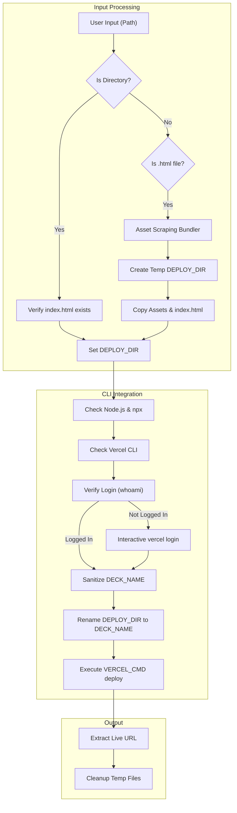
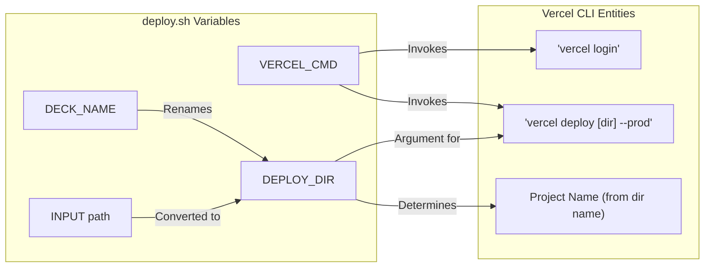

<!-- source: DeepWiki mcp.deepwiki.com · repo zarazhangrui/frontend-slides · page 10.1 Vercel Deployment (deploy.sh) · fetched 2026-10-26 -->

# Vercel Deployment (deploy.sh)

<details>
<summary>Relevant source files</summary>

The following files were used as context for generating this wiki page:

- [plugins/frontend-slides/skills/frontend-slides/scripts/deploy.sh](plugins/frontend-slides/skills/frontend-slides/scripts/deploy.sh)
- [scripts/deploy.sh](scripts/deploy.sh)
- [scripts/export-pdf.sh](scripts/export-pdf.sh)

</details>


The `deploy.sh` script provides a streamlined, zero-configuration pipeline for hosting generated HTML presentations on Vercel. It handles asset bundling, project sanitization, and CLI integration to transform local HTML files or directories into permanent, public URLs accessible across all devices.

### Deployment Workflow Overview

The script supports two primary input modes: a single standalone HTML file or a directory-based deck containing an `index.html`. For single files, the script implements an automated asset-scraping bundler to ensure all local dependencies (images, scripts, fonts) are included in the deployment package.

#### Logic Flow: Input to Vercel

The following diagram illustrates how the script processes inputs and interacts with the Vercel CLI.

**Deployment Logic Flow**

**Sources:**
- `[scripts/deploy.sh:45-88]()` - Input validation and directory/file branching logic.
- `[scripts/deploy.sh:98-158]()` - Vercel CLI and login verification steps.
- `[scripts/deploy.sh:169-186]()` - Project name sanitization and directory preparation.

---

### Asset-Scraping Bundler

When a single HTML file is provided, the script parses the file to identify and collect local dependencies. This ensures that the presentation remains functional when moved from a local filesystem to a cloud environment.

#### Extraction Mechanism
The script uses `grep` and `sed` to extract paths from common HTML attributes:
1.  **Attributes Scanned:** `src`, `href`, and `url()` patterns [scripts/deploy.sh:55-55]().
2.  **Filters:** It ignores absolute URLs (`http`), data URIs (`data:`), and internal anchors (`#`) [scripts/deploy.sh:57-57]().
3.  **Resolution:** References are resolved relative to the input HTML file's parent directory [scripts/deploy.sh:60-60]().
4.  **Structure Preservation:** The script recreates the nested directory structure (e.g., `assets/img.png`) within the temporary deployment folder [scripts/deploy.sh:62-65]().

**Sources:**
- `[scripts/deploy.sh:48-75]()` - Single HTML file processing and asset scraping implementation.

---

### Project Name Sanitization

Vercel project names have strict requirements. The script automatically transforms the folder or file name into a Vercel-compatible string using the following transformations:

| Step | Transformation | Implementation Snippet |
| :--- | :--- | :--- |
| 1 | Lowercase | `tr '[:upper:]' '[:lower:]'` |
| 2 | Special Chars to Hyphens | `sed 's/[^a-z0-9._-]/-/g'` |
| 3 | Collapse Hyphens | `sed 's/--*/-/g'` |
| 4 | Trim Padding | `sed 's/^-//;s/-$//'` |
| 5 | Length Limit | `cut -c1-100` |

**Sources:**
- `[scripts/deploy.sh:175-178]()` - Regex-based sanitization pipeline.

---

### Vercel CLI Integration

The script manages the Vercel lifecycle without requiring the user to manually configure the `vercel.json` file.

#### Commands and Flags
- **Binary Detection:** The script checks for a global `vercel` command or falls back to `npx --yes vercel` [scripts/deploy.sh:110-115]().
- **Authentication:** Uses `vercel whoami` to check status and triggers `vercel login` if the session is invalid [scripts/deploy.sh:129-151]().
- **Deployment:** Executes `deploy` with `--yes` (skip prompts) and `--prod` (immediate production alias) [scripts/deploy.sh:188-188]().

**Entity Mapping: Script Variables to CLI Operations**

**Sources:**
- `[scripts/deploy.sh:109-121]()` - `VERCEL_CMD` assignment logic.
- `[scripts/deploy.sh:188-193]()` - Execution of the deployment command.

### Usage and Examples

The script is designed to be executed from the repository root.

- **Deploying a Folder:**
  ```bash
  bash scripts/deploy.sh ./my-pitch-deck/
  ```
- **Deploying a Standalone File:**
  ```bash
  bash scripts/deploy.sh ./presentation.html
  ```

**Sources:**
- `[scripts/deploy.sh:4-9]()` - Usage documentation and examples.

---

