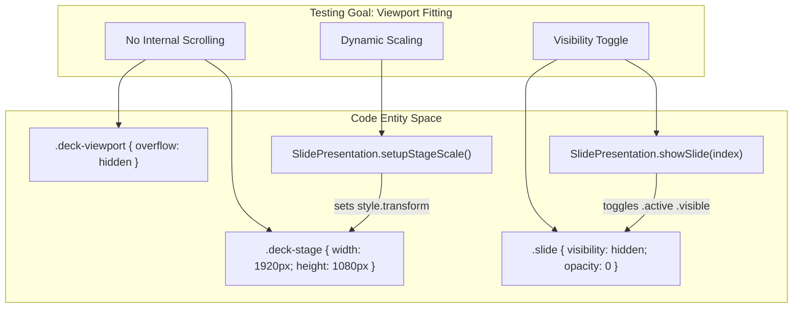
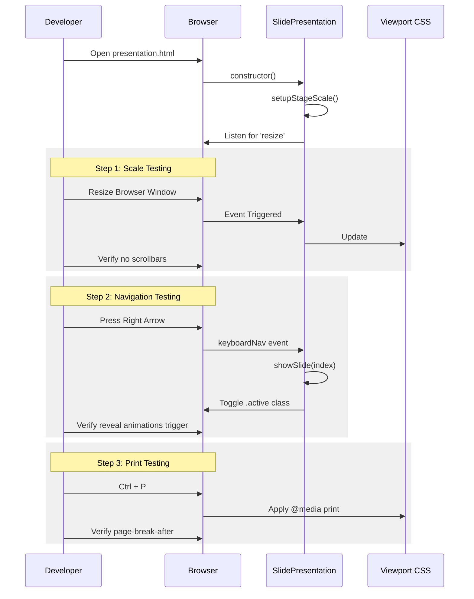

<!-- source: DeepWiki mcp.deepwiki.com · repo zarazhangrui/frontend-slides · page 11.3 Testing & Validation · fetched 2026-10-26 -->

# Testing & Validation

<details>
<summary>Relevant source files</summary>

The following files were used as context for generating this wiki page:

- [html-template.md](html-template.md)
- [viewport-base.css](viewport-base.css)

</details>


This document provides systematic testing procedures to ensure frontend-slides presentations render correctly across all viewport sizes, orientations, and devices. Testing focuses primarily on the **16:9 stage model** compliance—ensuring that the fixed design canvas scales correctly to fit the browser window without internal scrolling or content reflow.

**Scope:** This page covers manual and automated validation workflows, viewport test matrices, and the mandatory verification checklist for both standard presets and the `deck-stage` web component.

---

## Testing Philosophy

The repository follows a "fixed stage" philosophy where slides are authored at a 1920×1080 resolution and scaled as a whole [html-template.md:1-5](). A presentation that works on a desktop but requires scrolling on a mobile device violates the core system requirements defined in the viewport architecture [viewport-base.css:1-5]().

### Non-Negotiable Validation Requirements

| Requirement | Test Method | Failure Impact |
|-------------|-------------|----------------|
| No vertical scrolling within slides | Manual scroll attempt | System philosophy violation |
| `.deck-stage` scales via transform | Inspect CSS `transform: scale()` | Responsive failure |
| `.slide` elements have `overflow: hidden` | DevTools inspection | Content bleed |
| 16:9 aspect ratio preserved | Visual check for pillarbox/letterbox | Layout distortion |
| Keyboard/Touch navigation works | Physical interaction | UX failure |
| Images constrained by `max-height` | Inspect oversized images | Stage overflow |

**Sources:** [html-template.md:158-162](), [viewport-base.css:27-36](), [viewport-base.css:61-68]()

---

## Viewport Size Test Matrix

The system must be tested at these mandatory viewport dimensions. Since the `SlidePresentation` class uses a `Math.min` calculation for scaling [html-template.md:116](), testing different aspect ratios is critical to verify letterboxing and pillarboxing.

### Desktop Viewports (Pillarbox/Letterbox Checks)

| Resolution | Aspect | Behavior Expected | Test Priority |
|------------|--------|-------------------|---------------|
| 1920×1080 | 16:9 | Full screen, no bars | High |
| 1440×900 | 16:10 | Letterbox (bars top/bottom) | High |
| 2560×1080 | 21:9 | Pillarbox (bars left/right) | Medium |

### Mobile Viewports (Scale Checks)

| Resolution | Aspect | Device Type | Test Priority |
|------------|--------|-------------|---------------|
| 375×667 | ~9:16 | iPhone (portrait) | High |
| 667×375 | ~16:9 | iPhone (landscape) | **Critical** |
| 1024×768 | 4:3 | iPad (landscape) | High |

**Sources:** [html-template.md:114-123](), [viewport-base.css:17-23]()

---

## Manual Testing Procedure

### Step 1: Initial Visual Inspection

Test at the primary target viewport (1920×1080) first:

1. Open the generated HTML file in a browser.
2. Verify `SlidePresentation` initializes and shows the first slide [html-template.md:103-112]().
3. Navigate through ALL slides using arrow keys or spacebar.
4. Verify for each slide:
   - No scrollbar appears.
   - The `.deck-stage` is centered in the `.deck-viewport` [html-template.md:117-119]().
   - Animations (classes `.reveal` and `.visible`) trigger correctly [html-template.md:59-69]().

### Step 2: Responsive Scaling Verification

1. Open DevTools (F12) and enable Responsive Mode.
2. Drag the viewport handle to various sizes.
3. **Verify:** The `setupStageScale` function updates the `transform` property on `#deckStage` dynamically [html-template.md:114-123]().
4. **Verify:** Content does NOT reflow; it only shrinks or grows in size.

### Step 3: Print Layout Validation

The system includes specific print styles to ensure slides export correctly to PDF [viewport-base.css:80-123]().

1. Press `Ctrl+P` (or `Cmd+P`).
2. Set "Layout" to Landscape.
3. **Verify:** Each slide appears on its own page (no cutoff) [viewport-base.css:111-112]().
4. **Verify:** The `.deck-controls` are hidden [viewport-base.css:120-122]().
5. **Verify:** Backgrounds are visible (check "Background graphics" in print settings).

**Sources:** [html-template.md:114-123](), [viewport-base.css:80-123]()

---

## Core Testing Architecture

The following diagram bridges the high-level testing requirements to the specific CSS classes and JS functions responsible for the rendering logic.



**Diagram: Testing Goals to Code Mapping**
**Sources:** [viewport-base.css:18-23](), [viewport-base.css:27-36](), [html-template.md:114-123](), [html-template.md:133-139]()

---

## Automated Checklist Validation

Developers should use the browser console to programmatically verify the state of the presentation during testing.

### Viewport Integrity Check
```javascript
// Run in console to verify all slides are correctly sized and hidden
const slides = document.querySelectorAll('.slide');
const failures = [];

slides.forEach((slide, i) => {
    const style = window.getComputedStyle(slide);
    if (style.width !== '1920px' || style.height !== '1080px') {
        failures.push(`Slide ${i} has incorrect dimensions: ${style.width}x${style.height}`);
    }
    if (style.overflow !== 'hidden') {
        failures.push(`Slide ${i} missing overflow:hidden`);
    }
});

console.log(failures.length ? failures : "Viewport Integrity: PASS");
```

### Scale Logic Check
```javascript
// Run in console to verify scaling factor calculation
const stage = document.getElementById('deckStage');
const transform = stage.style.transform;
console.log("Current Transform:", transform); 
// Should look like: translate(Xpx, Ypx) scale(0.5)
```

**Sources:** [viewport-base.css:40-51](), [html-template.md:119]()

---

## Testing Workflow Diagram

The following diagram illustrates the sequence of validation steps from the moment a slide deck is generated until it is considered valid for delivery.



**Diagram: Systematic Validation Sequence**
**Sources:** [html-template.md:103-123](), [html-template.md:133-139](), [viewport-base.css:111-112]()

---

## Interaction & Navigation Validation

Every presentation must be validated for input handling across different hardware configurations.

| Input Type | Action | Expected Result | Code Reference |
|------------|--------|-----------------|----------------|
| **Keyboard** | Right/Down/Space | Advance to next slide | [html-template.md:109]() |
| **Keyboard** | Left/Up | Go to previous slide | [html-template.md:109]() |
| **Touch** | Swipe Left | Advance to next slide | [html-template.md:110]() |
| **Mouse** | Wheel Scroll | Threshold-based navigation | [html-template.md:155]() |
| **Keyboard** | 'E' Key | Toggle inline editor | [html-template.md:172]() |

### Inline Editor Testing
1. Hover over the "hotzone" (usually top-right) or press `E` [html-template.md:172]().
2. Verify the edit button appears with the JS-based delay [html-template.md:183-184]().
3. Change text on a slide and refresh the page.
4. **Verify:** Changes are persisted via `localStorage` [html-template.md:173]().

**Sources:** [html-template.md:103-112](), [html-template.md:171-184]()

---

