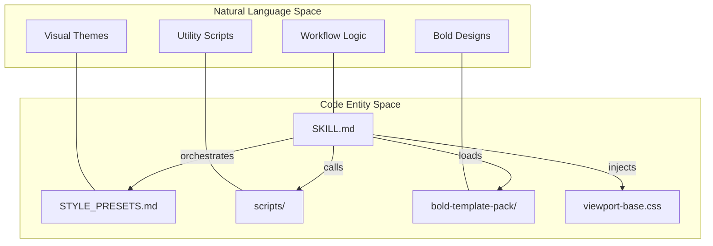
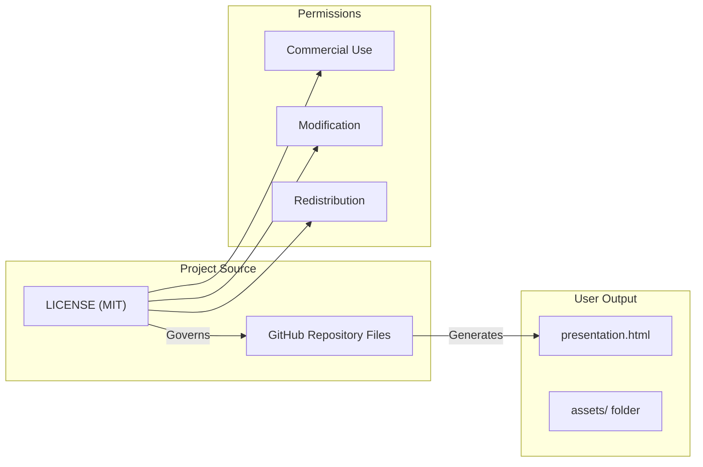

<!-- source: DeepWiki mcp.deepwiki.com · repo zarazhangrui/frontend-slides · page 12 Reference · fetched 2026-10-26 -->

# Reference

Relevant source files

The following files were used as context for generating this wiki page:

- [LICENSE](LICENSE)
- [README.md](README.md)
- [STYLE_PRESETS.md](STYLE_PRESETS.md)

This section provides consolidated reference material for the `frontend-slides` repository, including design anti-patterns to avoid, the repository's file organization, and licensing information.

---

## 12.1 DO NOT USE Guidelines

The `frontend-slides` system maintains a curated aesthetic by explicitly avoiding generic AI-generated design patterns, often referred to as "AI slop." These guidelines ensure that generated presentations remain distinctive and high-impact.

### Anti-Pattern Catalog
The system is instructed to avoid overused, generic elements that signal low-effort generation.

| Category | Forbidden Elements | Rationale |
|----------|-------------------|-----------|
| **Fonts** | Inter, Roboto, Arial | Overused in generic tech templates; lack personality. |
| **Colors** | Generic indigo (`#6366f1`), purple-on-white gradients | Default "SaaS" aesthetics that appear mass-produced. |
| **Layouts** | Identical card grids, generic hero sections | Lack visual hierarchy and professional editorial feel. |
| **Decorations** | Realistic AI illustrations, gratuitous glassmorphism | Adds visual noise without serving the content. |

For a complete catalog of aesthetic restrictions and preferred alternatives, see [DO NOT USE Guidelines](#12.1).

**Sources:** [STYLE_PRESETS.md:3-5](), [README.md:28-28]()

---

## 12.2 Repository Structure

The repository is organized to support a zero-dependency, single-file output philosophy. It separates the execution logic (skills) from the design specifications (presets and templates).

### System Entity Map
The following diagram bridges the natural language concepts of the system to the specific files and folders in the codebase.

**Code-to-System Mapping**

### Key Components
*   **`SKILL.md`**: The core execution engine. It contains the five-phase workflow instructions for the coding agent.
*   **`STYLE_PRESETS.md`**: A catalog of 12 curated themes, typography pairings, and the "Anti-AI-Slop" definitions.
*   **`bold-template-pack/`**: A library of 34 advanced design systems, including the `deck-stage` web component and a `selection-index.json` for progressive disclosure.
*   **`scripts/`**: Contains `extract-pptx.py` for PowerPoint conversion and shell scripts for Vercel deployment and PDF export.

For a detailed breakdown of the file system and how these components interact during the generation process, see [Repository Structure](#12.2).

**Sources:** [README.md:82-90](), [README.md:155-172]()

---

## 12.3 License

The `frontend-slides` project is released under the **MIT License**. This permissive license allows for broad use, modification, and distribution.

### License Application Flow
This diagram illustrates how the license applies to the source code versus the generated user content.

**License and Permissions Flow**

### Summary of Terms
*   **Permissions**: You are free to use, copy, modify, and distribute the software for any purpose, including commercial applications.
*   **Conditions**: The original copyright notice and permission notice must be included in all copies or substantial portions of the software.
*   **No Warranty**: The software is provided "as is," without warranty of any kind.

For the full legal text and copyright information, see [License](#12.3).

**Sources:** [LICENSE:1-21](), [README.md:1-3]()

---

