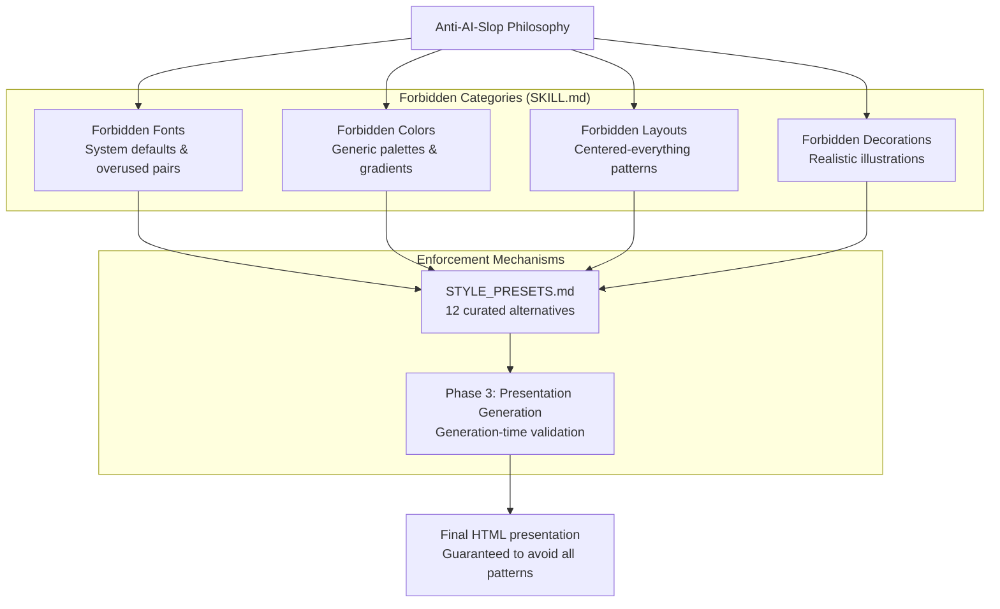
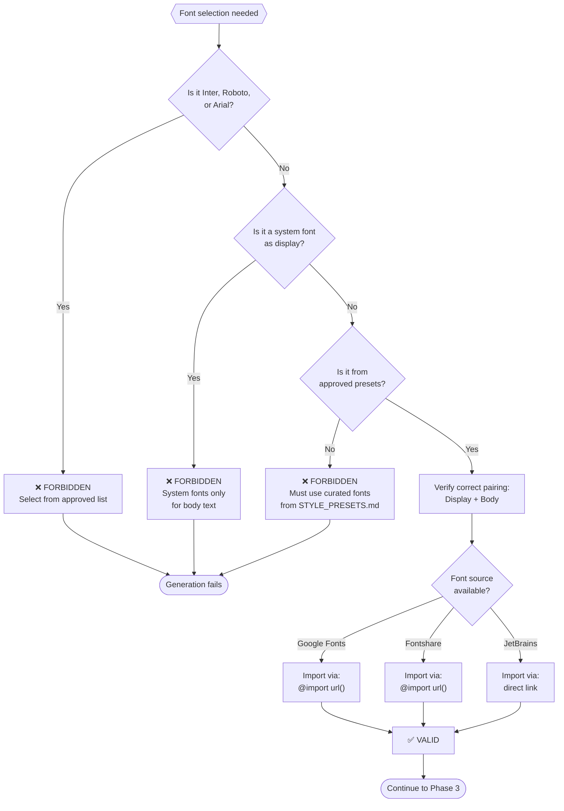
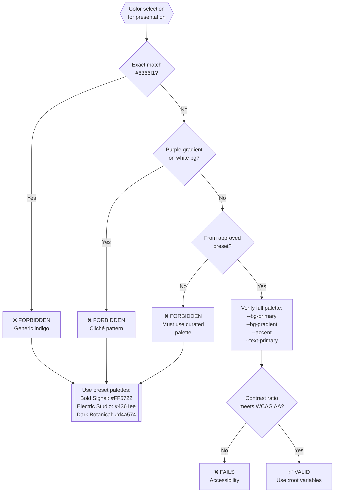

<!-- source: DeepWiki mcp.deepwiki.com · repo zarazhangrui/frontend-slides · page 12.1 DO NOT USE Guidelines · fetched 2026-10-26 -->

# DO NOT USE Guidelines

<details>
<summary>Relevant source files</summary>

The following files were used as context for generating this wiki page:

- [LICENSE](LICENSE)
- [SKILL.md](SKILL.md)
- [STYLE_PRESETS.md](STYLE_PRESETS.md)

</details>


## Purpose and Scope

This document catalogs design patterns, fonts, colors, layouts, and decorative elements that are **explicitly forbidden** in `frontend-slides` presentations. These restrictions enforce the "Anti-AI-Slop" philosophy, ensuring every generated presentation maintains distinctive, curated aesthetics rather than generic, overused patterns common in auto-generated content.

This page documents what **not** to use. For approved style options, see [6. Style Presets Reference](). For the philosophical justification of these constraints, see [4.2 Design Philosophy]().

**Sources:** [SKILL.md:14-15](), [SKILL.md:29-37](), [STYLE_PRESETS.md:1-3]()

---

## Forbidden Pattern Categories

The system maintains four categories of prohibited patterns that collectively define "generic AI aesthetics" to avoid:

**Generic AI Aesthetics to Avoid:**
*   **Overused font families:** Inter, Roboto, Arial, system fonts [SKILL.md:31]().
*   **Cliched color schemes:** Particularly purple gradients on white backgrounds [SKILL.md:32]().
*   **Predictable layouts:** Cookie-cutter design that lacks context-specific character [SKILL.md:33-34]().
*   **Realistic Illustrations:** Human figures or stock art; only abstract CSS shapes are permitted [STYLE_PRESETS.md:3-4]().

### Visual Space to Code Entity Mapping



**Sources:** [SKILL.md:29-37](), [STYLE_PRESETS.md:1-3]()

---

## Forbidden Fonts

### Prohibited Typefaces

The following fonts are **never** permitted as display or body typefaces in any presentation to avoid "on distribution" outputs [SKILL.md:20-24]():

| Font Name | Category | Why Forbidden | Approved Alternatives |
|-----------|----------|---------------|----------------------|
| `Inter` | Sans-serif | Overused default in AI tools | `Space Grotesk`, `Manrope`, `Plus Jakarta Sans` |
| `Roboto` | Sans-serif | Generic Android/Material Design | `DM Sans`, `Work Sans`, `Outfit` |
| `Arial` | Sans-serif | System default, no personality | `Archivo`, `Nunito`, `Satoshi` |
| System fonts | System stack | Lacks distinctive character | Never use as display font |

### Font Selection Decision Tree



**Sources:** [SKILL.md:24-37](), [STYLE_PRESETS.md:346]()

---

## Forbidden Colors and Gradients

### Prohibited Color Values

Specific color values that signal "generic AI design" are forbidden:

| Color/Gradient | CSS Value | Why Forbidden | Context |
|----------------|-----------|---------------|---------|
| Generic indigo | `#6366f1` | Tailwind default, overused in SaaS UIs | Primary accent color |
| Purple gradient on white | `linear-gradient(purple, blue)` on `#ffffff` | Cliché "modern" gradient pattern | Background treatments |
| Pure `#ffffff` with purple | Background + accent combination | Overused in AI-generated landing pages | Color scheme |

### Color Validation Rules



**Sources:** [SKILL.md:25-37](), [STYLE_PRESETS.md:21-30](), [STYLE_PRESETS.md:50-59]()

---

## Forbidden Layout Patterns

### Prohibited Layout Structures

| Pattern Name | Description | Why Forbidden | Approved Alternative |
|--------------|-------------|---------------|---------------------|
| Everything centered | All content centered vertically and horizontally with no asymmetry | Creates monotonous, AI-generated look | Asymmetric layouts, grid-based positioning [STYLE_PRESETS.md:36]() |
| Generic hero sections | Full-screen centered text with button, no distinctive elements | Overused template pattern | Styled cards, split panels, numbered sections |
| Identical card grids | Uniform grid with no visual hierarchy or variation | Predictable, template-like | Varying card sizes, tab systems, panel splits [STYLE_PRESETS.md:154-159]() |

### Specific Forbidden Constructs

Do **not** generate HTML structures like:

```html
<!-- ❌ FORBIDDEN: Generic centered pattern -->
<section class="slide" style="display: flex; align-items: center; justify-content: center;">
    <div style="text-align: center;">
        <h1>Generic Title</h1>
        <p>Generic description</p>
        <button>Generic CTA</button>
    </div>
</section>
```

Instead, use preset-specific structures with distinctive positioning defined in `STYLE_PRESETS.md`. For example, the **Bold Signal** preset requires "Number top-left, navigation top-right, title bottom-left" [STYLE_PRESETS.md:15]().

**Sources:** [SKILL.md:33-34](), [STYLE_PRESETS.md:15](), [STYLE_PRESETS.md:36](), [STYLE_PRESETS.md:154-159]()

---

## Forbidden Decorative Elements

### Prohibited Visual Effects

| Element Type | Specific Examples | Why Forbidden | Approved Alternative |
|--------------|------------------|---------------|---------------------|
| Realistic illustrations | Human figures, product mockups, photo-realistic drawings | Creates inconsistent, stock-art aesthetic | Abstract shapes only [STYLE_PRESETS.md:3]() |
| Gratuitous glassmorphism | `backdrop-filter: blur(10px)` without functional purpose | Overused trendy effect | Use when functionally necessary for layering |
| Drop shadows without purpose | Generic `box-shadow` on every card | Adds noise without hierarchy | Use shadows selectively for depth |
| Generic gradients | Smooth linear gradients with no texture | Flat, uninspired | Textured gradients, halftone patterns [STYLE_PRESETS.md:91]() |

### Abstract Shapes Only Rule

All decorations must be CSS-generated abstract shapes. Realistic illustrations are explicitly banned [STYLE_PRESETS.md:3]().

**Approved Abstract Decoration Pattern (Dark Botanical):**
```html
<!-- ✅ VALID: Abstract soft gradient circles (blurred, overlapping) -->
<div class="decorative-shape" style="
    position: absolute;
    width: 400px;
    height: 400px;
    border-radius: 50%;
    background: radial-gradient(circle, rgba(212, 165, 116, 0.3), transparent);
    filter: blur(80px);
"></div>
```
*Reference: [STYLE_PRESETS.md:120-124]()*

**Sources:** [STYLE_PRESETS.md:3](), [STYLE_PRESETS.md:91](), [STYLE_PRESETS.md:120-125](), [STYLE_PRESETS.md:247]()

---

## Enforcement Mechanism

### How Restrictions are Applied

The restrictions are enforced through the **Five-Phase Workflow Pipeline** documented in [SKILL.md:67-156]().

1.  **Phase 2: Style Discovery**: The system presents 12 curated presets from `STYLE_PRESETS.md`. The user cannot manually input forbidden font names or color hex codes [SKILL.md:113-134]().
2.  **Phase 3: Presentation Generation**: The agent applies the selected preset's CSS variables and layout rules. Any deviation toward generic defaults is flagged by the system's internal "Anti-AI-Slop" prompt instructions [SKILL.md:29-37]().
3.  **Mode C Modification Rules**: When enhancing existing slides, the system must check density limits (e.g., max 4-6 bullets) and split slides rather than shrinking text to fit, which prevents cramped, generic layouts [SKILL.md:75-86]().

### Design Philosophy Alignment

The "DO NOT USE" restrictions directly implement the **Anti-AI-Slop** philosophy:

| Philosophy Principle | How Restrictions Support It |
|---------------------|----------------------------|
| **Show Don't Tell** | Users see distinctive previews, never generic templates [SKILL.md:13]() |
| **Zero Dependencies** | Curated fonts from CDNs, no local font files or complex build tools [SKILL.md:12]() |
| **Anti-AI-Slop** | Explicit blacklist prevents generic patterns [SKILL.md:14]() |
| **Fixed 16:9 Stage** | Layout restrictions ensure content fits without reflow or scrolling [SKILL.md:16]() |

**Sources:** [SKILL.md:10-17](), [SKILL.md:29-37](), [SKILL.md:75-86](), [SKILL.md:113-134]()

---

