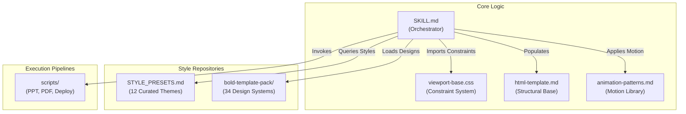
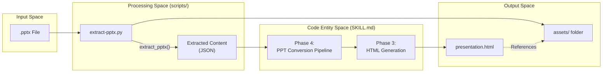

<!-- source: DeepWiki mcp.deepwiki.com · repo zarazhangrui/frontend-slides · page 12.2 Repository Structure · fetched 2026-10-26 -->

# Repository Structure

<details>
<summary>Relevant source files</summary>

The following files were used as context for generating this wiki page:

- [README.md](README.md)
- [plugins/frontend-slides/.claude-plugin/plugin.json](plugins/frontend-slides/.claude-plugin/plugin.json)

</details>


This document provides a technical overview of the `frontend-slides` repository's file organization. It explains the purpose of each directory and file, their relationships, and how they interact within the Claude Code skill system.

## Overview

The `frontend-slides` repository follows a modular architecture designed for high-quality, zero-dependency HTML output. The system is centered around a core execution engine (`SKILL.md`) that orchestrates a multi-phase workflow, drawing design specifications from both curated presets (`STYLE_PRESETS.md`) and a library of professional templates (`bold-template-pack/`).

**Sources:** [README.md:1-31](), [SKILL.md:1-10]()

---

## File Structure

The repository is organized into core logic files, style libraries, and utility scripts.

```text
frontend-slides/
├── SKILL.md                  # Core execution engine & workflow logic
├── STYLE_PRESETS.md          # 12 curated visual theme specifications
├── viewport-base.css         # Mandatory CSS for viewport fitting
├── html-template.md          # Base HTML/JS structure for presentations
├── animation-patterns.md     # Reusable CSS animation definitions
├── bold-template-pack/       # 34 high-fidelity design templates
│   ├── selection-index.json  # Metadata for template discovery
│   ├── deck-stage.js         # Custom element for slide scaling
│   └── [template-name]/      # Individual template directories
├── scripts/                  # Utility automation scripts
│   ├── extract-pptx.py       # Python script for PowerPoint conversion
│   ├── deploy.sh             # Vercel deployment bundler
│   └── export-pdf.sh         # Playwright-based PDF exporter
├── plugins/                  # Claude Code plugin manifest
└── README.md                 # User documentation
```

**Diagram: System Component Architecture**



**Sources:** [README.md:52-64](), [README.md:82-89]()

---

## Core Skill Files

### SKILL.md: The Execution Engine
`SKILL.md` acts as the primary instruction set for the coding agent. It defines the five-phase workflow pipeline, ranging from mode detection to delivery. It contains the logic for content discovery, mood mapping, and the final construction of the presentation.

**Key Responsibilities:**
- **Mode Detection:** Routing between new deck creation, PPT conversion, or enhancement [SKILL.md:248-263]().
- **Mood Mapping:** Translating user keywords into specific style recommendations [SKILL.md:380]().
- **Code Assembly:** Merging content with CSS from `STYLE_PRESETS.md` or `bold-template-pack/` [SKILL.md:380]().

### STYLE_PRESETS.md: Curated Themes
This file contains 12 "safe" presets. These are robust, CSS-variable-driven themes that are guaranteed to work across all content types.

**Key Specifications:**
- **Color Tokens:** CSS variables for backgrounds, text, and accents [STYLE_PRESETS.md:163-346]().
- **Typography:** Specific font pairings and Google Font/Fontshare import URLs [STYLE_PRESETS.md:346]().
- **Anti-Patterns:** Explicit "DO NOT USE" guidelines to prevent generic AI-generated aesthetics [STYLE_PRESETS.md:346]().

**Sources:** [SKILL.md:1-380](), [STYLE_PRESETS.md:1-346]()

---

## The Bold Template Pack

The `bold-template-pack/` directory contains 34 design-forward templates sourced from `beautiful-html-templates`. This library uses a progressive disclosure model to minimize context window usage.

### Progressive Selection Workflow
1. **Index Search:** The agent first reads `selection-index.json` to find templates matching the user's mood [bold-template-pack/selection-index.json:1-10]().
2. **Preview Loading:** The agent reads only the `preview.md` file for shortlisted candidates to generate visual previews [README.md:167-171]().
3. **Full Load:** Only after the user selects a template does the agent read the full `design.md` "recipe" [README.md:169-171]().

### deck-stage.js
A critical component located at `bold-template-pack/deck-stage.js`. It defines the `<deck-stage>` custom element, which handles:
- **Coordinate Scaling:** Translating a fixed 1920x1080 design coordinate system to the actual browser viewport.
- **Navigation:** Keyboard, touch, and tap event listeners for slide transitions.
- **Printing:** Specialized layout logic for `window.print()`.

**Sources:** [README.md:155-172](), [bold-template-pack/deck-stage.js:1-50]()

---

## Utility Scripts

The `scripts/` directory provides automation for specialized tasks that extend the core HTML generation.

| Script | Purpose | Key Function/Logic |
| :--- | :--- | :--- |
| `extract-pptx.py` | PowerPoint Extraction | Uses `python-pptx` to extract text, notes, and image blobs [scripts/extract-pptx.py:1-96]() |
| `deploy.sh` | Vercel Deployment | Scrapes assets, sanitizes project names, and triggers Vercel CLI [scripts/deploy.sh:1-80]() |
| `export-pdf.sh` | PDF Generation | Launches a local server and uses Playwright to capture per-slide screenshots [scripts/export-pdf.sh:1-120]() |

**Diagram: Data Flow for PPT Conversion**



**Sources:** [SKILL.md:380](), [scripts/extract-pptx.py:1-50]()

---

## Plugin Integration

The `plugins/` directory contains the manifest for Claude Code.

- **plugin.json:** Defines the plugin name, version, and the location of the skills directory [plugins/frontend-slides/.claude-plugin/plugin.json:1-14]().
- **Installation:** When installed via `/plugin install`, Claude Code uses this structure to register the `/frontend-slides:frontend-slides` command.

**Sources:** [plugins/frontend-slides/.claude-plugin/plugin.json:1-14](), [README.md:34-50]()

---

