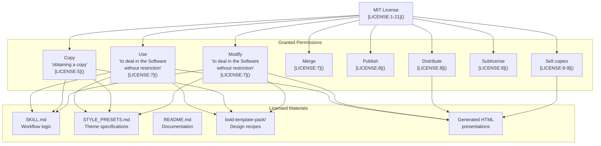
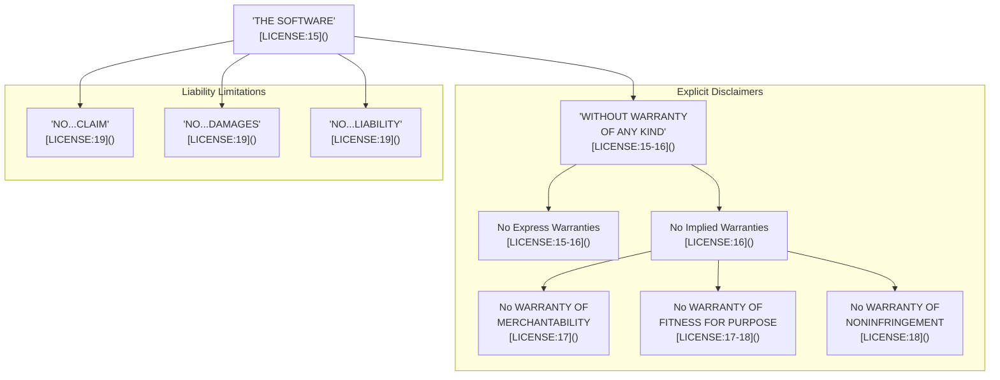

<!-- source: DeepWiki mcp.deepwiki.com · repo zarazhangrui/frontend-slides · page 12.3 License · fetched 2026-10-26 -->

# License

<details>
<summary>Relevant source files</summary>

The following files were used as context for generating this wiki page:

- [LICENSE](LICENSE)
- [STYLE_PRESETS.md](STYLE_PRESETS.md)

</details>


## Purpose and Scope

This document provides comprehensive information about the licensing terms for the frontend-slides repository. It covers the MIT License that governs the use, modification, and distribution of the core system files and how licensing applies to generated presentation outputs.

The frontend-slides project operates under a zero-dependencies philosophy, though it integrates with various web fonts and optional Python libraries for specific workflows like PowerPoint conversion.

---

## License Type and Copyright

The frontend-slides repository is released under the **MIT License**, one of the most permissive open-source licenses available. The software is copyrighted by **Zara Zhang** as of 2025.

| **Attribute** | **Value** |
|---------------|-----------|
| License Type | MIT License |
| Copyright Holder | Zara Zhang |
| Copyright Year | 2025 |
| License File | [LICENSE:1-21]() |

**Sources:** [LICENSE:1-4]()

---

## Permissions Granted

The MIT License grants users extensive freedoms with minimal restrictions. The following permissions are explicitly granted without requiring additional authorization:

### Diagram: Rights and Permissions Flow



**Sources:** [LICENSE:5-9]()

### Specific Rights

1. **Use**: Execute the `/frontend-slides` command in Claude Code CLI without restriction. [LICENSE:7]()
2. **Copy**: Duplicate system files, documentation, or the template library. [LICENSE:5]()
3. **Modify**: Alter the workflow logic or add new visual styles to the curated presets. [LICENSE:7]()
4. **Merge**: Combine frontend-slides components with other software systems. [LICENSE:7]()
5. **Publish**: Share the repository publicly or privately. [LICENSE:8]()
6. **Distribute**: Provide copies to others, including generated HTML presentations. [LICENSE:8]()
7. **Sublicense**: Grant others the right to use modified versions under different terms. [LICENSE:8]()
8. **Sell**: Commercially exploit generated presentations or modified versions of the system. [LICENSE:8-9]()

**Sources:** [LICENSE:5-9]()

---

## Conditions and Requirements

While the MIT License is permissive, it imposes two mandatory conditions that users must satisfy:

### Copyright Notice Preservation

The copyright notice and license text must be included in all copies or substantial portions of the software:

```
MIT License

Copyright (c) 2025 Zara Zhang

Permission is hereby granted, free of charge, to any person obtaining a copy
of this software and associated documentation files (the "Software")...
```

**Location:** [LICENSE:1-10]()

### Applicability

| **Action** | **Copyright Notice Required** |
|------------|-------------------------------|
| Distributing unmodified system files | ✓ Yes |
| Distributing modified `STYLE_PRESETS.md` | ✓ Yes |
| Using system privately (no distribution) | ✗ No |
| Distributing generated HTML presentations | ✗ No (see [License Scope](#license-application-scope)) |
| Forking repository on GitHub | ✓ Yes (LICENSE file preserved) |

**Sources:** [LICENSE:11-13]()

---

## Warranty Disclaimer

The MIT License explicitly disclaims all warranties. The software is provided "AS IS" without any guarantees of functionality or fitness for purpose.

### Diagram: Liability and Warranty Structure



**Sources:** [LICENSE:15-21]()

---

## License Application Scope

### Component-by-Component Analysis

| **Component** | **License Status** | **Notes** |
|---------------|-------------------|-----------|
| `SKILL.md` | MIT Licensed | Core system workflow logic |
| `STYLE_PRESETS.md` | MIT Licensed | Curated theme specifications [STYLE_PRESETS.md:1-3]() |
| `bold-template-pack/` | MIT Licensed | Extended design library |
| `LICENSE` | N/A | The license text itself |
| `presentation.html` | **Dual ownership** | Contains MIT-licensed runtime code + user content |
| `assets/` directory | User-owned | Extracted from user's PowerPoint files |

**Sources:** [LICENSE:1-21](), [STYLE_PRESETS.md:1-3]()

---

## Third-Party Dependencies

The frontend-slides system integrates with external resources that have their own licensing terms.

### Typography and Fonts
The `STYLE_PRESETS.md` and `bold-template-pack` reference various high-quality fonts. These are typically loaded via CDN at runtime.

| **Source** | **Common Licenses** | **Usage** |
|------------|---------------------|-----------|
| Google Fonts | OFL, Apache 2.0 | `Archivo`, `Space Grotesk`, `Manrope`, `Syne`, `Cormorant`, `Bodoni Moda`, `DM Sans`, `Plus Jakarta Sans`, `Outfit`, `Fraunces`, `Work Sans`, `Source Serif 4` [STYLE_PRESETS.md:18-293]() |
| Fontshare | Free for Commercial Use | `Clash Display`, `Satoshi` [STYLE_PRESETS.md:257]() |
| JetBrains | SIL OFL 1.1 | `JetBrains Mono` [STYLE_PRESETS.md:269]() |

### Optional Tooling
- **python-pptx**: Used for PowerPoint extraction. Distributed under the Apache License 2.0.
- **Playwright/Chromium**: Used by `export-pdf.sh` for PDF generation. Distributed under the Apache License 2.0.

**Sources:** [STYLE_PRESETS.md:18-293](), [LICENSE:1-21]()

---

## Summary Table

| **Aspect** | **Details** |
|------------|-------------|
| **License Type** | MIT License [LICENSE:1]() |
| **Copyright Holder** | Zara Zhang [LICENSE:3]() |
| **Year** | 2025 [LICENSE:3]() |
| **Permissions** | Use, copy, modify, merge, publish, distribute, sublicense, sell [LICENSE:7-9]() |
| **Conditions** | Include copyright notice and license text in distributions [LICENSE:11-13]() |
| **Warranty** | None - provided "AS IS" [LICENSE:15-16]() |
| **Liability** | Disclaimed [LICENSE:18-21]() |
| **Commercial Use** | Permitted without restriction [LICENSE:8-9]() |

**Sources:** [LICENSE:1-21]()

---

