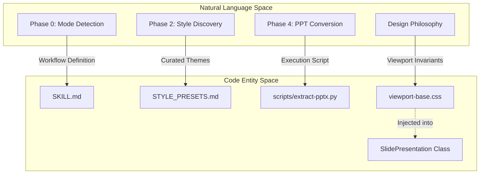
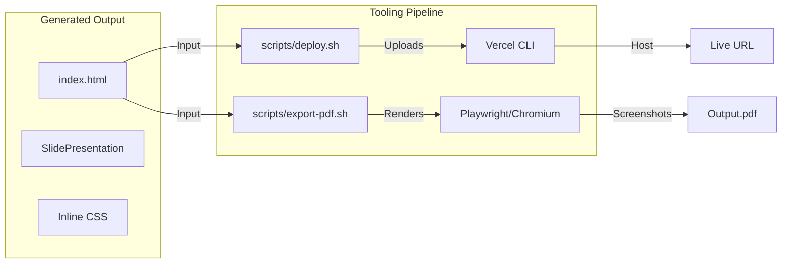

<!-- source: DeepWiki mcp.deepwiki.com · repo zarazhangrui/frontend-slides · page 13 Glossary · fetched 2026-10-26 -->

# Glossary

Relevant source files

The following files were used as context for generating this wiki page:

- [LICENSE](LICENSE)
- [README.md](README.md)
- [SKILL.md](SKILL.md)
- [STYLE_PRESETS.md](STYLE_PRESETS.md)
- [animation-patterns.md](animation-patterns.md)
- [bold-template-pack/templates/biennale-yellow/design.md](bold-template-pack/templates/biennale-yellow/design.md)
- [html-template.md](html-template.md)
- [scripts/deploy.sh](scripts/deploy.sh)
- [scripts/export-pdf.sh](scripts/export-pdf.sh)
- [scripts/extract-pptx.py](scripts/extract-pptx.py)
- [viewport-base.css](viewport-base.css)

This page provides definitions for codebase-specific terms, abbreviations, and architectural concepts used within the `frontend-slides` repository. It is intended to help onboarding engineers understand the "Natural Language Space" used in prompts and documentation versus the "Code Entity Space" where these concepts are implemented.

## Core Concepts & Jargon

### Anti-AI-Slop
A design philosophy and technical constraint aimed at avoiding generic, predictable AI-generated aesthetics (e.g., purple gradients on white backgrounds, overused fonts like Inter/Arial). 
*   **Implementation**: Enforced through curated font pairings and color tokens in `STYLE_PRESETS.md` [STYLE_PRESETS.md:1-299]() and the "DO NOT USE" guidelines in `SKILL.md` [SKILL.md:18-36]().

### Bold Template Pack
A collection of 34 advanced design systems sourced from `beautiful-html-templates`. Unlike the standard `STYLE_PRESETS.md`, these use a "Design Recipe" format (`design.md`) and a custom web component for rendering.
*   **Key Files**: `bold-template-pack/selection-index.json`, `bold-template-pack/deck-stage.js`.

### Fixed 16:9 Stage
The non-negotiable architectural invariant that all slides are authored within a virtual 1920×1080 canvas. This canvas is then scaled as a single unit to fit the user's viewport.
*   **Logic**: Contained in `viewport-base.css` [viewport-base.css:25-36]() and the `setupStageScale()` method of the `SlidePresentation` class [html-template.md:114-123]().

### Mode Detection (Phase 0)
The initial logic used by the agent to determine if the user wants to create a new deck (Mode A), convert a PPTX (Mode B), or enhance an existing HTML file (Mode C).
*   **Definition**: `SKILL.md` [SKILL.md:67-87]().

### Show, Don't Tell
The user experience pattern where the system generates visual "Style Previews" (miniature versions of a title slide) for the user to select from, rather than asking the user to describe their aesthetic in words.
*   **Definition**: `SKILL.md` [SKILL.md:120-137]().

---

## Technical Component Mapping

The following diagram bridges the conceptual "Phases" described in the documentation to the actual code entities and files that execute them.

**System Workflow to Code Mapping**

**Sources**: [SKILL.md:10-17](), [SKILL.md:67-156](), [viewport-base.css:1-51](), [scripts/extract-pptx.py:18-75]()

---

## Architectural Terms Reference

| Term | Definition | Code Reference |
|:---|:---|:---|
| **Deck Viewport** | The top-level fixed container that locks the browser scroll and holds the stage. | `.deck-viewport` in [viewport-base.css:18-23]() |
| **Deck Stage** | The 1920x1080 container that undergoes CSS `transform: scale()`. | `.deck-stage` in [viewport-base.css:27-36]() |
| **Reveal Class** | A CSS class applied to elements to hide them until the parent slide becomes `.visible`. | `.reveal` in [html-template.md:59-76]() |
| **Compact Mode** | A flag for the PDF exporter to reduce resolution to 1280x720 for smaller file sizes. | `--compact` in [scripts/export-pdf.sh:38-49]() |
| **Design Recipe** | The `design.md` file within a bold template folder containing specific tokens for the agent. | `bold-template-pack/templates/.../design.md` |
| **Letterboxing** | The black bars appearing when the 16:9 stage doesn't match the aspect ratio of the window. | `Math.min(window.innerWidth / 1920, ...)` in [html-template.md:116]() |

---

## Delivery and Runtime Flow

The following diagram illustrates how the generated HTML interacts with the system scripts for deployment and export.

**Runtime and Tooling Integration**

**Sources**: [scripts/deploy.sh:48-88](), [scripts/export-pdf.sh:111-140](), [html-template.md:103-143]()