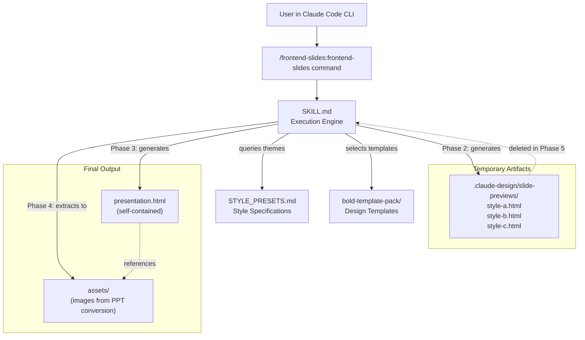
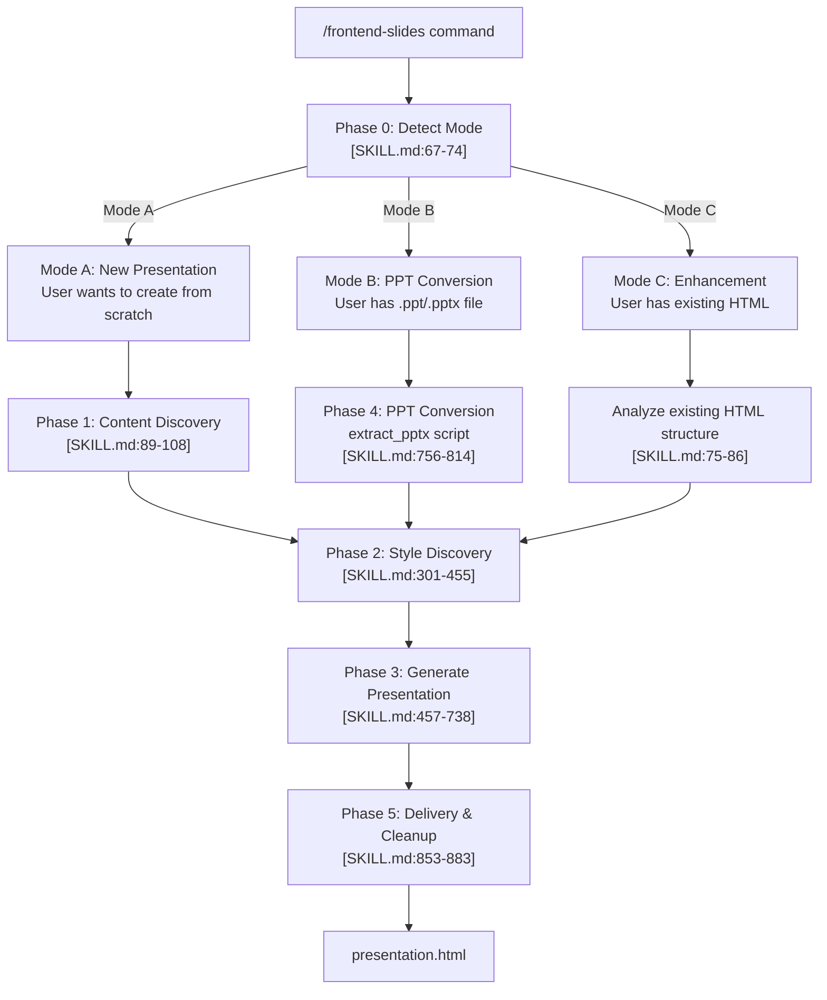
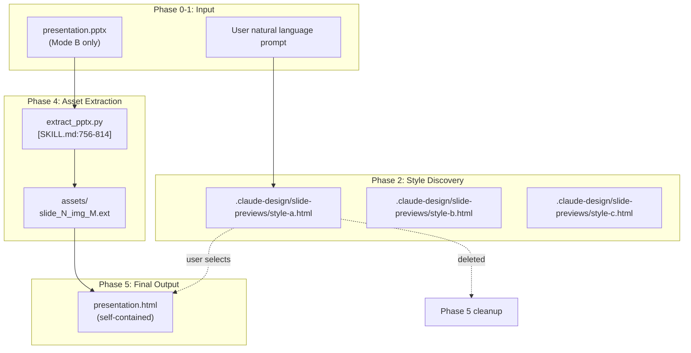

<!-- source: DeepWiki mcp.deepwiki.com · repo zarazhangrui/frontend-slides · page 2 Getting Started · fetched 2026-10-26 -->

# Getting Started

<details>
<summary>Relevant source files</summary>

The following files were used as context for generating this wiki page:

- [README.md](README.md)
- [SKILL.md](SKILL.md)

</details>


This document guides you through the initial setup and first-time usage of the frontend-slides system. It covers installation, system requirements, and the basic workflow for invoking the skill and generating your first presentation.

For detailed installation steps, see [Installation & Requirements](#2.1). For a comprehensive walkthrough with example prompts, see [Quick Start Guide](#2.2). For architecture details, see [Core Architecture](#4).

---

## System Overview

The frontend-slides system is a Claude Code skill that generates animation-rich HTML presentations. It consists of two core files that work together to produce self-contained HTML output, supplemented by a library of style presets and templates.

### Core Components

| Component | Path | Role |
|-----------|------|------|
| `SKILL.md` | `~/.claude/skills/frontend-slides/SKILL.md` | Execution engine: orchestrates the five-phase workflow, processes user input, generates HTML. [SKILL.md:1-4]() |
| `STYLE_PRESETS.md` | `~/.claude/skills/frontend-slides/STYLE_PRESETS.md` | Specification repository: defines 12 curated visual themes, CSS requirements, and viewport fitting rules. [STYLE_PRESETS.md:1-10]() |
| `bold-template-pack/` | `~/.claude/skills/frontend-slides/bold-template-pack/` | Extended design library: 34 high-impact templates from `beautiful-html-templates`. [README.md:155-160]() |

The system operates within the Claude Code CLI environment and is invoked using the `/frontend-slides` command. It generates a single HTML file (typically `presentation.html`) with all CSS and JavaScript inlined, requiring no external dependencies at runtime.

**Diagram: System Invocation and Component Relationships**



Sources: [SKILL.md:1-8](), [README.md:1-10](), [README.md:161-172]()

---

## Prerequisites

### Required

- **Claude Code CLI**: The system runs as a plugin or standalone skill within the Claude Code command-line interface. [README.md:3-4]()
- **Web Browser**: For viewing generated presentations and style previews. [SKILL.md:380]()

### Optional

- **Python 3.x** with `python-pptx` library: Required only for PowerPoint conversion (Mode B). [README.md:27](), [SKILL.md:380]()
  - Install via: `pip install python-pptx`
- **Vercel CLI**: Required for deploying presentations via the `deploy.sh` script. [README.md:63]()

The system has zero runtime dependencies for the generated output. All CSS, JavaScript, and fonts are inlined or loaded via CDN links in the final HTML. [SKILL.md:12-13]()

Sources: [README.md:15-31](), [SKILL.md:380]()

---

## Installation

### Via Claude Code Marketplace (Recommended)

Install directly from the public GitHub repo. Run these as two separate Claude Code messages:

```text
/plugin marketplace add https://github.com/zarazhangrui/frontend-slides
/plugin install frontend-slides@frontend-slides
```

Use the HTTPS URL to avoid SSH `known_hosts` issues. [README.md:34-50]()

### Manual Installation

Copy the skill files to your Claude Code skills directory:

```bash
# Create the skill directory
mkdir -p ~/.claude/skills/frontend-slides/scripts

# Copy the core files and templates
cp SKILL.md STYLE_PRESETS.md viewport-base.css html-template.md animation-patterns.md ~/.claude/skills/frontend-slides/
cp -R bold-template-pack ~/.claude/skills/frontend-slides/
cp scripts/extract-pptx.py scripts/deploy.sh scripts/export-pdf.sh ~/.claude/skills/frontend-slides/scripts/
```

Sources: [README.md:52-64](), [README.md:66-70]()

---

## Invoking the System

### Command Syntax

The system is invoked using the following command in the Claude Code CLI:

```text
/frontend-slides:frontend-slides
```

*Note: If installed manually as a standalone skill, use `/frontend-slides`.* [README.md:100-105]()

**Diagram: Mode Detection and Workflow Routing**



Sources: [SKILL.md:67-74](), [SKILL.md:248-263]()

---

## Workflow Overview

### Five-Phase Pipeline

The system follows a consistent five-phase workflow defined in `SKILL.md`:

| Phase | Name | Purpose | Key Outputs |
|-------|------|---------|-------------|
| Phase 0 | Mode Detection | Determine workflow (new/convert/enhance). [SKILL.md:67-74]() | Mode selection |
| Phase 1 | Content Discovery | Gather purpose, length, and density. [SKILL.md:89-108]() | Content structure |
| Phase 2 | Style Discovery | Generate visual previews (A/B/C). [SKILL.md:301-380]() | Chosen style preset |
| Phase 3 | Generate Presentation | Build HTML with fixed 16:9 stage. [SKILL.md:380]() | `presentation.html` |
| Phase 4 | PPT Conversion | Extract content using `extract-pptx.py`. [SKILL.md:380]() | `slides_data` JSON, `assets/` |
| Phase 5 | Delivery & Cleanup | Delete temp files, open browser. [SKILL.md:380]() | Final deliverable |

**Diagram: File System Interactions Across Phases**



Sources: [SKILL.md:248-380](), [SKILL.md:380](), [SKILL.md:380]()

---

## First Run Expectations

### Interaction Pattern

1. **Mode Detection**: The system identifies if you are creating new slides or converting a PPT. [SKILL.md:67-74]()
2. **Content Questions**: The system asks for Purpose, Length, Content readiness, and Density in one message. [SKILL.md:91-108]()
3. **Style Discovery**: It generates 3 visual previews (one safe preset, one bold template, one wildcard). [README.md:161-172]()
4. **Style Selection**: You view the HTML files in your browser and pick a direction. [SKILL.md:380]()
5. **Generation**: The system writes the final `presentation.html` using the fixed 16:9 stage rules. [SKILL.md:38-52]()
6. **Delivery**: The presentation is opened automatically. [SKILL.md:380]()

### Navigation Controls

Generated presentations include a `SlidePresentation` controller supporting:
- **Keyboard**: Arrow keys, Space, Home/End. [SKILL.md:380]()
- **Touch**: Swipe gestures for mobile/tablet. [SKILL.md:380]()
- **UI**: Progress bar and navigation dots. [SKILL.md:380]()

Sources: [SKILL.md:380](), [README.md:108-122]()

---

## Next Steps

- **For detailed installation guidance**: See [Installation & Requirements](#2.1)
- **For step-by-step first presentation**: See [Quick Start Guide](#2.2)
- **To understand the three usage modes**: See [User Guide](#3)
- **To learn about the 12 style presets**: See [Style Presets Reference](#6)
- **To explore the 34 bold templates**: See [Bold Template Pack](#7)

Sources: [SKILL.md:1-17](), [README.md:127-137]()

---

