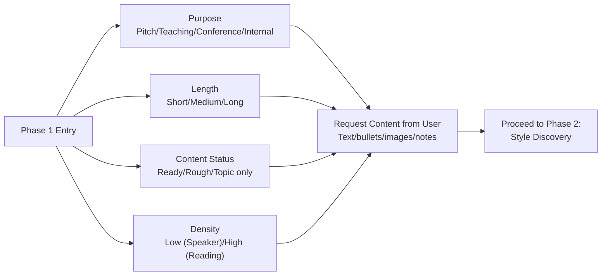
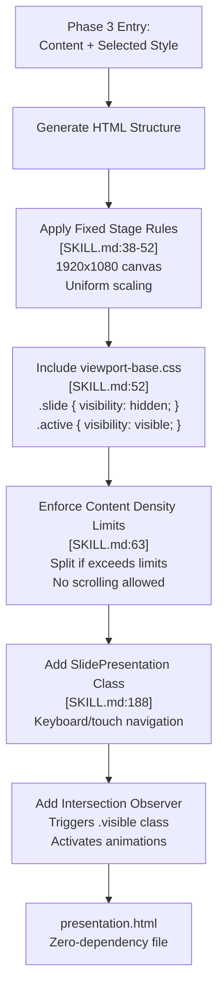

<!-- source: DeepWiki mcp.deepwiki.com · repo zarazhangrui/frontend-slides · page 3.1 Creating New Presentations · fetched 2026-10-26 -->

# Creating New Presentations

Relevant source files

The following files were used as context for generating this wiki page:

- [SKILL.md](SKILL.md)
- [plugins/frontend-slides/skills/frontend-slides/SKILL.md](plugins/frontend-slides/skills/frontend-slides/SKILL.md)

## Purpose and Scope

This page documents the workflow for creating HTML presentations from scratch using natural language prompts. It covers the complete pipeline from initial user intent through content discovery, style selection, and final HTML generation.

For converting existing PowerPoint files to HTML, see [Converting PowerPoint Files](#3.2). For detailed information about the visual style selection process, see [Style Selection Process](#3.3). For the underlying five-phase architecture, see [Five-Phase Workflow Pipeline](#4.1).

---

## Workflow Overview

Creating a new presentation follows a linear three-phase pipeline after mode detection determines the user wants to create slides from scratch (Mode A).

**Diagram: New Presentation Creation Pipeline**

```mermaid
flowchart TD
    UserPrompt["User: Natural Language Prompt<br/>'Create pitch deck for AI startup'"]
    
    Phase0["Phase 0: Mode Detection<br/>[SKILL.md:67-74]"]
    
    ModeA["Mode A Detected:<br/>New Presentation"]
    
    Phase1["Phase 1: Content Discovery<br/>[SKILL.md:89-114]"]
    
    Q1["AskUserQuestion: Purpose<br/>Options: Pitch/Teaching/Conference/Internal"]
    Q2["AskUserQuestion: Length<br/>Options: Short 5-10/Medium 10-20/Long 20+"]
    Q3["AskUserQuestion: Content Status<br/>Options: Ready/Rough/Topic only"]
    Q4["AskUserQuestion: Density<br/>Options: Low/High"]
    
    ContentGather["User Provides Content<br/>Text, bullets, images, notes"]
    
    Phase2["Phase 2: Style Discovery<br/>[SKILL.md:116-160]<br/>Detailed in page 3.3"]
    
    MoodQ["Query user mood/feeling"]
    GenPreviews["Generate 3 HTML previews<br/>.claude-design/slide-previews/"]
    UserPick["User selects preferred style"]
    
    Phase3["Phase 3: Generate Presentation<br/>[SKILL.md:162-200]"]
    
    BuildHTML["Construct HTML structure<br/>Apply Fixed Stage Rules"]
    EnforceVF["Enforce Viewport Fitting<br/>Content Density Limits"]
    AddJS["Add SlidePresentation class<br/>Intersection Observer"]
    
    Output["presentation.html<br/>Self-contained file"]
    
    UserPrompt --> Phase0
    Phase0 --> ModeA
    ModeA --> Phase1
    Phase1 --> Q1
    Q1 --> Q2
    Q2 --> Q3
    Q3 --> Q4
    Q4 --> ContentGather
    ContentGather --> Phase2
    Phase2 --> MoodQ
    MoodQ --> GenPreviews
    GenPreviews --> UserPick
    UserPick --> Phase3
    Phase3 --> BuildHTML
    BuildHTML --> EnforceVF
    EnforceVF --> AddJS
    AddJS --> Output
```

**Sources:** [SKILL.md:67-74](), [SKILL.md:89-114](), [SKILL.md:116-160](), [SKILL.md:162-200]()

---

## Mode Detection (Phase 0)

The system first determines whether the user intends to create a new presentation, convert PowerPoint, or enhance existing HTML. For new presentations, the system detects Mode A based on user language patterns.

| User Intent Pattern | Detected Mode | Next Phase |
|---------------------|---------------|------------|
| "Create slides for...", "Build a presentation about..." | Mode A: New Presentation | Phase 1 (Content Discovery) |
| "Convert my PPT", "Transform this PowerPoint..." | Mode B: PPT Conversion | Phase 4 (PPT Extraction) |
| "Improve this HTML", "Enhance my presentation..." | Mode C: Enhancement | Phase 2 (Style Discovery) |

Mode A automatically proceeds to Phase 1 for structured content gathering.

**Sources:** [SKILL.md:67-74]()

---

## Phase 1: Content Discovery

Content Discovery structures user requirements through four simultaneous questions. This phase gathers information about presentation purpose, scope, content readiness, and density before any design work begins.

**Diagram: Content Discovery Question Flow**

**Sources:** [SKILL.md:89-114]()

### Question 1: Presentation Purpose

The first question identifies the presentation's primary use case, which influences content structure and later style recommendations.

| Option | Description | Typical Characteristics |
|--------|-------------|------------------------|
| Pitch deck | Selling idea/product/company to investors or clients | Persuasive, concise, focused on value proposition |
| Teaching/Tutorial | Explaining concepts, how-to guides, educational content | Sequential, detailed explanations, examples |
| Conference talk | Speaking at event, tech talk, keynote | Engaging, story-driven, balanced text-visuals |
| Internal presentation | Team updates, strategy meetings, company updates | Informational, data-heavy, process-oriented |

**Sources:** [SKILL.md:93-94]()

### Question 2: Slide Count

The second question establishes presentation scope, affecting content depth per slide and overall pacing.

| Option | Slide Range | Use Cases |
|--------|-------------|-----------|
| Short (5-10) | 5-10 slides | Quick pitch, lightning talk, executive summary |
| Medium (10-20) | 10-20 slides | Standard presentation, workshop session |
| Long (20+) | 20+ slides | Deep dive, comprehensive training, detailed analysis |

**Sources:** [SKILL.md:96-97]()

### Question 4: Content Density Modes

A critical differentiator in Phase 1 is the selection of Density Mode, which dictates the layout behavior and content limits.

| Density mode | Best for | Design behavior |
| ------------- | -------- | --------------- |
| **Low density / speaker-led** | Public talks, keynote-style sharing | One idea per slide, large type, 1-3 bullets max |
| **High density / reading-first** | Reports, handouts, async review | Structured grids, 4-8 bullets, tighter spacing |

**Sources:** [SKILL.md:54-61]()

---

## Phase 2: Style Discovery Overview

Phase 2 implements the "show, don't tell" philosophy. The system generates visual previews in the `.claude-design/slide-previews/` directory. For bold templates, it uses a **Progressive Disclosure** model, reading lightweight indexes first and loading the full `design.md` only after a user selects that template.

**Sources:** [SKILL.md:13-15](), [SKILL.md:116-160]()

---

## Phase 3: Presentation Generation

Phase 3 constructs the final HTML presentation. This phase enforces the **Fixed 16:9 Stage** invariant, ensuring every deck uses a 1920×1080 slide canvas scaled to the viewport.

**Diagram: HTML Generation Process with Code Entities**

**Sources:** [SKILL.md:162-200](), [SKILL.md:38-52]()

### Fixed Stage Rules

These invariants apply to every slide to prevent layout reflow on different devices:
- Every deck has a viewport wrapper filling the browser window.
- Every slide is authored inside a fixed **1920×1080 stage**.
- The stage scales uniformly (letterbox/pillarbox) to fit the viewport.
- Slide visibility is controlled by `.active` / `.visible` classes.
- Use of `display: none` for slide switching is prohibited to prevent layout conflicts.

**Sources:** [SKILL.md:38-52]()

### Content Density Enforcement

The system guarantees viewport fitting by splitting content that exceeds limits:
- **Low Density:** 1-3 bullets max.
- **High Density:** 4-8 bullets or 4-6 cards.
- **Invariants:** No scrolling, no overflow, no overlapping panels.

**Sources:** [SKILL.md:60-63]()

---

## Viewport Fitting Validation

Before finalizing, the agent verifies the slide stage remains 16:9 and that no text overflows its card. This is particularly critical when enhancing existing presentations (Mode C).

**Modification Rules for Existing Content:**
1. Count existing elements before adding content.
2. Check against density limits.
3. If modifications cause overflow, automatically split content and inform the user.

**Sources:** [SKILL.md:75-86]()

---

## File Output and Cleanup

The final output is a single HTML file requiring only a web browser to present. The system follows a zero-dependency philosophy, meaning the file contains all necessary CSS and JS inline.

**Sources:** [SKILL.md:12](), [SKILL.md:196-200]()

---

