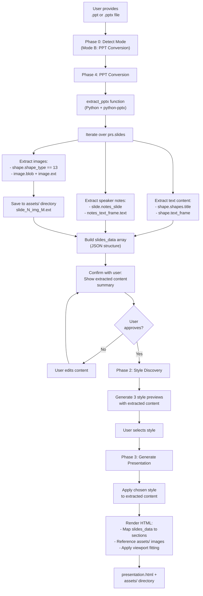
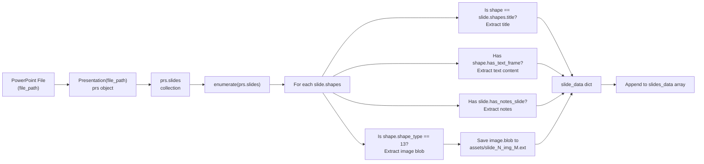

<!-- source: DeepWiki mcp.deepwiki.com · repo zarazhangrui/frontend-slides · page 3.2 Converting PowerPoint Files · fetched 2026-10-26 -->

# Converting PowerPoint Files

<details>
<summary>Relevant source files</summary>

The following files were used as context for generating this wiki page:

- [animation-patterns.md](animation-patterns.md)
- [plugins/frontend-slides/skills/frontend-slides/scripts/extract-pptx.py](plugins/frontend-slides/skills/frontend-slides/scripts/extract-pptx.py)
- [scripts/extract-pptx.py](scripts/extract-pptx.py)

</details>


## Purpose and Scope

This document describes the PowerPoint conversion workflow in the frontend-slides system, which transforms existing `.ppt` and `.pptx` files into animation-rich HTML presentations. This covers content extraction via Python scripts, asset management, and the integration with the style discovery workflow.

For information about creating new presentations from scratch, see [Creating New Presentations](#3.1). For style selection after content extraction, see [Style Selection Process](#3.3). For technical details about the PPT extraction pipeline, see [Phase 4: PPT Conversion Pipeline](#4.1.5).

**Sources:** [plugins/frontend-slides/skills/frontend-slides/scripts/extract-pptx.py:1-10](), [scripts/extract-pptx.py:1-10]()

---

## Conversion Mode Overview

PowerPoint conversion is one of three operational modes detected in Phase 0. When a user provides a PowerPoint file, the system enters **Mode B: PPT Conversion**, which bypasses content discovery (Phase 1) and proceeds directly to extraction.

| Mode | Trigger | Phase Route |
|------|---------|-------------|
| Mode A: New Presentation | Natural language prompt | Phase 1 → Phase 2 → Phase 3 |
| **Mode B: PPT Conversion** | .ppt/.pptx file provided | **Phase 4 → Phase 2 → Phase 3** |
| Mode C: Enhancement | Existing HTML file | Analyze → Phase 2 → Phase 3 |

The conversion process preserves:
- All text content (titles, body text, bullet points)
- All embedded images with original dimensions
- Slide ordering and structure
- Speaker notes (optional, as HTML comments)

**Sources:** [plugins/frontend-slides/skills/frontend-slides/scripts/extract-pptx.py:18-22](), [scripts/extract-pptx.py:18-22]()

---

## Extraction Workflow

The following diagram illustrates the complete PowerPoint conversion workflow, from file input to final HTML presentation:

### Diagram: PowerPoint to HTML Conversion Pipeline



**Sources:** [plugins/frontend-slides/skills/frontend-slides/scripts/extract-pptx.py:30-75](), [scripts/extract-pptx.py:30-75]()

---

## The extract_pptx Function

The core extraction logic is implemented in the `extract_pptx` function within `scripts/extract-pptx.py`, which uses the `python-pptx` library to parse PowerPoint files. This script is invoked during Phase 4 of the workflow.

### Function Signature and Purpose

```python
def extract_pptx(file_path, output_dir="."):
    """
    Extract all content from a PowerPoint file.
    Returns a list of slide data dicts with text, images, and notes.
    """
```

The function accepts two parameters:
- `file_path`: Path to the `.ppt`/`.pptx` file [scripts/extract-pptx.py:18]()
- `output_dir`: Directory where assets and the `extracted-slides.json` should be saved [scripts/extract-pptx.py:18]()

**Sources:** [scripts/extract-pptx.py:18-22](), [plugins/frontend-slides/skills/frontend-slides/scripts/extract-pptx.py:18-22]()

### Extraction Process Steps

The extraction occurs in the following sequence:

1. **Initialize Presentation object**: `prs = Presentation(file_path)` [scripts/extract-pptx.py:23]()
2. **Create assets directory**: `os.makedirs(assets_dir, exist_ok=True)` [scripts/extract-pptx.py:28]()
3. **Iterate through slides**: `for slide_num, slide in enumerate(prs.slides):` [scripts/extract-pptx.py:30]()
4. **Process each shape** on the slide:
   - Text frames (`shape.has_text_frame`) [scripts/extract-pptx.py:41]()
   - Images (`shape.shape_type == 13`) [scripts/extract-pptx.py:50]()
5. **Extract speaker notes** if present: `slide.notes_slide.notes_text_frame` [scripts/extract-pptx.py:70]()



**Sources:** [scripts/extract-pptx.py:23-73](), [plugins/frontend-slides/skills/frontend-slides/scripts/extract-pptx.py:23-73]()

---

## Content Structure: slides_data Format

The `extract_pptx` function returns a structured JSON array (saved as `extracted-slides.json`) where each element represents one slide.

### Slide Data Schema

```javascript
{
  "number": 1,                    // Sequential slide number [scripts/extract-pptx.py:32]
  "title": "Slide Title",         // From slide.shapes.title [scripts/extract-pptx.py:43]
  "content": [                    // Array of content blocks [scripts/extract-pptx.py:45-47]
    {
      "type": "text",
      "content": "Text content"
    }
  ],
  "images": [                     // Array of extracted images [scripts/extract-pptx.py:60-66]
    {
      "path": "assets/slide1_img1.png",
      "width": 914400,            // Original shape.width (EMUs)
      "height": 514350            // Original shape.height (EMUs)
    }
  ],
  "notes": "Speaker notes text"   // From slide.notes_slide [scripts/extract-pptx.py:71]
}
```

**Sources:** [scripts/extract-pptx.py:31-73](), [plugins/frontend-slides/skills/frontend-slides/scripts/extract-pptx.py:31-73]()

---

## Image Extraction and Asset Management

Images are extracted as binary blobs and saved to a dedicated `assets/` directory with systematic naming conventions.

### Image Processing Flow

| Step | Operation | Code Entity |
|------|-----------|-------------|
| 1. Detect image shape | Check if shape is picture type | `shape.shape_type == 13` [scripts/extract-pptx.py:50]() |
| 2. Access image data | Get image object from shape | `image = shape.image` [scripts/extract-pptx.py:51]() |
| 3. Extract binary data | Read image blob | `image_bytes = image.blob` [scripts/extract-pptx.py:52]() |
| 4. Determine format | Get file extension | `image_ext = image.ext` [scripts/extract-pptx.py:53]() |
| 5. Generate filename | Create systematic name | `slide{slide_num + 1}_img{len + 1}.{ext}` [scripts/extract-pptx.py:54]() |
| 6. Write to disk | Save to assets directory | `with open(image_path, "wb") as f` [scripts/extract-pptx.py:57-58]() |

**Sources:** [scripts/extract-pptx.py:50-66](), [plugins/frontend-slides/skills/frontend-slides/scripts/extract-pptx.py:50-66]()

---

## Integration with Style Discovery

After content confirmation, the PPT conversion path merges with the standard workflow at Phase 2 (Style Discovery). The extracted content is used as context for style preview generation.

### Phase 2 Integration Points

The `slides_data` array influences:

1. **Mood Mapping**: The content tone from the PowerPoint informs style recommendations (e.g., "Professional" for corporate decks vs "Playful" for casual ones) [animation-patterns.md:7-14]().
2. **Preview Generation**: The three style previews use actual extracted content titles and text blocks.
3. **Animation Matching**: Entrance animations are matched to the intended feeling of the extracted content [animation-patterns.md:19-51]().

**Sources:** [animation-patterns.md:5-14](), [animation-patterns.md:16-51]()

---

## Code Entity Reference Map

The following table maps natural language concepts to specific code entities in the system:

| Concept | Code Entity | Location | Type |
|---------|-------------|----------|------|
| Extraction function | `extract_pptx(file_path, output_dir)` | [scripts/extract-pptx.py:18]() | Python function |
| PowerPoint parser | `Presentation(file_path)` | [scripts/extract-pptx.py:23]() | Library Class |
| Assets directory | `assets/` | [scripts/extract-pptx.py:27]() | Directory path |
| Image type constant | `shape.shape_type == 13` | [scripts/extract-pptx.py:50]() | Constant check |
| Image blob extraction | `image.blob` | [scripts/extract-pptx.py:52]() | Property |
| Speaker notes extraction | `slide.notes_slide.notes_text_frame` | [scripts/extract-pptx.py:70]() | Property chain |
| Title shape detection | `shape == slide.shapes.title` | [scripts/extract-pptx.py:42]() | Comparison |
| Output JSON file | `extracted-slides.json` | [scripts/extract-pptx.py:89]() | File name |

**Sources:** [scripts/extract-pptx.py:1-96](), [plugins/frontend-slides/skills/frontend-slides/scripts/extract-pptx.py:1-96]()

---

## Error Handling and Edge Cases

The system handles several edge cases during PowerPoint extraction:

| Scenario | Detection | Handling |
|----------|-----------|----------|
| Missing Title | `shape == slide.shapes.title` is false for all shapes | `slide_data["title"]` remains empty string [scripts/extract-pptx.py:33]() |
| No Notes | `slide.has_notes_slide` is false | `slide_data["notes"]` remains empty string [scripts/extract-pptx.py:36]() |
| Multiple Images | Multiple shapes with `shape_type == 13` | Appended sequentially to `images` list [scripts/extract-pptx.py:60]() |
| Command Line Usage | `len(sys.argv) < 2` | Prints usage and exits [scripts/extract-pptx.py:79-81]() |

**Sources:** [scripts/extract-pptx.py:30-81](), [plugins/frontend-slides/skills/frontend-slides/scripts/extract-pptx.py:30-81]()

---

