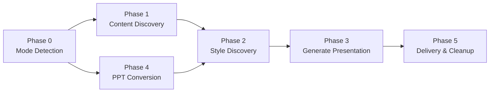
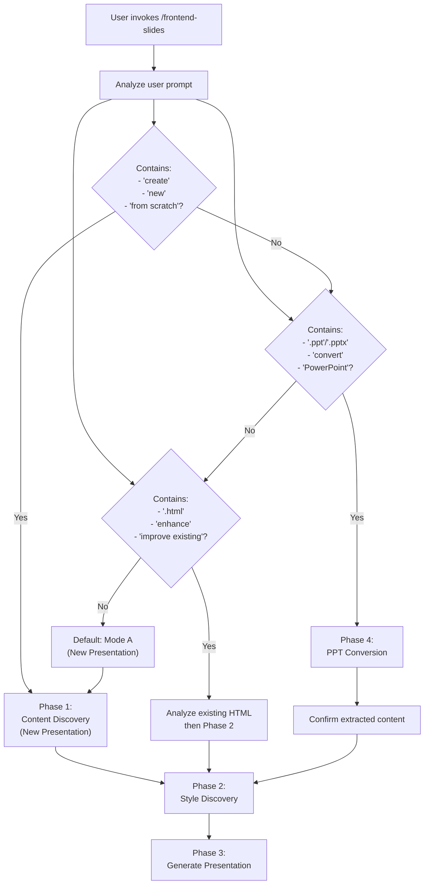
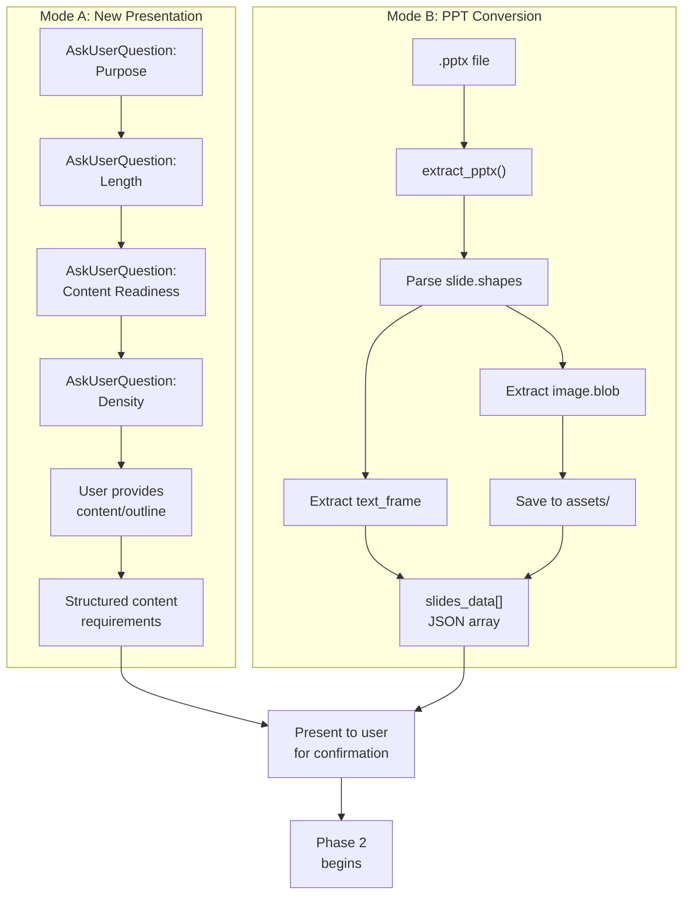
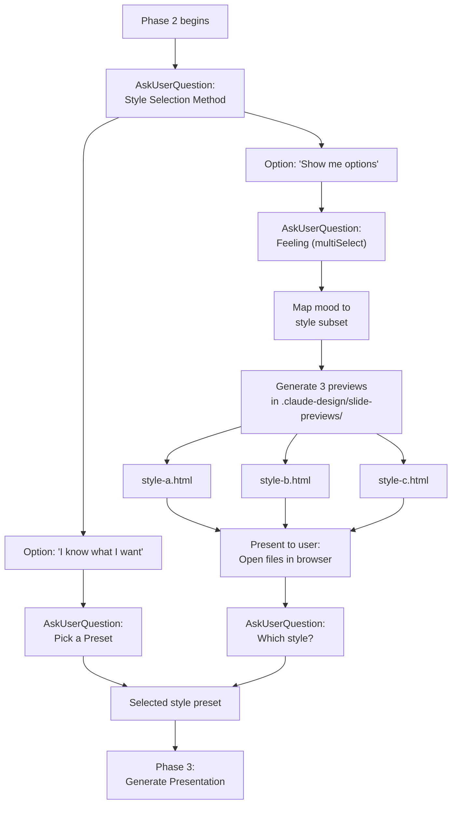
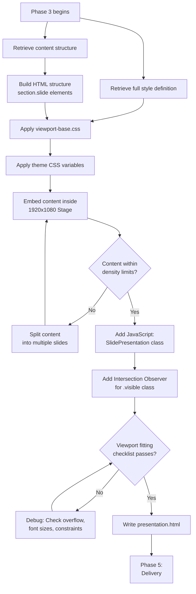
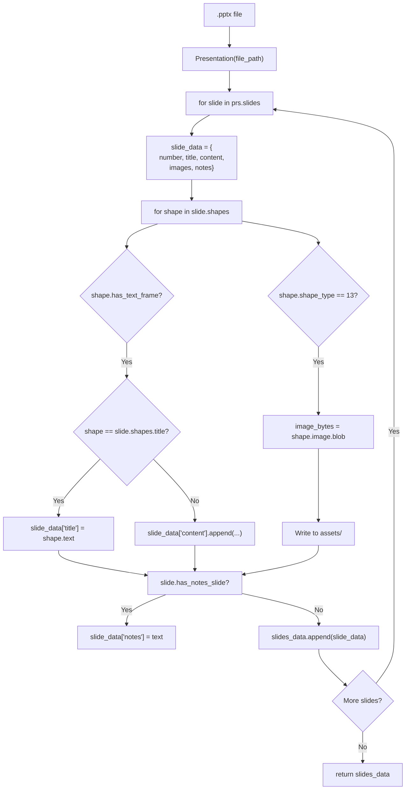
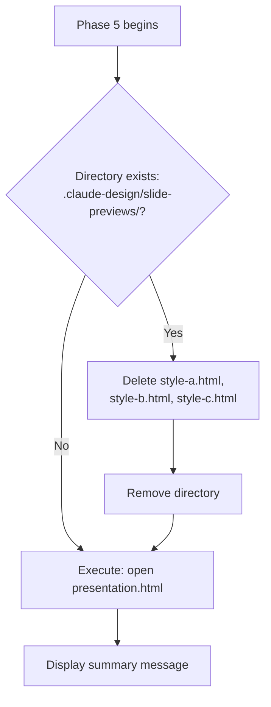

<!-- source: DeepWiki mcp.deepwiki.com · repo zarazhangrui/frontend-slides · page 4.1 Five-Phase Workflow Pipeline · fetched 2026-10-26 -->

# Five-Phase Workflow Pipeline

<details>
<summary>Relevant source files</summary>

The following files were used as context for generating this wiki page:

- [SKILL.md](SKILL.md)
- [plugins/frontend-slides/skills/frontend-slides/SKILL.md](plugins/frontend-slides/skills/frontend-slides/SKILL.md)

</details>


## Purpose and Scope

This document describes the complete execution pipeline defined in [SKILL.md:67-380](), which orchestrates the generation of HTML presentations from user input. The pipeline consists of five sequential phases (Phase 0 through Phase 5) that transform natural language requests into production-ready HTML files. 

A critical architectural invariant throughout this pipeline is the **Fixed 16:9 Stage**. Every presentation is authored inside a fixed 1920×1080 stage that scales uniformly to the viewport, ensuring no reflow occurs on different devices [SKILL.md:10-16]().

This page provides an architectural overview of how phases connect and communicate. For detailed documentation of individual phases, see:
- [Phase 0: Mode Detection](#4.1.1)
- [Phase 1: Content Discovery](#4.1.2)
- [Phase 2: Style Discovery](#4.1.3)
- [Phase 3: Presentation Generation](#4.1.4)
- [Phase 4: PPT Conversion Pipeline](#4.1.5)
- [Phase 5: Delivery & Cleanup](#4.1.6)

For the philosophical principles that shape this pipeline, see [Design Philosophy](#4.2). For the viewport fitting constraints enforced during Phase 3, see [Viewport Fitting System](#5).

---

## Pipeline Architecture Overview

The workflow is a linear pipeline with a critical branching point at Phase 0. The system supports three distinct input modalities (new presentation, PowerPoint conversion, existing HTML enhancement), all of which converge at Phase 2 for unified style selection.

### High-Level Phase Sequence



**Sources:** [SKILL.md:67-380]()

### Phase Responsibilities Summary

| Phase | Primary Function | Input | Output | Mandatory |
|-------|-----------------|-------|--------|-----------|
| Phase 0 | Route user intent to appropriate workflow | Natural language prompt | Mode selection (A/B/C) | Yes |
| Phase 1 | Extract content requirements | User responses to structured questions | Content structure & requirements | Only for Mode A |
| Phase 2 | Visual style selection via preview generation | Mood preferences or direct selection | Selected style preset name | Yes |
| Phase 3 | Generate complete HTML presentation | Content + style preset | `presentation.html` | Yes |
| Phase 4 | Extract content from PowerPoint | `.pptx` file | Structured JSON + extracted assets | Only for Mode B |
| Phase 5 | Cleanup and browser launch | Generated HTML file | Opened browser, deleted temp files | Yes |

**Sources:** [SKILL.md:67-380]()

---

## Mode Detection and Routing (Phase 0)

Phase 0 acts as the entry router, analyzing user intent to determine which workflow path to execute. The detection logic categorizes requests into three modes [SKILL.md:67-74]().

### Mode Routing Decision Tree



**Sources:** [SKILL.md:67-87]()

### Mode Characteristics

**Mode A: New Presentation**
- Triggered by: Natural language description of presentation needs.
- Path: Phase 0 → Phase 1 → Phase 2 → Phase 3 → Phase 5 [SKILL.md:71]().
- Example prompts: "AI startup pitch deck", "Tutorial on React hooks".

**Mode B: PPT Conversion**
- Triggered by: Presence of PowerPoint file reference.
- Path: Phase 0 → Phase 4 → Phase 2 → Phase 3 → Phase 5 [SKILL.md:72]().
- Uses: `extract_pptx()` function [SKILL.md:380]().

**Mode C: Enhancement**
- Triggered by: Reference to existing HTML file.
- Path: Phase 0 → Analyze HTML → Phase 2 → Phase 3 → Phase 5 [SKILL.md:73]().
- Follows strict modification rules to ensure fixed-stage fitting [SKILL.md:75-87]().

---

## Content Acquisition Flow

After mode routing, the pipeline acquires presentation content through different mechanisms depending on the selected mode.

### Content Acquisition Pathways



**Sources:** [SKILL.md:89-110](), [SKILL.md:380]()

### Content Data Structure

Both Mode A and Mode B produce a normalized content structure before entering Phase 2:

```javascript
// Structure produced by Phase 1 (Mode A) or Phase 4 (Mode B)
{
  "slides": [
    {
      "number": 1,
      "title": "Slide Title",
      "content": [
        {"type": "text", "content": "Bullet point"},
        {"type": "text", "content": "Another point"}
      ],
      "images": [
        {"path": "assets/slide1_img1.png", "width": 800, "height": 600}
      ],
      "notes": "Speaker notes (from PPT only)"
    }
  ]
}
```

**Sources:** [SKILL.md:380]()

---

## Style Discovery Workflow (Phase 2)

Phase 2 implements the "show, don't tell" philosophy by generating visual previews rather than asking abstract questions [SKILL.md:300-305](). It uses **Progressive Disclosure** for bold templates, reading lightweight style indexes before loading full design recipes [SKILL.md:15]().

### Style Selection Decision Flow



**Sources:** [SKILL.md:300-380]()

### Mood to Style Mapping

The system maps user mood selections to specific style presets [SKILL.md:380]():

| Mood Selection | Style Options (pick 3) |
|----------------|------------------------|
| Impressed/Confident | Bold Signal, Electric Studio, Dark Botanical |
| Excited/Energized | Creative Voltage, Neon Cyber, Split Pastel |
| Calm/Focused | Notebook Tabs, Paper & Ink, Swiss Modern |
| Inspired/Moved | Dark Botanical, Vintage Editorial, Pastel Geometry |

---

## Presentation Generation Pipeline (Phase 3)

Phase 3 constructs the complete HTML presentation by combining content, applying the selected style preset, and enforcing viewport fitting constraints [SKILL.md:380]().

### Generation Process Flow



**Sources:** [SKILL.md:380]()

### Fixed Stage Rules

Every generated presentation MUST follow the **Fixed Stage Rules** [SKILL.md:38-52]():
- Every slide is authored inside a fixed **1920×1080 stage**.
- The stage scales uniformly; it must **not** re-layout content for phones.
- Slide visibility is controlled by `.active` / `.visible` classes.
- Full contents of `viewport-base.css` must be included.

---

## PowerPoint Extraction Pipeline (Phase 4)

Phase 4 is invoked only for Mode B, using the `extract_pptx()` function to parse PowerPoint files [SKILL.md:380]().

### Extraction Process



**Sources:** [SKILL.md:380]()

---

## Delivery and Cleanup (Phase 5)

Phase 5 performs final housekeeping and presents the completed presentation to the user [SKILL.md:380]().

### Cleanup Operations



**Sources:** [SKILL.md:380]()

### Content Density Enforcement

Phase 3 validates content against maximum density limits to guarantee viewport fitting [SKILL.md:33-65]():

| Slide Type | Maximum Content |
|------------|-----------------|
| Title slide | 1 heading + 1 subtitle + optional tagline [SKILL.md:38]() |
| Content slide | 1 heading + 4-6 bullet points [SKILL.md:39]() |
| Feature grid | 1 heading + 6 cards maximum [SKILL.md:40]() |
| Code slide | 1 heading + 8-10 lines of code [SKILL.md:41]() |

If content exceeds these limits, the system must split it into more slides [SKILL.md:63]().

---

