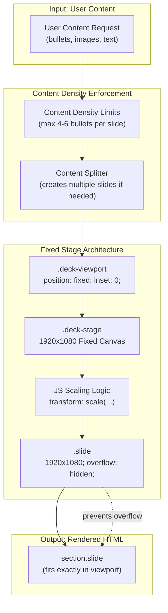
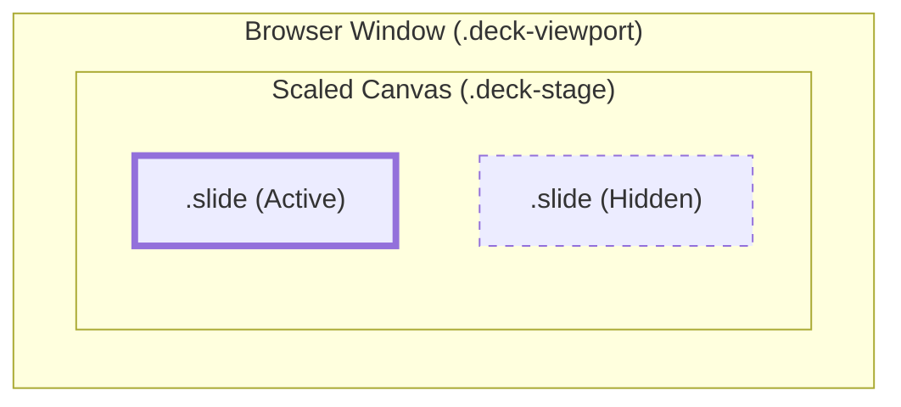

<!-- source: DeepWiki mcp.deepwiki.com · repo zarazhangrui/frontend-slides · page 5 Viewport Fitting System · fetched 2026-10-26 -->

# Viewport Fitting System

<details>
<summary>Relevant source files</summary>

The following files were used as context for generating this wiki page:

- [plugins/frontend-slides/skills/frontend-slides/viewport-base.css](plugins/frontend-slides/skills/frontend-slides/viewport-base.css)
- [viewport-base.css](viewport-base.css)

</details>


The Viewport Fitting System is the architectural constraint that ensures every slide in a presentation fits exactly within the browser viewport without requiring scrolling. This is a non-negotiable requirement enforced through CSS architecture, content density limits, responsive breakpoints, and a verification checklist. The system guarantees that presentations remain readable and navigable across all device sizes while maintaining aesthetic integrity.

In the **Bold Template Pack**, this system is further formalized through a fixed 1920×1080 design canvas that is dynamically scaled to fit the browser window using CSS transforms.

For information about how viewport fitting is enforced during presentation generation, see [Phase 3: Presentation Generation](#4.1.4). For style-specific implementations of viewport fitting rules, see [Style Presets Reference](#6).

---

## Core Requirements & Philosophy

### The Golden Rule

The viewport fitting system is built on a single inviolable constraint:

```
Each slide = exactly one viewport height (100vh/100dvh)
Content overflows? → Split into multiple slides or reduce content
Never scroll within a slide.
```

This constraint is declared as "CRITICAL" and "non-negotiable" in both [plugins/frontend-slides/skills/frontend-slides/SKILL.md:16]() and [plugins/frontend-slides/skills/frontend-slides/STYLE_PRESETS.md:7-9](). The philosophy prioritizes content clarity over density—if content cannot fit in the viewport at readable sizes, the solution is always to create additional slides, never to enable scrolling or reduce text below legible thresholds.

### Architectural Principles

The viewport fitting system operates through three complementary mechanisms:

1.  **Fixed Design Stage** — Authoring content at a fixed 1920×1080 resolution which is then scaled as a whole [viewport-base.css:2-5]().
2.  **CSS Constraints** — Every `.slide` element has `overflow: hidden` and exact viewport height [viewport-base.css:40-45]().
3.  **Content Limits** — Maximum content per slide type prevents overflow before generation [plugins/frontend-slides/skills/frontend-slides/SKILL.md:32-43]().

### Diagram: Viewport Fitting System Architecture



**Sources:** [viewport-base.css:1-51](), [plugins/frontend-slides/skills/frontend-slides/SKILL.md:16-30]()

---

## Required Base CSS Architecture

### Mandatory CSS Rules

Every presentation must include base CSS rules that lock the document and slide containers to viewport dimensions. These rules are defined in [viewport-base.css:1-133]().

#### Document-Level Constraints

```css
html,
body {
    width: 100%;
    height: 100%;
    margin: 0;
    overflow: hidden;
    background: var(--stage-bg, #000);
}
```

The `html` and `body` elements are locked to 100% height to establish the viewport boundary. The `overflow: hidden` ensures the browser scrollbar never appears [viewport-base.css:8-15]().

#### The Fixed Stage Canvas

The `.deck-stage` class is the core architectural component for modern templates:

```css
.deck-stage {
    position: absolute;
    left: 0;
    top: 0;
    width: 1920px;
    height: 1080px;
    overflow: hidden;
    transform-origin: 0 0;
}
```

Key properties:
*   **1920px × 1080px** — Fixed authoring dimensions [viewport-base.css:31-32]().
*   **`transform-origin: 0 0`** — Allows JavaScript to scale the entire presentation from the top-left corner to fit the available window size [viewport-base.css:34]().
*   **`.slide`** — Each slide occupies the full 1920×1080 stage and is hidden by default unless active [viewport-base.css:40-51]().

### Diagram: Viewport vs. Stage vs. Slide



**Sources:** [viewport-base.css:18-59]()

---

## Content Density Limits

### Per-Slide Type Maximums

Content density limits are enforced to prevent overflow within the 1920×1080 canvas. These limits are defined in [plugins/frontend-slides/skills/frontend-slides/SKILL.md:32-43]().

| Slide Type | Maximum Content | Rationale |
| :--- | :--- | :--- |
| **Title slide** | 1 heading + 1 subtitle | Large display text takes significant space |
| **Content slide** | 1 heading + 4-6 bullet points | Ensures readability at the authored resolution |
| **Feature grid** | 1 heading + 6 cards maximum | Grid must fit within the 1080px height limit |
| **Code slide** | 1 heading + 8-10 lines of code | Monospace text requires generous line-height |
| **Image slide** | 1 heading + 1 image (max 60vh/60% height) | Leaves room for captions and headers |

**Sources:** [plugins/frontend-slides/skills/frontend-slides/SKILL.md:32-43](), [plugins/frontend-slides/skills/frontend-slides/STYLE_PRESETS.md:11-20]()

---

## Responsive Breakpoints & Scaling

### JavaScript-Driven Scaling

Unlike traditional responsive design, this system uses a scale-to-fit approach. A script calculates the ratio between the browser window and the 1920×1080 stage:

```javascript
// Logic implemented in deck-stage.js or SlidePresentation class
const scale = Math.min(window.innerWidth / 1920, window.innerHeight / 1080);
stage.style.transform = `translate(${x}px, ${y}px) scale(${scale})`;
```

This ensures that the layout remains identical regardless of device resolution, similar to how a PDF or a PowerPoint file behaves [viewport-base.css:25-26]().

### Media Constraints

To ensure assets do not break the stage layout, media elements are strictly constrained:

```css
img,
video,
canvas,
svg {
    max-width: 100%;
    max-height: 100%;
}
```

**Sources:** [viewport-base.css:61-68]()

---

## Viewport Fitting Checklist

Before any presentation is considered complete, developers must verify compliance with the viewport fitting checklist:

1.  ✅ **Stage Dimensions** — `.deck-stage` is exactly 1920×1080 [viewport-base.css:31-32]().
2.  ✅ **Overflow Hidden** — `.deck-viewport`, `.deck-stage`, and `.slide` all have `overflow: hidden` [viewport-base.css:21, 33, 45]().
3.  ✅ **Global Lock** — `html` and `body` have `overflow: hidden` and `height: 100%` [viewport-base.css:8-13]().
4.  ✅ **Media Scaling** — All images and videos use `max-height: 100%` [viewport-base.css:66-67]().
5.  ✅ **Content Density** — No slide exceeds the 6-bullet or 6-card limit [plugins/frontend-slides/skills/frontend-slides/SKILL.md:35-37]().
6.  ✅ **Print Layout** — The `@media print` block resets positions to `static` and allows one slide per page [viewport-base.css:80-123]().

**Sources:** [viewport-base.css:1-133](), [plugins/frontend-slides/skills/frontend-slides/SKILL.md:207-219]()

---

### Child Pages
*   [Core Requirements & Philosophy](#5.1)
*   [Required Base CSS Architecture](#5.2)
*   [Content Density Limits](#5.3)
*   [Responsive Breakpoints & Scaling](#5.4)
*   [Viewport Fitting Checklist](#5.5)

---

