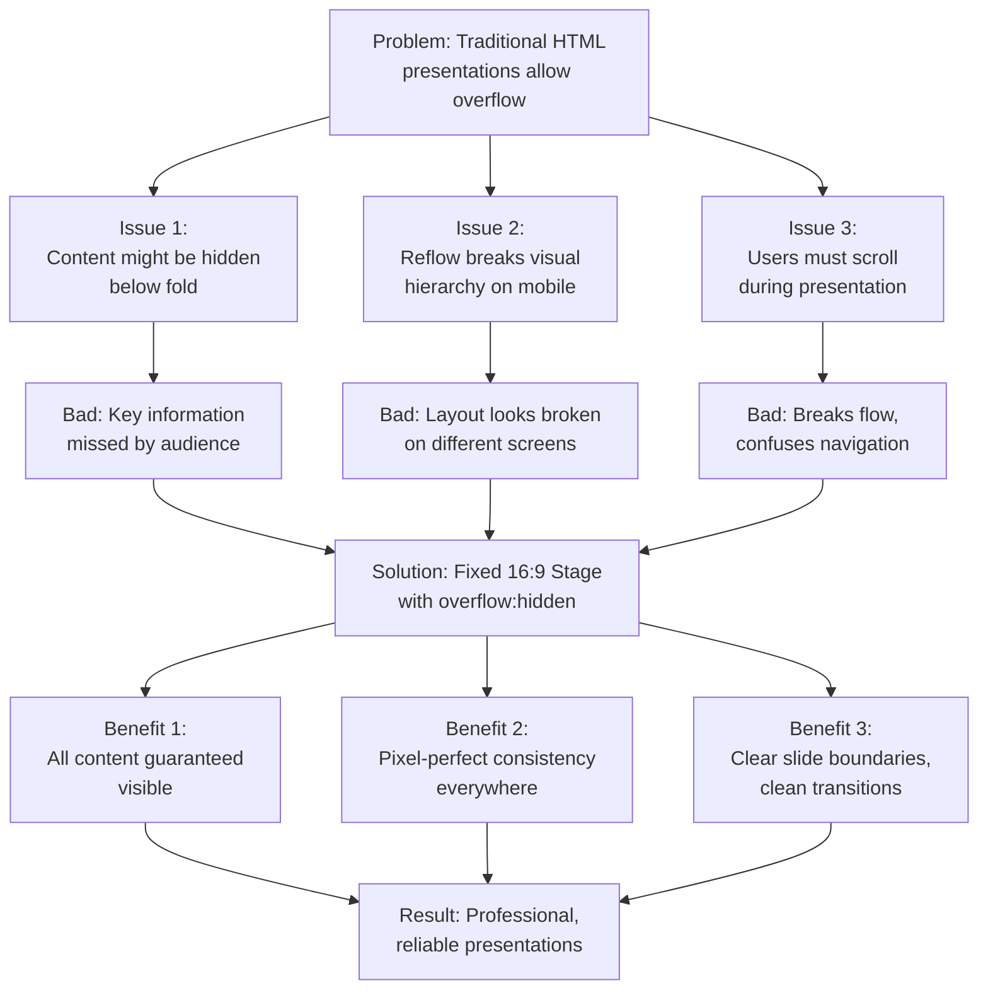
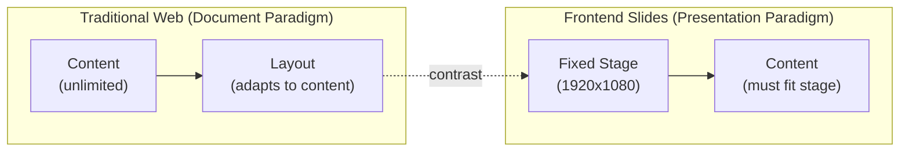
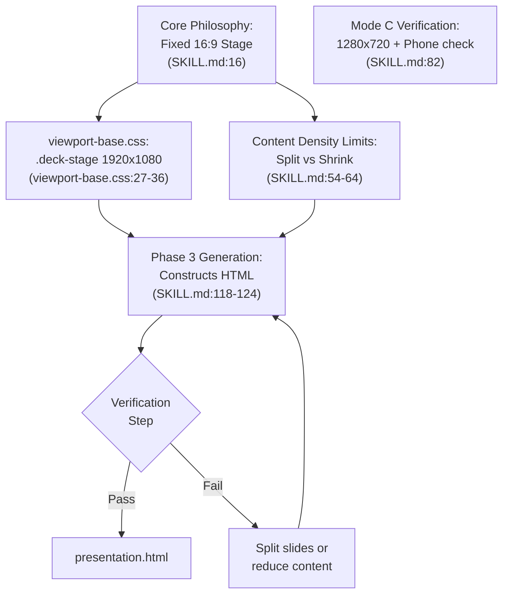
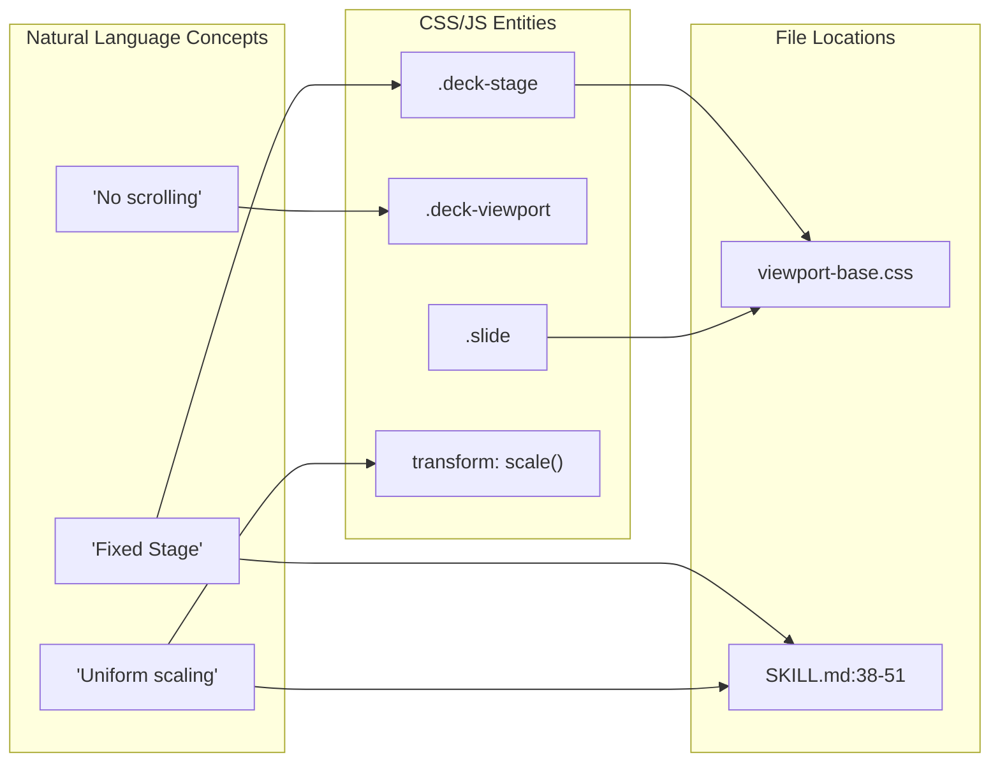

<!-- source: DeepWiki mcp.deepwiki.com · repo zarazhangrui/frontend-slides · page 5.1 Core Requirements & Philosophy · fetched 2026-10-26 -->

# Core Requirements & Philosophy

<details>
<summary>Relevant source files</summary>

The following files were used as context for generating this wiki page:

- [SKILL.md](SKILL.md)
- [viewport-base.css](viewport-base.css)

</details>


## Purpose and Scope

This document establishes the fundamental constraint that governs all presentation generation in the `frontend-slides` system: **every slide must fit exactly within the viewport without scrolling**. This page explains the philosophical reasoning behind this requirement, its technical implications, and the shift from fluid layouts to a fixed-stage architecture.

For technical implementation details of how this constraint is enforced, see [Required Base CSS Architecture](#5.2). For specific content limitations, see [Content Density Limits](#5.3). For the broader design principles that inform this system, see [Design Philosophy](#4.2).

---

## The Non-Negotiable Constraint

The `frontend-slides` system enforces one absolute rule that cannot be violated under any circumstances:

**Every slide must stay 16:9 on every screen and fit exactly in the viewport. No scrolling within slides, ever.**

This is explicitly documented as a critical, non-negotiable requirement in the "Fixed Stage Rules" at [SKILL.md:38-51](). Unlike typical web presentation frameworks that allow overflow scrolling or fluid reflow, this system treats the 1920×1080 design canvas as a hard invariant.

### Technical Definition: The Fixed Stage

The system uses a "Stage and Viewport" model defined in `viewport-base.css` [viewport-base.css:1-59]():

```css
/* 2. Full-window deck viewport */
.deck-viewport {
    position: fixed;
    inset: 0;
    overflow: hidden; /* CRITICAL: No overflow ever */
}

/* 3. Fixed 16:9 design canvas. 
   JavaScript sets transform: translate(...) scale(...). */
.deck-stage {
    position: absolute;
    width: 1920px;
    height: 1080px;
    overflow: hidden;
    transform-origin: 0 0;
}
```

The `overflow: hidden` property at [viewport-base.css:13]() and [viewport-base.css:33]() is the enforcement mechanism. Content that exceeds the 1920×1080 boundaries is clipped rather than causing scrollbars.

**Sources:** [SKILL.md:38-51](), [viewport-base.css:1-59]()

---

## Philosophical Foundation

### Presentation vs. Document Paradigm

The viewport fitting requirement reflects a fundamental philosophical distinction between **presentations** and **documents**:

| Paradigm | Scroll Behavior | Content Model | User Experience |
|----------|----------------|---------------|-----------------|
| **Document** (web pages, articles) | Vertical scrolling expected | Linear, continuous flow | User controls pace through scrolling |
| **Presentation** (slides, decks) | **No scrolling** | Discrete, bounded units | System controls pace through navigation |

Traditional HTML presentations often blur this distinction, treating slides as scrollable web pages. The `frontend-slides` system enforces the presentation paradigm strictly: each slide is a complete, self-contained visual unit that the user experiences in its entirety without needing to scroll [SKILL.md:16]().

### Zero Dependencies & Fixed Aspect Ratio

The viewport fitting constraint directly supports the "Zero Dependencies" principle documented at [SKILL.md:12](). By using a fixed 1920×1080 stage that scales uniformly [SKILL.md:43-44](), the system avoids complex responsive breakpoints that rearrange content. This ensures the design intent is preserved perfectly whether viewed on a desktop or a phone.

**Sources:** [SKILL.md:10-17](), [viewport-base.css:38-46]()

---

## Why This Constraint Exists

### Diagram: Constraint Rationale Decision Tree



**Sources:** [SKILL.md:38-51](), [viewport-base.css:1-59]()

### Practical Reasons

1. **Information Completeness**: If a slide requires scrolling, audience members may miss critical content. The viewport fitting constraint guarantees every element is visible [SKILL.md:63]().
2. **Device Consistency**: By authoring at a fixed 1920×1080 size [SKILL.md:43](), the system ensures the presentation adapts via scaling rather than re-layout, preventing "layout breakage" on mobile devices [SKILL.md:45]().
3. **Navigation Clarity**: Discrete slides eliminate the ambiguity of whether scrolling moves within a slide or to the next one [SKILL.md:47]().
4. **Professional Quality**: Traditional software (PowerPoint, Keynote) enforces slide boundaries. This constraint brings HTML presentations to parity with professional tools [SKILL.md:16]().

---

## Implications for Content Design

### Content Must Adapt to Constraint

In `frontend-slides`, content must be constrained to fit the layout, not vice versa:



### Content Density Modes

To enforce this constraint, the system defines two density modes documented at [SKILL.md:54-64]():

| Density Mode | Design Behavior | Limits |
|--------------|-----------------|--------|
| **Low Density** | One idea per slide, large type | 1-3 bullets max [SKILL.md:60]() |
| **High Density** | Structured grids, detailed docs | 4-8 bullets or 4-6 cards [SKILL.md:61]() |

### Split Instead of Scroll

When content exceeds density limits, the system's response is mandated at [SKILL.md:63]():
> **"If content exceeds the selected density mode, split it into more slides instead of shrinking until it becomes cramped."**

This is enforced during **Phase 3 (Generation)** and **Mode C (Enhancement)**, where the agent is instructed to proactively reorganize and split content if modifications cause overflow [SKILL.md:81-83]().

**Sources:** [SKILL.md:54-64](), [SKILL.md:75-85]()

---

## Relationship to Other System Components

### Diagram: Viewport Constraint Enforcement Chain



**Sources:** [SKILL.md:16-51](), [SKILL.md:75-85](), [viewport-base.css:1-59]()

### Code Entity Mapping



**Sources:** [SKILL.md:38-51](), [viewport-base.css:1-59]()

---

## Contrast with Alternative Approaches

### What This System Rejects

The viewport fitting philosophy explicitly rejects several common web presentation patterns:

| Rejected Pattern | Why Rejected | Alternative in This System |
|------------------|--------------|----------------------------|
| Scrollable slide content | Breaks presentation paradigm | Split content across multiple slides [SKILL.md:63]() |
| Responsive breakpoints | Causes unpredictable reflow | Uniformly scaled fixed stage [SKILL.md:44-45]() |
| `display: none` for slides | Breaks layout overrides | `visibility` and `opacity` [SKILL.md:47]() |
| Direct CSS function negation | Silently ignored by browsers | `calc(-1 * clamp(...))` [SKILL.md:50]() |

The system's approach is documented as **NON-NEGOTIABLE** at [SKILL.md:16]().

**Sources:** [SKILL.md:16-51](), [viewport-base.css:40-59]()

---

