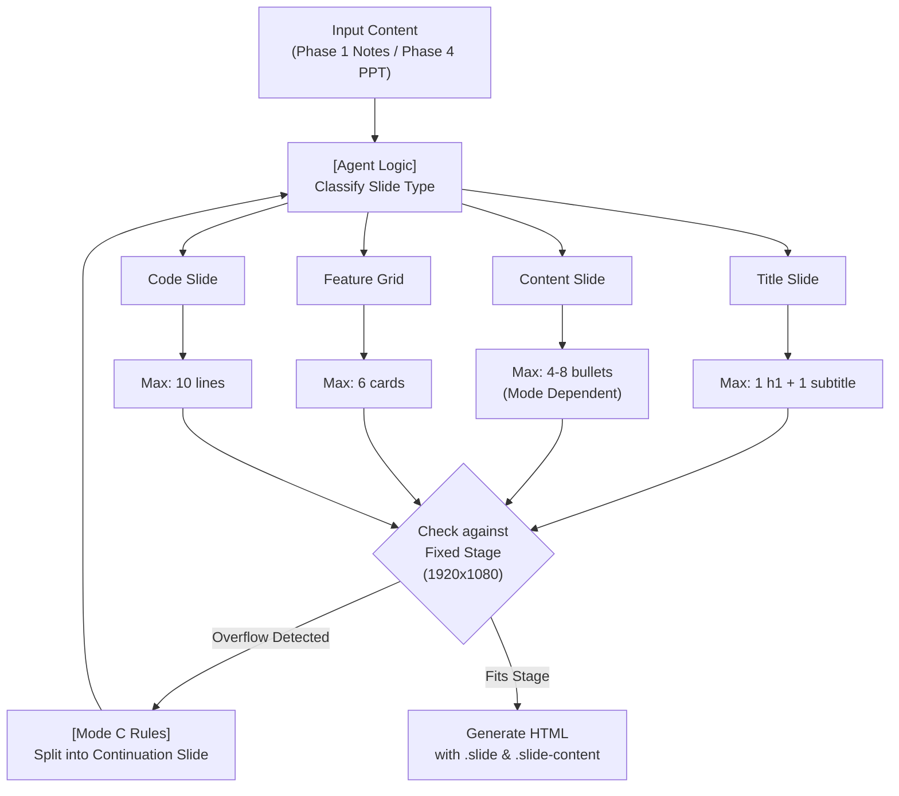
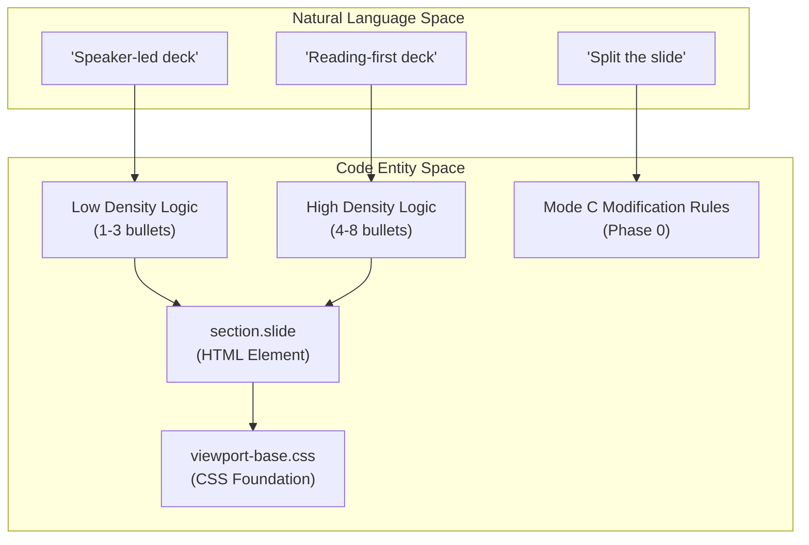

<!-- source: DeepWiki mcp.deepwiki.com · repo zarazhangrui/frontend-slides · page 5.3 Content Density Limits · fetched 2026-10-26 -->

# Content Density Limits

Relevant source files

The following files were used as context for generating this wiki page:

- [SKILL.md](SKILL.md)
- [plugins/frontend-slides/skills/frontend-slides/SKILL.md](plugins/frontend-slides/skills/frontend-slides/SKILL.md)

This document specifies the maximum content allowances per slide type to guarantee viewport fitting. These limits are enforced during **Phase 3 (Presentation Generation)** and **Phase 4 (PPT Conversion)** to prevent content overflow and ensure every slide fits exactly within the fixed 1920×1080 stage without scrolling.

For information about the overall viewport fitting philosophy, see [Core Requirements & Philosophy](5.1). For implementation details of the CSS architecture that supports these limits, see [Required Base CSS Architecture](5.2).

---

## Purpose and Enforcement

Content density limits serve two non-negotiable purposes:

1.  **Prevent Overflow**: Ensure content never exceeds the `1920×1080` stage height [SKILL.md:43-46]().
2.  **Maintain Readability**: Preserve minimum font sizes and spacing defined via `clamp()` functions [SKILL.md:48-51]().

These limits are enforced by the agent during generation. When content exceeds limits, the agent must **split it into more slides** instead of shrinking text until it becomes cramped [SKILL.md:63-64]().

**Sources:** [SKILL.md:15-16](), [SKILL.md:38-52](), [SKILL.md:63-64]()

---

## Content Density Modes

The system distinguishes between two primary density modes which influence the specific limits applied during generation.

| Density Mode | Best For | Design Behavior |
| :--- | :--- | :--- |
| **Low density / speaker-led** | Public talks, keynotes, live explanation | One idea per slide, large type, 1-3 bullets max, generous negative space [SKILL.md:60](). |
| **High density / reading-first** | Reports, handouts, async review | Structured grids/tables, 4-8 bullets or 4-6 cards, tighter but intentional spacing [SKILL.md:61](). |

**Sources:** [SKILL.md:54-64]()

---

## Content Density Specification (Baseline)

The following table defines the maximum baseline content per slide type to prevent overflow on the 1920×1080 stage.

| Slide Type | Maximum Content | Rationale |
| :--- | :--- | :--- |
| **Title Slide** | 1 heading + 1 subtitle + optional tagline | Needs large typography (`--title-size`) for hero impact [SKILL.md:60](). |
| **Content Slide** | 1 heading + 4-6 bullets (Reading) OR 1-3 bullets (Speaker) | Each bullet max 2 lines; prevents scroll on short viewports [SKILL.md:60-61](). |
| **Feature Grid** | 1 heading + 6 cards maximum | Cards scale to fit; more than 6 breaks 16:9 stage layout [SKILL.md:61](). |
| **Code Slide** | 1 heading + 8-10 lines of code | Code uses monospace; more lines overflow at standard font sizes [SKILL.md:63](). |
| **Quote Slide** | 1 quote (max 3 lines) + attribution | Typically uses significantly larger font size for emphasis [SKILL.md:60](). |
| **Image Slide** | 1 heading + 1 image (max 60% stage height) | Image must be `object-fit: contain` to stay within stage [SKILL.md:85](). |

**Sources:** [SKILL.md:60-64](), [SKILL.md:81-85](), [SKILL.md:43-47]()

---

## Slide Type Classification and Validation Flow

**Diagram: Content Validation and Splitting Logic**

**Sources:** [SKILL.md:67-87](), [SKILL.md:43-47]()

---

## Enforcement During Modification (Mode C)

When enhancing existing presentations or adding content to a generated slide, the following "Mode C" modification rules apply:

1.  **Count Elements**: Before adding content, count existing elements against density limits [SKILL.md:79]().
2.  **Image Addition**: Never add an image to a slide that already has maximum text content. Move the image to a new slide or reduce text first [SKILL.md:85]().
3.  **Automatic Reorganization**: If a modification causes overflow, the system must automatically split content and inform the user rather than waiting for a failure [SKILL.md:83]().
4.  **Verification**: After any modification, the agent must verify the slide stage remains 16:9 and no text overflows its card [SKILL.md:82]().

**Sources:** [SKILL.md:75-86]()

---

## Technical Mapping to Code Entities

The content limits are supported by specific CSS and JS structures that define the "Fixed Stage" behavior.

| Concept | Code Entity / CSS Selector | File Path |
| :--- | :--- | :--- |
| **Fixed Stage Size** | `1920px` x `1080px` | [SKILL.md:43]() |
| **Scaling Logic** | `.viewport-wrapper` (CSS Transform) | [SKILL.md:42]() |
| **Visibility Control** | `.active`, `.visible` (Opacity/Visibility) | [SKILL.md:47]() |
| **Font Sizing** | `clamp()` for non-slide UI | [SKILL.md:48]() |
| **Motion Support** | `prefers-reduced-motion` | [SKILL.md:49]() |

**Diagram: Density Mode to Code Implementation Mapping**

**Sources:** [SKILL.md:40-52](), [SKILL.md:60-61](), [SKILL.md:72-86]()

---

## Splitting Implementation Pattern

When content exceeds limits, the system follows this pattern:

*   **Maintain Hierarchy**: Keep the same heading on continued slides.
*   **Sequential Numbering**: Add "(1/2)", "(2/2)" or "(Continued)" to the slide heading.
*   **Even Distribution**: If a slide has 10 bullets, split into 5 and 5 rather than 8 and 2 to maintain visual balance.
*   **Fixed internal measurements**: Ensure that even with fewer items, the items remain at their fixed 1920×1080 design size [SKILL.md:46]().

**Sources:** [SKILL.md:46](), [SKILL.md:81-83]()

---

