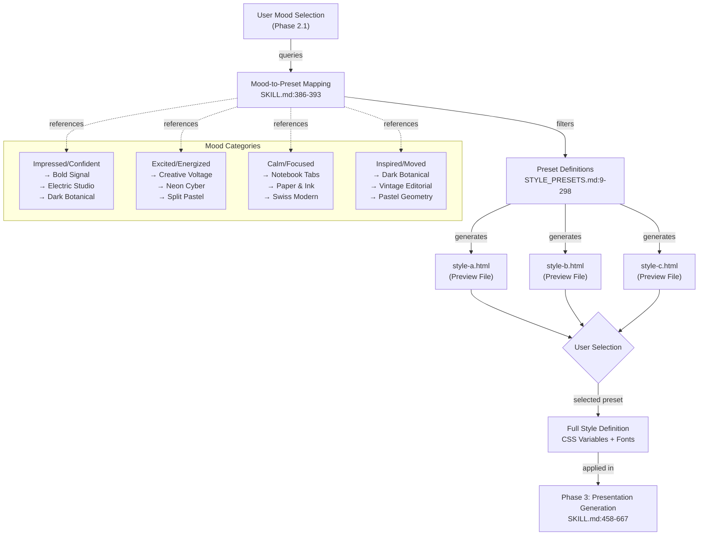
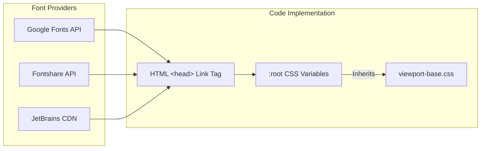

<!-- source: DeepWiki mcp.deepwiki.com · repo zarazhangrui/frontend-slides · page 6 Style Presets Reference · fetched 2026-10-26 -->

# Style Presets Reference

Relevant source files

The following files were used as context for generating this wiki page:

- [LICENSE](LICENSE)
- [STYLE_PRESETS.md](STYLE_PRESETS.md)
- [plugins/frontend-slides/skills/frontend-slides/STYLE_PRESETS.md](plugins/frontend-slides/skills/frontend-slides/STYLE_PRESETS.md)

This document catalogs all 12 curated visual themes available in the frontend-slides system. Each preset defines a complete design system including typography, color palettes, layout patterns, and signature visual elements. These presets are the concrete implementation of the "Anti-AI-Slop" philosophy—each is inspired by real design references and avoids generic patterns.

For information about the viewport fitting requirements that all presets must adhere to, see [Viewport Fitting System](#5). For the mood-based discovery workflow that helps users select presets, see [Phase 2: Style Discovery](#4.1.3).

---

## System Architecture

The style preset system operates as a curated library that `SKILL.md` queries during Phase 2 (Style Discovery). Each preset is a declarative specification stored in `STYLE_PRESETS.md`, not executable code. The system uses mood mapping to narrow the 12 presets to 3 candidate previews, which are then generated as temporary HTML files for user selection.

### Preset Selection Architecture

Typical workflow from user intent to code entity application:

**Sources:** [STYLE_PRESETS.md:1-298](), [plugins/frontend-slides/skills/frontend-slides/STYLE_PRESETS.md:1-298]()

---

## Preset Categories

The 12 presets are organized into three categories by background tone. This organization helps users navigate options and ensures balanced representation across aesthetic ranges. For technical details on each, see the respective child pages.

| Category | Preset Names | Count | Use Cases | Details |
|----------|--------------|-------|-----------|---------|
| **Dark Themes** | Bold Signal, Electric Studio, Creative Voltage, Dark Botanical | 4 | High-impact presentations, keynotes, agency pitches | [Dark Themes](#6.1) |
| **Light Themes** | Notebook Tabs, Pastel Geometry, Split Pastel, Vintage Editorial | 4 | Reports, educational content, editorial presentations | [Light Themes](#6.2) |
| **Specialty Themes** | Neon Cyber, Terminal Green, Swiss Modern, Paper & Ink | 4 | Tech-focused, developer tools, literary content | [Specialty Themes](#6.3) |

**Sources:** [STYLE_PRESETS.md:9-298]()

---

## Dark Themes

Dark themes share a common base of light text on dark backgrounds, optimized for dramatic impact and reduced eye strain. All dark themes require proper contrast ratios and must avoid pure black (#000000) in favor of near-blacks with subtle hue.

- **Bold Signal**: High-impact with colored cards on dark gradients [STYLE_PRESETS.md:11-37]().
- **Electric Studio**: Professional high-contrast split-panel layout [STYLE_PRESETS.md:40-66]().
- **Creative Voltage**: Retro-modern aesthetic using neon accents and halftones [STYLE_PRESETS.md:69-95]().
- **Dark Botanical**: Elegant and artistic using soft blurred CSS shapes [STYLE_PRESETS.md:97-126]().

For detailed color palettes and signature elements, see [Dark Themes](#6.1).

**Sources:** [STYLE_PRESETS.md:9-126]()

---

## Light Themes

Light themes use predominantly light backgrounds with dark text, optimized for readability and approachable aesthetics.

- **Notebook Tabs**: Tactile editorial style with vertical section tabs [STYLE_PRESETS.md:130-160]().
- **Pastel Geometry**: Friendly modern style with rounded cards and vertical pills [STYLE_PRESETS.md:162-191]().
- **Split Pastel**: Playful vertical color splits and badge pills [STYLE_PRESETS.md:193-221]().
- **Vintage Editorial**: Witty personality-driven style with distinctive serif typography [STYLE_PRESETS.md:223-249]().

For typography scales and layout patterns, see [Light Themes](#6.2).

**Sources:** [STYLE_PRESETS.md:128-249]()

---

## Specialty Themes

Specialty themes target specific technical audiences or aesthetic niches.

- **Neon Cyber**: Futuristic navy/cyan/magenta palette with particle effects [STYLE_PRESETS.md:253-262]().
- **Terminal Green**: Developer-focused hacker aesthetic using `JetBrains Mono` [STYLE_PRESETS.md:265-274]().
- **Swiss Modern**: Clean, Bauhaus-inspired Bauhaus layout with visible grids [STYLE_PRESETS.md:277-286]().
- **Paper & Ink**: Thoughtful literary style with drop caps and pull quotes [STYLE_PRESETS.md:289-298]().

For technical implementation of these specific aesthetics, see [Specialty Themes](#6.3).

**Sources:** [STYLE_PRESETS.md:251-298]()

---

## Typography & Font Pairing

Each preset defines two font families: display (headings, emphasis) and body (content, UI). The system imports fonts via CDN links (Google Fonts, Fontshare, or JetBrains) in the HTML `<head>`.

### Font Import Architecture

For the complete reference guide of display and body font combinations, see [Typography & Font Pairing](#6.4).

**Sources:** [STYLE_PRESETS.md:17-293](), [STYLE_PRESETS.md:5-6]()

---

## Design Anti-Patterns

The presets explicitly avoid these generic patterns to maintain distinctive aesthetics. This list is defined as a non-negotiable constraint for the generation agent.

- **Prohibited Fonts**: Generic families like `Inter`, `Roboto`, or `Arial` for display typography.
- **Prohibited Colors**: Generic indigo (#6366f1) or purple gradients on white.
- **Prohibited Layouts**: Centered-only layouts with no compositional variety.
- **Prohibited Decorations**: Realistic illustrations or gratuitous glassmorphism.

**Sources:** [STYLE_PRESETS.md:3-4](), [LICENSE:1-21]()

---

