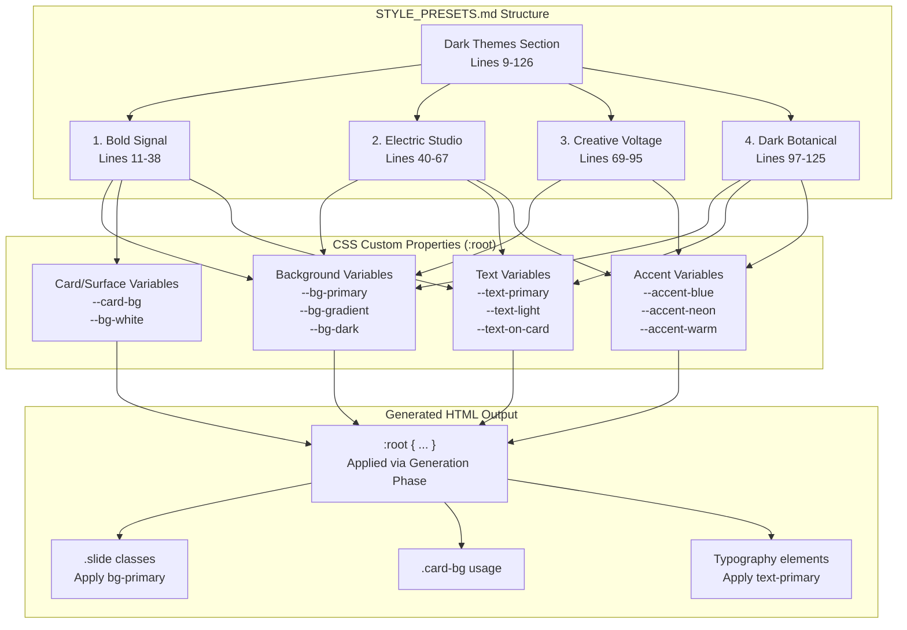
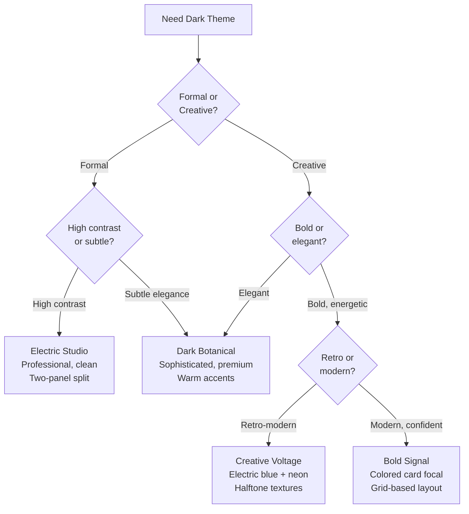

<!-- source: DeepWiki mcp.deepwiki.com · repo zarazhangrui/frontend-slides · page 6.1 Dark Themes · fetched 2026-10-26 -->

# Dark Themes

Relevant source files

The following files were used as context for generating this wiki page:

- [LICENSE](LICENSE)
- [STYLE_PRESETS.md](STYLE_PRESETS.md)
- [plugins/frontend-slides/skills/frontend-slides/STYLE_PRESETS.md](plugins/frontend-slides/skills/frontend-slides/STYLE_PRESETS.md)

## Purpose and Scope

This document catalogs the four dark theme presets available in the frontend-slides system: **Bold Signal**, **Electric Studio**, **Dark Botanical**, and **Midnight Executive**. Each theme is defined in [STYLE_PRESETS.md:11-125]() with complete specifications for colors, typography, layouts, and signature elements.

Dark themes are distinguished by their dark background colors (typically `#0a0a0a` to `#1a1a2e`) and high-contrast text. They are designed for dramatic presentations, executive reviews, or technical showcases that benefit from high visual impact.

For information about other theme categories, see [Light Themes (6.2)]() and [Specialty Themes (6.3)](). For the overall style selection workflow, see [Style Selection Process (3.3)]().

**Sources:** [STYLE_PRESETS.md:1-10](), [STYLE_PRESETS.md:11-125]()

---

## Theme Classification and CSS Variable Architecture

The following diagram shows how dark themes are organized within the preset system and how they map to CSS custom properties at runtime.

**Diagram: Dark Theme Architecture and CSS Variable Mapping**

**Sources:** [STYLE_PRESETS.md:11-125](), [STYLE_PRESETS.md:23-30](), [STYLE_PRESETS.md:52-59](), [STYLE_PRESETS.md:81-87](), [STYLE_PRESETS.md:109-117]()

---

## Theme 1: Bold Signal

### Overview
**Vibe:** Confident, bold, modern, high-impact  
**Primary Use Cases:** Product launches, high-stakes announcements, modern marketing decks  
**Specification:** [STYLE_PRESETS.md:11-38]()

Bold Signal utilizes a dark gradient background with a high-contrast colored card as the primary focal point. It relies on a rigid grid for precise alignment.

### Color Palette [STYLE_PRESETS.md:22-30]()
| Variable | Value | Purpose |
|----------|-------|---------|
| `--bg-primary` | `#1a1a1a` | Base background |
| `--bg-gradient` | `linear-gradient(135deg, #1a1a1a 0%, #2d2d2d 50%, #1a1a1a 100%)` | Depth layer |
| `--card-bg` | `#FF5722` | Focal accent card (Orange/Coral) |
| `--text-primary` | `#ffffff` | Standard slide text |
| `--text-on-card` | `#1a1a1a` | High-contrast text for accent cards |

### Typography & Signature Elements
- **Display:** `Archivo Black` (900) [STYLE_PRESETS.md:18]()
- **Body:** `Space Grotesk` (400/500) [STYLE_PRESETS.md:19]()
- **Layout:** Colored card focal point, large section numbers (01, 02), and navigation breadcrumbs with active/inactive opacity states [STYLE_PRESETS.md:33-36]().

**Sources:** [STYLE_PRESETS.md:11-38]()

---

## Theme 2: Electric Studio

### Overview
**Vibe:** Bold, clean, professional, high contrast  
**Primary Use Cases:** Design agencies, tech portfolios, professional service showcases  
**Specification:** [STYLE_PRESETS.md:40-67]()

Electric Studio features a distinctive split-panel layout that balances professional white surfaces with deep dark backgrounds.

### Color Palette [STYLE_PRESETS.md:50-59]()
| Variable | Value | Purpose |
|----------|-------|---------|
| `--bg-dark` | `#0a0a0a` | Dark panel background |
| `--bg-white` | `#ffffff` | Light panel surface |
| `--accent-blue` | `#4361ee` | Brand accent color |
| `--text-dark` | `#0a0a0a` | Text on light panels |
| `--text-light` | `#ffffff` | Text on dark panels |

### Typography & Signature Elements
- **Typography:** `Manrope` (Display 800 / Body 400-500) [STYLE_PRESETS.md:47-48]()
- **Layout:** Two-panel vertical split with an accent bar on the panel edge [STYLE_PRESETS.md:62-63]().
- **Hero Element:** Uses quote typography as a primary hero element [STYLE_PRESETS.md:64]().

**Sources:** [STYLE_PRESETS.md:40-67]()

---

## Theme 3: Creative Voltage

### Overview
**Vibe:** Bold, creative, energetic, retro-modern  
**Primary Use Cases:** Creative brainstorming, hackathons, energetic workshops  
**Specification:** [STYLE_PRESETS.md:69-95]()

Creative Voltage uses a high-energy palette of electric blue and neon yellow, combined with halftone textures for a retro-modern feel.

### Color Palette [STYLE_PRESETS.md:79-87]()
| Variable | Value | Purpose |
|----------|-------|---------|
| `--bg-primary` | `#0066ff` | Electric blue panel |
| `--bg-dark` | `#1a1a2e` | Dark contrast panel |
| `--accent-neon` | `#d4ff00` | Neon yellow callouts |
| `--text-light` | `#ffffff` | Global light text |

### Typography & Signature Elements
- **Typography:** `Syne` (Display 700/800) and `Space Mono` (Mono 400/700) [STYLE_PRESETS.md:76-77]()
- **Patterns:** Employs halftone texture patterns and neon badges/callouts [STYLE_PRESETS.md:91-92]().
- **Accents:** Script typography is used for creative flair [STYLE_PRESETS.md:93]().

**Sources:** [STYLE_PRESETS.md:69-95]()

---

## Theme 4: Dark Botanical

### Overview
**Vibe:** Elegant, sophisticated, artistic, premium  
**Primary Use Cases:** Luxury brand storytelling, art/design editorial, premium product showcases  
**Specification:** [STYLE_PRESETS.md:97-125]()

Dark Botanical creates a premium atmosphere using soft abstract shapes and a warm, sophisticated color palette. It strictly forbids illustrations in favor of CSS-generated abstract shapes.

### Color Palette [STYLE_PRESETS.md:107-117]()
| Variable | Value | Purpose |
|----------|-------|---------|
| `--bg-primary` | `#0f0f0f` | Deep dark background |
| `--text-primary` | `#e8e4df` | Off-white primary text |
| `--text-secondary` | `#9a9590` | Muted secondary text |
| `--accent-warm` | `#d4a574` | Terracotta/warm accent |
| `--accent-pink` | `#e8b4b8` | Soft pink accent |
| `--accent-gold` | `#c9b896` | Gold accent |

### Typography & Signature Elements
- **Typography:** `Cormorant` (Serif Display 400/600) and `IBM Plex Sans` (Body 300/400) [STYLE_PRESETS.md:104-105]()
- **Visuals:** Abstract soft gradient circles (blurred/overlapping) and thin vertical accent lines [STYLE_PRESETS.md:120-122]().
- **Constraint:** **No illustrations**—only abstract CSS shapes are permitted [STYLE_PRESETS.md:124]().

**Sources:** [STYLE_PRESETS.md:97-125]()

---

## Dark Theme Comparison Matrix

The following table provides a quick reference for selecting the appropriate dark theme based on the desired tone and formality.

| Theme | Best For | Visual Intensity | Formality Level | Accent Strategy |
|-------|----------|------------------|-----------------|-----------------|
| **Bold Signal** | Product launches | Very High | Medium | Single bold card focal point |
| **Electric Studio** | Professional Studio | High | High | Two-panel vertical split |
| **Creative Voltage** | Creative/Tech | Very High | Low | Neon contrast + halftone |
| **Dark Botanical** | Luxury/Premium | Medium | Very High | Warm gradients + Serif |

**Diagram: Dark Theme Selection Decision Tree**

**Sources:** [STYLE_PRESETS.md:11-125]()

---

## Implementation Reference

Dark themes are implemented via Phase 2 (Style Discovery) of the presentation generation pipeline. The agent maps user requirements to these presets by reading [STYLE_PRESETS.md]().

### CSS Integration
All dark themes must include the mandatory base styles defined in `viewport-base.css` [STYLE_PRESETS.md:5](). The generated HTML applies these presets by:
1. Defining CSS variables in the `:root` selector.
2. Applying `.slide` base styles to ensure viewport fitting.
3. Injecting Google Font `@import` rules based on the typography section of the chosen preset.

**Sources:** [STYLE_PRESETS.md:1-10](), [STYLE_PRESETS.md:11-125]()

---

