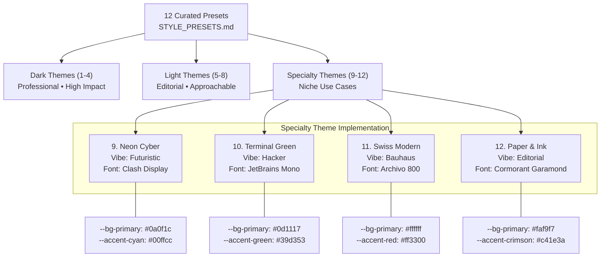
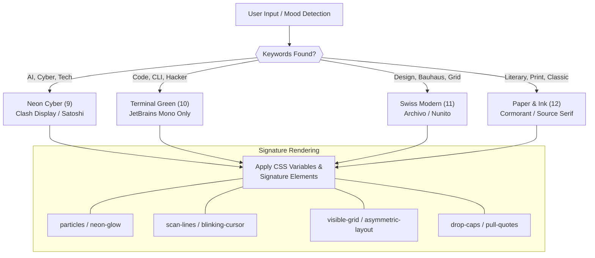

<!-- source: DeepWiki mcp.deepwiki.com · repo zarazhangrui/frontend-slides · page 6.3 Specialty Themes · fetched 2026-10-26 -->

# Specialty Themes

Relevant source files

The following files were used as context for generating this wiki page:

- [LICENSE](LICENSE)
- [STYLE_PRESETS.md](STYLE_PRESETS.md)
- [plugins/frontend-slides/skills/frontend-slides/STYLE_PRESETS.md](plugins/frontend-slides/skills/frontend-slides/STYLE_PRESETS.md)

## Purpose and Scope

This page documents the four specialty theme presets (presets 9-12) available in the `frontend-slides` system: **Neon Cyber**, **Terminal Green**, **Swiss Modern**, and **Paper & Ink**. Specialty themes serve niche use cases with specific aesthetic requirements, unique typography sources, or technical constraints that differentiate them from general-purpose dark and light themes.

For general-purpose professional presentations, see [Dark Themes (6.1)]() and [Light Themes (6.2)](). For font pairing details across all themes, see [Typography & Font Pairing (6.4)]().

**Sources:** [STYLE_PRESETS.md:251-298]()

---

## What Makes a Theme "Specialty"

Specialty themes differ from standard dark and light themes in three key ways:

1.  **Narrower Use Case**: Designed for specific content types or audiences (e.g., developer tools, literary editorial, or futuristic tech).
2.  **Non-Standard Typography**: These themes often pull from specific foundries like Fontshare or use dedicated monospace families like JetBrains Mono [STYLE_PRESETS.md:257-269]().
3.  **Distinctive Visual Language**: They utilize high-concept signature elements such as particle backgrounds, scan lines, or visible Bauhaus-inspired grids [STYLE_PRESETS.md:261-285]().

**Sources:** [STYLE_PRESETS.md:253-298]()

---

## Theme Classification Architecture

The following diagram bridges the natural language "Vibe" and "Signature" of the specialty themes to their specific code implementation properties.

**Diagram: Specialty Theme Classification and CSS Tokens**

**Sources:** [STYLE_PRESETS.md:253-297]()

---

## 9. Neon Cyber

### Specifications
*   **Vibe**: Futuristic, techy, confident [STYLE_PRESETS.md:255]().
*   **Typography**: `Clash Display` + `Satoshi` from Fontshare [STYLE_PRESETS.md:257]().
*   **Color Palette**:
    *   `--bg-primary`: Deep navy (`#0a0f1c`)
    *   `--accent-cyan`: Cyan (`#00ffcc`)
    *   `--accent-magenta`: Magenta (`#ff00aa`) [STYLE_PRESETS.md:259]().

### Signature Elements
*   **Particle Backgrounds**: Dynamic SVG or CSS-based particle fields.
*   **Neon Glow**: Intense `text-shadow` and `box-shadow` on key metrics and headings.
*   **Grid Patterns**: Background overlays mimicking a digital HUD [STYLE_PRESETS.md:261]().

**Sources:** [STYLE_PRESETS.md:253-262]()

---

## 10. Terminal Green

### Specifications
*   **Vibe**: Developer-focused, "hacker" aesthetic [STYLE_PRESETS.md:267]().
*   **Typography**: `JetBrains Mono` exclusively (monospace only) [STYLE_PRESETS.md:269]().
*   **Color Palette**:
    *   `--bg-primary`: GitHub dark (`#0d1117`)
    *   `--accent-green`: Terminal green (`#39d353`) [STYLE_PRESETS.md:271]().

### Signature Elements
*   **CRT Aesthetics**: Scan line overlays and subtle screen flicker animations.
*   **Blinking Cursor**: Animated `::after` pseudo-elements on headings.
*   **Syntax Styling**: Highlighting content as if it were structured code [STYLE_PRESETS.md:273]().

**Sources:** [STYLE_PRESETS.md:265-274]()

---

## 11. Swiss Modern

### Specifications
*   **Vibe**: Clean, precise, Bauhaus-inspired [STYLE_PRESETS.md:279]().
*   **Typography**: `Archivo` (800) for headers, `Nunito` (400) for body [STYLE_PRESETS.md:281]().
*   **Color Palette**:
    *   `--bg-primary`: Pure white
    *   `--text-primary`: Pure black
    *   `--accent-red`: Bauhaus red (`#ff3300`) [STYLE_PRESETS.md:283]().

### Signature Elements
*   **Visible Grid**: The underlying structural grid is rendered via borders or background lines.
*   **Asymmetric Layouts**: Intentional use of negative space and off-center alignment.
*   **Geometric Shapes**: Bold, simple CSS shapes used for composition [STYLE_PRESETS.md:285]().

**Sources:** [STYLE_PRESETS.md:277-286]()

---

## 12. Paper & Ink

### Specifications
*   **Vibe**: Editorial, literary, thoughtful [STYLE_PRESETS.md:291]().
*   **Typography**: `Cormorant Garamond` + `Source Serif 4` [STYLE_PRESETS.md:293]().
*   **Color Palette**:
    *   `--bg-primary`: Warm cream (`#faf9f7`)
    *   `--text-primary`: Charcoal (`#1a1a1a`)
    *   `--accent-crimson`: Crimson (`#c41e3a`) [STYLE_PRESETS.md:295]().

### Signature Elements
*   **Typographic Hierarchy**: Use of drop caps (`::first-letter`) and elegant pull quotes.
*   **Horizontal Rules**: Stylized `
` elements with custom stroke-dash styles.
*   **Whitespace**: Low-density layouts focused on readability [STYLE_PRESETS.md:297]().

**Sources:** [STYLE_PRESETS.md:289-298]()

---

## Theme Selection Decision Tree

The system selects these themes during **Phase 2: Style Discovery** based on content keywords and user-selected mood.

**Diagram: Specialty Theme Logic Mapping**

**Sources:** [STYLE_PRESETS.md:251-298](), [plugins/frontend-slides/skills/frontend-slides/STYLE_PRESETS.md:251-298]()

---

## Technical Implementation Notes

### Viewport Fitting for Specialty Themes
Specialty themes must still adhere to the strict **Viewport Fitting System (Section 5)**. This presents unique challenges:
*   **Terminal Green**: Monospace fonts are generally wider. The content discovery agent must limit bullets to 3-4 per slide to prevent horizontal overflow [STYLE_PRESETS.md:269-273]().
*   **Neon Cyber**: Particle density must be reduced on mobile viewports to prevent performance lag that blocks the `SlidePresentation` controller's interaction [STYLE_PRESETS.md:261]().
*   **Swiss Modern**: Asymmetric layouts are converted to standard centered layouts using `@media (max-width: 768px)` to ensure readability [STYLE_PRESETS.md:285]().

### Font Source Mapping
| Theme | Display Font | Body Font | Source |
| :--- | :--- | :--- | :--- |
| **Neon Cyber** | Clash Display | Satoshi | Fontshare |
| **Terminal Green** | JetBrains Mono | JetBrains Mono | Google Fonts |
| **Swiss Modern** | Archivo (800) | Nunito (400) | Google Fonts |
| **Paper & Ink** | Cormorant Garamond | Source Serif 4 | Google Fonts |

**Sources:** [STYLE_PRESETS.md:257-293](), [plugins/frontend-slides/skills/frontend-slides/STYLE_PRESETS.md:257-293]()

---

