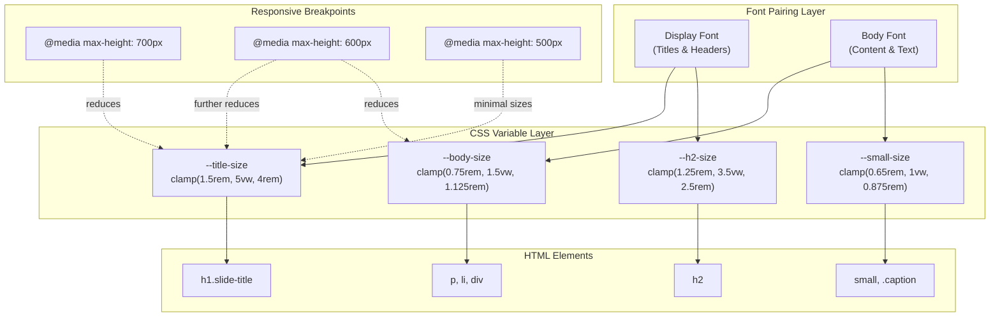
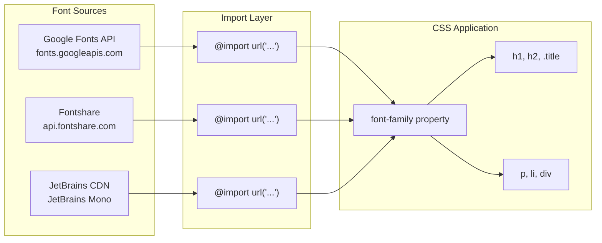
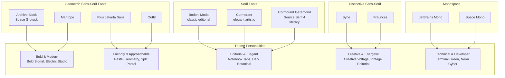

<!-- source: DeepWiki mcp.deepwiki.com · repo zarazhangrui/frontend-slides · page 6.4 Typography & Font Pairing · fetched 2026-10-26 -->

# Typography & Font Pairing

Relevant source files

The following files were used as context for generating this wiki page:

- [LICENSE](LICENSE)
- [STYLE_PRESETS.md](STYLE_PRESETS.md)
- [plugins/frontend-slides/skills/frontend-slides/STYLE_PRESETS.md](plugins/frontend-slides/skills/frontend-slides/STYLE_PRESETS.md)

This page documents the typography system and font pairing strategy used across all 12 style presets in the frontend-slides system. It serves as a complete reference for display and body font combinations, their sources, and how they integrate with the viewport fitting architecture.

For specific theme visual characteristics, see [Dark Themes](6.1), [Light Themes](6.2), and [Specialty Themes](6.3). For the broader style system architecture, see [Style Presets Reference](6).

---

## Font Pairing Strategy

The frontend-slides system uses a **two-tier typography hierarchy** for all presentations:

| Role | Purpose | Characteristics |
|------|---------|-----------------|
| **Display Font** | Titles, headings, hero text | Bold weights (700-900), distinctive personality, larger scale |
| **Body Font** | Content text, bullets, captions | Regular weights (400-500), high readability, smaller scale |

This pairing strategy ensures:
- **Visual hierarchy**: Display fonts create impact; body fonts maintain readability.
- **Personality expression**: Display font choice defines the theme's character.
- **Performance**: Only two font families per presentation (minimal HTTP requests).
- **Consistency**: Each preset has a single, curated pairing—no mix-and-match.

**Sources:** [STYLE_PRESETS.md:17-19](), [STYLE_PRESETS.md:136-138](), [STYLE_PRESETS.md:229-231]()

---

## Font Pairing Hierarchy

**Diagram: Typography System Architecture**

**Sources:** [STYLE_PRESETS.md:5-6](), [STYLE_PRESETS.md:158-158]()

---

## Complete Font Reference

### Dark Themes

| Preset Name | Display Font | Weights | Body Font | Weights | Character |
|-------------|--------------|---------|-----------|---------|-----------|
| Bold Signal | Archivo Black | 900 | Space Grotesk | 400, 500 | Confident, impactful |
| Electric Studio | Manrope | 800 | Manrope | 400, 500 | Unified, professional |
| Creative Voltage | Syne | 700, 800 | Space Mono | 400, 700 | Energetic, retro-modern |
| Dark Botanical | Cormorant | 400, 600 | IBM Plex Sans | 300, 400 | Elegant, artistic |

**Sources:** [STYLE_PRESETS.md:18-19](), [STYLE_PRESETS.md:47-48](), [STYLE_PRESETS.md:76-77](), [STYLE_PRESETS.md:104-105]()

### Light Themes

| Preset Name | Display Font | Weights | Body Font | Weights | Character |
|-------------|--------------|---------|-----------|---------|-----------|
| Notebook Tabs | Bodoni Moda | 400, 700 | DM Sans | 400, 500 | Editorial, classic |
| Pastel Geometry | Plus Jakarta Sans | 700, 800 | Plus Jakarta Sans | 400, 500 | Modern, approachable |
| Split Pastel | Outfit | 700, 800 | Outfit | 400, 500 | Playful, friendly |
| Vintage Editorial | Fraunces | 700, 900 | Work Sans | 400, 500 | Witty, distinctive |

**Note:** Presets like Electric Studio, Pastel Geometry, and Split Pastel use a **single font family** for both display and body, relying on weight differentiation to create hierarchy.

**Sources:** [STYLE_PRESETS.md:137-138](), [STYLE_PRESETS.md:169-170](), [STYLE_PRESETS.md:200-201](), [STYLE_PRESETS.md:230-231]()

### Specialty Themes

| Preset Name | Display Font | Body Font | Source | Special Characteristics |
|-------------|--------------|-----------|--------|------------------------|
| Neon Cyber | Clash Display | Satoshi | Fontshare | Futuristic, techy |
| Terminal Green | JetBrains Mono | JetBrains Mono | JetBrains | Monospace-only, hacker aesthetic |
| Swiss Modern | Archivo | Nunito | Google Fonts | Bauhaus-inspired, geometric |
| Paper & Ink | Cormorant Garamond | Source Serif 4 | Google Fonts | Serif pairing, literary |

**Sources:** [STYLE_PRESETS.md:257-257](), [STYLE_PRESETS.md:269-269](), [STYLE_PRESETS.md:281-281](), [STYLE_PRESETS.md:293-293]()

---

## Font Sources & Import Methods

**Diagram: Font Loading Architecture**

**Sources:** [STYLE_PRESETS.md:257-293]()

### Google Fonts (10 of 12 Presets)

Most presets use Google Fonts, typically imported via `@import` in the presentation's `<style>` block.

**Presets using Google Fonts:**
- Bold Signal, Electric Studio, Creative Voltage, Dark Botanical
- Notebook Tabs, Pastel Geometry, Split Pastel, Vintage Editorial
- Swiss Modern, Paper & Ink

**Weight Specification:** Weights are specified in the URL (e.g., `wght@400;500;700`) to load only required variants, minimizing file size.

**Sources:** [STYLE_PRESETS.md:18-19](), [STYLE_PRESETS.md:281-281]()

### Fontshare (1 Preset: Neon Cyber)

Fontshare provides professional-grade fonts via their API.

**Unique characteristics:**
- Modern, distinctive typefaces not available on Google Fonts.
- Used exclusively for the **Neon Cyber** preset (`Clash Display` + `Satoshi`).

**Sources:** [STYLE_PRESETS.md:257-257]()

### JetBrains Mono (1 Preset: Terminal Green)

JetBrains Mono is used for a developer-centric experience.

**Unique characteristics:**
- Monospace-only font family.
- Optimized for code readability.
- Used for both display and body in **Terminal Green**.

**Sources:** [STYLE_PRESETS.md:269-269]()

---

## Typography Scaling System

### Viewport-Relative Sizing

The system enforces viewport fitting by avoiding fixed pixel sizes. While specific implementation details are found in the `viewport-base.css` reference, the style presets define how fonts interact with the layout.

| Variable (Conceptual) | Purpose | Scaling Method |
|----------|---------|-------------------|
| Title Size | H1 titles, hero text | `clamp()` based on viewport width |
| Body Size | Paragraphs, bullets | `clamp()` based on viewport width |
| Tab Size | Navigation elements | `font-size: clamp(0.5rem, 1vh, 0.7rem)` |

**How it works:**
1. **Minimum Bounds**: Font never shrinks below a readable floor.
2. **Preferred Value**: Scales proportionally with viewport width or height (e.g., `1vh`).
3. **Maximum Bounds**: Prevents oversized text on large displays.

**Sources:** [STYLE_PRESETS.md:5-6](), [STYLE_PRESETS.md:158-158]()

---

## Font Weight Usage Patterns

### Display Font Weights

Display fonts typically use **bold to black weights** (700-900) for maximum impact:

| Weight | Appearance | Used By |
|--------|-----------|----------|
| 900 (Black) | Extra heavy | Archivo Black (Bold Signal) |
| 800 (Extra Bold) | Very bold | Manrope (Electric Studio), Plus Jakarta Sans (Pastel Geometry) |
| 700 (Bold) | Standard bold | Syne (Creative Voltage), Outfit (Split Pastel), Fraunces (Vintage Editorial) |
| 400 (Regular) | Elegant serif | Bodoni Moda (Notebook Tabs), Cormorant (Dark Botanical) |

**Sources:** [STYLE_PRESETS.md:18-18](), [STYLE_PRESETS.md:47-47](), [STYLE_PRESETS.md:137-137](), [STYLE_PRESETS.md:230-230]()

### Body Font Weights

Body fonts use **regular to medium weights** (300-500) for optimal readability:

| Weight | Appearance | Used By |
|--------|-----------|----------|
| 500 (Medium) | Slightly emphasized | Space Grotesk, Manrope, DM Sans, Plus Jakarta Sans, Outfit, Work Sans |
| 400 (Regular) | Standard text | Most body fonts (Space Mono, IBM Plex Sans) |
| 300 (Light) | Elegant, airy | IBM Plex Sans (Dark Botanical) |

**Sources:** [STYLE_PRESETS.md:19-19](), [STYLE_PRESETS.md:105-105](), [STYLE_PRESETS.md:138-138]()

---

## Font-to-Theme Personality Mapping

**Diagram: Font Psychology and Theme Association**

**Sources:** [STYLE_PRESETS.md:11-298]()

### Font Selection Guidelines

| If Theme Is... | Choose Display Font... | Choose Body Font... |
|----------------|----------------------|-------------------|
| **Bold, confident** | Extra-bold sans-serif (800-900 weight) | Clean sans-serif with strong legibility |
| **Elegant, artistic** | Serif with distinctive character | Clean sans-serif for contrast |
| **Playful, friendly** | Rounded sans-serif (700-800 weight) | Same family at regular weight |
| **Technical, developer** | Monospace with character | Same monospace font |
| **Editorial, literary** | Classic serif | Complementary serif or clean sans |

**Sources:** [STYLE_PRESETS.md:13-295]()

---

## Typography Anti-Patterns

The system explicitly forbids generic "AI slop" aesthetics. Typography must be intentional and high-impact.

| Practice | Why Avoided |
|------|------------|
| **Generic Sans Defaults** | Avoid overused fonts like Inter or Arial to maintain distinctiveness. |
| **Fixed Pixel Sizes** | Prohibited to ensure Viewport Fitting compliance. |
| **Low Contrast** | Text must be legible against preset backgrounds (e.g., `--text-on-card` vs `--card-bg`). |
| **Over-illustration** | The system uses abstract shapes and typography only; no generic AI illustrations. |

**Sources:** [STYLE_PRESETS.md:3-3](), [STYLE_PRESETS.md:28-29]()

---

