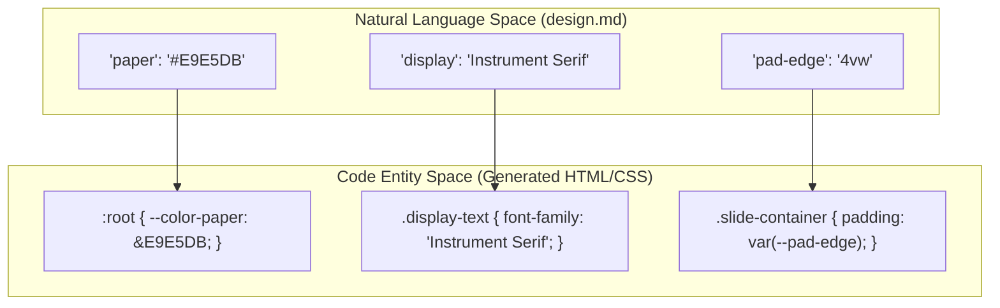
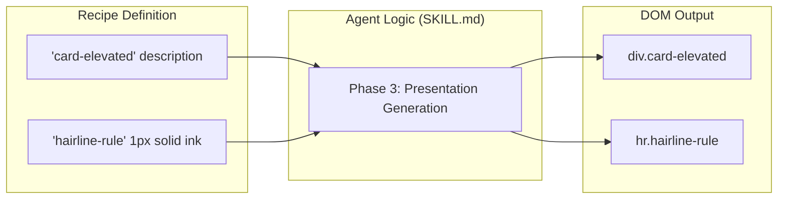

<!-- source: DeepWiki mcp.deepwiki.com · repo zarazhangrui/frontend-slides · page 7.2 Design Recipe Format · fetched 2026-10-26 -->

# Design Recipe Format

Relevant source files

The following files were used as context for generating this wiki page:

- [bold-template-pack/templates/biennale-yellow/design.md](bold-template-pack/templates/biennale-yellow/design.md)
- [bold-template-pack/templates/block-frame/design.md](bold-template-pack/templates/block-frame/design.md)
- [bold-template-pack/templates/sakura-chroma/design.md](bold-template-pack/templates/sakura-chroma/design.md)
- [bold-template-pack/templates/studio/design.md](bold-template-pack/templates/studio/design.md)

The **Design Recipe** is a structured markdown document (`design.md`) located within each template directory of the `bold-template-pack`. It serves as the authoritative technical specification for a visual theme, providing the LLM agent with the precise tokens, component grammar, and decorative vocabulary required to generate animation-rich HTML presentations that adhere to a specific aesthetic.

## Purpose and Scope

The Design Recipe bridges the gap between high-level aesthetic descriptions and low-level CSS/HTML implementation. It defines the "DNA" of a template, ensuring that generated slides maintain visual consistency across different content types (e.g., grids, quotes, data visualizations). 

Key functions include:
*   **Tokenization**: Defining color palettes, typography scales, and spacing units.
*   **Component Grammar**: Specifying how structural elements (cards, rules, buttons) should be constructed.
*   **Stage Mapping**: Providing the logic for translating fluid design values into the fixed 1920×1080 coordinate system required by the `frontend-slides` architecture.

---

## Structure of design.md

Each recipe follows a strict YAML frontmatter structure followed by detailed implementation guidelines.

### 1. Visual Metadata and Description
The header defines the version, name, and a high-level "mood" description that helps the agent understand the intended atmosphere (e.g., "literary-editorial," "neobrutalist," or "industrial").
*   **Source**: [bold-template-pack/templates/biennale-yellow/design.md:1-4]()
*   **Source**: [bold-template-pack/templates/block-frame/design.md:1-4]()

### 2. Color Tokens and Aliases
Colors are defined as hex codes and then mapped to semantic aliases (e.g., `ink`, `paper`, `accent`). This allows the agent to swap themes by changing the underlying token values while keeping the HTML class structure identical.
*   **Source**: [bold-template-pack/templates/biennale-yellow/design.md:6-16]()
*   **Source**: [bold-template-pack/templates/studio/design.md:6-30]()

### 3. Typography Scale
Typography is defined using `clamp()` functions to maintain legibility across different viewport heights, even within the fixed-stage model. Recipes specify font families, weights, line heights, and letter spacing for specific roles like `numeral-jumbo`, `display-it`, or `mono-data`.
*   **Source**: [bold-template-pack/templates/biennale-yellow/design.md:18-148]()
*   **Source**: [bold-template-pack/templates/sakura-chroma/design.md:20-170]()

### 4. Component Grammar
This section describes the "building blocks" of the template. It provides CSS-like properties and descriptions for elements such as:
*   **Decorations**: Radial blooms, halftone textures, or diagonal ribbons.
*   **Structural Elements**: Hairline rules, elevated cards with specific offsets, or corner brackets.
*   **Source**: [bold-template-pack/templates/biennale-yellow/design.md:165-190]()
*   **Source**: [bold-template-pack/templates/block-frame/design.md:146-212]()

---

## Natural Language to Code Entity Space

The following diagrams illustrate how the abstract design concepts in the recipe are translated into concrete code entities and system behaviors.

### Mapping Design Intent to CSS Variables
"How natural language tokens in design.md become runtime CSS properties."

**Sources**: [bold-template-pack/templates/biennale-yellow/design.md:6-22](), [bold-template-pack/templates/studio/design.md:151-160]()

### Component Translation Workflow
"How the agent interprets component descriptions to build HTML structures."

**Sources**: [bold-template-pack/templates/biennale-yellow/design.md:174-179](), [bold-template-pack/templates/block-frame/design.md:147-151]()

---

## Viewport-Fluid to Fixed-Stage Translation

A critical requirement of the `frontend-slides` system is the **Fixed-Stage Policy**. While many templates were originally designed with viewport-fluid units (`vw`, `vh`, `clamp()`), the generator translates these into a fixed **1920×1080 stage**.

### Translation Logic
1.  **Coordinate Mapping**: `100vw` is mapped to `1920px`; `100vh` is mapped to `1080px`.
2.  **Scaling**: The entire stage is scaled uniformly using CSS transforms (handled by `deck-stage.js`) to fit the browser window without reflowing content.
3.  **Priority**: The fixed-stage policy overrides any responsive behavior described in the source template's original history.

| Fluid Unit | Stage Coordinate (16:9) | Implementation |
| :--- | :--- | :--- |
| `1vw` | `19.2px` | Calculated during HTML generation |
| `1vh` | `10.8px` | Calculated during HTML generation |
| `clamp(min, fluid, max)` | Fixed `px` value | Evaluated at 1920×1080 resolution |

*   **Source**: [bold-template-pack/templates/studio/design.md:151-160]()

---

## Decorative Vocabulary

Templates include specific "decorative signatures" that distinguish them from standard AI-generated content. The Design Recipe provides the mathematical or CSS-pattern definitions for these elements:

*   **Atmospheric Layers**: Radial gradients like the `sun-bloom` in Biennale Yellow. [bold-template-pack/templates/biennale-yellow/design.md:180-185]()
*   **Textural Overlays**: Halftone dot patterns or paper grains defined as `background-image` radial gradients. [bold-template-pack/templates/sakura-chroma/design.md:186-191]()
*   **Geometric Accents**: `ribbon-bands` rotated at specific angles (e.g., 22°) to break the grid. [bold-template-pack/templates/sakura-chroma/design.md:194-198]()
*   **Neobrutalist Shadows**: Hard, non-blurry offsets (e.g., `8px 8px 0px #000000`). [bold-template-pack/templates/block-frame/design.md:20-25]()

---

## Implementation Checklist for Agents

When applying a Design Recipe, the system follows these rules:
1.  **No Rounded Corners**: Unless explicitly defined (e.g., `stat-deco-dot`), assume all corners are sharp. [bold-template-pack/templates/biennale-yellow/design.md:4]()
2.  **No Drop Shadows**: Use hard offsets or hairline rules instead, unless the recipe defines a specific `shadows` token. [bold-template-pack/templates/studio/design.md:4]()
3.  **Type as Mass**: In templates like "Studio," use extremely heavy weights (900) and uppercase transformations to treat text as a graphic element. [bold-template-pack/templates/studio/design.md:32-38]()
4.  **Strict Color Usage**: Only use colors defined in the `colors` or `color-aliases` section; do not introduce generic CSS colors. [bold-template-pack/templates/biennale-yellow/design.md:6-16]()

**Sources**:
*   [bold-template-pack/templates/biennale-yellow/design.md]()
*   [bold-template-pack/templates/block-frame/design.md]()
*   [bold-template-pack/templates/sakura-chroma/design.md]()
*   [bold-template-pack/templates/studio/design.md]()

---

