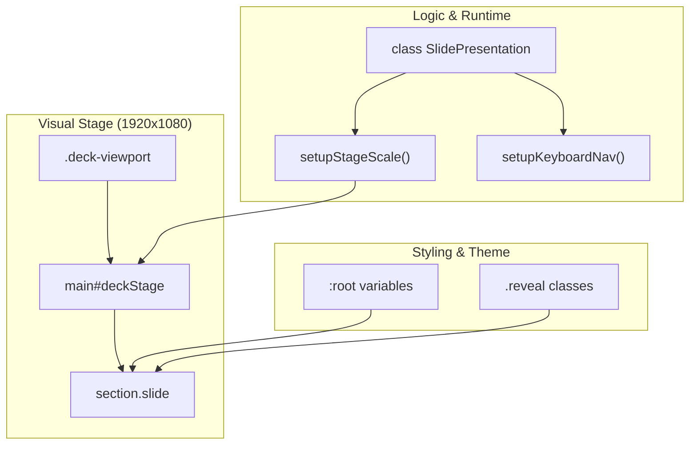
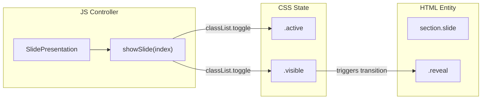

<!-- source: DeepWiki mcp.deepwiki.com · repo zarazhangrui/frontend-slides · page 8 Generated Output · fetched 2026-10-26 -->

# Generated Output

Relevant source files

The following files were used as context for generating this wiki page:

- [html-template.md](html-template.md)
- [plugins/frontend-slides/skills/frontend-slides/html-template.md](plugins/frontend-slides/skills/frontend-slides/html-template.md)

This document describes the technical structure of the HTML presentation files generated by the `frontend-slides` system. It covers the file architecture, inline CSS/JS embedding strategy, and the 16:9 stage scaling model.

For detailed documentation of specific components within the generated output, see:
- [HTML Structure & Semantics](#8.1) — Document the semantic HTML structure using `section.slide` elements and `reveal` classes.
- [CSS Architecture & Custom Properties](#8.2) — Explain the CSS variable system (`:root`), theme customization, and base styles.
- [JavaScript Runtime System](#8.3) — Document the `SlidePresentation` class, navigation logic, and animation triggering.

---

## Overview

The `frontend-slides` system generates a single, self-contained HTML file (and an optional `assets/` folder for images) following a **fixed 16:9 stage model** [html-template.md:3-3](). All slides are authored at a virtual resolution of 1920×1080, and the runtime JavaScript scales this stage to fit the browser window while maintaining the aspect ratio [html-template.md:158-162]().

The generated output adheres to a "Zero Dependencies" philosophy. The HTML file can be opened directly in any modern browser without requiring a build process or local server.

**Key Characteristics:**
- **Fixed Aspect Ratio**: 16:9 stage scaling ensures layouts never reflow across devices [html-template.md:158-162]().
- **Self-contained**: All core CSS and JavaScript are inlined [html-template.md:18-143]().
- **Zero build tools**: No npm or webpack required for the final output.
- **Viewport-fitted**: Base CSS ensures slides fit the screen exactly [html-template.md:53-53]().

Sources: [html-template.md:3-3](), [html-template.md:158-162](), [html-template.md:18-143]()

---

## Technical Architecture

The following diagrams map the "Natural Language" requirements of a presentation to the specific "Code Entities" generated in the output file.

### System Mapping: Structure to Code

Sources: [html-template.md:81-97](), [html-template.md:103-140]()

### Component Lifecycle

Sources: [html-template.md:66-69](), [html-template.md:133-139]()

---

## File Structure

### Standalone Output
For a standard generation, the system produces:
- `presentation.html`: The main file containing all HTML, CSS, and JS [html-template.md:7-145]().
- `assets/`: (Optional) Stores images extracted during PowerPoint conversion.

### PowerPoint Conversion
When converting `.pptx` files, the extraction pipeline names assets systematically:
`slide{n}_img{m}.{ext}` (e.g., `slide3_img1.png`).

---

## Core Systems Overview

### Viewport Fitting & Scaling
The generated output does not use standard responsive reflow. Instead, it uses a **Stage Scaling** approach:
1. All slides are contained within a `#deckStage` element [html-template.md:82-82]().
2. The `SlidePresentation` class calculates a `scale()` factor based on `Math.min(window.innerWidth / 1920, window.innerHeight / 1080)` [html-template.md:115-116]().
3. This transform is applied to the stage to ensure it fits the screen while letterboxing or pillarboxing as needed [html-template.md:119-119]().

### Theme System (CSS Custom Properties)
Themes are applied via a `:root` block that defines colors, typography (display and body fonts), and spacing tokens [html-template.md:23-46](). These properties are authored specifically for the 1920×1080 coordinate system.

### Animation System
Animations use a **State-Triggered Reveal** pattern:
- Elements intended to animate are given the `.reveal` class [html-template.md:59-64]().
- When a slide becomes the active slide, the JavaScript controller adds a `.visible` class to the `section.slide` [html-template.md:137-137]().
- CSS transitions then trigger on the children based on staggered `transition-delay` values [html-template.md:72-75]().

### Inline Editing Affordance
Every generated presentation includes a lightweight inline editing system by default [html-template.md:171-175](). This features:
- An edit toggle button (hotkey `E`) [html-template.md:172-172]().
- A JS-based hover delay (400ms) to manage UI visibility [html-template.md:183-183]().
- Automatic persistence to `localStorage` [html-template.md:173-173]().

Sources: [html-template.md:23-46](), [html-template.md:59-75](), [html-template.md:103-140](), [html-template.md:171-183]()

---

