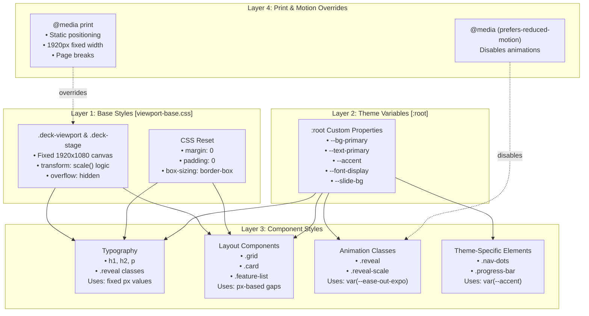
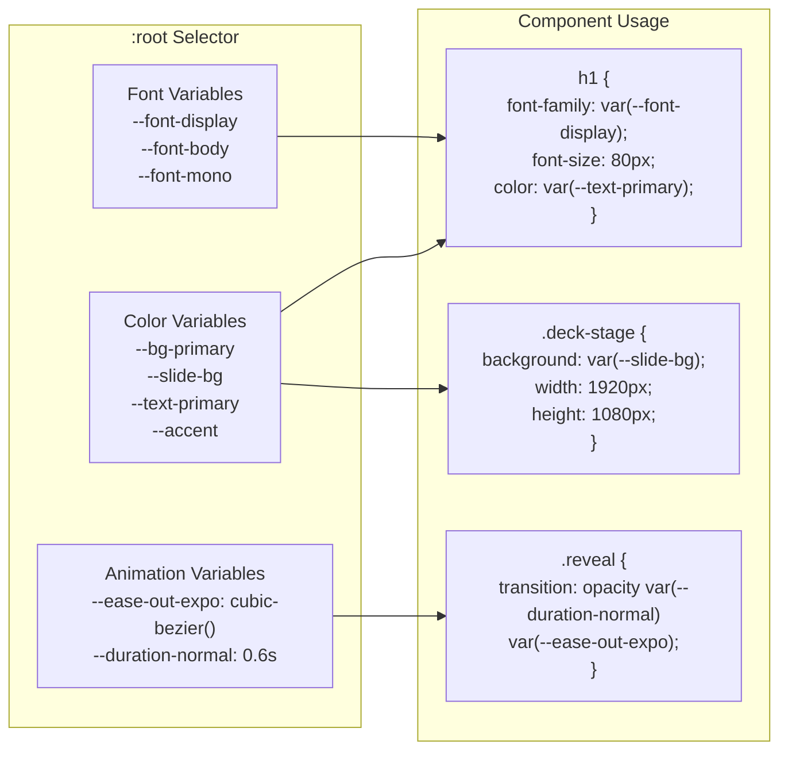

<!-- source: DeepWiki mcp.deepwiki.com · repo zarazhangrui/frontend-slides · page 8.2 CSS Architecture & Custom Properties · fetched 2026-10-26 -->

# CSS Architecture & Custom Properties

<details>
<summary>Relevant source files</summary>

The following files were used as context for generating this wiki page:

- [LICENSE](LICENSE)
- [STYLE_PRESETS.md](STYLE_PRESETS.md)
- [viewport-base.css](viewport-base.css)

</details>


This page documents the CSS architecture used in generated HTML presentations, focusing on the custom properties (CSS variables) system that enables theme customization and the mandatory 16:9 stage scaling system. This covers the structure and organization of styles, the `:root` variable system, and how base styles interact with theme-specific rules.

For information about the mandatory viewport fitting CSS requirements, see [5. Viewport Fitting System](). For details on individual theme presets and their visual characteristics, see [6. Style Presets Reference]().

---

## Purpose and Scope

Generated presentations use a CSS custom properties system that separates base functionality (viewport fitting, layout) from visual theming (colors, typography). This page explains:

- The three-layer CSS architecture (base, theme, component)
- The transition from viewport-relative units to a fixed 1920x1080 stage model
- How `:root` custom properties enable theme customization
- Variable naming conventions and categories
- The relationship between mandatory base styles and optional theme overrides

---

## CSS Architecture Overview

All presentations use inline CSS within the `<head>` tag to maintain the zero-dependencies philosophy. The architecture has evolved from fluid viewport units to a fixed-stage scaling model where slides are authored at a constant resolution and scaled to fit the window.

### Three-Layer Architecture



**Diagram: CSS Architecture Layers and Dependencies**

The architecture ensures that:
1. Viewport fitting constraints are applied first via the `.deck-stage` container [viewport-base.css:27-36]().
2. Theme customization happens via CSS variables, not direct style changes [STYLE_PRESETS.md:23-30]().
3. Component styles reference variables, making theme switching simple.
4. Media queries handle print layout and accessibility without touching core design logic [viewport-base.css:80-123]().

**Sources:** [viewport-base.css:1-133](), [STYLE_PRESETS.md:1-248]()

---

## The `:root` Custom Properties System

All theme customization occurs through CSS custom properties defined in the `:root` selector. Variables are organized into categories, serving specific purposes in the presentation system.

### Variable Categories

| Category | Purpose | Example Variables | Typical Usage |
|----------|---------|-------------------|---------------|
| **Colors** | Theme palette definition | `--bg-primary`, `--text-primary`, `--accent` | Backgrounds, text, highlights |
| **Typography** | Font family references | `--font-display`, `--font-body`, `--font-mono` | Font stack definitions |
| **Stage Styling** | Canvas background | `--stage-bg`, `--slide-bg` | The area outside and inside the 16:9 box |
| **Theme Accents** | Specialized elements | `--tab-1`, `--pill-mint`, `--card-bg` | Unique theme-specific decorations |
| **Animation** | Motion timing | `--ease-out-expo`, `--duration-normal` | Transitions and reveals |

### Variable Definition Structure



**Diagram: CSS Custom Properties Flow from Definition to Usage**

**Sources:** [STYLE_PRESETS.md:23-30](), [STYLE_PRESETS.md:52-59](), [viewport-base.css:14-35]()

---

## Theme Customization via CSS Variables

Themes customize presentations by overriding color and typography variables while inheriting the base stage system. Each preset defines its own variable values that reflect its visual identity.

### Example: Bold Signal Theme Variables
This theme uses a vibrant orange card on a dark gradient.

```css
:root {
    --bg-primary: #1a1a1a;
    --bg-gradient: linear-gradient(135deg, #1a1a1a 0%, #2d2d2d 50%, #1a1a1a 100%);
    --card-bg: #FF5722;
    --text-primary: #ffffff;
    --text-on-card: #1a1a1a;
}
```
**Sources:** [STYLE_PRESETS.md:23-29]()

### Example: Notebook Tabs Theme Variables
This theme uses a cream paper aesthetic with multiple accent colors for tabs.

```css
:root {
    --bg-outer: #2d2d2d;
    --bg-page: #f8f6f1;
    --text-primary: #1a1a1a;
    --tab-1: #98d4bb; /* Mint */
    --tab-2: #c7b8ea; /* Lavender */
    --tab-3: #f4b8c5; /* Pink */
}
```
**Sources:** [STYLE_PRESETS.md:142-151]()

---

## Base Styles vs Theme-Specific Rules

The CSS architecture separates mandatory base styles (fixed stage scaling) from optional theme enhancements.

### Mandatory Base CSS [viewport-base.css]

The following styles are mandatory for the presentation to function correctly:

1.  **Browser Lock**: `html, body` are set to `overflow: hidden` to prevent browser-level scrolling [viewport-base.css:8-15]().
2.  **Deck Viewport**: A fixed `inset: 0` container that holds the stage [viewport-base.css:18-23]().
3.  **Fixed 16:9 Stage**: The `.deck-stage` is strictly `1920px` by `1080px`. JavaScript applies `transform: scale()` to fit this stage into the browser window [viewport-base.css:27-36]().
4.  **Slide Stacking**: Slides use `position: absolute` and `inset: 0` to stack within the stage, toggling `visibility` and `opacity` for transitions [viewport-base.css:40-59]().

### Interaction Table

| Base Style Responsibility | Theme Style Responsibility | Interaction Rule |
|---------------------------|---------------------------|------------------|
| Stage Dimensions (1920x1080) | Background color/image | Theme cannot change stage dimensions |
| Media constraints (`max-width: 100%`) | Border radius/Shadows | Media always stays inside slide bounds |
| Print Layout (`@media print`) | High-contrast overrides | Print uses static positioning to bypass scaling |
| Reduced Motion Support | Animation timing variables | Base enforces 0.01ms duration if requested |

**Sources:** [viewport-base.css:27-133]()

---

## Responsive Scaling Strategy

Unlike traditional responsive web design that uses fluid grids and `clamp()`, this system uses **Uniform Stage Scaling**.

1.  **Authoring**: Content is authored as if it were on a fixed 1920x1080 canvas.
2.  **Scaling**: The entire `.deck-stage` is scaled using CSS transforms (`scale()`). This ensures that the relationship between text size, image size, and whitespace remains identical regardless of screen resolution.
3.  **Fallback**: For specific UI elements like notebook tabs, `clamp()` is still used for fine-tuned viewport-relative scaling when they sit on the edge of the stage [STYLE_PRESETS.md:158]().

### Print Layout Behavior
When printing, the scaling logic is bypassed. The system switches to a static layout where each `.slide` is treated as a `1920x1080` block with `break-after: page` to ensure high-quality PDF exports [viewport-base.css:80-113]().

**Sources:** [viewport-base.css:27-36](), [viewport-base.css:80-123]()

---

