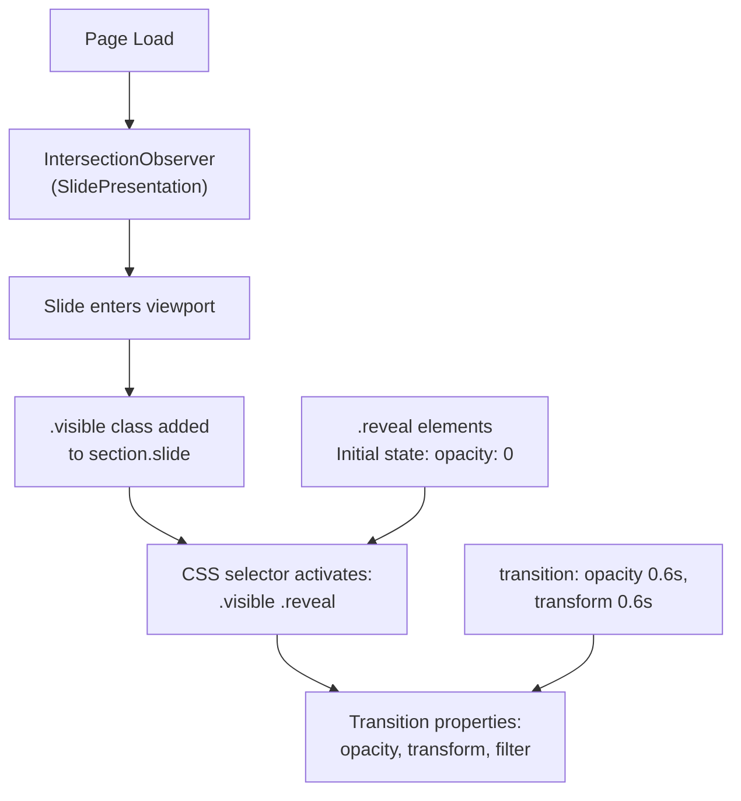
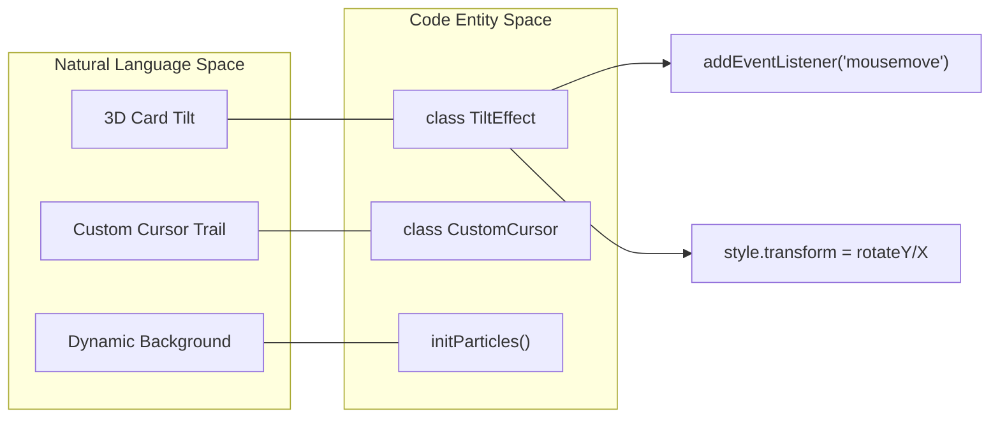

<!-- source: DeepWiki mcp.deepwiki.com · repo zarazhangrui/frontend-slides · page 9 Animation System · fetched 2026-10-26 -->

# Animation System

Relevant source files

The following files were used as context for generating this wiki page:

- [animation-patterns.md](animation-patterns.md)
- [plugins/frontend-slides/skills/frontend-slides/animation-patterns.md](plugins/frontend-slides/skills/frontend-slides/animation-patterns.md)
- [scripts/extract-pptx.py](scripts/extract-pptx.py)

The Animation System defines the entrance effects, background patterns, interactive enhancements, and motion design that bring presentations to life. This system is implemented entirely through CSS transitions and JavaScript classes, with no external animation libraries required. All animations are triggered by viewport visibility detection and respect user accessibility preferences.

For information about the JavaScript runtime that controls slide navigation and triggers these animations, see [SlidePresentation Controller Class](#8.3.1). For the viewport constraints that animations must respect, see [Viewport Fitting System](#5).

## Core Animation Architecture

The animation system is built on three coordinated components:

1.  **CSS `.reveal` classes** — Define the initial hidden state and animated properties [plugins/frontend-slides/skills/frontend-slides/animation-patterns.md:18-51]().
2.  **Intersection Observer** — Detects when slides enter the viewport.
3.  **`.visible` class trigger** — Added by the observer to activate CSS transitions [plugins/frontend-slides/skills/frontend-slides/animation-patterns.md:26-29]().

### Animation Flow Diagram
Title: Animation Trigger Logic

**Sources:** [plugins/frontend-slides/skills/frontend-slides/animation-patterns.md:20-29](), [animation-patterns.md:20-29]()

### The `.reveal` Class Pattern
All animated elements use the `.reveal` class, which defines the initial hidden state. The animation is triggered when the parent `.slide` receives the `.visible` class from the Intersection Observer.

| State | CSS Selector | Properties |
| :--- | :--- | :--- |
| Initial (hidden) | `.reveal` | `opacity: 0; transform: translateY(30px);` |
| Visible (animated) | `.visible .reveal` | `opacity: 1; transform: translateY(0);` |
| Transition | Applied to `.reveal` | `transition: opacity 0.6s var(--ease-out-expo)...` |

**Sources:** [plugins/frontend-slides/skills/frontend-slides/animation-patterns.md:19-29](), [animation-patterns.md:19-29]()

---

## Entrance Animation Patterns (#9.1)
The system provides four primary entrance animation types to match different visual tones. For technical implementation details, see [Entrance Animation Patterns](#9.1).

*   **Fade + Slide Up**: The most versatile pattern using `translateY(30px)` [plugins/frontend-slides/skills/frontend-slides/animation-patterns.md:19-25]().
*   **Scale In**: Elements grow from `scale(0.9)` to full size [plugins/frontend-slides/skills/frontend-slides/animation-patterns.md:32-36]().
*   **Slide Left**: Horizontal entrance using `translateX(-50px)` [plugins/frontend-slides/skills/frontend-slides/animation-patterns.md:39-43]().
*   **Blur In**: A soft entrance using `filter: blur(10px)` [plugins/frontend-slides/skills/frontend-slides/animation-patterns.md:46-50]().

**Sources:** [plugins/frontend-slides/skills/frontend-slides/animation-patterns.md:16-51](), [animation-patterns.md:16-51]()

---

## Background Effect Patterns (#9.2)
Background effects provide atmospheric depth without interfering with content readability. For implementation guides, see [Background Effect Patterns](#9.2).

*   **Gradient Mesh**: Layered radial gradients for organic depth [plugins/frontend-slides/skills/frontend-slides/animation-patterns.md:57-62]().
*   **Noise Texture**: Inline SVG patterns for grain and tactile feel [plugins/frontend-slides/skills/frontend-slides/animation-patterns.md:65-67]().
*   **Grid Pattern**: Subtle structural lines using linear gradients [plugins/frontend-slides/skills/frontend-slides/animation-patterns.md:70-75]().

**Sources:** [plugins/frontend-slides/skills/frontend-slides/animation-patterns.md:53-76](), [animation-patterns.md:53-76]()

---

## Interactive Effects (#9.3)
Interactive enhancements respond to user input and are implemented as JavaScript classes. For class definitions and API, see [Interactive Effects](#9.3).

*   **TiltEffect**: A class that applies 3D rotation to elements based on mouse position [plugins/frontend-slides/skills/frontend-slides/animation-patterns.md:82-99]().
*   **CustomCursor**: Smoothly follows mouse movement using linear interpolation.
*   **Magnetic Buttons**: Buttons that subtly attract the cursor on hover.

### Code-to-System Mapping
Title: Interactive Class Architecture

**Sources:** [plugins/frontend-slides/skills/frontend-slides/animation-patterns.md:80-100](), [animation-patterns.md:80-100]()

---

## Style-to-Animation Mapping (#9.4)
Different style presets map to specific animation choices and timings to ensure visual consistency. For the full mapping table, see [Style-to-Animation Mapping](#9.4).

| Feeling | Animations | Visual Cues |
| :--- | :--- | :--- |
| **Dramatic** | Slow fade-ins (1-1.5s), scale transitions | Spotlight effects, full-bleed images |
| **Techy** | Neon glow, grid reveals, glitch text | Particle systems, monospace accents |
| **Playful** | Bouncy easing (spring physics) | Rounded corners, bright colors |
| **Professional** | Fast animations (200-300ms) | Precise spacing, clean slides |
| **Calm** | Very slow subtle motion, gentle fades | High whitespace, muted palette |

**Sources:** [plugins/frontend-slides/skills/frontend-slides/animation-patterns.md:5-14](), [animation-patterns.md:5-14]()

---

## Troubleshooting & Performance

| Problem | Fix |
| :--- | :--- |
| **Animations not triggering** | Verify Intersection Observer is running; check `.visible` class addition [plugins/frontend-slides/skills/frontend-slides/animation-patterns.md:107](). |
| **Performance issues** | Use `will-change` sparingly; prefer `transform`/`opacity` [plugins/frontend-slides/skills/frontend-slides/animation-patterns.md:110](). |
| **Mobile issues** | Disable heavy effects at 768px breakpoint; reduce particle count [plugins/frontend-slides/skills/frontend-slides/animation-patterns.md:109](). |

**Sources:** [plugins/frontend-slides/skills/frontend-slides/animation-patterns.md:102-110](), [animation-patterns.md:102-110]()

---

