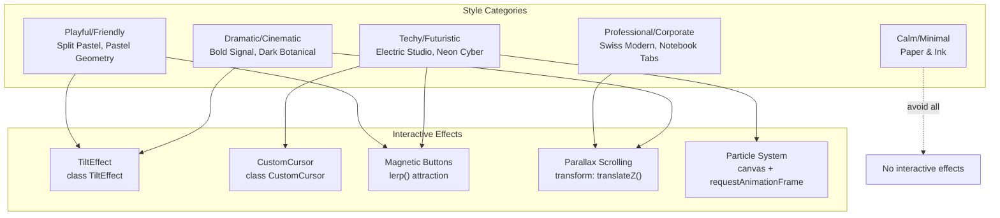
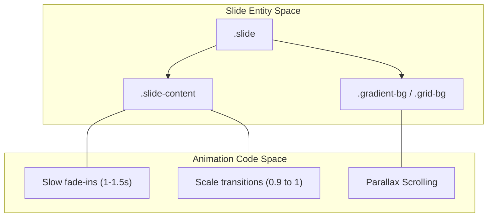

<!-- source: DeepWiki mcp.deepwiki.com · repo zarazhangrui/frontend-slides · page 9.3 Interactive Effects · fetched 2026-10-26 -->

# Interactive Effects

<details>
<summary>Relevant source files</summary>

The following files were used as context for generating this wiki page:

- [animation-patterns.md](animation-patterns.md)
- [plugins/frontend-slides/skills/frontend-slides/animation-patterns.md](plugins/frontend-slides/skills/frontend-slides/animation-patterns.md)
- [scripts/extract-pptx.py](scripts/extract-pptx.py)

</details>


This document covers the advanced interactive patterns available in generated presentations, including hover effects, custom cursors, magnetic buttons, and parallax scrolling. These effects are optional enhancements applied based on the selected style preset and are implemented as standalone JavaScript classes that integrate with the main `SlidePresentation` controller.

For basic entrance animations (fade, slide, scale), see [9.1 Entrance Animation Patterns](). For background visual effects (gradients, noise, grids), see [9.2 Background Effect Patterns]().

---

## Overview

Interactive effects are "optional enhancements" that add sophisticated user interactions beyond basic slide navigation. Unlike entrance animations which trigger on scroll, interactive effects respond to user input (mouse movement, hover) in real-time. These effects are conditionally included based on the style preset's personality [plugins/frontend-slides/skills/frontend-slides/animation-patterns.md:3-14]().

The system provides five primary interactive effect categories:

| Effect Type | Purpose | Typical Use Cases |
|-------------|---------|-------------------|
| **3D Tilt** | Hover-triggered 3D rotation | Cards, feature boxes, high-impact slides |
| **Custom Cursor** | Stylized mouse cursor with trail | Techy/futuristic themes, immersive experiences |
| **Magnetic Buttons** | Elements attracted to mouse proximity | CTAs, interactive navigation, playful themes |
| **Parallax Scrolling** | Multi-layer depth effect on scroll | Hero slides, dramatic backgrounds |
| **Particle Systems** | Animated background particles via canvas | Techy themes, ambient atmosphere |

Sources: [plugins/frontend-slides/skills/frontend-slides/animation-patterns.md:78-100](), [animation-patterns.md:78-100]()

---

## Effect Selection by Style



**Diagram: Style Preset to Interactive Effect Mapping**

The system maps style personalities to appropriate interactive effects. Dramatic themes utilize slow fade-ins and parallax, while techy themes leverage neon glows and particle systems [plugins/frontend-slides/skills/frontend-slides/animation-patterns.md:7-14]().

Sources: [plugins/frontend-slides/skills/frontend-slides/animation-patterns.md:5-14](), [animation-patterns.md:5-14]()

---

## TiltEffect Class

The `TiltEffect` class implements 3D hover tilt on interactive elements, creating a sense of depth and responsiveness. Elements rotate on their X and Y axes based on mouse position within the element bounds [plugins/frontend-slides/skills/frontend-slides/animation-patterns.md:81-82]().

### Implementation Pattern

The class is defined to handle `mousemove` and `mouseleave` events, applying CSS transformations to the element's style [plugins/frontend-slides/skills/frontend-slides/animation-patterns.md:83-100]().

```javascript
/* 3D Tilt on Hover — adds depth to cards/panels */
class TiltEffect {
    constructor(element) {
        this.element = element;
        this.element.style.transformStyle = 'preserve-3d';
        this.element.style.perspective = '1000px';

        this.element.addEventListener('mousemove', (e) => {
            const rect = this.element.getBoundingClientRect();
            const x = (e.clientX - rect.left) / rect.width - 0.5;
            const y = (e.clientY - rect.top) / rect.height - 0.5;
            this.element.style.transform = `rotateY(${x * 10}deg) rotateX(${-y * 10}deg)`;
        });

        this.element.addEventListener('mouseleave', () => {
            this.element.style.transform = 'rotateY(0) rotateX(0)';
        });
    }
}
```

Sources: [plugins/frontend-slides/skills/frontend-slides/animation-patterns.md:82-100](), [animation-patterns.md:82-100]()

### Key Characteristics

| Property | Value | Purpose |
|----------|-------|---------|
| `transformStyle` | `'preserve-3d'` | Enables 3D transform space [plugins/frontend-slides/skills/frontend-slides/animation-patterns.md:85]() |
| `perspective` | `'1000px'` | Sets viewing distance for 3D effect [plugins/frontend-slides/skills/frontend-slides/animation-patterns.md:86]() |
| Rotation range | ±10 degrees | Balances visibility with effect strength [plugins/frontend-slides/skills/frontend-slides/animation-patterns.md:92]() |
| Mouse position calc | Normalized -0.5 to +0.5 | Centers rotation around element midpoint [plugins/frontend-slides/skills/frontend-slides/animation-patterns.md:90-91]() |
| Reset behavior | `mouseleave` event | Returns to neutral position when mouse exits [plugins/frontend-slides/skills/frontend-slides/animation-patterns.md:95-97]() |

---

## Parallax Scrolling

Parallax effects create depth by moving background layers at different speeds than foreground content. This is a signature of **Dramatic / Cinematic** styles [plugins/frontend-slides/skills/frontend-slides/animation-patterns.md:9]().

### Layer Structure



**Diagram: Dramatic Style Entities and Animations**

Sources: [plugins/frontend-slides/skills/frontend-slides/animation-patterns.md:9](), [animation-patterns.md:9]()

---

## Troubleshooting & Performance

Interactive effects can impact performance or fail to trigger if dependencies aren't met.

| Problem | Fix |
|---------|-----|
| Animations not triggering | Verify Intersection Observer is running; check `.visible` class is being added [plugins/frontend-slides/skills/frontend-slides/animation-patterns.md:107]() |
| Performance issues | Use `will-change` sparingly; prefer `transform`/`opacity` animations; throttle scroll handlers [plugins/frontend-slides/skills/frontend-slides/animation-patterns.md:110]() |
| Mobile issues | Disable heavy effects at 768px breakpoint; test touch events; reduce particle count [plugins/frontend-slides/skills/frontend-slides/animation-patterns.md:109]() |

Sources: [plugins/frontend-slides/skills/frontend-slides/animation-patterns.md:104-110](), [animation-patterns.md:104-110]()

---

## Background Effect Integration

Interactive effects often sit on top of or interact with structural background patterns.

| Pattern | CSS Implementation |
|---------|--------------------|
| **Gradient Mesh** | Layered radial gradients for depth [plugins/frontend-slides/skills/frontend-slides/animation-patterns.md:57-62]() |
| **Noise Texture** | Inline SVG for grain/texture [plugins/frontend-slides/skills/frontend-slides/animation-patterns.md:65-67]() |
| **Grid Pattern** | Subtle structural lines using linear-gradients [plugins/frontend-slides/skills/frontend-slides/animation-patterns.md:70-75]() |

Sources: [plugins/frontend-slides/skills/frontend-slides/animation-patterns.md:56-75](), [animation-patterns.md:56-75]()

---

