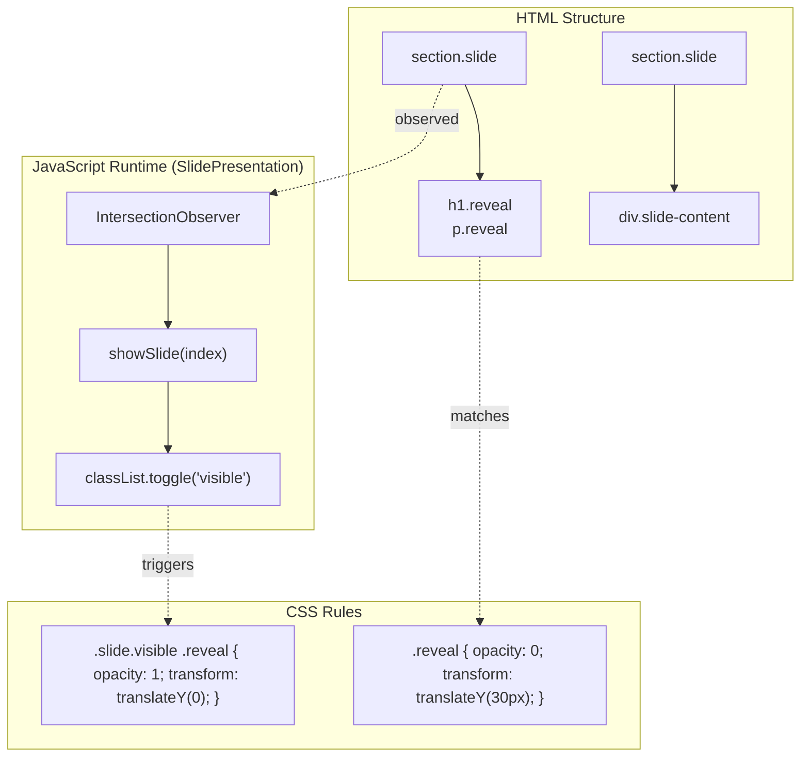
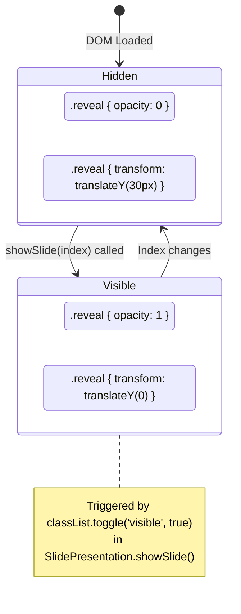
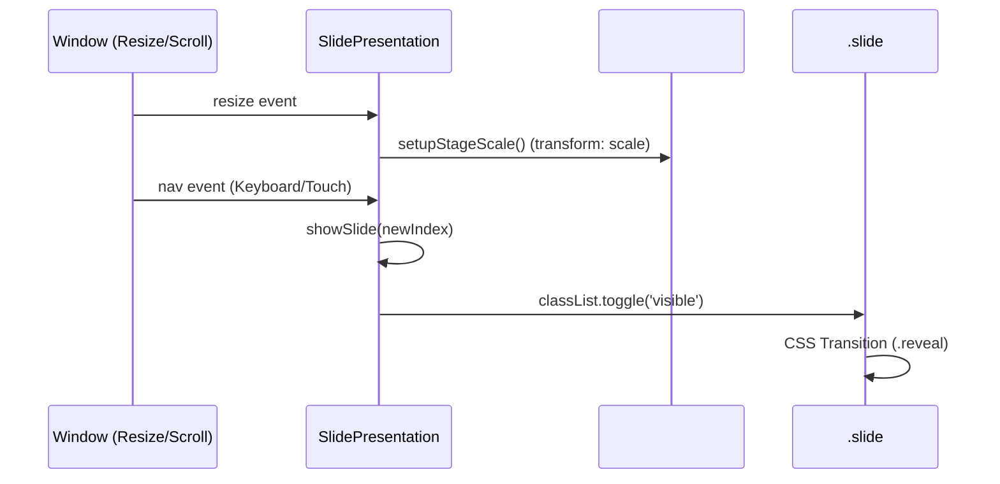

<!-- source: DeepWiki mcp.deepwiki.com · repo zarazhangrui/frontend-slides · extra page Intersection Observer Pattern · fetched 2026-10-26 -->

# Intersection Observer Pattern

<details>
<summary>Relevant source files</summary>

The following files were used as context for generating this wiki page:

- [html-template.md](html-template.md)
- [plugins/frontend-slides/skills/frontend-slides/html-template.md](plugins/frontend-slides/skills/frontend-slides/html-template.md)

</details>


## Purpose and Scope

This page documents the Intersection Observer pattern used in generated HTML presentations to detect when slides enter the viewport and trigger entrance animations. While the `SlidePresentation` controller class handles explicit navigation (keyboard, touch, and stage scaling), the Intersection Observer provides a performant mechanism for triggering visual transitions as slides become active.

The pattern ensures that animations defined by the `.reveal` class only execute when a slide is actually viewed, maintaining high performance by avoiding continuous scroll event listeners.

---

## Core Concept

### The Problem
HTML presentations need to animate content as slides enter the viewport. Traditional approaches using `scroll` event listeners are performance-intensive because they fire continuously during scrolling, requiring throttling or debouncing to avoid frame drops.

### The Solution
The Intersection Observer API provides a native, efficient way to detect when elements enter or exit the viewport. The pattern used in `frontend-slides` presentations:
1.  Initialize an `IntersectionObserver` that watches all `.slide` elements.
2.  When a slide's visibility crosses a threshold, trigger a callback.
3.  Update the slide's state by toggling the `.visible` and `.active` classes.
4.  CSS transitions automatically animate child elements with `.reveal` classes based on these state changes [html-template.md:59-69]().

**Diagram: Intersection Observer Architecture**


**Sources:** [html-template.md:59-75](), [html-template.md:103-140]()

---

## Implementation Pattern

### Initialization and Logic
The Intersection Observer logic is encapsulated within the `SlidePresentation` class [html-template.md:103-103](). When the class is instantiated, it selects all elements with the `.slide` class [html-template.md:105-105]().

The core method responsible for updating the visual state is `showSlide(index)` [html-template.md:133-139]().

```javascript
showSlide(index) {
    this.currentSlide = Math.max(0, Math.min(index, this.slides.length - 1));
    this.slides.forEach((slide, i) => {
        slide.classList.toggle('active', i === this.currentSlide);
        slide.classList.toggle('visible', i === this.currentSlide);
    });
}
```
**Sources:** [html-template.md:133-139]()

### Animation Triggering Mechanism
The transition is driven by CSS selectors that react to the presence of the `.visible` class on the parent `.slide` element [html-template.md:66-69]().

| Selector | Role | CSS Property |
| :--- | :--- | :--- |
| `.reveal` | Initial State | `opacity: 0; transform: translateY(30px);` |
| `.slide.visible .reveal` | Active State | `opacity: 1; transform: translateY(0);` |
| `.reveal:nth-child(n)` | Staggering | `transition-delay: 0.1s * n;` |

**Sources:** [html-template.md:59-75]()

**Diagram: Visibility State Machine**


**Sources:** [html-template.md:66-69](), [html-template.md:137-137]()

---

## Integration with Stage Scaling

The Intersection Observer pattern works in tandem with the fixed 16:9 stage model. While the observer triggers animations, the `setupStageScale()` method ensures that the `deck-stage` (containing all slides) is correctly transformed to fit the viewport [html-template.md:114-123]().

1.  **Stage Scaling**: Calculates a `factor` based on `Math.min(window.innerWidth / 1920, window.innerHeight / 1080)` [html-template.md:116-116]().
2.  **Slide Visibility**: Once the stage is scaled and centered, the `SlidePresentation` controller manages which slide receives the `.visible` class [html-template.md:137-137]().

**Diagram: Component Interaction**


**Sources:** [html-template.md:114-123](), [html-template.md:133-139]()

---

## Performance and Staggering

To create a professional "reveal" effect, the template uses sequential delays for children of a slide. This is implemented using `:nth-child` selectors in the base CSS [html-template.md:72-75]().

*   **Child 1**: 0.1s delay
*   **Child 2**: 0.2s delay
*   **Child 3**: 0.3s delay
*   **Child 4**: 0.4s delay

This staggering occurs automatically once the Intersection Observer logic adds the `.visible` class to the parent slide [html-template.md:66-66]().

**Sources:** [html-template.md:72-75]()

---

