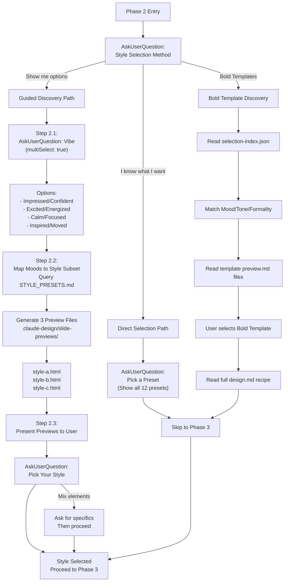
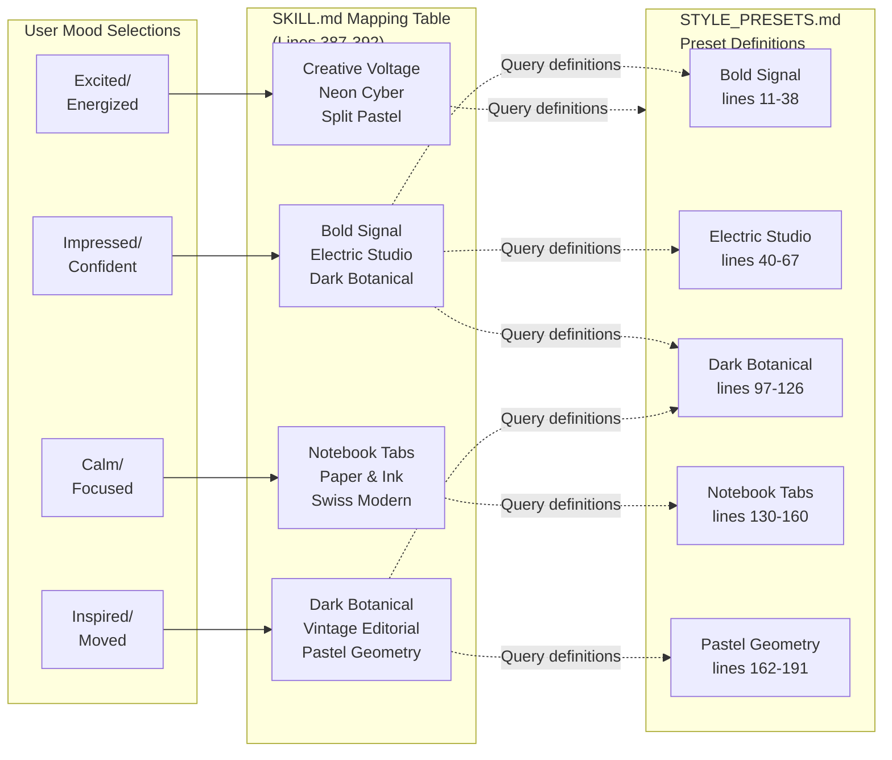

<!-- source: DeepWiki mcp.deepwiki.com · repo zarazhangrui/frontend-slides · extra page Phase 2: Style Discovery · fetched 2026-10-26 -->

# Phase 2: Style Discovery

<details>
<summary>Relevant source files</summary>

The following files were used as context for generating this wiki page:

- [LICENSE](LICENSE)
- [SKILL.md](SKILL.md)
- [STYLE_PRESETS.md](STYLE_PRESETS.md)

</details>


## Purpose and Scope

Phase 2: Style Discovery is the visual exploration phase where users select the aesthetic style for their presentation. This phase implements the "show, don't tell" design philosophy by generating visual previews rather than asking abstract questions about design preferences. 

This document covers the style selection workflow, mood-based discovery system, preview generation process, and the relationship between user preferences and the 12 curated presets and 34 bold templates. For information about the presets themselves, see [Style Presets Reference](#6). For content gathering that precedes this phase, see [Phase 1: Content Discovery](#4.1.2). For the HTML generation that follows, see [Phase 3: Presentation Generation](#4.1.4).

**Sources:** [SKILL.md:301-380](), [SKILL.md:13-16]()

---

## Style Selection Philosophy

Phase 2 embodies the core principle that users cannot articulate design preferences abstractly. Rather than asking "do you want minimalist or bold?", the system generates concrete visual examples and lets users react to what they see.

### Three Selection Paths

The system provides three distinct workflows for choosing a style:

| Path | Method | Use Case |
|------|--------|----------|
| **Guided Discovery** (Default) | User answers mood questions → System generates 3 previews → User selects | Users who don't have a specific style in mind |
| **Direct Selection** | User requests preset by name → Skip to Phase 3 | Users who already know what they want |
| **Bold Template Discovery** | System queries `selection-index.json` → Shows previews → Loads full `design.md` | Users seeking high-end, professionally designed templates |

**Sources:** [SKILL.md:307-322](), [SKILL.md:15-16]()

---

## Workflow Architecture

### Phase 2 Decision Flow



**Diagram: Phase 2 Style Selection Decision Tree**

This diagram shows how users enter Phase 2 and follow one of three distinct paths to style selection, including the progressive disclosure model for Bold Templates.

**Sources:** [SKILL.md:338-380](), [SKILL.md:15-16]()

---

## Step 2.0: Style Path Selection

The first interaction in Phase 2 determines which workflow path to follow.

### AskUserQuestion Structure

```
Header: "Style"
Question: "How would you like to choose your presentation style?"
Options:
  - "Show me options" — Generate 3 previews based on my needs (recommended)
  - "I know what I want" — Let me pick from the preset list directly
  - "Bold Templates" — Choose from 34 high-end professional templates
```

**Sources:** [SKILL.md:338-362]()

---

## Step 2.1: Mood Selection (Guided Discovery)

When users choose the guided discovery path, the system asks about the desired emotional impact rather than visual characteristics.

### Mood Question Structure

```
Header: "Vibe"
Question: "What feeling should the audience have when viewing your slides?"
Options:
  - "Impressed/Confident" — Professional, trustworthy, this team knows what they're doing
  - "Excited/Energized" — Innovative, bold, this is the future
  - "Calm/Focused" — Clear, thoughtful, easy to follow
  - "Inspired/Moved" — Emotional, storytelling, memorable
multiSelect: true (up to 2 selections)
```

**Sources:** [SKILL.md:365-374]()

---

## Step 2.2: Mood-to-Style Mapping

### Mapping Logic



**Diagram: Mood-to-Style Preset Mapping System**

The mood mapping table in `SKILL.md` acts as a router that selects which preset definitions from `STYLE_PRESETS.md` to instantiate as previews.

**Sources:** [SKILL.md:380](), [STYLE_PRESETS.md:11-191]()

---

## Bold Template Selection Process

For users choosing "Bold Templates," the system utilizes a **Progressive Disclosure** model to minimize token usage while offering high-quality designs.

### Selection Steps:
1. **Index Search**: The agent reads `bold-template-pack/selection-index.json` to find templates matching the user's mood, tone, and formality.
2. **Preview Cards**: The agent reads only the `preview.md` file for the top 3-5 candidates. This file contains a short description and a text-based "preview card" of the aesthetic.
3. **User Selection**: The user selects a template based on the preview cards.
4. **Recipe Loading**: Only after selection does the agent read the full `design.md` (the "design recipe") which contains the full CSS tokens and component grammar.

**Sources:** [SKILL.md:15-16]()

---

## Preview Generation Process

### Preview Generation Requirements

Each preview is a minimal HTML file demonstrating the aesthetic. The previews serve as visual "samples" that users can view in their browser.

#### Preview File Specifications

| Attribute | Requirement |
|-----------|-------------|
| **File Size** | ~50-100 lines of HTML |
| **Architecture** | Self-contained (inline CSS/JS) |
| **Content** | Single "title slide" showing aesthetic |
| **Location** | `.claude-design/slide-previews/` |

**Sources:** [SKILL.md:376-380]()

---

## Preview Generation Anti-Patterns

The system explicitly forbids "AI slop" aesthetics to maintain high-quality, distinctive design.

### Forbidden Generic Patterns:
- Purple gradients on white backgrounds.
- Generic font families like Inter, Roboto, or Arial.
- Standard blue primary colors (#6366f1).
- Cookie-cutter design that lacks context-specific character.

**Sources:** [SKILL.md:29-36](), [STYLE_PRESETS.md:3]()

---

## Step 2.3: Present Previews to User

### Final Selection Question

```
Header: "Style"
Question: "Which style preview do you prefer?"
Options:
  - "Style A: [Name]" — [Brief description]
  - "Style B: [Name]" — [Brief description]
  - "Style C: [Name]" — [Brief description]
  - "Mix elements" — Combine aspects from different styles
```

If the user selects "Mix elements", the system asks for specifics about which aspects they want to combine before proceeding to Phase 3.

**Sources:** [SKILL.md:380]()

---

## Phase 2 Exit Conditions

Phase 2 completes when:
1. **Guided Path:** User selects one of the three generated previews.
2. **Direct Path:** User selects a preset by name.
3. **Bold Path:** User selects a template and the agent has loaded the full `design.md` recipe.

### Data Passed to Phase 3:
- **Selected preset/template name**.
- **Full design tokens** (colors, typography, spacing).
- **Component grammar** (specific layout rules for the chosen style).
- **Animation patterns** (entrance and background effects).

**Sources:** [SKILL.md:380](), [SKILL.md:15-16]()

---

