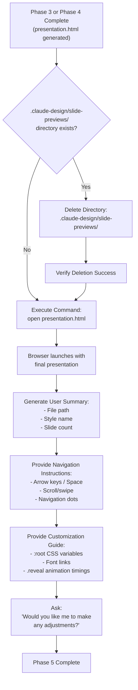
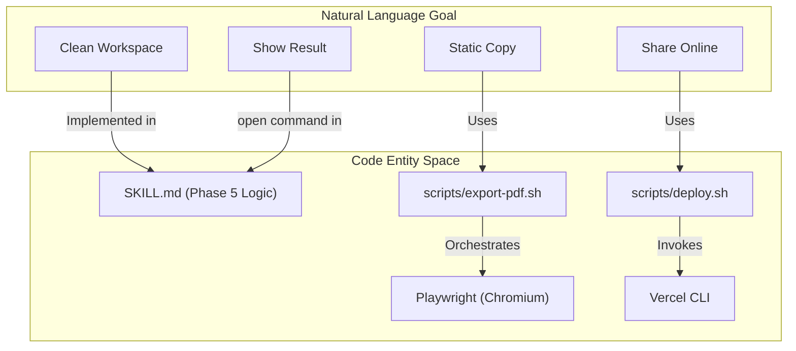

<!-- source: DeepWiki mcp.deepwiki.com · repo zarazhangrui/frontend-slides · extra page Phase 5: Delivery & Cleanup · fetched 2026-10-26 -->

# Phase 5: Delivery & Cleanup

<details>
<summary>Relevant source files</summary>

The following files were used as context for generating this wiki page:

- [plugins/frontend-slides/skills/frontend-slides/scripts/deploy.sh](plugins/frontend-slides/skills/frontend-slides/scripts/deploy.sh)
- [scripts/deploy.sh](scripts/deploy.sh)
- [scripts/export-pdf.sh](scripts/export-pdf.sh)

</details>


## Purpose and Scope

This document describes the final phase of the `frontend-slides` workflow pipeline, where the system completes the presentation generation process by cleaning up temporary artifacts, launching the final output, and communicating usage instructions to the user. This phase executes after Phase 3 (Presentation Generation) for new presentations, or after Phase 4 (PPT Conversion Pipeline) for PowerPoint conversions. It also covers post-generation utility scripts for deployment and PDF export.

For information about the preceding phases, see:
- Phase 0: Mode Detection [4.1.1]()
- Phase 1: Content Discovery [4.1.2]()
- Phase 2: Style Discovery [4.1.3]()
- Phase 3: Presentation Generation [4.1.4]()
- Phase 4: PPT Conversion Pipeline [4.1.5]()

**Sources:** [SKILL.md:380]()

---

## Overview

Phase 5 performs three sequential operations to finalize the presentation delivery:

| Step | Operation | Purpose |
|------|-----------|---------|
| 1 | Temporary file cleanup | Remove `.claude-design/slide-previews/` directory and all preview HTML files |
| 2 | Browser launch | Execute `open [filename].html` command to display presentation |
| 3 | User communication | Provide structured summary with navigation instructions and customization guidance |

This phase ensures a clean working directory state and provides the user with immediate access to their completed presentation along with comprehensive usage documentation.

**Sources:** [SKILL.md:380]()

---

## Phase 5 Workflow



**Sources:** [SKILL.md:380]()

---

## Temporary File Cleanup

### Preview Directory Structure

During Phase 2 (Style Discovery), the system creates temporary preview files in a specific directory structure:

```
.claude-design/
└── slide-previews/
    ├── style-a.html
    ├── style-b.html
    ├── style-c.html
    └── assets/        # Optional shared assets
```

These files serve only for visual style selection and must be removed after the user makes their choice to prevent workspace clutter and potential confusion between preview files and the final presentation.

**Sources:** [SKILL.md:380](), [SKILL.md:380]()

### Cleanup Operation

The cleanup operation removes the entire `.claude-design/slide-previews/` directory and all its contents. This operation is conditional; for users who selected a preset directly via Option B (Direct Selection) in Phase 2, no previews are generated and this step is skipped.

**Sources:** [SKILL.md:380](), [SKILL.md:380](), [SKILL.md:311-362]()

---

## Delivery Utilities

Beyond the automated cleanup and launch, the codebase provides two primary delivery scripts for sharing and archiving: `deploy.sh` and `export-pdf.sh`.

### Vercel Deployment (`deploy.sh`)

The `scripts/deploy.sh` script automates the process of hosting a presentation on Vercel.

1.  **Input Handling**: Accepts a directory or a single HTML file [scripts/deploy.sh:5-9]().
2.  **Asset Bundling**: If a single HTML file is provided, the script parses the HTML for local references (src, href, url) and copies them into a temporary deployment directory [scripts/deploy.sh:48-67]().
3.  **Sanitization**: Project names are sanitized for Vercel (lowercase, hyphens for special characters, 100 char limit) [scripts/deploy.sh:175-178]().
4.  **Deployment**: Uses `vercel deploy --prod` to generate a permanent public URL [scripts/deploy.sh:188]().

**Sources:** [scripts/deploy.sh:1-210]()

### PDF Export (`export-pdf.sh`)

The `scripts/export-pdf.sh` script converts the interactive HTML presentation into a static PDF.

1.  **Local Server**: Starts a temporary HTTP server using Node.js `http.createServer` to ensure fonts and relative assets load correctly [scripts/export-pdf.sh:149-187]().
2.  **Playwright Automation**: Launches a headless Chromium browser via Playwright [scripts/export-pdf.sh:193-196]().
3.  **Slide Capture**: Navigates to the presentation, counts `.slide` elements, and takes screenshots of each slide at 1920x1080 (or 1280x720 in `--compact` mode) [scripts/export-pdf.sh:208-226]().
4.  **PDF Assembly**: Combines individual PNG screenshots into a single PDF file using a generated Node.js script [scripts/export-pdf.sh:127-145]().

**Sources:** [scripts/export-pdf.sh:1-226]()

---

## User Communication & Summary

Phase 5 generates a standardized message template to communicate the delivery status and provide essential information.

### Message Template

The exact message format as defined in `SKILL.md`:

```markdown
Your presentation is ready!

📁 File: [filename].html
🎨 Style: [Style Name]
📊 Slides: [count]

**Navigation:**
- Arrow keys (← →) or Space to navigate
- Scroll/swipe also works
- Click the dots on the right to jump to a slide

**To customize:**
- Colors: Look for :root CSS variables at the top
- Fonts: Change the Fontshare/Google Fonts link
- Animations: Modify .reveal class timings

Would you like me to make any adjustments?
```

**Sources:** [SKILL.md:380]()

---

## Delivery Logic Association

This diagram bridges the natural language delivery requirements to the specific script entities responsible for them.



**Sources:** [SKILL.md:380](), [scripts/deploy.sh:1-15](), [scripts/export-pdf.sh:11-18]()

---

## Post-Delivery Support

Phase 5 concludes with an open-ended prompt that enables iterative refinement. This initiates a potential loop where users can request modifications to the delivered presentation.

| Request Type | Example | Re-Entry Phase |
|--------------|---------|----------------|
| Style changes | "Make it darker" | Phase 3 (Regeneration) |
| Content edits | "Add a slide about X" | Phase 3 (Regeneration) |
| Animation tweaks | "Make animations faster" | Phase 3 (CSS edit) |

**Sources:** [SKILL.md:380](), [SKILL.md:380]()

---

