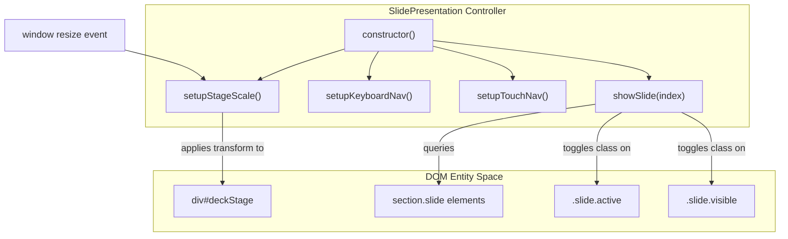
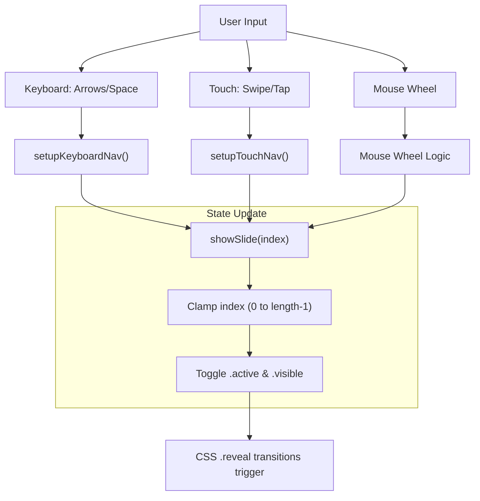

<!-- source: DeepWiki mcp.deepwiki.com · repo zarazhangrui/frontend-slides · extra page SlidePresentation Controller Class · fetched 2026-10-26 -->

# SlidePresentation Controller Class

<details>
<summary>Relevant source files</summary>

The following files were used as context for generating this wiki page:

- [html-template.md](html-template.md)
- [plugins/frontend-slides/skills/frontend-slides/html-template.md](plugins/frontend-slides/skills/frontend-slides/html-template.md)

</details>


## Purpose and Scope

This page documents the `SlidePresentation` JavaScript class, which serves as the main controller for all navigation, interaction, and state management in generated HTML presentations. The class is responsible for handling user input (keyboard, touch, mouse wheel), managing slide state, and coordinating with the animation system. It also manages the 16:9 stage scaling system that ensures presentations fit any viewport without reflowing content.

**Sources:** [html-template.md:103-143](), [plugins/frontend-slides/skills/frontend-slides/html-template.md:103-143]()

---

## Class Responsibilities

The `SlidePresentation` class is instantiated once per presentation and manages the following core responsibilities:

| Responsibility | Description |
|----------------|-------------|
| **Stage Scaling** | Maintains fixed 16:9 aspect ratio via CSS transforms |
| **Keyboard Navigation** | Arrow keys, Space, Page Up/Down for slide traversal |
| **Touch Navigation** | Swipe gestures on touch devices for mobile support |
| **Mouse Wheel Navigation** | Scroll wheel events for quick navigation |
| **Slide State** | Toggles `.active` and `.visible` classes for animations |
| **Responsive Handling** | Re-calculates stage scale on window resize events |

**Sources:** [html-template.md:148-162](), [plugins/frontend-slides/skills/frontend-slides/html-template.md:148-162]()

---

## Class Architecture

The following diagram maps the class methods to the physical DOM entities they manipulate within the `html-template.md` structure.



**Diagram: SlidePresentation class method relationships and DOM associations**

**Sources:** [html-template.md:103-112](), [html-template.md:114-123](), [html-template.md:133-139]()

---

## Initialization and Stage Scaling

The `SlidePresentation` class is instantiated at the end of the presentation HTML file. A critical feature is the `setupStageScale` method, which enforces a fixed 16:9 stage model (1920×1080).

### Stage Scaling Logic

The controller calculates a scale factor based on the browser's current dimensions and applies a `translate` and `scale` transform to the `#deckStage` element. This ensures the presentation is letterboxed or pillarboxed rather than reflowing.

```javascript
setupStageScale() {
    const scale = () => {
        const factor = Math.min(window.innerWidth / 1920, window.innerHeight / 1080);
        const x = (window.innerWidth - 1920 * factor) / 2;
        const y = (window.innerHeight - 1080 * factor) / 2;
        this.stage.style.transform = `translate(${x}px, ${y}px) scale(${factor})`;
    };
    scale();
    window.addEventListener('resize', scale);
}
```

**Sources:** [html-template.md:114-123](), [html-template.md:158-162]()

---

## Navigation Event Flow

The controller translates various user inputs into a single `showSlide(index)` call, which manages the application of state classes.



**Diagram: Input to state transition flow**

**Sources:** [html-template.md:109-111](), [html-template.md:133-139]()

---

### Keyboard Navigation

The controller is required to support standard presentation keys. While the implementation is often simplified in the template, the specification requires:

| Key(s) | Action |
|--------|--------|
| `ArrowRight`, `Space`, `PageDown` | Next slide |
| `ArrowLeft`, `PageUp` | Previous slide |
| `Home` | Jump to first slide |
| `End` | Jump to last slide |

**Sources:** [html-template.md:125-127](), [html-template.md:153]()

---

### Touch and Wheel Navigation

- **Touch Support:** Implementations include swipe detection to allow mobile users to navigate by horizontal dragging.
- **Mouse Wheel:** The controller uses wheel delta detection to navigate slides. To prevent "scrolling through the whole deck," this is typically throttled or tied to significant delta thresholds.

**Sources:** [html-template.md:129-131](), [html-template.md:154-155]()

---

## Core State Management: showSlide

The `showSlide(index)` method is the central state manager. It performs two primary actions:
1. **Clamping:** Ensures the `currentSlide` index never goes out of bounds.
2. **Class Coordination:** Toggles classes that the CSS uses for visibility and animation triggering.

```javascript
showSlide(index) {
    this.currentSlide = Math.max(0, Math.min(index, this.slides.length - 1));
    this.slides.forEach((slide, i) => {
        slide.classList.toggle('active', i === this.currentSlide);
        slide.classList.toggle('visible', i === this.currentSlide);
    });
}
```

- **`.active`**: Used for layout visibility (e.g., `display: block` or `opacity: 1`).
- **`.visible`**: Used as a hook for entrance animations defined via the `.reveal` class.

**Sources:** [html-template.md:133-139](), [html-template.md:59-69]()

---

## Inline Editing Integration

The controller also coordinates with the **Inline Editing** system. Unlike standard navigation, editing controls are revealed via a JS-based hover with a 400ms delay to avoid pointer-event failures.

### Edit Mode Controller Logic
- **Activation:** Triggered by the `E` key or hovering over the `.edit-hotzone`.
- **Functionality:** Toggles `contentEditable` on slide elements and manages `localStorage` persistence.

**Sources:** [html-template.md:171-184]()

---

## Complete Class API Reference

### Constructor
**Signature:** `constructor()`
Initializes DOM references for `.slide` and `#deckStage`, then invokes setup methods for scaling and navigation listeners.

### Methods

| Method | Parameters | Description |
|--------|------------|-------------|
| `setupStageScale()` | None | Attaches resize listener and calculates 16:9 CSS transform. |
| `setupKeyboardNav()` | None | Attaches `keydown` listeners for presentation control. |
| `setupTouchNav()` | None | Attaches `touchstart/end` listeners for swipe detection. |
| `showSlide(index)` | `number` | The primary state updater. Clamps index and toggles CSS classes. |

**Sources:** [html-template.md:103-140]()

---

