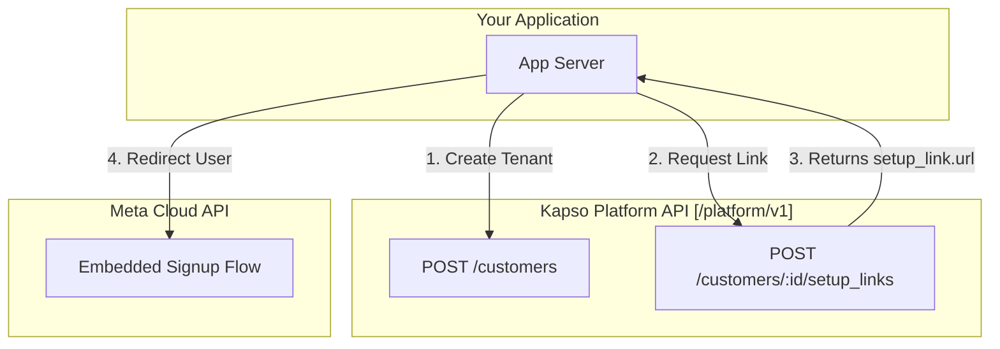
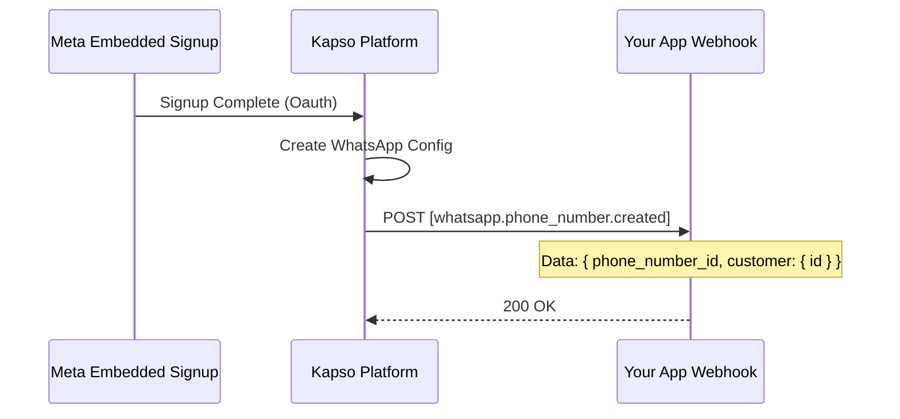

<!-- source: DeepWiki mcp.deepwiki.com · repo gokapso/agent-skills · page 2.1 Customer Onboarding & Setup Links · fetched 2026-10-26 -->

# Customer Onboarding & Setup Links

<details>
<summary>Relevant source files</summary>

The following files were used as context for generating this wiki page:

- [skills/integrate-whatsapp/references/detecting-whatsapp-connection.md](skills/integrate-whatsapp/references/detecting-whatsapp-connection.md)
- [skills/integrate-whatsapp/references/platform-api-reference.md](skills/integrate-whatsapp/references/platform-api-reference.md)
- [skills/integrate-whatsapp/references/setup-links.md](skills/integrate-whatsapp/references/setup-links.md)
- [skills/integrate-whatsapp/references/whatsapp-cloud-api-js.md](skills/integrate-whatsapp/references/whatsapp-cloud-api-js.md)

</details>


The Kapso platform enables multi-tenant WhatsApp integration, allowing your customers to connect their own WhatsApp Business Accounts (WABA) to your application. This process is powered by **Setup Links**, which wrap Meta's Embedded Signup flow into a customizable, hosted experience.

### Onboarding Lifecycle

The onboarding flow follows a standard sequence:
1.  **Customer Creation**: Establish a `customer` entity in the Kapso platform.
2.  **Link Generation**: Generate a unique `setup_link` for that customer.
3.  **Embedded Signup**: The customer completes the Meta OAuth flow.
4.  **Connection Detection**: Your system detects completion via webhooks or URL redirects.
5.  **Provisioning (Optional)**: Kapso automatically assigns a phone number to the new WABA.

---

### 1. Creating Customers and Setup Links

Before a customer can connect WhatsApp, they must exist as a `customer` resource. This allows Kapso to isolate WABAs, phone numbers, and message history per tenant [skills/integrate-whatsapp/references/platform-api-reference.md:20-22]().

#### Data Flow: Setup Link Generation
This diagram bridges the high-level onboarding request to the specific Platform API entities.

Title: Customer Onboarding Data Flow

**Sources:** [skills/integrate-whatsapp/references/platform-api-reference.md:30-36](), [skills/integrate-whatsapp/references/setup-links.md:198-231]()

#### Implementation Example
To generate a setup link, call the `/setup_links` endpoint for a specific `customer_id` [skills/integrate-whatsapp/references/setup-links.md:13-21]().

```javascript
// Example implementation for generating a setup link
const response = await fetch(`${KAPSO_API_BASE_URL}/platform/v1/customers/${customerId}/setup_links`, {
  method: 'POST',
  headers: { 'X-API-Key': process.env.KAPSO_API_KEY, 'Content-Type': 'application/json' },
  body: JSON.stringify({
    setup_link: {
      success_redirect_url: 'https://app.com/callback/success',
      failure_redirect_url: 'https://app.com/callback/error',
      allowed_connection_types: ['dedicated'],
      provision_phone_number: true
    }
  })
});
```
**Sources:** [skills/integrate-whatsapp/references/setup-links.md:198-224]()

---

### 2. Connection Types & Provisioning

Kapso supports two distinct connection models for WhatsApp. The `allowed_connection_types` array in the setup link configuration controls which options the customer sees [skills/integrate-whatsapp/references/setup-links.md:95-124]().

| Connection Type | Throughput | App Access | Best Use Case |
| :--- | :--- | :--- | :--- |
| **Coexistence** | 5 msg/sec | Yes (WA Business App) | Small businesses, manual support |
| **Dedicated** | 1000 msg/sec | No (API Only) | High-volume automation, AI agents |

**Sources:** [skills/integrate-whatsapp/references/setup-links.md:28-40]()

#### Phone Number Provisioning
If `provision_phone_number` is set to `true`, Kapso will automatically purchase and assign a phone number to the customer's WABA upon successful signup [skills/integrate-whatsapp/references/setup-links.md:149-160](). 
*   **Default**: US numbers (`["US"]`).
*   **Constraint**: If `reconnect_phone_number` is used, provisioning is forced to `false` [skills/integrate-whatsapp/references/setup-links.md:190-191]().

---

### 3. Detecting Connections

Once the customer completes the Meta flow, you must capture the resulting `phone_number_id`.

#### Method A: Project Webhooks (Recommended)
Configure a webhook for the `whatsapp.phone_number.created` event. This is the most reliable method for backend synchronization [skills/integrate-whatsapp/references/detecting-whatsapp-connection.md:8-11]().

Title: Webhook Connection Detection

**Sources:** [skills/integrate-whatsapp/references/detecting-whatsapp-connection.md:21-33]()

#### Method B: Success Redirect
The customer is redirected to your `success_redirect_url` with query parameters containing the connection details [skills/integrate-whatsapp/references/detecting-whatsapp-connection.md:61-63]().

**Key Query Parameters:**
*   `phone_number_id`: The primary identifier for sending messages [skills/integrate-whatsapp/references/detecting-whatsapp-connection.md:97-97]().
*   `display_phone_number`: The E.164 formatted number [skills/integrate-whatsapp/references/detecting-whatsapp-connection.md:100-100]().
*   `status`: Will be `completed` [skills/integrate-whatsapp/references/detecting-whatsapp-connection.md:96-96]().

---

### 4. Error Handling & Reconnection

#### Onboarding Errors
If setup fails, the user is sent to the `failure_redirect_url` with an `error_code` [skills/integrate-whatsapp/references/detecting-whatsapp-connection.md:135-142]().

| Error Code | Meaning |
| :--- | :--- |
| `facebook_auth_failed` | User cancelled the Facebook login popup |
| `phone_verification_failed` | The number provided failed Meta's OTP check |
| `link_expired` | The 30-day link validity period has passed |
| `already_used` | The setup link has already been completed |

**Sources:** [skills/integrate-whatsapp/references/detecting-whatsapp-connection.md:143-149]()

#### Reconnecting Existing Numbers
If a customer's token is revoked or they change their Meta password, you can generate a "refresh" link using the `reconnect_phone_number` field [skills/integrate-whatsapp/references/setup-links.md:176-186]().
*   **Behavior**: Forces the customer to select the specific existing number during signup.
*   **Validation**: Fails if the customer selects a different WABA or number than the one specified [skills/integrate-whatsapp/references/setup-links.md:192-192]().

**Sources:** [skills/integrate-whatsapp/references/setup-links.md:188-194]()

---

