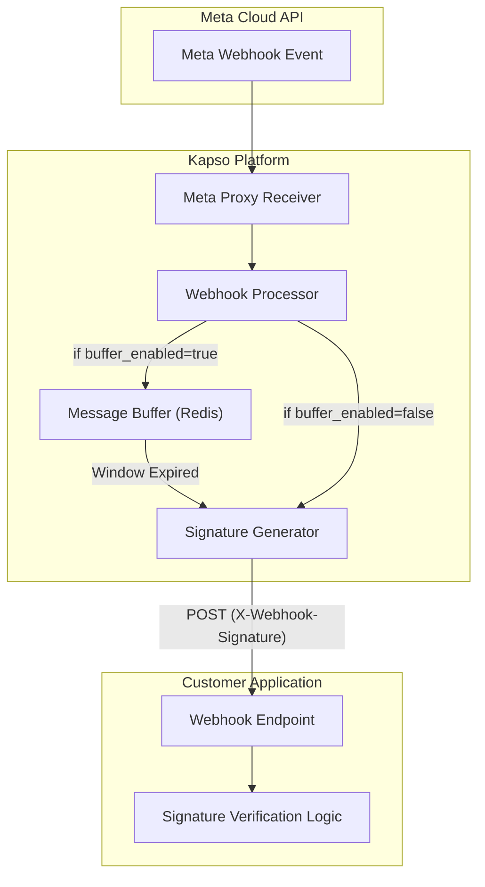
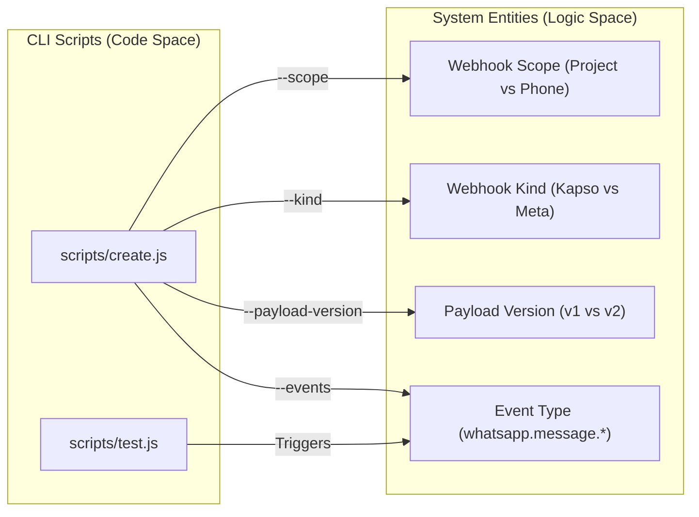

<!-- source: DeepWiki mcp.deepwiki.com · repo gokapso/agent-skills · page 2.4 Webhooks: Events, Delivery & Verification · fetched 2026-10-26 -->

# Webhooks: Events, Delivery & Verification

<details>
<summary>Relevant source files</summary>

The following files were used as context for generating this wiki page:

- [skills/integrate-whatsapp/SKILL.md](skills/integrate-whatsapp/SKILL.md)
- [skills/integrate-whatsapp/references/webhooks-event-types.md](skills/integrate-whatsapp/references/webhooks-event-types.md)
- [skills/integrate-whatsapp/references/webhooks-overview.md](skills/integrate-whatsapp/references/webhooks-overview.md)
- [skills/integrate-whatsapp/references/webhooks-reference.md](skills/integrate-whatsapp/references/webhooks-reference.md)

</details>


The Kapso webhook system provides real-time event notifications for WhatsApp interactions, connection lifecycles, and automation workflows. It supports two distinct scopes (Project vs. Phone-number) and two delivery formats (Kapso Event-based vs. Raw Meta forwarding).

## Webhook Scopes & Kinds

Webhooks are partitioned by scope to ensure data isolation and efficient routing [skills/integrate-whatsapp/references/webhooks-reference.md:3-9]().

### Scopes
| Scope | Target Entity | Event Types |
|-------|---------------|-------------|
| **Project** | `project_id` | Lifecycle (`whatsapp.phone_number.created`) and Workflow events (`workflow.execution.*`) [skills/integrate-whatsapp/references/webhooks-overview.md:9-12](). |
| **Phone-number** | `phone_number_id` | Messaging (`whatsapp.message.*`) and Conversation (`whatsapp.conversation.*`) [skills/integrate-whatsapp/references/webhooks-overview.md:13-16](). |

### Delivery Kinds
*   **Kapso Webhooks (Default):** Provides enriched, event-based payloads, server-side filtering, message buffering, and signature verification [skills/integrate-whatsapp/references/webhooks-overview.md:20]().
*   **Meta Webhooks:** Forwards raw payloads directly from the Meta Graph API. Does not support Kapso filtering or buffering. Includes `X-Idempotency-Key` for deduplication [skills/integrate-whatsapp/references/webhooks-overview.md:21-23]().

### Configuration Parameters
Webhooks are managed via the Platform API or CLI scripts [skills/integrate-whatsapp/SKILL.md:86-88]().
*   `payload_version`: `v2` is recommended, placing `phone_number_id` at the root [skills/integrate-whatsapp/references/webhooks-reference.md:49]().
*   `active`: Boolean toggle to enable/disable delivery [skills/integrate-whatsapp/SKILL.md:98]().

## Event Catalog

### Project Lifecycle & Workflow Events
These events notify your system when infrastructure changes occur or when AI/Automation requires human intervention.

*   **`whatsapp.phone_number.created`**: Triggered after a successful Meta Embedded Signup via a Kapso setup link [skills/integrate-whatsapp/references/webhooks-event-types.md:20-22]().
*   **`workflow.execution.handoff`**: Triggered when a workflow agent tool or action step transfers a session to a human [skills/integrate-whatsapp/references/webhooks-event-types.md:40-42]().
*   **`workflow.execution.failed`**: Triggered on execution errors or timeouts [skills/integrate-whatsapp/references/webhooks-event-types.md:69-71]().

### WhatsApp Messaging Events
These events track the full lifecycle of a message [skills/integrate-whatsapp/references/webhooks-event-types.md:95-120]().
*   `whatsapp.message.received`: Inbound message from customer.
*   `whatsapp.message.sent`: Message accepted by Meta.
*   `whatsapp.message.delivered`: Reached recipient device.
*   `whatsapp.message.read`: Recipient opened message.
*   `whatsapp.message.failed`: Delivery failure (e.g., blocked, invalid number).

### Conversation & Inactivity Events
*   `whatsapp.conversation.created`: New 24-hour window started [skills/integrate-whatsapp/references/webhooks-event-types.md:121-122]().
*   `whatsapp.conversation.inactive`: Fired when no activity occurs for a configured duration (default 60 mins) [skills/integrate-whatsapp/references/webhooks-event-types.md:131-134]().
*   `whatsapp.conversation.ended`: Manual closure or 24-hour expiration [skills/integrate-whatsapp/references/webhooks-event-types.md:127-129]().

## Delivery Logic & Buffering

### Message Buffering
For `whatsapp.message.received` events, Kapso can buffer rapid-fire messages into a single batch to reduce endpoint pressure and preserve message order for LLM processing [skills/integrate-whatsapp/references/webhooks-reference.md:51-53]().

*   `buffer_enabled`: Set to `true` to enable.
*   `buffer_window_seconds`: 1-60 seconds [skills/integrate-whatsapp/SKILL.md:96]().
*   `max_buffer_size`: 1-100 messages [skills/integrate-whatsapp/SKILL.md:97]().

### Retry Schedule
If the target endpoint does not return a `200 OK` within 10 seconds, Kapso follows a fixed retry schedule [skills/integrate-whatsapp/references/webhooks-overview.md:27-33]():
1.  **Retry 1**: 10 seconds after failure.
2.  **Retry 2**: 40 seconds after failure.
3.  **Retry 3**: 90 seconds after failure.

## Signature Verification

To ensure requests originate from Kapso, every request includes an `X-Webhook-Signature` header [skills/integrate-whatsapp/references/webhooks-overview.md:39]().

**Verification Process:**
1.  Capture the **raw request body** as bytes (do not parse JSON first) [skills/integrate-whatsapp/references/webhooks-reference.md:17]().
2.  Retrieve your `webhook_secret_key` from the Kapso dashboard or CLI.
3.  Compute an `HMAC-SHA256` hash using the secret and raw body.
4.  Compare the hex-encoded result with the value in `X-Webhook-Signature` [skills/integrate-whatsapp/references/webhooks-overview.md:40-42]().

## Implementation Diagrams

### Webhook Event Flow: Meta to Application
This diagram maps the flow from the external Meta webhook to the Kapso processing layer and finally to the user's endpoint.


Sources: [skills/integrate-whatsapp/references/webhooks-overview.md](), [skills/integrate-whatsapp/references/webhooks-reference.md]()

### Code Entity Mapping: Webhook Management
Associating CLI scripts and parameters with the underlying system logic.


Sources: [skills/integrate-whatsapp/SKILL.md:86-103](), [skills/integrate-whatsapp/references/webhooks-event-types.md]()

## Payload Examples (v2)

### Message Received (Enriched)
[skills/integrate-whatsapp/references/webhooks-event-types.md:142-181]()
```json
{
  "message": {
    "id": "wamid.123",
    "type": "text",
    "text": { "body": "Hello" },
    "kapso": {
      "direction": "inbound",
      "status": "received",
      "content": "Hello"
    }
  },
  "conversation": {
    "id": "conv_123",
    "phone_number": "+15551234567",
    "phone_number_id": "123456789012345"
  },
  "phone_number_id": "123456789012345"
}
```

### Workflow Handoff
[skills/integrate-whatsapp/references/webhooks-event-types.md:46-62]()
```json
{
  "event": "workflow.execution.handoff",
  "project_id": "990e8400-e29b-41d4-a716-446655440004",
  "workflow_execution_id": "770e8400-e29b-41d4-a716-446655440002",
  "handoff": {
    "reason": "User requested human assistance",
    "source": "agent_tool"
  }
}
```

Sources:
* [skills/integrate-whatsapp/SKILL.md]()
* [skills/integrate-whatsapp/references/webhooks-overview.md]()
* [skills/integrate-whatsapp/references/webhooks-reference.md]()
* [skills/integrate-whatsapp/references/webhooks-event-types.md]()

---

