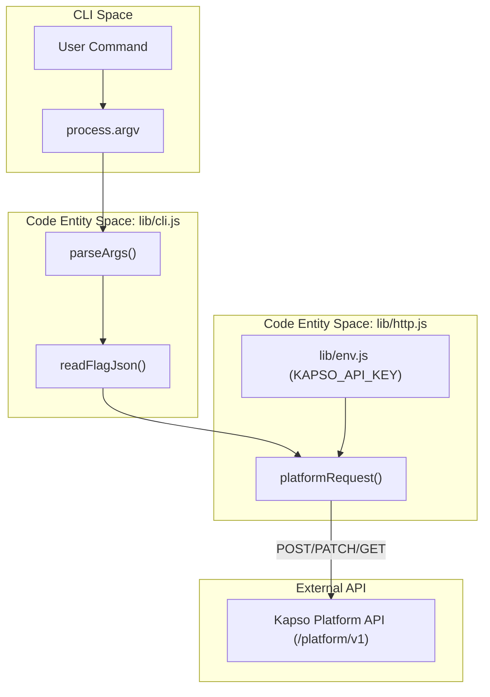
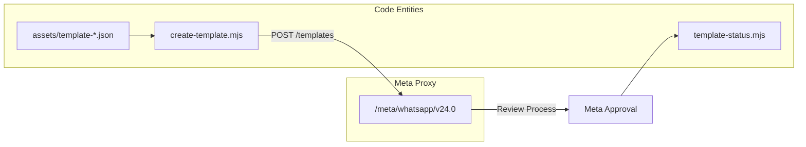

<!-- source: DeepWiki mcp.deepwiki.com · repo gokapso/agent-skills · page 2.5 Integrate WhatsApp Scripts Reference · fetched 2026-10-26 -->

# Integrate WhatsApp Scripts Reference

Relevant source files

The following files were used as context for generating this wiki page:

- [skills/integrate-whatsapp/SKILL.md](skills/integrate-whatsapp/SKILL.md)
- [skills/integrate-whatsapp/scripts/create-function.js](skills/integrate-whatsapp/scripts/create-function.js)
- [skills/integrate-whatsapp/scripts/lib/cli.js](skills/integrate-whatsapp/scripts/lib/cli.js)
- [skills/integrate-whatsapp/scripts/update-function.js](skills/integrate-whatsapp/scripts/update-function.js)

This page provides a comprehensive technical reference for the utility scripts located in `skills/integrate-whatsapp/scripts/`. These scripts serve as a fallback or automation layer for managing customers, WhatsApp templates, flows, and media when the Kapso CLI is not used directly.

## Shared Library Utilities

All scripts in this module rely on a set of common libraries located in `skills/integrate-whatsapp/scripts/lib/` to handle environment configuration, CLI argument parsing, and HTTP communication with the Kapso Platform API.

### CLI Parser (`lib/cli.js`)
The `lib/cli.js` utility provides robust parsing for command-line arguments. It supports string, boolean, numeric, and enum flags, as well as reading content from files when a `--*-file` flag is provided [skills/integrate-whatsapp/scripts/lib/cli.js:3-31]().

| Function | Description |
| :--- | :--- |
| `parseArgs` | Splits `process.argv` into `flags` (key-value) and `positionals` [skills/integrate-whatsapp/scripts/lib/cli.js:3-31](). |
| `requireStringFlag` | Retrieves a flag or throws an error if missing [skills/integrate-whatsapp/scripts/lib/cli.js:44-48](). |
| `getBooleanFlag` | Converts truthy/falsy strings (e.g., "yes", "0", "true") to booleans [skills/integrate-whatsapp/scripts/lib/cli.js:50-58](). |
| `readFlagText` | Reads content either directly from a flag or from a file path provided in a companion flag [skills/integrate-whatsapp/scripts/lib/cli.js:76-89](). |

### HTTP Client (`lib/http.js`)
The `platformRequest` function is the primary interface for communicating with the Kapso Platform API. It automatically injects the `X-API-Key` from the environment and handles JSON serialization.

**Data Flow: Script to API**
The following diagram illustrates how a script utilizes the library utilities to execute a command against the Platform API.

Title: Script Execution Data Flow

**Sources:** [skills/integrate-whatsapp/scripts/lib/cli.js:3-106](), [skills/integrate-whatsapp/scripts/lib/http.js:1-12]()

---

## Customer Management

These scripts manage the `customer` entity, which is the root container for WhatsApp Business Accounts (WABA) and phone numbers in a multi-tenant environment [skills/integrate-whatsapp/SKILL.md:45-51]().

*   **`create.js`**: Creates a new customer. Requires `--name`. Optionally accepts `--external-id` to map the Kapso customer to your internal database ID.
*   **`get.js`**: Retrieves a single customer by ID.
*   **`list.js`**: Lists all customers within the project.
*   **`delete.js`**: Removes a customer entity.

**Sources:** [skills/integrate-whatsapp/SKILL.md:38-40](), [skills/integrate-whatsapp/SKILL.md:47-48]()

---

## WhatsApp Template Management

Templates must be created and approved by Meta before they can be sent to users outside of a 24-hour session window [skills/integrate-whatsapp/SKILL.md:170-172]().

### Script Reference
*   **`create-template.mjs`**: Submits a new template definition to Meta. Requires `--business-account-id` and a JSON payload file via `--file` [skills/integrate-whatsapp/SKILL.md:166]().
*   **`submit-template.mjs`**: An alias or variation for submitting templates for approval.
*   **`update-template.mjs`**: Updates an existing template. Note that Meta has strict rules on what fields can be edited after approval.

### Template Lifecycle
Title: Template Management Workflow

**Sources:** [skills/integrate-whatsapp/SKILL.md:117](), [skills/integrate-whatsapp/SKILL.md:162-168]()

---

## WhatsApp Flow Management

Flows allow for rich, multi-screen interactions within WhatsApp. These scripts manage the Flow definition and its lifecycle [skills/integrate-whatsapp/SKILL.md:3-4]().

*   **`create-flow.js`**: Registers a new Flow container with Meta.
*   **`update-flow-json.js`**: Updates the Flow's JSON layout (screens, components, and data requirements).
*   **`publish-flow.js`**: Transitions a Flow from `DRAFT` to `PUBLISHED` status, making it available for use in messages.

**Sources:** [skills/integrate-whatsapp/SKILL.md:3-4]()

---

## Serverless Function Management

Functions are used as data endpoints for WhatsApp Flows or as custom logic nodes in automations.

### `create-function.js`
Creates a new serverless function.
*   **Flags**:
    *   `--name`: (Required) Name of the function [skills/integrate-whatsapp/scripts/create-function.js:15]().
    *   `--code` or `--code-file`: (Required) The JavaScript source code [skills/integrate-whatsapp/scripts/create-function.js:16-21]().
    *   `--runtime-config-file`: JSON configuration for environment variables or secrets [skills/integrate-whatsapp/scripts/create-function.js:22]().
    *   `--public-endpoint`: Boolean. If true, the function can be invoked via a public URL [skills/integrate-whatsapp/scripts/create-function.js:23]().

### `update-function.js`
Updates an existing function's code or configuration.
*   **Flags**:
    *   `--function-id`: (Required) The UUID of the function to update [skills/integrate-whatsapp/scripts/update-function.js:16]().
    *   `--invoke-response-mode`: Either `passthrough` (raw response) or `wrapped` (Kapso standard envelope) [skills/integrate-whatsapp/scripts/update-function.js:25]().

**Sources:** [skills/integrate-whatsapp/scripts/create-function.js:1-43](), [skills/integrate-whatsapp/scripts/update-function.js:1-48]()

---

## Media and Messaging

*   **`media-upload.js`**: Uploads files (images, documents) to Meta's servers to obtain a `media_id` for use in messages.
*   **`send-template.mjs`**: Sends a pre-approved template message to a specific recipient [skills/integrate-whatsapp/SKILL.md:168]().
*   **`send-interactive.mjs`**: Sends interactive messages (Buttons, Lists, Flows) using a JSON payload [skills/integrate-whatsapp/SKILL.md:176]().

**Sources:** [skills/integrate-whatsapp/SKILL.md:118](), [skills/integrate-whatsapp/SKILL.md:168-176]()

---

