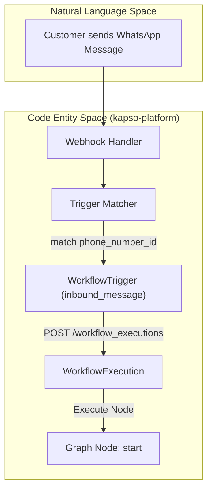
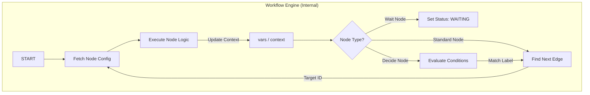

<!-- source: DeepWiki mcp.deepwiki.com · repo gokapso/agent-skills · page 3.1 Workflow Concepts & Execution Model · fetched 2026-10-26 -->

# Workflow Concepts & Execution Model

<details>
<summary>Relevant source files</summary>

The following files were used as context for generating this wiki page:

- [skills/automate-whatsapp/SKILL.md](skills/automate-whatsapp/SKILL.md)
- [skills/automate-whatsapp/references/triggers.md](skills/automate-whatsapp/references/triggers.md)
- [skills/automate-whatsapp/references/workflow-reference.md](skills/automate-whatsapp/references/workflow-reference.md)

</details>


The Kapso workflow engine is a directed graph-based system designed for automating WhatsApp interactions and backend logic. It separates the execution logic (the graph) from the entry points (triggers) and maintains a persistent state for every interaction.

## Core Execution Model

The engine operates on a directed graph where each **Node** represents a specific action or state, and **Edges** define the transition logic between them [skills/automate-whatsapp/references/workflow-reference.md:74-85]().

### Execution States
Every workflow execution follows a lifecycle tracked by a status field.
*   **Running**: The engine is actively processing nodes in the graph.
*   **Waiting**: Execution is paused, typically by a `wait_for_response` node, awaiting an external event (e.g., a WhatsApp reply) [skills/automate-whatsapp/assets/workflow-decision.json:44-60]().
*   **Handoff**: Control has been transferred to a human agent or external system.
*   **Ended**: The execution reached a terminal state or completed all nodes.
*   **Failed**: An error occurred during node execution or function invocation.

### Directed Graph Model
*   **Start Node**: Every graph must contain exactly one node with `id: "start"` and `data.node_type: "start"` [skills/automate-whatsapp/SKILL.md:156-156](), [skills/automate-whatsapp/references/workflow-reference.md:96-96]().
*   **Edges**: Transitions are defined by `source`, `target`, and `label`. Non-decide nodes are restricted to a single outgoing edge [skills/automate-whatsapp/references/workflow-reference.md:99-99]().
*   **Decide Branching**: Logic branching occurs only at `decide` nodes, where the edge `label` must match the `conditions[].label` defined in the node configuration [skills/automate-whatsapp/SKILL.md:160-160]().

### Concurrency & Lock Versioning
To prevent race conditions during graph updates, the platform uses a `lock_version` optimistic concurrency model. When updating a graph via `PATCH /platform/v1/workflows/:id`, the request must include the `expected-lock-version`. If the remote version has changed since the last fetch, the update is rejected [skills/automate-whatsapp/SKILL.md:91-99](), [skills/automate-whatsapp/references/workflow-reference.md:76-76]().

## Trigger Types

Triggers are independent entities that initiate a workflow execution. They are managed separately from the graph definition [skills/automate-whatsapp/references/triggers.md:3-3]().

| Trigger Type | Description | Required Fields |
| :--- | :--- | :--- |
| `inbound_message` | Fires when a user sends a message to a specific WhatsApp number. | `phone_number_id` [skills/automate-whatsapp/references/triggers.md:6-6]() |
| `api_call` | Manual initiation via the Platform API. | None [skills/automate-whatsapp/references/triggers.md:20-20]() |
| `whatsapp_event` | Fires on specific WhatsApp lifecycle events (e.g., `whatsapp.message.failed`). | `event` [skills/automate-whatsapp/references/triggers.md:8-8]() |

### Code-to-Entity Mapping: Trigger Lifecycle
This diagram shows how a WhatsApp event is routed through the system to start a `WorkflowExecution`.


Sources: [skills/automate-whatsapp/references/triggers.md:5-9](), [skills/automate-whatsapp/references/workflow-reference.md:59-60]()

## Execution Context & Variables

The execution context is a JSON object that stores data throughout the lifecycle of a workflow. It is partitioned into four primary namespaces [skills/automate-whatsapp/SKILL.md:181-186]():

1.  **`vars`**: User-defined variables used for custom business logic (e.g., `vars.customer_name`).
2.  **`system`**: Internal engine variables (e.g., `system.now`).
3.  **`context`**: Channel-specific data, such as the sender's phone number or the incoming message text.
4.  **`metadata`**: Request-level metadata.

### Variable Interpolation Syntax
Variables are accessed using double curly braces: `{{namespace.path}}`.
*   Example: `Hello {{context.sender_name}}, your ID is {{vars.user_id}}`.
*   Interpolation is supported in `send_text` messages, `decide` node conditions, and function arguments.

## Execution Flow & Node Transition

The workflow engine processes nodes sequentially until it hits a `wait_for_response` node or a terminal state.

### Execution Engine Logic

Sources: [skills/automate-whatsapp/SKILL.md:154-163](), [skills/automate-whatsapp/references/workflow-reference.md:94-102]()

## Local Development & Source Sync

While the Platform API supports direct graph manipulation, the preferred method for managing workflows is the **Source Sync** model using the Kapso CLI and `@kapso/workflows` SDK [skills/automate-whatsapp/SKILL.md:14-17]().

1.  **`kapso pull`**: Downloads the remote graph and converts it to a local `workflow.js` or `workflow.ts` file.
2.  **`Workflow` Class**: Developers use the SDK to define nodes and edges programmatically.
3.  **`kapso push`**: Validates the local definition and updates the remote graph, handling the `lock_version` automatically [skills/automate-whatsapp/SKILL.md:69-73]().

### Example Workflow Definition (SDK)
```javascript
import { START, Workflow } from "@kapso/workflows";

const workflow = new Workflow("support-bot");

workflow.addNode(START, { position: { x: 0, y: 0 } });
workflow.addNode("greet", {
  type: "send_text",
  message: "Welcome to support!"
});
workflow.addEdge(START, "greet");

export default workflow;
```
Sources: [skills/automate-whatsapp/SKILL.md:40-65]()

---

