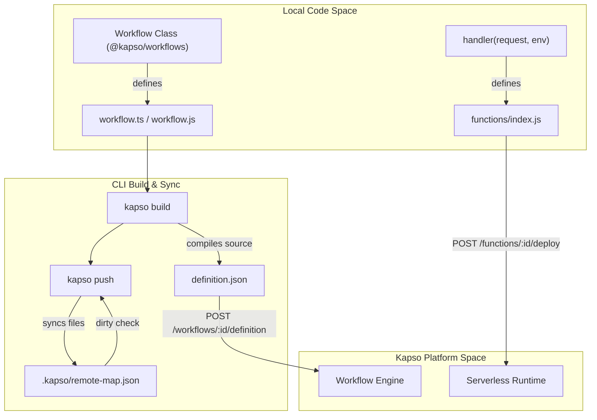
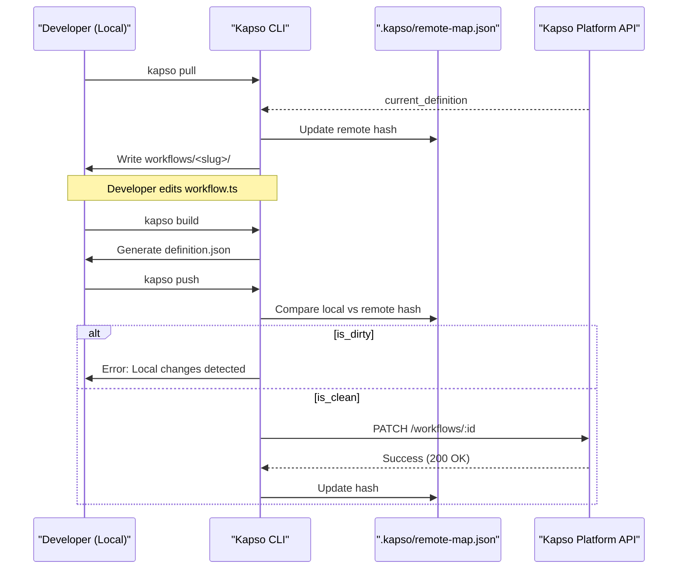

<!-- source: DeepWiki mcp.deepwiki.com · repo gokapso/agent-skills · page 3.3 Local Development with CLI & @kapso/workflows SDK · fetched 2026-10-26 -->

# Local Development with CLI & @kapso/workflows SDK

<details>
<summary>Relevant source files</summary>

The following files were used as context for generating this wiki page:

- [skills/automate-whatsapp/SKILL.md](skills/automate-whatsapp/SKILL.md)
- [skills/automate-whatsapp/references/local-workflow-source.md](skills/automate-whatsapp/references/local-workflow-source.md)

</details>


The Kapso platform provides a professional development workflow that bridges the gap between local source-controlled code and remote cloud execution. This system centers around the **Kapso CLI** for synchronization and the **@kapso/workflows SDK** for defining complex automation logic using TypeScript or JavaScript.

## CLI Synchronization Workflow

The Kapso CLI manages the lifecycle of workflows and functions by syncing local files with the Kapso Platform API. It enables a "Source of Truth" model where developers can author logic in their IDE, commit to Git, and deploy via a structured build process.

### Core Commands
The development lifecycle typically follows this sequence:

1.  **`kapso login`**: Authenticates the local environment with the Kapso Platform [[skills/automate-whatsapp/SKILL.md:15-15]]().
2.  **`kapso link --project <project-id>`**: Binds the current working directory to a specific Kapso project [[skills/automate-whatsapp/references/local-workflow-source.md:11-11]]().
3.  **`kapso pull`**: Downloads the remote project state into the local directory structure [[skills/automate-whatsapp/references/local-workflow-source.md:12-12]]().
4.  **`kapso build`**: Compiles local workflow source files (`.js` or `.ts`) into the standard `definition.json` format [[skills/automate-whatsapp/references/local-workflow-source.md:66-66]]().
5.  **`kapso push`**: Uploads changed functions and workflows to the Kapso cloud [[skills/automate-whatsapp/references/local-workflow-source.md:71-71]]().

### Local Directory Structure
When `kapso pull` is executed, it populates the following structure:

| Path | Description |
| :--- | :--- |
| `kapso.yaml` | Project-level configuration. |
| `.kapso/project.json` | Metadata about the linked project. |
| `.kapso/remote-map.json` | Stores the last pulled state to detect "dirty" files and stale updates [[skills/automate-whatsapp/references/local-workflow-source.md:28-28]](). |
| `functions/<slug>/` | Contains `index.js` (logic) and `function.yaml` (metadata) [[skills/automate-whatsapp/references/local-workflow-source.md:21-22]](). |
| `workflows/<slug>/` | Contains `workflow.js/ts` (source), `definition.json` (compiled graph), and `workflow.yaml` (metadata) [[skills/automate-whatsapp/references/local-workflow-source.md:23-25]](). |

**Sources:** [[skills/automate-whatsapp/references/local-workflow-source.md:17-28]]()

---

## The @kapso/workflows SDK

The SDK allows developers to define workflows programmatically rather than editing raw JSON graphs. It provides a `Workflow` class and helper constants to ensure graph integrity.

### Key Entities
*   **`Workflow` Class**: The main container for an automation. It accepts a slug and a configuration object (name, status) [[skills/automate-whatsapp/SKILL.md:43-46]]().
*   **`START` Constant**: A reserved identifier used to mark the entry point of the workflow graph [[skills/automate-whatsapp/SKILL.md:41-41]]().
*   **`addTrigger()`**: Configures how the workflow starts (e.g., `inbound_message`) [[skills/automate-whatsapp/SKILL.md:48-51]]().
*   **`addNode()`**: Adds a functional block (e.g., `send_text`, `agent`, `function`) to the graph [[skills/automate-whatsapp/SKILL.md:57-60]]().
*   **`addEdge()`**: Connects two nodes to define the execution flow [[skills/automate-whatsapp/SKILL.md:62-62]]().

### Example Workflow Authoring
```ts
import { START, Workflow } from "@kapso/workflows";

const workflow = new Workflow("inbound-support", {
  name: "Inbound Support",
  status: "draft",
});

workflow.addTrigger({
  type: "inbound_message",
  phoneNumberId: "phone-123",
});

workflow.addNode(START, { position: { x: 100, y: 100 } });
workflow.addNode("reply", {
  type: "send_text",
  message: "Hello from local SDK!",
});

workflow.addEdge(START, "reply");

export default workflow;
```
**Sources:** [[skills/automate-whatsapp/SKILL.md:40-65]](), [[skills/automate-whatsapp/references/local-workflow-source.md:34-59]]()

---

## Data Flow: Authoring to Deployment

The following diagram illustrates how the CLI and SDK transform high-level code into a deployed Kapso workflow.

### Code to Platform Mapping
"This diagram maps local code entities to their remote counterparts in the Kapso Platform."


**Sources:** [[skills/automate-whatsapp/references/local-workflow-source.md:63-74]](), [[skills/automate-whatsapp/SKILL.md:167-172]]()

---

## Synchronization & Safety Logic

To prevent accidental overwrites, the CLI implements a "dirty-file" check using the `remote-map.json` file.

### Pull Behavior
*   **Preservation**: `kapso pull` will not overwrite `workflow.js` or `workflow.ts` files if they exist, as these are considered user-authored source code [[skills/automate-whatsapp/references/local-workflow-source.md:77-77]]().
*   **Dirty Checks**: The CLI refuses to overwrite local versions of `workflow.yaml` or `definition.json` if they contain changes not yet synced to the remote [[skills/automate-whatsapp/references/local-workflow-source.md:79-79]]().
*   **Conflict Resolution**: Users can use `--diff` to inspect changes or `--overwrite` to force the local state to match the remote [[skills/automate-whatsapp/references/local-workflow-source.md:80-81]]().

### Workflow Lifecycle Diagram
"This diagram shows the lifecycle of a workflow definition from authoring to the remote execution environment."


**Sources:** [[skills/automate-whatsapp/references/local-workflow-source.md:28-28]](), [[skills/automate-whatsapp/references/local-workflow-source.md:75-82]]()

---

## Implementation Details

### The `remote-map.json`
The remote map is critical for multi-developer environments. It tracks the state of the project at the time of the last `pull`. If another developer pushes a change to the Kapso Platform, your local CLI will detect that your `remote-map.json` is out of sync with the current remote state, preventing you from overwriting their work [[skills/automate-whatsapp/references/local-workflow-source.md:28-28]]().

### Source vs. Compiled
*   **Source**: `workflow.js` or `workflow.ts`. This is where the `@kapso/workflows` SDK is used.
*   **Compiled**: `definition.json`. This is the raw JSON graph that the Kapso Workflow Engine actually executes.
*   **Metadata**: `workflow.yaml`. Contains non-graph settings like the workflow name and status [[skills/automate-whatsapp/references/local-workflow-source.md:23-25]]().

**Sources:** [[skills/automate-whatsapp/references/local-workflow-source.md:32-32]](), [[skills/automate-whatsapp/references/local-workflow-source.md:73-73]]()

---

