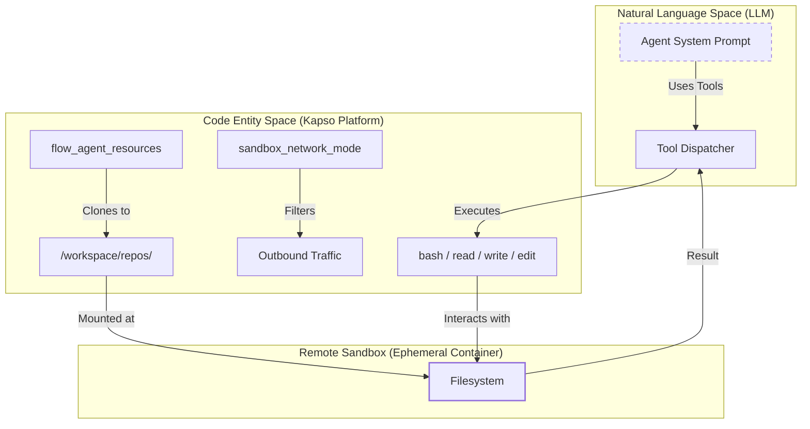
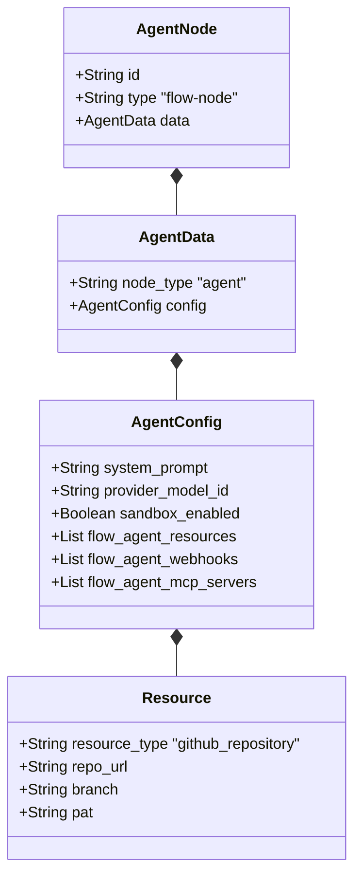

<!-- source: DeepWiki mcp.deepwiki.com · repo gokapso/agent-skills · page 3.5 Agent Nodes & Remote Sandbox · fetched 2026-10-26 -->

# Agent Nodes & Remote Sandbox

Relevant source files

The following files were used as context for generating this wiki page:

- [skills/automate-whatsapp/assets/agent-remote-sandbox-github-repo-example.json](skills/automate-whatsapp/assets/agent-remote-sandbox-github-repo-example.json)
- [skills/automate-whatsapp/references/agent-remote-sandbox.md](skills/automate-whatsapp/references/agent-remote-sandbox.md)
- [skills/automate-whatsapp/references/node-types.md](skills/automate-whatsapp/references/node-types.md)

Agent nodes represent the most advanced execution unit in the Kapso workflow engine. Unlike standard nodes that follow a fixed path, an agent node uses a Large Language Model (LLM) to dynamically decide which tools to call, how to process information, and when to transition to the next state. The **Remote Sandbox** extends this capability by providing an ephemeral, secure environment where the agent can execute code, inspect filesystems, and interact with cloned repositories.

## Agent Node Configuration

An agent node is defined within the workflow graph using the `agent` node type. Its behavior is governed by its `config` object, which includes model selection, prompts, and tool enablement.

### Core Attributes
*   **`provider_model_id`**: The UUID of the LLM provider. Must be retrieved via `list-provider-models.js` [skills/automate-whatsapp/references/node-types.md:239-248]().
*   **`system_prompt`**: The primary instructions for the agent, defining its persona and objectives [skills/automate-whatsapp/references/node-types.md:238]().
*   **`message_delivery_mode`**: Determines how the agent interacts with the end-user:
    *   `auto_send_assistant_text`: Standard LLM responses are automatically sent to the user as WhatsApp messages [skills/automate-whatsapp/references/node-types.md:242,251]().
    *   `tool_only`: LLM text remains internal. The agent must explicitly call the `send_notification_to_user` tool to communicate [skills/automate-whatsapp/references/node-types.md:252-253]().

### Default Tools
Kapso provides a suite of "Default Tools" that can be toggled on or off. These tools allow the agent to manipulate the workflow state and interact with the platform.

| Tool Name | Purpose |
| :--- | :--- |
| `complete_task` | Transitions the workflow to the next node in the graph (Required) [skills/automate-whatsapp/references/node-types.md:258](). |
| `handoff_to_human` | Moves the execution into a `handoff` state for manual intervention (Required) [skills/automate-whatsapp/references/node-types.md:259](). |
| `enter_waiting` | Pauses execution to wait for a user reply [skills/automate-whatsapp/references/node-types.md:260](). |
| `contact_conversations` | Allows the agent to list and read historical WhatsApp messages for the current contact [skills/automate-whatsapp/references/node-types.md:265,271](). |
| `save_variable` / `get_variable` | Persists or retrieves data from the workflow `vars` context [skills/automate-whatsapp/references/node-types.md:267-268](). |

### Custom Tools
Agents can be extended with external capabilities through three custom tool types located in the `data.config` of the node [skills/automate-whatsapp/references/node-types.md:279-281]():
1.  **Webhook Tools (`flow_agent_webhooks`)**: Define API calls with `body_schema` and `jmespath_query` for response parsing [skills/automate-whatsapp/references/node-types.md:273]().
2.  **MCP Server Tools (`flow_agent_mcp_servers`)**: Integration with Model Context Protocol servers [skills/automate-whatsapp/references/node-types.md:274]().
3.  **Function Tools (`flow_agent_function_tools`)**: Direct invocation of Kapso serverless functions [skills/automate-whatsapp/assets/agent-remote-sandbox-github-repo-example.json:24]().

**Sources:** [skills/automate-whatsapp/references/node-types.md:232-277](), [skills/automate-whatsapp/assets/agent-remote-sandbox-github-repo-example.json:1-28]()

---

## Remote Sandbox Architecture

The Remote Sandbox is a disposable, ephemeral workspace that allows agents to perform technical tasks like code analysis or file manipulation. When `sandbox_enabled` is set to `true`, the platform spins up a secure container for the duration of the agent's execution [skills/automate-whatsapp/references/agent-remote-sandbox.md:1-7]().

### Data Flow: Agent to Sandbox
The following diagram illustrates how the `AgentNode` interacts with the `RemoteSandbox` and external `GitHub` resources.

**Agent-Sandbox Integration Map**

**Sources:** [skills/automate-whatsapp/references/agent-remote-sandbox.md:1-15](), [skills/automate-whatsapp/assets/agent-remote-sandbox-github-repo-example.json:10-22]()

### Filesystem & Repository Resources
Repositories are mounted into the sandbox under a specific path convention: `/workspace/repos/<repo-slug>` [skills/automate-whatsapp/references/agent-remote-sandbox.md:47-49]().

*   **GitHub Integration**: Supports `https` and `git@` URLs [skills/automate-whatsapp/references/agent-remote-sandbox.md:38]().
*   **Authentication**: Requires a Personal Access Token (PAT). The PAT is encrypted and not returned in API responses (only a `has_pat: true` flag is shown) [skills/automate-whatsapp/references/agent-remote-sandbox.md:40-41]().
*   **Injected Tools**: Enabling the sandbox automatically injects the following tools into the agent's context: `bash`, `read`, `list_dir`, `write`, and `edit` [skills/automate-whatsapp/references/agent-remote-sandbox.md:9-13]().

### Network Security
The sandbox's outbound connectivity is managed by the `sandbox_network_mode` [skills/automate-whatsapp/references/agent-remote-sandbox.md:59]():
*   **`allow_all`**: No restrictions on outbound calls.
*   **`allow_list`**: Only hosts defined in `sandbox_allowed_outbound_hosts` are accessible. Kapso automatically includes necessary GitHub hosts if repositories are attached [skills/automate-whatsapp/references/agent-remote-sandbox.md:60-64]().

**Sources:** [skills/automate-whatsapp/references/agent-remote-sandbox.md:21-65](), [skills/automate-whatsapp/assets/agent-remote-sandbox-github-repo-example.json:10-22]()

---

## Technical Implementation Reference

### Agent Node Structure
The JSON schema for an agent node requires specific placement of tools within the `config` object.

**Node Entity Schema**

**Sources:** [skills/automate-whatsapp/references/node-types.md:281-300](), [skills/automate-whatsapp/assets/agent-remote-sandbox-github-repo-example.json:1-28]()

### Setup Workflow
1.  **Identify Model**: Use `node scripts/list-provider-models.js` to get a valid `provider_model_id` [skills/automate-whatsapp/references/agent-remote-sandbox.md:68]().
2.  **Define Resources**: Add GitHub repositories to `flow_agent_resources` with valid PATs [skills/automate-whatsapp/references/agent-remote-sandbox.md:71]().
3.  **Configure Sandbox**: Set `sandbox_enabled: true` and define the `sandbox_network_mode` [skills/automate-whatsapp/references/agent-remote-sandbox.md:72-73]().
4.  **Validate**: Run `node scripts/validate-graph.js --definition-file <path>` to ensure the JSON structure and node connections are correct before pushing to the platform [skills/automate-whatsapp/references/agent-remote-sandbox.md:74]().

**Sources:** [skills/automate-whatsapp/references/agent-remote-sandbox.md:66-76]()

---

