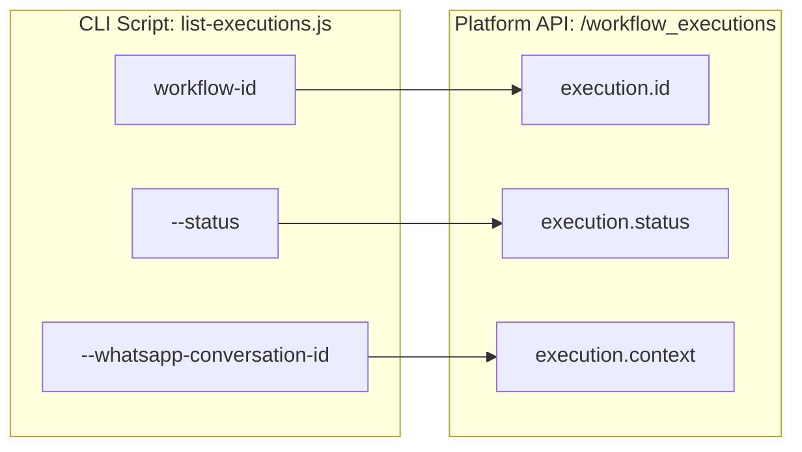

<!-- source: DeepWiki mcp.deepwiki.com · repo gokapso/agent-skills · page 3.6 Automate WhatsApp Scripts Reference · fetched 2026-10-26 -->

# Automate WhatsApp Scripts Reference

<details>
<summary>Relevant source files</summary>

The following files were used as context for generating this wiki page:

- [skills/automate-whatsapp/references/workflow-reference.md](skills/automate-whatsapp/references/workflow-reference.md)
- [skills/automate-whatsapp/scripts/list-execution-events.js](skills/automate-whatsapp/scripts/list-execution-events.js)
- [skills/automate-whatsapp/scripts/list-executions.js](skills/automate-whatsapp/scripts/list-executions.js)
- [skills/automate-whatsapp/scripts/update-workflow-settings.js](skills/automate-whatsapp/scripts/update-workflow-settings.js)
- [skills/automate-whatsapp/scripts/validate-graph.js](skills/automate-whatsapp/scripts/validate-graph.js)

</details>


This page provides a technical reference for the scripts located in `skills/automate-whatsapp/scripts/`. These scripts interface with the Kapso Platform API to manage workflow life cycles, graph definitions, triggers, and execution monitoring. While the Kapso CLI is the primary tool for local development, these scripts serve as a fallback for debugging, API-only environments, and fine-grained resource inspection [skills/automate-whatsapp/references/workflow-reference.md:3-8]().

## System Overview & Data Flow

The scripts operate by sending authenticated requests to the Kapso Platform API. The data flow typically involves loading environment configuration, parsing CLI arguments, and executing HTTP requests using a shared utility library.

### Logic Flow: Script Execution
The following diagram illustrates how a script moves from a CLI command to a Platform API interaction.

"Script Execution Flow"
```mermaid
graph TD
    subgraph "Local Environment"
        CLI["User Command (node scripts/...)"]
        LC["loadConfig()"]
        PA["parseArgs()"]
        RJ["requestJson()"]
    end

    subgraph "Kapso Platform API"
        API["/platform/v1/"]
        DB[("Workflow Engine DB")]
    end

    CLI --> PA
    PA --> LC
    LC --> RJ
    RJ -- "HTTPS + API Key" --> API
    API <--> DB
    API --> RJ
    RJ --> "printJson(result)"
```
**Sources:** [skills/automate-whatsapp/scripts/update-workflow-settings.js:14-63](), [skills/automate-whatsapp/references/workflow-reference.md:45-66]()

## Workflow Management Scripts

These scripts handle the CRUD operations for workflow metadata and their underlying graph definitions.

### Workflow CRUD & Settings
*   **`create-workflow.js`**: Initializes a new workflow record [skills/automate-whatsapp/references/workflow-reference.md:23]().
*   **`list-workflows.js`**: Retrieves a list of workflows for the project [skills/automate-whatsapp/references/workflow-reference.md:21]().
*   **`get-workflow.js`**: Fetches workflow metadata (name, status, `lock_version`) but excludes the graph definition [skills/automate-whatsapp/references/workflow-reference.md:22](), [skills/automate-whatsapp/references/workflow-reference.md:76]().
*   **`update-workflow-settings.js`**: Updates metadata and execution behavior. Key parameters include:
    *   `--lock-version`: Required for optimistic concurrency control [skills/automate-whatsapp/scripts/update-workflow-settings.js:26-30]().
    *   `--status`: Set to `draft`, `active`, or `archived` [skills/automate-whatsapp/scripts/update-workflow-settings.js:8]().
    *   `--message-debounce-seconds`: Controls how long the engine waits for additional messages before processing [skills/automate-whatsapp/scripts/update-workflow-settings.js:47]().
    *   `--inbound-message-read-mode`: Configures automated read receipts (`disabled`, `read_only`, `read_with_typing`) [skills/automate-whatsapp/scripts/update-workflow-settings.js:48]().

### Graph Management
*   **`get-graph.js`**: Fetches the full graph definition (nodes and edges) from `/platform/v1/workflows/:id/definition` [skills/automate-whatsapp/references/workflow-reference.md:52]().
*   **`update-graph.js`**: Pushes a new graph definition to the API. It uses the `workflow: { definition: <definition> }` envelope [skills/automate-whatsapp/references/workflow-reference.md:78-79]().
*   **`validate-graph.js`**: A local utility to verify graph integrity before deployment. It checks for:
    *   Exactly one node with `id: "start"` and `node_type: "start"` [skills/automate-whatsapp/scripts/validate-graph.js:121-126]().
    *   Valid `source` and `target` IDs for all edges [skills/automate-whatsapp/scripts/validate-graph.js:138-143]().
    *   Branching logic: Only `decide` nodes may have multiple outgoing edges [skills/automate-whatsapp/scripts/validate-graph.js:196-198]().
    *   Edge labeling: Non-decide nodes must use the label `"next"` [skills/automate-whatsapp/scripts/validate-graph.js:199-201]().

**Sources:** [skills/automate-whatsapp/scripts/update-workflow-settings.js:1-70](), [skills/automate-whatsapp/scripts/validate-graph.js:7-213](), [skills/automate-whatsapp/references/workflow-reference.md:74-85]()

## Trigger Management Scripts

Triggers define how workflows are initiated. These scripts manage the lifecycle of trigger resources.

| Script | API Endpoint | Description |
| :--- | :--- | :--- |
| `list-triggers.js` | `GET /workflows/:id/triggers` | Lists all triggers for a specific workflow [skills/automate-whatsapp/references/workflow-reference.md:55](). |
| `create-trigger.js` | `POST /workflows/:id/triggers` | Creates a new trigger (e.g., `inbound_message`) [skills/automate-whatsapp/references/workflow-reference.md:56](). |
| `update-trigger.js` | `PATCH /triggers/:id` | Modifies trigger configuration [skills/automate-whatsapp/references/workflow-reference.md:57](). |
| `delete-trigger.js` | `DELETE /triggers/:id` | Removes a trigger [skills/automate-whatsapp/references/workflow-reference.md:58](). |

> **Note:** For `inbound_message` triggers, use `list-whatsapp-phone-numbers.js` to retrieve the correct `phone_number_id` [skills/automate-whatsapp/references/workflow-reference.md:87-90]().

**Sources:** [skills/automate-whatsapp/references/workflow-reference.md:28-31](), [skills/automate-whatsapp/references/workflow-reference.md:55-58]()

## Execution Inspection Scripts

These scripts provide visibility into active and historical workflow runs.

### Execution Monitoring
*   **`list-executions.js`**: Queries executions for a workflow. Supports filtering by `status`, `waiting_reason`, and `whatsapp_conversation_id` [skills/automate-whatsapp/scripts/list-executions.js:8](). It uses **cursor pagination** (`after`, `before`, `limit`) [skills/automate-whatsapp/scripts/list-executions.js:37-38]().
*   **`get-execution.js`**: Retrieves the full state of a specific execution [skills/automate-whatsapp/references/workflow-reference.md:33]().
*   **`list-execution-events.js`**: Fetches the audit trail for an execution, showing node entry/exit and variable changes [skills/automate-whatsapp/scripts/list-execution-events.js:30-36]().
*   **`resume-execution.js`**: Manually resumes an execution that is in a `waiting` state [skills/automate-whatsapp/references/workflow-reference.md:62]().

### Data Access
*   **`get-context-value.js`**: Extracts specific values from the execution context (vars, system, or metadata) [skills/automate-whatsapp/references/workflow-reference.md:34]().

### Code Entity Mapping: Executions
This diagram maps script parameters to the underlying Platform API entities.

"Execution Inspection Mapping"

**Sources:** [skills/automate-whatsapp/scripts/list-executions.js:8-40](), [skills/automate-whatsapp/references/workflow-reference.md:59-64]()

## Function & Variable Scripts

### Serverless Functions
Functions are typically managed via the CLI, but the scripts allow for discovery:
*   **`list-provider-models.js`**: Lists available AI models (e.g., GPT-4o) that can be used in `agent` or `decide` nodes [skills/automate-whatsapp/references/workflow-reference.md:40]().

### Variable Constraints
The Platform API scripts include `variables-list.js`, `variables-set.js`, and `variables-delete.js`. However, **write operations (set/delete) are blocked** via the Platform API to ensure consistency with the local source-sync workflow [skills/automate-whatsapp/references/workflow-reference.md:5-6](), [skills/automate-whatsapp/references/workflow-reference.md:68]().

**Sources:** [skills/automate-whatsapp/references/workflow-reference.md:37-40](), [skills/automate-whatsapp/references/workflow-reference.md:68]()

---

