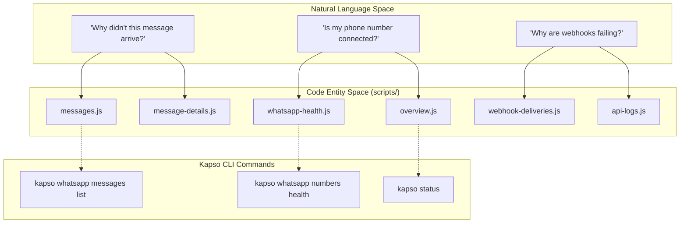
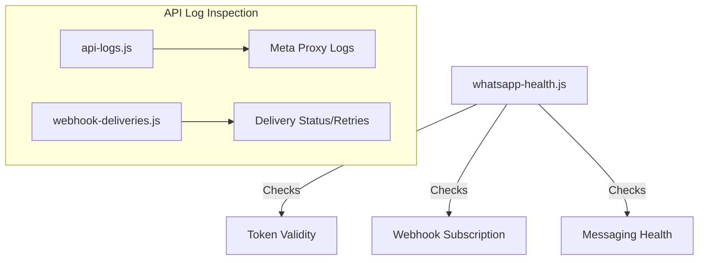

<!-- source: DeepWiki mcp.deepwiki.com · repo gokapso/agent-skills · page 4 Observe WhatsApp Skill · fetched 2026-10-26 -->

# Observe WhatsApp Skill

Relevant source files

The following files were used as context for generating this wiki page:

- [skills/observe-whatsapp/SKILL.md](skills/observe-whatsapp/SKILL.md)

The `observe-whatsapp` skill provides the operational tools and diagnostic scripts necessary for monitoring, debugging, and diagnosing WhatsApp integrations within the Kapso ecosystem. It is designed to assist developers and support engineers in investigating production issues, message delivery failures, and webhook synchronization problems [skills/observe-whatsapp/SKILL.md:1-4]().

## Overview

The skill focuses on three primary operational domains:
1.  **Message Investigation**: Tracing the lifecycle of specific messages and conversations.
2.  **Error Triage**: Analyzing API logs and webhook delivery attempts to identify failure points.
3.  **Health Checks**: Running automated diagnostics against WhatsApp Business API (WABA) assets to ensure connectivity and compliance.

### System Interaction Map

The following diagram maps the high-level operational tasks to the specific scripts and CLI commands used to execute them.

**Operational Flow to Code Entities**

Sources: [skills/observe-whatsapp/SKILL.md:23-59]()

---

## Message & Conversation Inspection

Investigating message delivery typically starts with resolving a public display number to a canonical `phone_number_id` [skills/observe-whatsapp/SKILL.md:105-107](). This subsystem allows for deep inspection of message states (sent, delivered, read) and the retrieval of specific metadata associated with a WhatsApp Message ID (WAMID).

Key capabilities include:
*   **Listing Messages**: Filtering recent outbound and inbound traffic.
*   **Message Details**: Fetching the full JSON payload and status history for a specific WAMID.
*   **Conversation Lookup**: Identifying the conversation thread context for a specific user.

For details, see [Message & Conversation Inspection](#4.1).

Sources: [skills/observe-whatsapp/SKILL.md:25-37](), [skills/observe-whatsapp/SKILL.md:62-69]()

---

## Health Checks & Triage

The health and triage subsystem is used to diagnose systemic issues ranging from expired Meta access tokens to "LIMITED" or "BLOCKED" phone number states [skills/observe-whatsapp/SKILL.md:10-11](). 

### Diagnostic Hierarchy

The triage process follows a structured order of operations to isolate faults:
1.  **Project State**: Verifying project-level access and configuration via `overview.js`.
2.  **Number Health**: Executing a 60-second suite of checks including `phone_number_access`, `token_validity`, and `messaging_health` [skills/observe-whatsapp/SKILL.md:52-58]().
3.  **External Logs**: Inspecting `api-logs.js` and `webhook-deliveries.js` to find discrepancies between Kapso and Meta's infrastructure [skills/observe-whatsapp/SKILL.md:70-77]().

**Health Check Logic Mapping**

Sources: [skills/observe-whatsapp/SKILL.md:38-59](), [skills/observe-whatsapp/SKILL.md:70-84]()

For details, see [Health Checks & Triage](#4.2).

---

## Script Reference Summary

The skill includes a collection of standalone scripts located in the `scripts/` directory, which serve as a fallback when the Kapso CLI is unavailable or when specific low-level API log access is required [skills/observe-whatsapp/SKILL.md:18-22]().

| Category | Script | Purpose |
| :--- | :--- | :--- |
| **Messages** | `messages.js` | List and filter messages for a phone number [skills/observe-whatsapp/SKILL.md:66]() |
| | `message-details.js` | Retrieve full details for a specific WAMID [skills/observe-whatsapp/SKILL.md:67]() |
| | `lookup-conversation.js` | Find conversation objects by ID or phone [skills/observe-whatsapp/SKILL.md:68]() |
| **Triage** | `errors.js` | List and aggregate message-level errors [skills/observe-whatsapp/SKILL.md:74]() |
| | `api-logs.js` | Inspect logs from the Kapso Meta Proxy [skills/observe-whatsapp/SKILL.md:75]() |
| | `webhook-deliveries.js` | Trace webhook delivery attempts and retry states [skills/observe-whatsapp/SKILL.md:76]() |
| **Health** | `overview.js` | Summarize project and number status [skills/observe-whatsapp/SKILL.md:82]() |
| | `whatsapp-health.js` | Run deep diagnostic suite on a specific number [skills/observe-whatsapp/SKILL.md:83]() |
| **Discovery**| `openapi-explore.mjs` | Search and explore the Kapso Platform API schema [skills/observe-whatsapp/SKILL.md:89]() |

Sources: [skills/observe-whatsapp/SKILL.md:60-90]()

---

