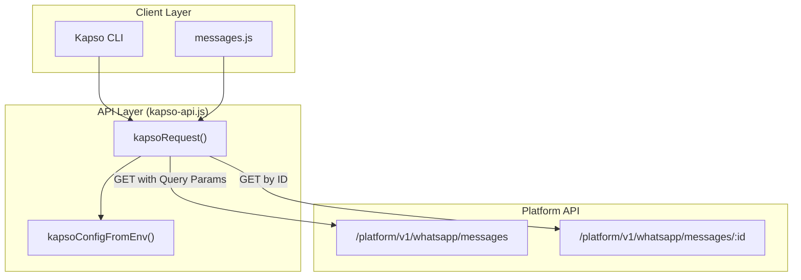

<!-- source: DeepWiki mcp.deepwiki.com · repo gokapso/agent-skills · page 4.1 Message & Conversation Inspection · fetched 2026-10-26 -->

# Message & Conversation Inspection

<details>
<summary>Relevant source files</summary>

The following files were used as context for generating this wiki page:

- [skills/observe-whatsapp/SKILL.md](skills/observe-whatsapp/SKILL.md)
- [skills/observe-whatsapp/scripts/lookup-conversation.js](skills/observe-whatsapp/scripts/lookup-conversation.js)
- [skills/observe-whatsapp/scripts/messages.js](skills/observe-whatsapp/scripts/messages.js)

</details>


This page details the technical implementation and workflows for investigating message delivery and conversation states within the Kapso platform. It covers the resolution of phone numbers, listing and filtering of messages, retrieval of specific message details (WAMIDs), and the lookup of conversation contexts.

## Overview

Message and conversation inspection is part of the `observe-whatsapp` skill. It provides visibility into the lifecycle of a message—from the initial API request to final delivery status (sent, delivered, read, failed). Developers can trace these events using either the Kapso CLI (preferred) or standalone Node.js fallback scripts.

### Core Objectives
*   **Identity Resolution**: Converting human-readable display numbers to canonical `phone_number_id` values.
*   **Lifecycle Tracing**: Fetching the full history and status updates for a specific message.
*   **Context Retrieval**: Locating the conversation thread associated with a specific user or phone number.
*   **Filtering**: Searching for messages based on direction, status, or media content.

---

## Message Inspection Workflow

The inspection process typically follows a hierarchical path: first identifying the correct phone number entity, then listing messages for that entity, and finally drilling into a specific message's metadata.

### 1. Identity Resolution
Before querying messages, the system must resolve the target WhatsApp phone number.
*   **CLI**: `kapso whatsapp numbers resolve --phone-number "<display-number>"` [skills/observe-whatsapp/SKILL.md:28-28]()
*   **Logic**: This maps the E.164 formatted number to the internal `phone_number_id` required for scoped API calls.

### 2. Listing and Filtering Messages
Messages can be listed with extensive filters to isolate specific delivery issues.
*   **Implementation**: `messages.js` [skills/observe-whatsapp/scripts/messages.js:1-73]()
*   **Key Parameters**:
    *   `direction`: `inbound` or `outbound`.
    *   `status`: `pending`, `sent`, `delivered`, `read`, or `failed`.
    *   `message_type`: `text`, `image`, `audio`, `video`, `document`.
    *   `has_media`: Boolean filter for attachments.

### 3. Fetching Message Details
Retrieving a specific message provides the WAMID (WhatsApp Message ID) and granular timestamps for each status change.
*   **Implementation**: `message-details.js` [skills/observe-whatsapp/scripts/message-details.js:1-60]()
*   **Usage**: Requires a `message-id` (the Kapso internal ID or WAMID) and the `phone-number-id`.

### Data Flow: Message Retrieval
The following diagram illustrates how the CLI/Scripts interact with the Platform API to retrieve message data.

**Message Inspection Logic**

**Sources:** [skills/observe-whatsapp/scripts/messages.js:50-53](), [skills/observe-whatsapp/scripts/lib/messages/kapso-api.js:1-50]()

---

## Conversation Inspection

Conversations group messages between a specific WhatsApp Business Account (WABA) number and a customer. Looking up a conversation is essential for understanding the state of an automation or agent interaction.

### Lookup Mechanisms
The `lookup-conversation.js` script supports three primary lookup methods [skills/observe-whatsapp/scripts/lookup-conversation.js:32-63]():
1.  **By ID**: Direct fetch using the UUID of the conversation.
2.  **By Phone Number**: Searching for the active conversation associated with a customer's E.164 number.
3.  **By Status**: Filtering conversations by `active` or `ended` states.

### Implementation Details
The lookup logic is centralized in `scripts/lookup-conversation.js`.

| Feature | Description | Code Reference |
| :--- | :--- | :--- |
| **Direct Lookup** | Fetches `/platform/v1/whatsapp/conversations/:id` | [skills/observe-whatsapp/scripts/lookup-conversation.js:38-45]() |
| **Search/Filter** | Fetches `/platform/v1/whatsapp/conversations` with query params | [skills/observe-whatsapp/scripts/lookup-conversation.js:51-64]() |
| **Pagination** | Supports `limit`, `after`, and `before` cursors | [skills/observe-whatsapp/scripts/lookup-conversation.js:57-59]() |

**Conversation Entity Mapping**
```mermaid
classDiagram
    class "kapso-api.js" {
        +kapsoRequest(config, endpoint)
        +kapsoConfigFromEnv()
    }
    class "lookup-conversation.js" {
        +main()
        +parseFlags(argv)
    }
    class "Platform API Endpoints" {
        +GET /whatsapp/conversations
        +GET /whatsapp/conversations/:id
    }

    "lookup-conversation.js" ..> "kapso-api.js" : uses
    "kapso-api.js" --> "Platform API Endpoints" : calls
```
**Sources:** [skills/observe-whatsapp/scripts/lookup-conversation.js:1-75](), [skills/observe-whatsapp/scripts/lib/messages/kapso-api.js:1-50]()

---

## Technical Reference

### CLI vs. Fallback Scripts
The `observe-whatsapp` skill provides two interfaces for inspection. The CLI is the preferred production tool, while the scripts in `scripts/` serve as a transparent fallback that demonstrates API usage.

| Action | CLI Command (Preferred) | Fallback Script |
| :--- | :--- | :--- |
| **List Messages** | `kapso whatsapp messages list` | `node scripts/messages.js` |
| **Get Message** | `kapso whatsapp messages get <id>` | `node scripts/message-details.js` |
| **Find Conversation** | `kapso whatsapp conversations list` | `node scripts/lookup-conversation.js` |

**Sources:** [skills/observe-whatsapp/SKILL.md:25-37]()

### Argument Parsing
The scripts utilize a shared utility library for consistent flag handling.
*   **File**: `scripts/lib/messages/args.js`
*   **Functions**: `parseFlags(argv)` and `hasHelpFlag(argv)` [skills/observe-whatsapp/scripts/messages.js:1-1]()

### Environment Configuration
Both interfaces rely on the following environment variables for authentication:
*   `KAPSO_API_BASE_URL`: The host of the Kapso API.
*   `KAPSO_API_KEY`: The secret key for authentication.

**Sources:** [skills/observe-whatsapp/SKILL.md:19-21](), [skills/observe-whatsapp/scripts/lib/messages/kapso-api.js:5-15]()

---

