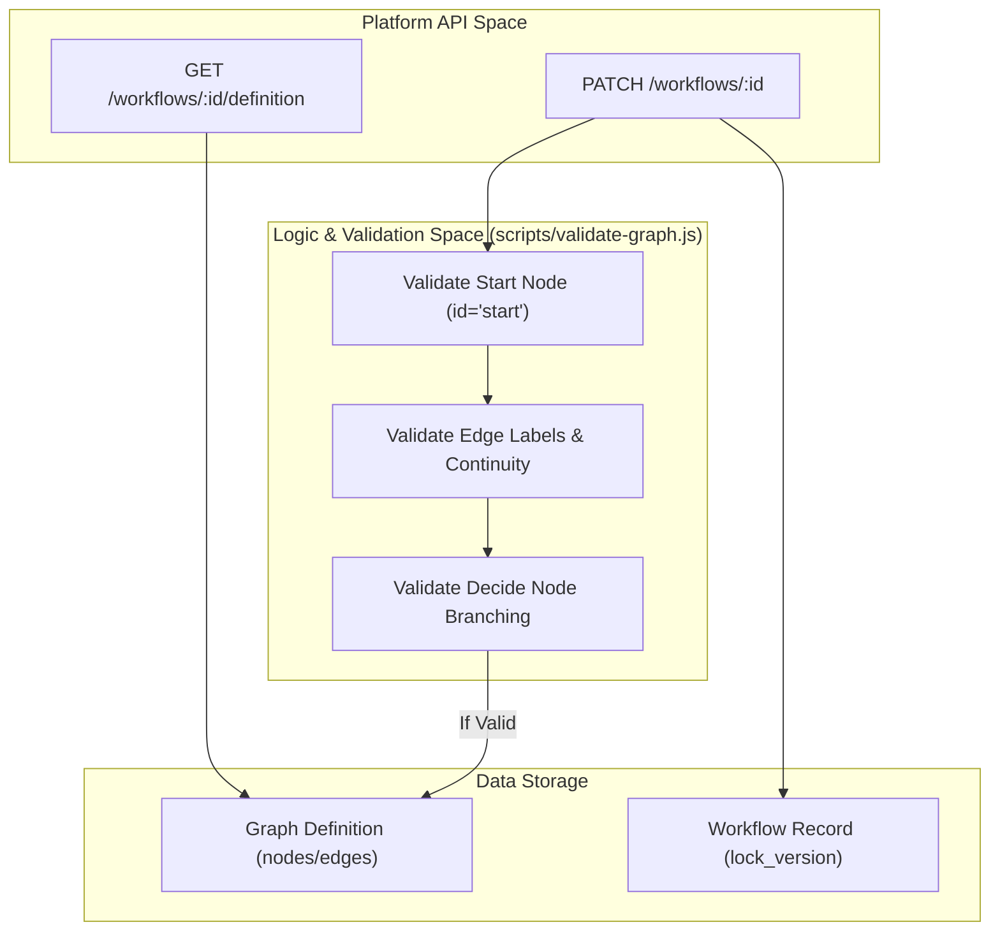
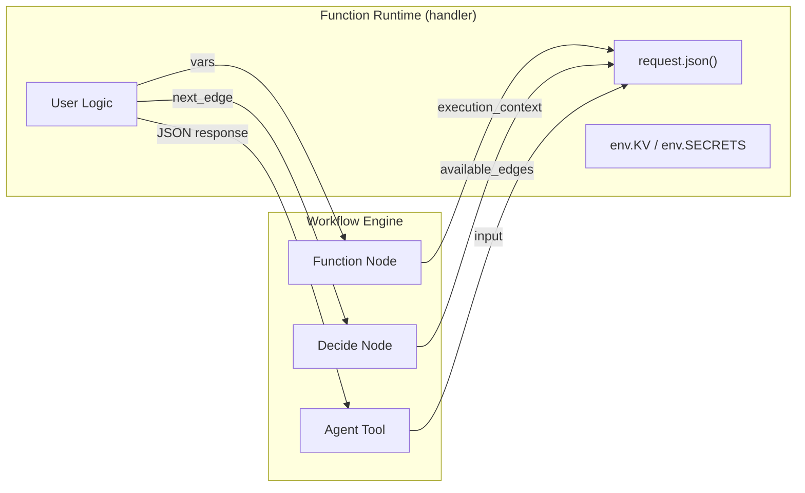

<!-- source: DeepWiki mcp.deepwiki.com · repo gokapso/agent-skills · page 5.2 Workflow, Function & Execution Endpoints · fetched 2026-10-26 -->

# Workflow, Function & Execution Endpoints

Relevant source files

The following files were used as context for generating this wiki page:

- [skills/automate-whatsapp/references/functions-reference.md](skills/automate-whatsapp/references/functions-reference.md)
- [skills/automate-whatsapp/references/workflow-reference.md](skills/automate-whatsapp/references/workflow-reference.md)
- [skills/integrate-whatsapp/references/platform-api-reference.md](skills/integrate-whatsapp/references/platform-api-reference.md)

This page provides a detailed technical reference for the Kapso Platform automation API endpoints. It covers the management of workflow graphs, triggers, serverless functions, and the inspection of execution lifecycles.

## 1. Workflow Management

Workflows are defined as directed graphs consisting of nodes and edges. The Platform API distinguishes between workflow metadata and the graph definition.

### 1.1. Workflow CRUD & Envelopes
Workflow operations utilize specific JSON envelopes to distinguish between metadata updates and graph structural changes.

*   **GET /workflows/:id**: Returns workflow metadata (e.g., `name`, `description`, `lock_version`) but **omits** the `definition` field [skills/automate-whatsapp/references/workflow-reference.md:76-76]().
*   **GET /workflows/:id/definition**: Returns the complete workflow record, including the full graph `definition` (nodes and edges) [skills/automate-whatsapp/references/workflow-reference.md:77-77]().
*   **PATCH /workflows/:id**: Accepts two types of envelopes [skills/automate-whatsapp/references/workflow-reference.md:78-78]():
    *   `workflow`: Used for updating metadata or the graph definition (`workflow: { definition: <definition> }`) [skills/automate-whatsapp/references/workflow-reference.md:79-79]().
    *   `flow`: An alternative envelope for specific flow-based updates.

### 1.2. Graph Data Flow
The API supports a "minimal editable definition" while providing a "rich definition" for UI/CLI consumption.

| Feature | API Minimal Shape (Input) | ReactFlow/CLI Shape (Output) |
| :--- | :--- | :--- |
| **Nodes** | `id`, `position`, `data.node_type`, `data.config` | `type`, `data.display_name`, `data.node_type`, `data.config` |
| **Edges** | `source`, `target`, `label` | `id`, `type`, `source`, `target`, `label` |

**Sources:** [skills/automate-whatsapp/references/workflow-reference.md:81-83]()

### 1.3. Workflow Graph Logic Entity Map
This diagram maps the relationship between the Platform API endpoints and the underlying graph validation logic.

**Workflow Entity Architecture**

**Sources:** [skills/automate-whatsapp/references/workflow-reference.md:74-103]()

---

## 2. Trigger Management

Triggers are the entry points for workflows. They link external events (like a WhatsApp message) to a specific workflow.

*   **Inbound Message Triggers**: Require a `phone_number_id`. Users should fetch valid IDs via `GET /platform/v1/whatsapp/phone_numbers` [skills/automate-whatsapp/references/workflow-reference.md:66-66]().
*   **Endpoints**:
    *   `GET /workflows/:workflow_id/triggers`: List triggers for a workflow [skills/automate-whatsapp/references/workflow-reference.md:55-55]().
    *   `POST /workflows/:workflow_id/triggers`: Create a new trigger [skills/automate-whatsapp/references/workflow-reference.md:56-56]().
    *   `PATCH /triggers/:id`: Update trigger configuration [skills/automate-whatsapp/references/workflow-reference.md:57-57]().
    *   `DELETE /triggers/:id`: Remove a trigger [skills/automate-whatsapp/references/workflow-reference.md:58-58]().

**Sources:** [skills/automate-whatsapp/references/workflow-reference.md:28-31](), [skills/automate-whatsapp/references/workflow-reference.md:88-90]()

---

## 3. Execution Inspection & Control

Workflow executions are instances of a workflow graph being traversed.

### 3.1. Cursor Pagination
All execution and event listing endpoints use cursor-based pagination.
*   **Parameters**: `limit` (max 100), `after`, `before` [skills/automate-whatsapp/references/platform-api-reference.md:101-102]().
*   **Response**: Includes a `paging` object with `cursors` and `next`/`previous` links [skills/automate-whatsapp/references/platform-api-reference.md:103-103]().
*   **Note**: Legacy `page` / `per_page` parameters are deprecated for these endpoints [skills/automate-whatsapp/references/workflow-reference.md:71-72]().

### 3.2. Execution Lifecycle Endpoints
*   **GET /workflow_executions/:id**: Retrieve current state and context [skills/automate-whatsapp/references/workflow-reference.md:60-60]().
*   **POST /workflow_executions/:id/resume**: Manually resume an execution that is in a `waiting` or `handoff` state [skills/automate-whatsapp/references/workflow-reference.md:62-62]().
*   **GET /workflow_executions/:id/events**: Fetch the audit log of all transitions and node executions for a specific run [skills/automate-whatsapp/references/workflow-reference.md:63-63]().

**Sources:** [skills/automate-whatsapp/references/workflow-reference.md:59-64](), [skills/automate-whatsapp/references/platform-api-reference.md:101-103]()

---

## 4. Serverless Functions

Functions are standalone code snippets executed in a secure runtime, often called by `function` or `decide` nodes.

### 4.1. Runtime Contract
Functions must implement an `async function handler(request, env)` signature [skills/automate-whatsapp/references/functions-reference.md:3-9]().
*   **request**: Standard Fetch API Request object [skills/automate-whatsapp/references/functions-reference.md:15-15]().
*   **env.KV**: Access to key-value storage [skills/automate-whatsapp/references/functions-reference.md:16-16]().
*   **env.SECRET_NAME**: Access to encrypted secrets [skills/automate-whatsapp/references/functions-reference.md:17-17]().

### 4.2. Function Deployment & Invocation
*   **Deployment**: Functions must be explicitly deployed via `POST /functions/:id/deploy` before they can be invoked [skills/automate-whatsapp/references/functions-reference.md:21-22]().
*   **Invoke Response Modes**:
    *   `passthrough`: (Default for new functions) Returns the function's response body directly [skills/automate-whatsapp/references/functions-reference.md:25-25]().
    *   `wrapped`: (Legacy) Wraps the response in a Kapso-specific envelope [skills/automate-whatsapp/references/functions-reference.md:48-48]().
*   **Public Endpoints**: Setting `public_endpoint: true` allows invocation without an `X-API-Key` [skills/automate-whatsapp/references/functions-reference.md:46-46]().

### 4.3. Function Interaction Map
This diagram shows how different workflow nodes interact with the Function runtime.

**Function Invocation & Data Flow**

**Sources:** [skills/automate-whatsapp/references/functions-reference.md:50-111]()

---

## 5. Variable Management & Constraints

Workflow variables (`vars`) store state during an execution.

*   **Discovery**: `GET /platform/v1/workflows/:id/variables` allows discovery of variables used within a workflow definition [skills/automate-whatsapp/references/workflow-reference.md:54-54]().
*   **CRUD Constraints**: Direct CRUD operations on variables via the Platform API are **blocked**. Variables are managed implicitly through workflow execution (e.g., `set_variable` nodes or function returns) [skills/automate-whatsapp/references/workflow-reference.md:37-39](), [skills/automate-whatsapp/references/workflow-reference.md:68-68]().

**Sources:** [skills/automate-whatsapp/references/workflow-reference.md:5-5](), [skills/automate-whatsapp/references/workflow-reference.md:54-54]()

---

## 6. Provider Models
To configure `agent` nodes, developers can query available AI models.
*   **GET /platform/v1/provider_models**: Returns a list of supported LLM providers and model IDs (e.g., GPT-4, Claude 3) [skills/automate-whatsapp/references/workflow-reference.md:65-65]().

**Sources:** [skills/automate-whatsapp/references/platform-api-reference.md:122-124]()

---

