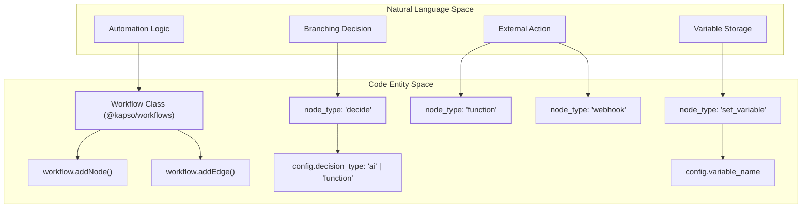
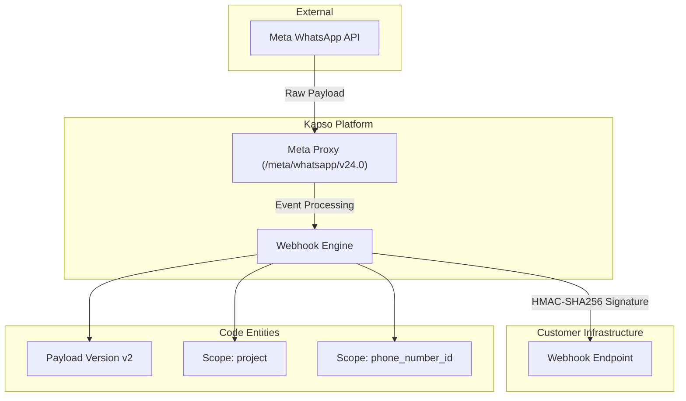

<!-- source: DeepWiki mcp.deepwiki.com · repo gokapso/agent-skills · page 6 Glossary · fetched 2026-10-26 -->

# Glossary

Relevant source files

The following files were used as context for generating this wiki page:

- [README.md](README.md)
- [skills/automate-whatsapp/SKILL.md](skills/automate-whatsapp/SKILL.md)
- [skills/automate-whatsapp/assets/agent-remote-sandbox-github-repo-example.json](skills/automate-whatsapp/assets/agent-remote-sandbox-github-repo-example.json)
- [skills/automate-whatsapp/references/agent-remote-sandbox.md](skills/automate-whatsapp/references/agent-remote-sandbox.md)
- [skills/automate-whatsapp/references/node-types.md](skills/automate-whatsapp/references/node-types.md)
- [skills/automate-whatsapp/references/workflow-reference.md](skills/automate-whatsapp/references/workflow-reference.md)
- [skills/integrate-whatsapp/SKILL.md](skills/integrate-whatsapp/SKILL.md)
- [skills/integrate-whatsapp/references/webhooks-event-types.md](skills/integrate-whatsapp/references/webhooks-event-types.md)
- [skills/integrate-whatsapp/references/webhooks-overview.md](skills/integrate-whatsapp/references/webhooks-overview.md)
- [skills/integrate-whatsapp/references/webhooks-reference.md](skills/integrate-whatsapp/references/webhooks-reference.md)
- [skills/observe-whatsapp/SKILL.md](skills/observe-whatsapp/SKILL.md)

This page provides a comprehensive reference of domain-specific terms, technical concepts, and implementation details within the Kapso Agent Skills codebase. It serves as a bridge between high-level business logic and the underlying code entities.

## Core Concepts

### Agent Skills Format
An open specification for packaging agent instructions, scripts, and resources.
*   **Progressive Disclosure**: A design pattern where only the skill `name` and `description` are loaded initially to save LLM context. Full instructions are fetched only when the task matches [README.md:47-48]().
*   **SKILL.md**: The entry point for every skill, containing YAML frontmatter and markdown instructions [README.md:61-80]().

### Workflow Engine
A directed graph execution system for automating WhatsApp interactions.
*   **Workflow Graph**: A collection of `nodes` and `edges` defining the execution logic [skills/automate-whatsapp/references/workflow-reference.md:78-80]().
*   **Execution**: A single instance of a workflow running for a specific contact. It maintains a state (e.g., `running`, `waiting`, `handoff`) [skills/automate-whatsapp/SKILL.md:112-115]().
*   **Lock Version**: A concurrency control mechanism. Updates to a workflow graph must provide the `expected-lock-version` to prevent overwriting intermediate changes [skills/automate-whatsapp/SKILL.md:91-94]().

### Messaging Identifiers
*   **phone_number_id**: The primary canonical identifier for a WhatsApp phone number within the Kapso platform. Used for sending messages and configuring webhooks [skills/integrate-whatsapp/SKILL.md:118-118]().
*   **business_account_id (WABA)**: The Meta-level ID for the WhatsApp Business Account, primarily used for Template CRUD operations [skills/integrate-whatsapp/SKILL.md:117-117]().
*   **WAMID**: A unique WhatsApp Message ID assigned by Meta to every inbound and outbound message [skills/observe-whatsapp/SKILL.md:30-30]().

**Sources:** [README.md:35-80](), [skills/automate-whatsapp/SKILL.md:1-100](), [skills/integrate-whatsapp/SKILL.md:110-120]()

---

## Code Entity Space: Workflows & Nodes

The following diagram maps the Natural Language concepts of automation to the specific code entities and data structures used in the `automate-whatsapp` skill.

### Automation Mapping: Natural Language to Code

**Sources:** [skills/automate-whatsapp/SKILL.md:41-65](), [skills/automate-whatsapp/references/node-types.md:1-20]()

### Workflow Node Types
| Node Type | Description | Key Config Fields |
| :--- | :--- | :--- |
| `start` | The entry point of every workflow. Must have ID `start` [skills/automate-whatsapp/references/node-types.md:42-49](). | N/A |
| `send_text` | Sends a plain text message with variable interpolation [skills/automate-whatsapp/references/node-types.md:50-57](). | `message`, `delay_seconds` |
| `decide` | Branches execution based on AI intent or function result [skills/automate-whatsapp/references/node-types.md:165-195](). | `decision_type`, `conditions` |
| `agent` | Invokes an LLM agent with access to tools and sandboxes [skills/automate-whatsapp/references/node-types.md:232-254](). | `system_prompt`, `provider_model_id` |
| `wait_for_response` | Pauses execution until a user replies [skills/automate-whatsapp/references/node-types.md:141-148](). | `save_response_to` |
| `function` | Executes a Kapso serverless function [skills/automate-whatsapp/references/node-types.md:224-230](). | `function_id`, `save_response_to` |

**Sources:** [skills/automate-whatsapp/references/node-types.md:3-20]()

---

## Code Entity Space: Webhooks & Events

This section describes the data flow from Meta through Kapso's webhook system to the customer's endpoint.

### Webhook Data Flow

**Sources:** [skills/integrate-whatsapp/SKILL.md:71-108](), [skills/integrate-whatsapp/references/webhooks-overview.md:1-24]()

### Webhook Terms
*   **Signature Verification**: The process of hashing the raw request body with a `webhook_secret_key` using HMAC-SHA256 and comparing it to the `X-Webhook-Signature` header [skills/integrate-whatsapp/references/webhooks-overview.md:35-42]().
*   **Buffering**: A feature for `whatsapp.message.received` that batches rapid messages into a single webhook delivery within a defined `buffer_window_seconds` [skills/integrate-whatsapp/references/webhooks-reference.md:51-58]().
*   **Scope**:
    *   **Project-level**: Lifecycle events like `whatsapp.phone_number.created` [skills/integrate-whatsapp/references/webhooks-reference.md:35-40]().
    *   **Phone-number-level**: Message events like `whatsapp.message.received` [skills/integrate-whatsapp/references/webhooks-reference.md:21-27]().

**Sources:** [skills/integrate-whatsapp/references/webhooks-reference.md:3-58]()

---

## Specialized Terms

### Remote Sandbox
An ephemeral, disposable workspace provided to `agent` nodes.
*   **Sandbox Tools**: Injected filesystem tools including `bash`, `read`, `write`, `list_dir`, and `edit` [skills/automate-whatsapp/references/agent-remote-sandbox.md:7-14]().
*   **Mounted Paths**: Repositories are cloned into `/workspace/repos/<repo-slug>` [skills/automate-whatsapp/references/agent-remote-sandbox.md:43-49]().
*   **Network Policy**: Controlled via `sandbox_network_mode` (`allow_all` or `allow_list`) [skills/automate-whatsapp/references/agent-remote-sandbox.md:57-65]().

### Execution Context
The standardized structure for data available during a workflow execution:
*   `vars`: User-defined variables (e.g., `vars.customer_name`) [skills/automate-whatsapp/SKILL.md:182]().
*   `system`: Internal workflow state variables [skills/automate-whatsapp/SKILL.md:183]().
*   `context`: Channel-specific data like `context.phone_number` [skills/automate-whatsapp/SKILL.md:184]().
*   `metadata`: Information about the triggering request [skills/automate-whatsapp/SKILL.md:185]().

### WhatsApp Flows
Interactive UI components within WhatsApp.
*   **Data Endpoint**: A serverless function or URL that handles `INIT` and `data_exchange` requests from the Flow [skills/integrate-whatsapp/SKILL.md:231-240]().
*   **Flow Token**: A unique identifier used to track a specific flow interaction [skills/integrate-whatsapp/SKILL.md:255]().

**Sources:** [skills/automate-whatsapp/references/agent-remote-sandbox.md:1-76](), [skills/automate-whatsapp/SKILL.md:179-186](), [skills/integrate-whatsapp/SKILL.md:231-260]()