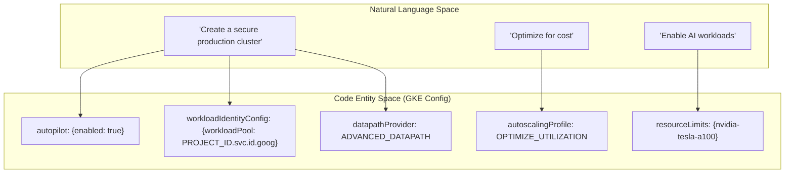
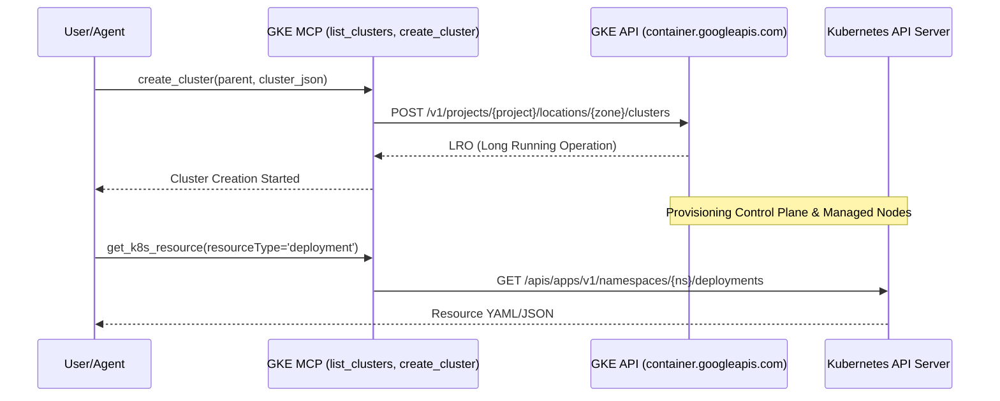

<!-- source: DeepWiki mcp.deepwiki.com · repo google/skills · page 2.2 Google Kubernetes Engine (GKE) Basics · fetched 2026-10-26 -->

# Google Kubernetes Engine (GKE) Basics

Relevant source files

The following files were used as context for generating this wiki page:

- [cloud/products/kubernetes-engine/gke-basics/SKILL.md](cloud/products/kubernetes-engine/gke-basics/SKILL.md)
- [cloud/products/kubernetes-engine/gke-basics/assets/default-deny-netpol.yaml](cloud/products/kubernetes-engine/gke-basics/assets/default-deny-netpol.yaml)
- [cloud/products/kubernetes-engine/gke-basics/assets/golden-path-autopilot.yaml](cloud/products/kubernetes-engine/gke-basics/assets/golden-path-autopilot.yaml)
- [cloud/products/kubernetes-engine/gke-basics/assets/hpa-example.yaml](cloud/products/kubernetes-engine/gke-basics/assets/hpa-example.yaml)
- [cloud/products/kubernetes-engine/gke-basics/assets/vpa-example.yaml](cloud/products/kubernetes-engine/gke-basics/assets/vpa-example.yaml)
- [cloud/products/kubernetes-engine/gke-basics/assets/workload-identity-pod.yaml](cloud/products/kubernetes-engine/gke-basics/assets/workload-identity-pod.yaml)
- [cloud/products/kubernetes-engine/gke-basics/references/cli-reference.md](cloud/products/kubernetes-engine/gke-basics/references/cli-reference.md)
- [cloud/products/kubernetes-engine/gke-basics/references/client-library-usage.md](cloud/products/kubernetes-engine/gke-basics/references/client-library-usage.md)
- [cloud/products/kubernetes-engine/gke-basics/references/core-concepts.md](cloud/products/kubernetes-engine/gke-basics/references/core-concepts.md)
- [cloud/products/kubernetes-engine/gke-basics/references/gke-app-onboarding.md](cloud/products/kubernetes-engine/gke-basics/references/gke-app-onboarding.md)
- [cloud/products/kubernetes-engine/gke-basics/references/gke-backup-dr.md](cloud/products/kubernetes-engine/gke-basics/references/gke-backup-dr.md)
- [cloud/products/kubernetes-engine/gke-basics/references/gke-batch-hpc.md](cloud/products/kubernetes-engine/gke-basics/references/gke-batch-hpc.md)
- [cloud/products/kubernetes-engine/gke-basics/references/gke-cluster-creation.md](cloud/products/kubernetes-engine/gke-basics/references/gke-cluster-creation.md)
- [cloud/products/kubernetes-engine/gke-basics/references/gke-compute-classes.md](cloud/products/kubernetes-engine/gke-basics/references/gke-compute-classes.md)
- [cloud/products/kubernetes-engine/gke-basics/references/gke-cost.md](cloud/products/kubernetes-engine/gke-basics/references/gke-cost.md)
- [cloud/products/kubernetes-engine/gke-basics/references/gke-golden-path.md](cloud/products/kubernetes-engine/gke-basics/references/gke-golden-path.md)
- [cloud/products/kubernetes-engine/gke-basics/references/gke-inference.md](cloud/products/kubernetes-engine/gke-basics/references/gke-inference.md)
- [cloud/products/kubernetes-engine/gke-basics/references/gke-multitenancy.md](cloud/products/kubernetes-engine/gke-basics/references/gke-multitenancy.md)
- [cloud/products/kubernetes-engine/gke-basics/references/gke-networking.md](cloud/products/kubernetes-engine/gke-basics/references/gke-networking.md)
- [cloud/products/kubernetes-engine/gke-basics/references/gke-observability.md](cloud/products/kubernetes-engine/gke-basics/references/gke-observability.md)
- [cloud/products/kubernetes-engine/gke-basics/references/gke-scaling.md](cloud/products/kubernetes-engine/gke-basics/references/gke-scaling.md)
- [cloud/products/kubernetes-engine/gke-basics/references/gke-security.md](cloud/products/kubernetes-engine/gke-basics/references/gke-security.md)
- [cloud/products/kubernetes-engine/gke-basics/references/gke-storage.md](cloud/products/kubernetes-engine/gke-basics/references/gke-storage.md)
- [cloud/products/kubernetes-engine/gke-basics/references/gke-upgrades.md](cloud/products/kubernetes-engine/gke-basics/references/gke-upgrades.md)
- [cloud/products/kubernetes-engine/gke-basics/references/iac-usage.md](cloud/products/kubernetes-engine/gke-basics/references/iac-usage.md)
- [cloud/products/kubernetes-engine/gke-basics/references/mcp-usage.md](cloud/products/kubernetes-engine/gke-basics/references/mcp-usage.md)

Google Kubernetes Engine (GKE) is a managed Kubernetes platform for deploying, scaling, and operating containerized applications. This page covers the technical implementation of GKE within the `google/skills` repository, focusing on the **Golden Path Autopilot** configuration, networking, security, and specialized workloads like AI/ML and HPC.

## Overview and Operational Modes

GKE operates in two primary modes: **Autopilot** and **Standard**. The repository defaults to the Golden Path Autopilot configuration, which manages node provisioning, health, and security automatically [cloud/products/kubernetes-engine/gke-basics/SKILL.md:10-12]().

| Feature | Autopilot (Recommended) | Standard |
| :--- | :--- | :--- |
| **Node Management** | Fully managed by Google | User-managed node pools |
| **Scaling** | Per-pod resource requests | Cluster Autoscaler / Node Pools |
| **Security** | Hardened by default (Shielded nodes, GKE Sandbox) | User-configurable hardening |
| **Pricing** | Pay per pod request (vCPU, Mem, Storage) | Pay for Compute Engine VMs + cluster fee |

**Sources:** [cloud/products/kubernetes-engine/gke-basics/references/core-concepts.md:9-14](), [cloud/products/kubernetes-engine/gke-basics/references/core-concepts.md:48-54]()

## The Golden Path Configuration

The "Golden Path" represents a production-ready baseline for GKE clusters. It is defined as an Autopilot cluster with specific security and networking defaults [cloud/products/kubernetes-engine/gke-basics/assets/golden-path-autopilot.yaml:1-148]().

### Core Configuration Logic
The following diagram illustrates how natural language requirements map to specific GKE configuration entities in the codebase.

**Mapping Requirements to GKE Configuration**

**Sources:** [cloud/products/kubernetes-engine/gke-basics/assets/golden-path-autopilot.yaml:31-47](), [cloud/products/kubernetes-engine/gke-basics/assets/golden-path-autopilot.yaml:71-76]()

## Cluster Creation and Management

Clusters are managed via three primary interfaces: GKE MCP Tools (preferred), `gcloud` CLI, and `kubectl` [cloud/products/kubernetes-engine/gke-basics/references/cli-reference.md:5-11]().

### Deployment Flow
The following diagram shows the data flow from an MCP tool call to the creation of a GKE cluster.

**GKE Resource Provisioning Flow**

**Sources:** [cloud/products/kubernetes-engine/gke-basics/references/cli-reference.md:37-59](), [cloud/products/kubernetes-engine/gke-basics/references/cli-reference.md:116-134]()

## Networking and Security

### VPC-Native Networking
GKE clusters in the repository use **VPC-native** configurations by default [cloud/products/kubernetes-engine/gke-basics/references/core-concepts.md:22-29]().
*   **Dataplane V2**: eBPF-based networking for performance and built-in Network Policy enforcement [cloud/products/kubernetes-engine/gke-basics/assets/golden-path-autopilot.yaml:76]().
*   **Private Clusters**: Nodes have no public IPs; the control plane is accessed via private endpoints [cloud/products/kubernetes-engine/gke-basics/assets/golden-path-autopilot.yaml:59-60]().

### Identity and Hardening
*   **Workload Identity Federation**: Allows Kubernetes Service Accounts (KSA) to impersonate IAM Service Accounts (GSA), eliminating the need for static JSON keys [cloud/products/kubernetes-engine/gke-basics/references/core-concepts.md:39-40]().
*   **Secret Manager Integration**: Automatically syncs Google Cloud secrets into Kubernetes volumes with rotation [cloud/products/kubernetes-engine/gke-basics/assets/golden-path-autopilot.yaml:64-68]().
*   **Binary Authorization**: Ensures only trusted container images are deployed [cloud/products/kubernetes-engine/gke-basics/assets/golden-path-autopilot.yaml:49-50]().

**Sources:** [cloud/products/kubernetes-engine/gke-basics/assets/golden-path-autopilot.yaml:48-73](), [cloud/products/kubernetes-engine/gke-basics/assets/workload-identity-pod.yaml:1-33]()

## Scaling and Observability

GKE provides multi-dimensional scaling capabilities:

| Mechanism | Component | File Reference |
| :--- | :--- | :--- |
| **HPA** | Scales pod replicas based on CPU/Memory | [assets/hpa-example.yaml:1-26]() |
| **VPA** | Adjusts pod resource requests (CPU/Mem) | [assets/vpa-example.yaml:1-22]() |
| **NAP** | Node Auto-Provisioning for right-sizing nodes | [assets/golden-path-autopilot.yaml:37]() |

### Observability Stack
The Golden Path enables comprehensive logging and monitoring components [cloud/products/kubernetes-engine/gke-basics/assets/golden-path-autopilot.yaml:97-125]():
*   **System Components**: Control plane logs and metrics.
*   **Workloads**: Application-level logs.
*   **Managed Service for Prometheus**: Enabled by default for metrics collection.
*   **Advanced Datapath Observability**: eBPF-based metrics for network troubleshooting.

**Sources:** [cloud/products/kubernetes-engine/gke-basics/references/gke-scaling.md](), [cloud/products/kubernetes-engine/gke-basics/references/gke-observability.md]()

## Specialized Workloads

### Batch and HPC
For high-performance computing, GKE supports:
*   **Kueue**: Job queuing and resource quota management [cloud/products/kubernetes-engine/gke-basics/references/gke-batch-hpc.md:68-103]().
*   **JobSet**: Orchestrating groups of related jobs [cloud/products/kubernetes-engine/gke-basics/references/gke-batch-hpc.md:40-66]().
*   **Compact Placement**: Ensuring nodes are physically close in the data center for low-latency MPI workloads [cloud/products/kubernetes-engine/gke-basics/references/gke-batch-hpc.md:107-119]().

### AI Inference
GKE supports GPU and TPU acceleration for LLM serving (e.g., vLLM, GIQ). Resource limits for `nvidia-tesla-t4` and `nvidia-tesla-a100` are pre-configured in the Autopilot Golden Path [cloud/products/kubernetes-engine/gke-basics/assets/golden-path-autopilot.yaml:44-46]().

**Sources:** [cloud/products/kubernetes-engine/gke-basics/references/gke-batch-hpc.md:1-168](), [cloud/products/kubernetes-engine/gke-basics/references/gke-inference.md]()

## Storage and Backup

*   **CSI Drivers**: The Golden Path enables drivers for Persistent Disk, Filestore, GCS FUSE, and Parallelstore [cloud/products/kubernetes-engine/gke-basics/assets/golden-path-autopilot.yaml:12-25]().
*   **Backup for GKE**: A managed service for backing up and restoring Kubernetes configuration and persistent data [cloud/products/kubernetes-engine/gke-basics/references/gke-backup-dr.md:1-81]().

**Sources:** [cloud/products/kubernetes-engine/gke-basics/references/gke-storage.md](), [cloud/products/kubernetes-engine/gke-basics/references/gke-backup-dr.md:9-22]()

---

