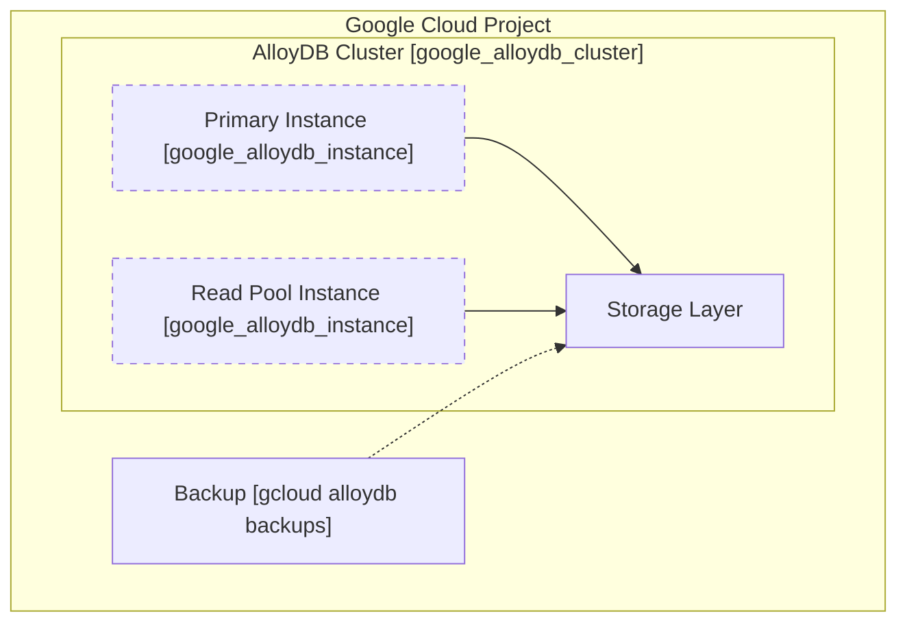
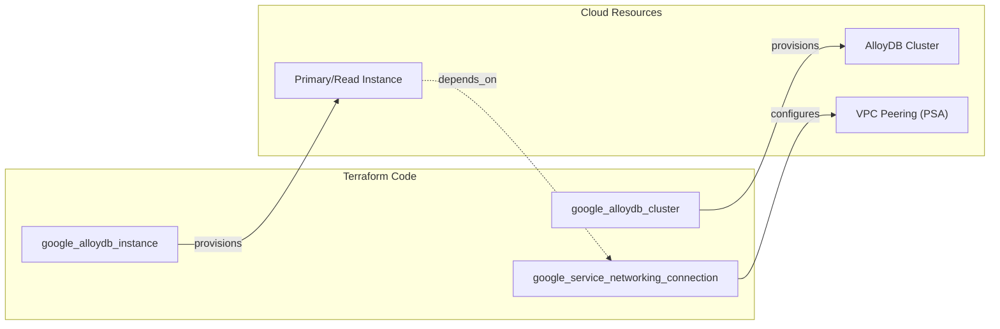

<!-- source: DeepWiki mcp.deepwiki.com · repo google/skills · page 2.5 AlloyDB Basics · fetched 2026-10-26 -->

# AlloyDB Basics

<details>
<summary>Relevant source files</summary>

The following files were used as context for generating this wiki page:

- [cloud/products/alloydb/alloydb-basics/SKILL.md](cloud/products/alloydb/alloydb-basics/SKILL.md)
- [cloud/products/alloydb/alloydb-basics/references/cli-usage.md](cloud/products/alloydb/alloydb-basics/references/cli-usage.md)
- [cloud/products/alloydb/alloydb-basics/references/client-library-usage.md](cloud/products/alloydb/alloydb-basics/references/client-library-usage.md)
- [cloud/products/alloydb/alloydb-basics/references/core-concepts.md](cloud/products/alloydb/alloydb-basics/references/core-concepts.md)
- [cloud/products/alloydb/alloydb-basics/references/iac-usage.md](cloud/products/alloydb/alloydb-basics/references/iac-usage.md)
- [cloud/products/alloydb/alloydb-basics/references/iam-security.md](cloud/products/alloydb/alloydb-basics/references/iam-security.md)
- [cloud/products/alloydb/alloydb-basics/references/mcp-usage.md](cloud/products/alloydb/alloydb-basics/references/mcp-usage.md)
- [cloud/products/cloud-sql/cloud-sql-basics/references/iam-security.md](cloud/products/cloud-sql/cloud-sql-basics/references/iam-security.md)

</details>


AlloyDB for PostgreSQL is a fully managed, PostgreSQL-compatible database service designed for enterprise-grade performance, scale, and availability [cloud/products/alloydb/alloydb-basics/SKILL.md:10-12](). It utilizes a cloud-native architecture that separates compute from storage, allowing resources to scale independently [cloud/products/alloydb/alloydb-basics/references/core-concepts.md:3-6]().

## Architecture and Resource Hierarchy

AlloyDB operates on a regional cluster-based hierarchy. A cluster is the top-level resource that contains instances and the underlying storage [cloud/products/alloydb/alloydb-basics/references/core-concepts.md:15-18]().

| Resource Level | Description |
| :--- | :--- |
| **Cluster** | A regional grouping of instances and storage. Replicates data across multiple zones for high availability [cloud/products/alloydb/alloydb-basics/references/core-concepts.md:15-18](). |
| **Primary Instance** | The main read/write instance in a cluster [cloud/products/alloydb/alloydb-basics/SKILL.md:38-43](). |
| **Read Pool Instance** | Optional instances used for scaling read workloads. Can have multiple nodes per instance [cloud/products/alloydb/alloydb-basics/references/cli-usage.md:22-24](). |
| **Storage Layer** | Disaggregated from compute; automatically scales and handles persistence independently [cloud/products/alloydb/alloydb-basics/SKILL.md:11-12](). |

### Logical Resource Flow
The following diagram illustrates the relationship between AlloyDB resource entities and the infrastructure code used to manage them.

**AlloyDB Resource Relationship**

**Sources:** [cloud/products/alloydb/alloydb-basics/references/iac-usage.md:10-11](), [cloud/products/alloydb/alloydb-basics/references/cli-usage.md:19-24](), [cloud/products/alloydb/alloydb-basics/references/core-concepts.md:15-18]().

## AlloyDB AI

AlloyDB AI provides integrated features for building AI-powered applications directly within the database [cloud/products/alloydb/alloydb-basics/SKILL.md:13-16]():

*   **Vector Search:** Native support for storing and querying vector embeddings for similarity search [cloud/products/alloydb/alloydb-basics/references/core-concepts.md:10-11]().
*   **Hybrid Search:** Combines vector search with standard relational filtering.
*   **Model Endpoint Management:** Integration with Vertex AI to invoke machine learning models (forecasting, analytics) via SQL [cloud/products/alloydb/alloydb-basics/SKILL.md:15-16]().

**Sources:** [cloud/products/alloydb/alloydb-basics/SKILL.md:13-16](), [cloud/products/alloydb/alloydb-basics/references/core-concepts.md:10-11]().

## Security and Authentication

AlloyDB supports both standard PostgreSQL authentication and advanced Google Cloud security features.

### IAM Database Authentication
This is the **recommended** method for production workloads [cloud/products/alloydb/alloydb-basics/SKILL.md:33-34](). It uses IAM principals (users or service accounts) and short-lived OAuth tokens instead of static passwords [cloud/products/alloydb/alloydb-basics/references/iam-security.md:40-43]().

### Connectivity Options
*   **Private Service Connect (PSC):** Recommended for new configurations. It provides multi-VPC topologies without peering and better IP management [cloud/products/alloydb/alloydb-basics/references/iam-security.md:21-23]().
*   **Private Services Access (PSA):** Uses VPC peering to keep traffic internal to Google Cloud [cloud/products/alloydb/alloydb-basics/references/iam-security.md:24]().
*   **AlloyDB Auth Proxy:** A standalone tool that creates a secure local socket and handles mTLS (Mutual TLS) and IAM authentication automatically [cloud/products/alloydb/alloydb-basics/references/iam-security.md:53-59]().

### IAM Roles
| Role Name | Purpose |
| :--- | :--- |
| `roles/alloydb.admin` | Full control of all AlloyDB resources [cloud/products/alloydb/alloydb-basics/references/iam-security.md:12](). |
| `roles/alloydb.client` | Connectivity access to instances [cloud/products/alloydb/alloydb-basics/references/iam-security.md:13](). |
| `roles/alloydb.databaseUser` | Permission to log in via IAM authentication [cloud/products/alloydb/alloydb-basics/references/iam-security.md:14](). |

**Sources:** [cloud/products/alloydb/alloydb-basics/references/iam-security.md:12-24](), [cloud/products/alloydb/alloydb-basics/references/iam-security.md:53-59]().

## Implementation: Language Connectors

Language connectors provide an integrated, driver-level experience that automates mTLS and IAM token handling without needing a separate proxy binary [cloud/products/alloydb/alloydb-basics/references/client-library-usage.md:9-13]().

### Python Connector Example
The Python connector uses the `Connector` class from `google.cloud.alloydbconnector` to create a connection pool [cloud/products/alloydb/alloydb-basics/references/client-library-usage.md:27-32]().

```python
from google.cloud.alloydbconnector import Connector
import sqlalchemy

# INSTANCE_URI: projects/PROJECT/locations/REGION/clusters/CLUSTER/instances/INSTANCE
with Connector() as connector:
    pool = sqlalchemy.create_engine(
        "postgresql+pg8000://",
        creator=lambda: connector.connect(
            INSTANCE_URI, "pg8000", user="my-user", db="my-db"
        ),
    )
```
**Sources:** [cloud/products/alloydb/alloydb-basics/references/client-library-usage.md:25-46]().

## Infrastructure as Code (Terraform)

AlloyDB resources are provisioned using the `google_alloydb_cluster` and `google_alloydb_instance` resources [cloud/products/alloydb/alloydb-basics/references/iac-usage.md:10-11]().

**Infrastructure Code Entity Mapping**

**Sources:** [cloud/products/alloydb/alloydb-basics/references/iac-usage.md:15-61]().

## MCP Server Integration

AlloyDB integrates with the Model Context Protocol (MCP) to allow AI agents to perform database operations.

*   **Endpoint:** Regional endpoints follow the pattern `https://alloydb.REGION.rep.googleapis.com/mcp` [cloud/products/alloydb/alloydb-basics/references/mcp-usage.md:8-9]().
*   **Authentication:** Requires the `roles/mcp.toolUser` role [cloud/products/alloydb/alloydb-basics/references/mcp-usage.md:17]().
*   **Capabilities:** Agents can use tools to manage clusters, monitor performance, or perform specialized health audits [cloud/products/alloydb/alloydb-basics/references/mcp-usage.md:29]().

**Sources:** [cloud/products/alloydb/alloydb-basics/references/mcp-usage.md:8-29]().

---

