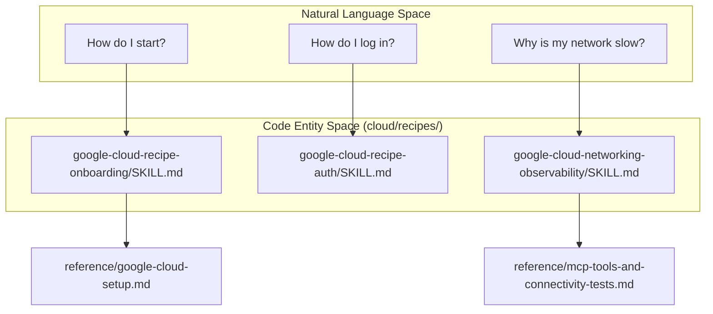
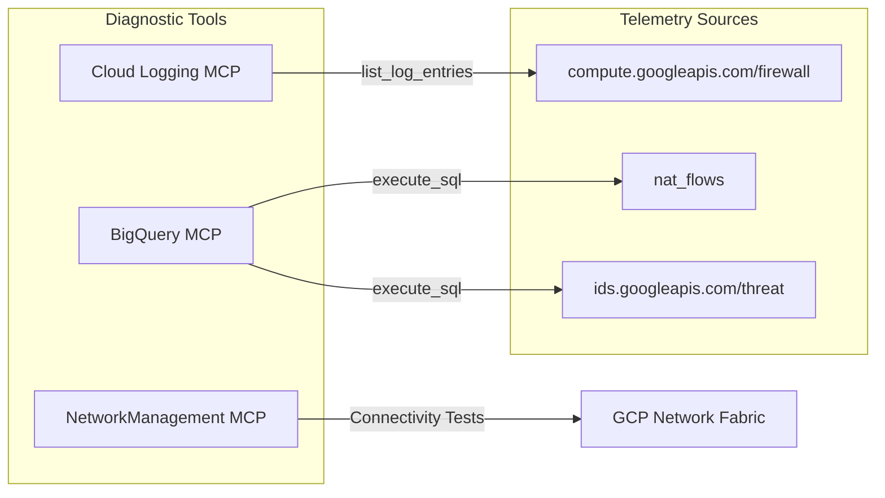

<!-- source: DeepWiki mcp.deepwiki.com · repo google/skills · page 3 Google Cloud Recipes · fetched 2026-10-26 -->

# Google Cloud Recipes

Relevant source files

The following files were used as context for generating this wiki page:

- [README.md](README.md)
- [cloud/recipes/google-cloud-recipe-auth/SKILL.md](cloud/recipes/google-cloud-recipe-auth/SKILL.md)
- [cloud/recipes/google-cloud-recipe-onboarding/SKILL.md](cloud/recipes/google-cloud-recipe-onboarding/SKILL.md)
- [cloud/recipes/google-cloud-recipe-onboarding/reference/google-cloud-setup.md](cloud/recipes/google-cloud-recipe-onboarding/reference/google-cloud-setup.md)

This page provides a high-level overview of the workflow-oriented "recipes" available in the `google/skills` repository. Unlike individual product skills, recipes focus on end-to-end procedures that span multiple services and address complex, multi-step operational tasks [README.md:29-31]().

## Recipe Ecosystem Overview

The recipes are designed to guide users through the lifecycle of Google Cloud adoption—from initial setup and identity management to advanced operational observability.

### Code-to-System Mapping: Recipes
The following diagram maps the logical recipe categories to their specific entry points in the codebase.

**Sources:** [README.md:29-31](), [cloud/recipes/google-cloud-recipe-onboarding/SKILL.md:1-6](), [cloud/recipes/google-cloud-recipe-auth/SKILL.md:1-6](), [cloud/recipes/google-cloud-networking-observability/SKILL.md:1-6]()

---

## Recipe: Onboarding to Google Cloud

This recipe provides two distinct tracks for getting started with Google Cloud. The **Individual Developer Track** focuses on a "happy path" using a personal Google Account, the $300 Free Trial, and the `gcloud` CLI to deploy a first resource like a Cloud Run service [cloud/recipes/google-cloud-recipe-onboarding/SKILL.md:8-19](). 

The **Enterprise Landing Zone Track** covers the structural foundation required for organizations, including Cloud Identity setup, the resource hierarchy (Organizations, Folders, Projects), and centralized billing [cloud/recipes/google-cloud-recipe-onboarding/reference/google-cloud-setup.md:17-40]().

**Key Components:**
*   **Project Management:** Creation and linking to billing accounts [cloud/recipes/google-cloud-recipe-onboarding/SKILL.md:51-72]().
*   **CLI Initialization:** Using `gcloud init` to configure the local environment [cloud/recipes/google-cloud-recipe-onboarding/SKILL.md:74-84]().
*   **Enterprise Foundations:** Shared VPC, Organization Policies, and Terraform-based infrastructure as code [cloud/recipes/google-cloud-recipe-onboarding/reference/google-cloud-setup.md:64-103]().

For details, see [Recipe: Onboarding to Google Cloud](#3.1).

**Sources:** [cloud/recipes/google-cloud-recipe-onboarding/SKILL.md:8-115](), [cloud/recipes/google-cloud-recipe-onboarding/reference/google-cloud-setup.md:3-103]()

---

## Recipe: Authenticating to Google Cloud

Authentication is the prerequisite for all cloud operations. This recipe details how both humans and services prove their identity to Google Cloud [cloud/recipes/google-cloud-recipe-auth/SKILL.md:8-12]().

It emphasizes the use of **Application Default Credentials (ADC)** and **Service Account Impersonation** as security best practices to avoid the risks associated with static Service Account keys [cloud/recipes/google-cloud-recipe-auth/SKILL.md:75-86]().

**Authentication Flows:**
| Entity Type | Recommended Method | Tool/Service |
| :--- | :--- | :--- |
| Human Developer | OAuth 2.0 Refresh Token | `gcloud auth login` |
| Local Code | Application Default Credentials | `gcloud auth application-default login` |
| Cloud Workload | Attached Service Account | Instance Metadata Server (Tokens) |
| External Workload | Workload Identity Federation | OIDC/SAML Exchange |

For details, see [Recipe: Authenticating to Google Cloud](#3.2).

**Sources:** [cloud/recipes/google-cloud-recipe-auth/SKILL.md:34-150]()

---

## Recipe: Google Cloud Network Observability

This recipe introduces a diagnostic framework for troubleshooting complex networking issues. It leverages the **Model Context Protocol (MCP)** to allow agents to query telemetry across multiple sources [cloud/recipes/google-cloud-networking-observability/SKILL.md:1-6]().

The framework relies on four primary telemetry sources to provide a "Primary Source of Truth" (PSOT):
1.  **VPC Flow Logs:** For traffic volume and path analysis.
2.  **Firewall Logs:** For identifying denied or allowed connections.
3.  **Cloud NAT Logs:** For troubleshooting port exhaustion.
4.  **Threat Logs:** For identifying malicious activity via Cloud IDS or Firewall Plus.

### Entity Relationship: Networking Diagnostics
This diagram illustrates how the diagnostic tools interact with Google Cloud's logging and monitoring infrastructure.

For details, see [Recipe: Google Cloud Network Observability](#3.3).

**Sources:** [cloud/recipes/google-cloud-networking-observability/SKILL.md:1-15](), [cloud/recipes/google-cloud-networking-observability/reference/mcp-tools-and-connectivity-tests.md:1-20]()

---

