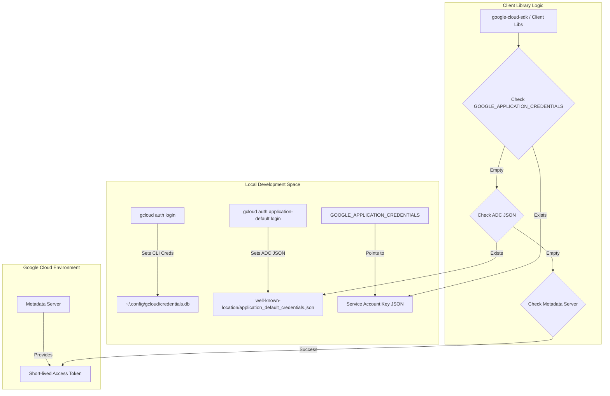
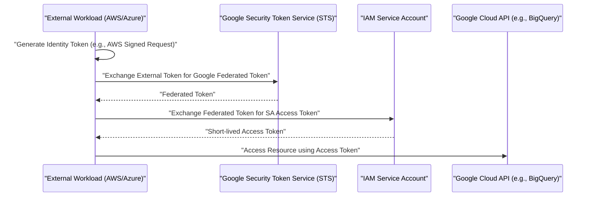

<!-- source: DeepWiki mcp.deepwiki.com · repo google/skills · page 3.2 Recipe: Authenticating to Google Cloud · fetched 2026-10-26 -->

# Recipe: Authenticating to Google Cloud

Relevant source files

The following files were used as context for generating this wiki page:

- [cloud/recipes/google-cloud-recipe-auth/SKILL.md](cloud/recipes/google-cloud-recipe-auth/SKILL.md)

This recipe provides technical guidance on authenticating and authorizing identities to Google Cloud services. It covers the lifecycle of Application Default Credentials (ADC), the distinction between CLI and application authentication, and secure patterns for both internal and external workloads.

## The Authentication Lifecycle

Authentication is the process of proving a **Principal's** identity [cloud/recipes/google-cloud-recipe-auth/SKILL.md:8-12](). In Google Cloud, this is primarily managed through **Application Default Credentials (ADC)**, a strategy used by Google Cloud Client Libraries to automatically find credentials [cloud/recipes/google-cloud-recipe-auth/SKILL.md:75-79]().

### ADC Resolution Order
When a client library is initialized, it searches for credentials in the following order:
1.  **Environment Variable**: The path specified in `GOOGLE_APPLICATION_CREDENTIALS` [cloud/recipes/google-cloud-recipe-auth/SKILL.md:154-154]().
2.  **User Credentials**: Credentials created via `gcloud auth application-default login` [cloud/recipes/google-cloud-recipe-auth/SKILL.md:75-79]().
3.  **Attached Service Account**: The Metadata Server on Compute Engine, GKE, or Cloud Run [cloud/recipes/google-cloud-recipe-auth/SKILL.md:125-135]().

### ADC Flow and Code Entity Mapping
The following diagram maps the logical authentication flow to the specific CLI commands and environment variables used in the codebase.

**ADC Resolution and Entity Mapping**

**Sources:** [cloud/recipes/google-cloud-recipe-auth/SKILL.md:71-86](), [cloud/recipes/google-cloud-recipe-auth/SKILL.md:125-135](), [cloud/recipes/google-cloud-recipe-auth/SKILL.md:154-154]()

---

## Human vs. Application Authentication

A common point of confusion is the difference between authenticating the `gcloud` CLI and authenticating an application.

| Feature | `gcloud auth login` | `gcloud auth application-default login` |
| :--- | :--- | :--- |
| **Target** | The `gcloud` CLI itself [cloud/recipes/google-cloud-recipe-auth/SKILL.md:71-74]() | Client Libraries (Python, Go, etc.) [cloud/recipes/google-cloud-recipe-auth/SKILL.md:75-79]() |
| **Credential Type** | OAuth 2.0 Refresh Token [cloud/recipes/google-cloud-recipe-auth/SKILL.md:74-74]() | Local JSON credential file [cloud/recipes/google-cloud-recipe-auth/SKILL.md:78-79]() |
| **Typical Use** | Running `gcloud compute...` or `gsutil...` [cloud/recipes/google-cloud-recipe-auth/SKILL.md:73-73]() | Running code that uses `google-cloud-storage` [cloud/recipes/google-cloud-recipe-auth/SKILL.md:79-79]() |
| **Best Practice** | Use for manual management [cloud/recipes/google-cloud-recipe-auth/SKILL.md:71-72]() | Use for local testing of code [cloud/recipes/google-cloud-recipe-auth/SKILL.md:75-76]() |

**Sources:** [cloud/recipes/google-cloud-recipe-auth/SKILL.md:71-79]()

---

## Secure Service Identity Patterns

### Service Account Impersonation
To avoid the risks associated with long-lived Service Account keys, developers should use **Service Account Impersonation** [cloud/recipes/google-cloud-recipe-auth/SKILL.md:80-86]().

1.  **Human Auth**: Authenticate as yourself using `gcloud auth login`.
2.  **Impersonate**: Use the `--impersonate-service-account` flag with CLI commands.
3.  **Short-lived**: This generates a temporary token, eliminating the need to download JSON keys [cloud/recipes/google-cloud-recipe-auth/SKILL.md:82-85]().

### Workload Identity Federation (WIF)
For workloads running outside of Google Cloud (AWS, Azure, or On-prem), Workload Identity Federation (WIF) allows you to use external identities to access Google Cloud resources without keys [cloud/recipes/google-cloud-recipe-auth/SKILL.md:147-150]().

**Workload Identity Federation Flow**

**Sources:** [cloud/recipes/google-cloud-recipe-auth/SKILL.md:141-150]()

---

## Advanced Authentication Scenarios

### Workload Identity for GKE
In GKE, Workload Identity maps Kubernetes Service Accounts (KSA) to Google Cloud Service Accounts (GSA) [cloud/recipes/google-cloud-recipe-auth/SKILL.md:141-145](). This ensures that a pod only has the permissions defined for its specific KSA, rather than the permissions of the underlying node [cloud/recipes/google-cloud-recipe-auth/SKILL.md:143-144]().

### OIDC Service-to-Service Flows
When one Google Cloud service (e.g., Cloud Run) calls another protected service (e.g., a private Cloud Run service), it must provide an **OpenID Connect (OIDC) ID Token** in the `Authorization: Bearer` header [cloud/recipes/google-cloud-recipe-auth/SKILL.md:151-153]().

### Identity-Aware Proxy (IAP)
IAP acts as a central authorization layer for web applications [cloud/recipes/google-cloud-recipe-auth/SKILL.md:94-97](). It intercepts requests to verify the user's identity before they reach the application, allowing for secure access to internal tools without a VPN [cloud/recipes/google-cloud-recipe-auth/SKILL.md:95-98]().

### API Key Hardening
API Keys should be used only for services that do not support IAM (e.g., Maps API) [cloud/recipes/google-cloud-recipe-auth/SKILL.md:155-157](). They must be restricted by:
*   **API Restriction**: Limiting the key to specific APIs.
*   **Application Restriction**: Limiting the key to specific IP addresses, referrers, or mobile app IDs.

**Sources:** [cloud/recipes/google-cloud-recipe-auth/SKILL.md:94-98](), [cloud/recipes/google-cloud-recipe-auth/SKILL.md:141-145](), [cloud/recipes/google-cloud-recipe-auth/SKILL.md:151-157]()

---

