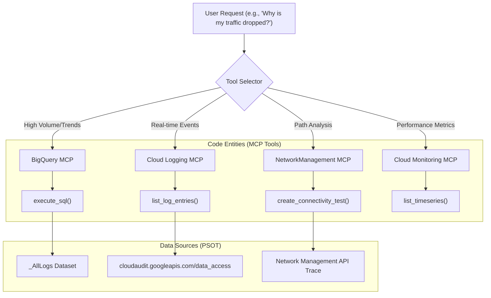
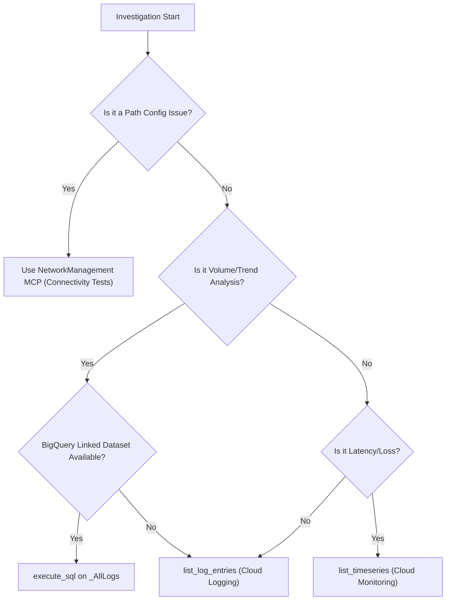

<!-- source: DeepWiki mcp.deepwiki.com · repo google/skills · page 3.3 Recipe: Google Cloud Network Observability · fetched 2026-10-26 -->

# Recipe: Google Cloud Network Observability

Relevant source files

The following files were used as context for generating this wiki page:

- [cloud/recipes/google-cloud-networking-observability/SKILL.md](cloud/recipes/google-cloud-networking-observability/SKILL.md)
- [cloud/recipes/google-cloud-networking-observability/references/connectivity-tests.md](cloud/recipes/google-cloud-networking-observability/references/connectivity-tests.md)
- [cloud/recipes/google-cloud-networking-observability/references/mcp-usage.md](cloud/recipes/google-cloud-networking-observability/references/mcp-usage.md)

This recipe provides a framework for investigating Google Cloud networking issues by analyzing logs, metrics, and diagnostics. It utilizes a multi-layered telemetry approach to troubleshoot VPC Flow Logs, Cloud NAT, Firewalls, and Threat detections.

## Overview

The Networking Observability recipe is built on the **Primary Source of Truth (PSOT)** principle: identifying the most efficient data source for a specific problem and terminating the investigation as soon as a definitive result is found [cloud/recipes/google-cloud-networking-observability/SKILL.md:9-20](). 

### Core Telemetry Sources
The framework categorizes network data into five primary streams:
*   **Threat Logs**: Deep packet inspection data from Cloud Firewall Plus and Cloud IDS [cloud/recipes/google-cloud-networking-observability/SKILL.md:23-25]().
*   **VPC Flow Logs**: Sampled IP traffic for volume trends and "top talker" analysis [cloud/recipes/google-cloud-networking-observability/SKILL.md:26-27]().
*   **Firewall Logs**: Records of connection attempts matched by ALLOW or DENY rules [cloud/recipes/google-cloud-networking-observability/SKILL.md:28-29]().
*   **Cloud NAT Logs**: Audit trails for NAT translations and port exhaustion troubleshooting [cloud/recipes/google-cloud-networking-observability/SKILL.md:30-31]().
*   **Networking Metrics**: Time-series data for throughput, RTT (latency), and packet loss [cloud/recipes/google-cloud-networking-observability/SKILL.md:32-34]().

### Analysis Framework: Natural Language to Code Entities
The following diagram illustrates how user requests are mapped to specific MCP tools and BigQuery resources within the codebase.

**System Mapping: Diagnostics Workflow**

Sources: [cloud/recipes/google-cloud-networking-observability/references/mcp-usage.md:1-82](), [cloud/recipes/google-cloud-networking-observability/SKILL.md:40-65]()

## MCP-Based Diagnostics Framework

The recipe prioritizes the use of Model Context Protocol (MCP) servers to interact with Google Cloud APIs. This provides a structured way to discover resources and execute queries without manual CLI intervention.

*   **BigQuery MCP**: The preferred source for high-volume analysis. It uses `execute_sql` to query logs exported to BigQuery [cloud/recipes/google-cloud-networking-observability/references/mcp-usage.md:8-18]().
*   **Cloud Logging MCP**: Used for real-time exploratory analysis and finding resource labels via `list_log_entries` [cloud/recipes/google-cloud-networking-observability/references/mcp-usage.md:29-38]().
*   **NetworkManagement MCP**: Executes static path analysis to identify configuration-based blocks [cloud/recipes/google-cloud-networking-observability/references/mcp-usage.md:47-58]().
*   **Cloud Monitoring MCP**: Retrieves performance metrics like RTT and throughput using `list_timeseries` [cloud/recipes/google-cloud-networking-observability/references/mcp-usage.md:66-75]().

For details on tool schemas and the `EXCLUDE_ALL_METADATA` fallback pattern, see [Network Observability: MCP Tools & Connectivity Tests](#3.3.1).

## Analysis Types

### Firewall & Threat Log Analysis
This analysis focus identifies whether traffic is being blocked by security policies. It distinguishes between standard Layer 4 firewall rules and Layer 7 threat signatures (e.g., SQL injection) detected by Cloud Firewall Plus.
*   **Primary Source**: `compute.googleapis.com/firewall` logs for rule matches.
*   **Threat Intelligence**: `firewall_threat` and `ids.googleapis.com/threat` log streams.

For details on SQL patterns for "top-blocking" rules, see [Network Observability: Firewall & Threat Log Analysis](#3.3.2).

### Cloud NAT & Port Exhaustion
When workloads cannot reach the internet, this analysis checks Cloud NAT gateways for port exhaustion or translation failures.
*   **Key Indicator**: `allocation_status=DROPPED` in `nat_flows` logs.
*   **Aggregation**: Summarizing drops by internal IP to identify impacted VMs.

For details on gateway status integration and BigQuery aggregation, see [Network Observability: Cloud NAT Analysis](#3.3.3).

## Operational Principles

The following diagram defines the decision logic for selecting the primary source of truth during an investigation.

**Decision Logic: Primary Source of Truth (PSOT)**

Sources: [cloud/recipes/google-cloud-networking-observability/SKILL.md:40-50](), [cloud/recipes/google-cloud-networking-observability/SKILL.md:117-131]()

### Key Constraints
*   **Schema Validation**: Before running BigQuery queries, the system must verify field names (e.g., `jsonPayload` vs `json_payload`) using `get_table_info` [cloud/recipes/google-cloud-networking-observability/references/mcp-usage.md:25-26]().
*   **Resource Cleanup**: Connectivity tests created via `create_connectivity_test` must be deleted using `delete_connectivity_test` immediately after results are retrieved [cloud/recipes/google-cloud-networking-observability/references/connectivity-tests.md:17-19]().
*   **Inactivity Handling**: A result of "0" or "No data found" is considered a conclusive finding and should terminate the investigation turn [cloud/recipes/google-cloud-networking-observability/SKILL.md:113-116]().

---
**Child Pages:**
*   [Network Observability: MCP Tools & Connectivity Tests](#3.3.1)
*   [Network Observability: Firewall & Threat Log Analysis](#3.3.2)
*   [Network Observability: Cloud NAT Analysis](#3.3.3)

---

