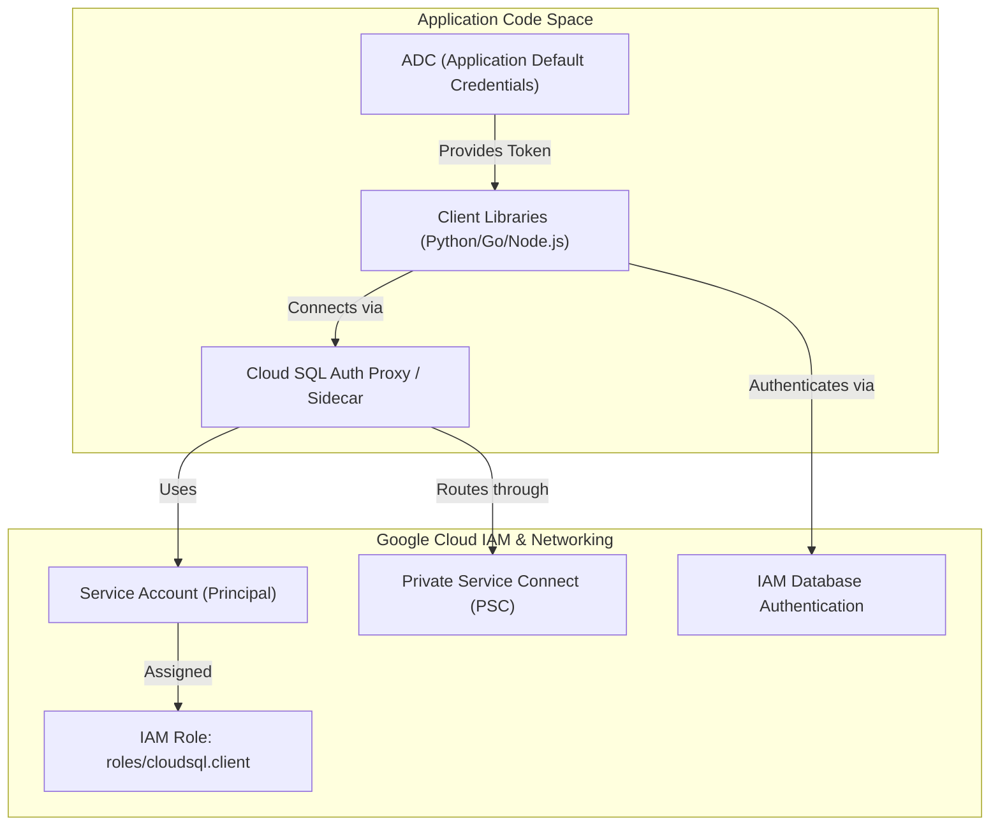
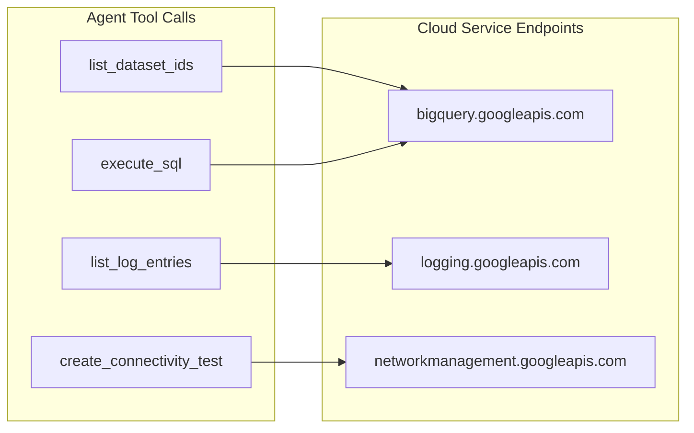

<!-- source: DeepWiki mcp.deepwiki.com · repo google/skills · page 5 Cross-Cutting Concerns: IAM, Security & MCP · fetched 2026-10-26 -->

# Cross-Cutting Concerns: IAM, Security & MCP

Relevant source files

The following files were used as context for generating this wiki page:

- [cloud/products/alloydb/alloydb-basics/references/iam-security.md](cloud/products/alloydb/alloydb-basics/references/iam-security.md)
- [cloud/products/cloud-sql/cloud-sql-basics/references/iam-security.md](cloud/products/cloud-sql/cloud-sql-basics/references/iam-security.md)
- [cloud/recipes/google-cloud-networking-observability/SKILL.md](cloud/recipes/google-cloud-networking-observability/SKILL.md)
- [cloud/recipes/google-cloud-networking-observability/references/connectivity-tests.md](cloud/recipes/google-cloud-networking-observability/references/connectivity-tests.md)
- [cloud/recipes/google-cloud-networking-observability/references/mcp-usage.md](cloud/recipes/google-cloud-networking-observability/references/mcp-usage.md)
- [cloud/recipes/google-cloud-recipe-auth/SKILL.md](cloud/recipes/google-cloud-recipe-auth/SKILL.md)

This section outlines the architectural patterns and integration standards that span across the `google/skills` repository. By maintaining consistent conventions for Identity and Access Management (IAM), the Model Context Protocol (MCP), and Infrastructure as Code (Terraform), the repository ensures that individual product skills can be composed into complex recipes while maintaining a unified security and operational model.

## IAM & Security Patterns

Security across Google Cloud skills follows a "Least Privilege" model, standardized through predefined roles and modern connectivity patterns. High-level patterns include the transition from static credentials to IAM Database Authentication and the use of the Cloud SQL Auth Proxy or AlloyDB Connectors for mTLS-encrypted communication.

### Common Role Conventions
Most product skills categorize IAM roles into three primary tiers:
*   **Admin**: Full control over the resource (e.g., `roles/cloudsql.admin` [cloud/products/cloud-sql/cloud-sql-basics/references/iam-security.md:10-10](), `roles/alloydb.admin` [cloud/products/alloydb/alloydb-basics/references/iam-security.md:12-12]()).
*   **Client/User**: Connectivity and data access (e.g., `roles/cloudsql.client` [cloud/products/cloud-sql/cloud-sql-basics/references/iam-security.md:17-19](), `roles/alloydb.databaseUser` [cloud/products/alloydb/alloydb-basics/references/iam-security.md:14-14]()).
*   **Viewer**: Read-only metadata access (e.g., `roles/alloydb.viewer` [cloud/products/alloydb/alloydb-basics/references/iam-security.md:15-15]()).

### Security Architecture: Code to Cloud
The following diagram illustrates how application code entities interact with Google Cloud security constructs.

**Identity & Connectivity Flow**

Sources: [cloud/recipes/google-cloud-recipe-auth/SKILL.md:75-80](), [cloud/products/cloud-sql/cloud-sql-basics/references/iam-security.md:28-33](), [cloud/products/alloydb/alloydb-basics/references/iam-security.md:53-62]()

For details on implementation and product-specific security, see [IAM & Security Patterns Across Skills](#5.1).

## Model Context Protocol (MCP) Integration

The Model Context Protocol (MCP) is the primary interface used by Gemini agents to interact with Google Cloud resources. Instead of executing arbitrary shell commands, agents use structured MCP tools to discover resources, query logs, and analyze network paths.

### Standardized MCP Tooling
The repository utilizes specialized MCP servers for different operational domains:
*   **BigQuery MCP**: Used for high-volume log aggregation via `execute_sql` [cloud/recipes/google-cloud-networking-observability/references/mcp-usage.md:16-18]().
*   **Cloud Logging MCP**: Used for real-time event discovery via `list_log_entries` [cloud/recipes/google-cloud-networking-observability/references/mcp-usage.md:36-37]().
*   **NetworkManagement MCP**: Used for path diagnostics via `create_connectivity_test` [cloud/recipes/google-cloud-networking-observability/references/mcp-usage.md:54-55]().

**MCP Tool to Code Mapping**

Sources: [cloud/recipes/google-cloud-networking-observability/references/mcp-usage.md:13-58](), [cloud/recipes/google-cloud-networking-observability/references/connectivity-tests.md:23-26]()

For details on configuring and using these servers, see [Model Context Protocol (MCP) Integration Pattern](#5.2).

## Infrastructure as Code (Terraform) Patterns

The repository promotes a consistent Terraform resource model for provisioning the infrastructure described in the skills. This ensures that the security patterns (like PSC and IAM Auth) are baked into the deployment by default.

Key resource patterns include:
*   **Database Provisioning**: Using `google_sql_database_instance` and `google_sql_user` with `type = "CLOUD_IAM_SERVICE_ACCOUNT"` to enforce IAM-based login [cloud/products/cloud-sql/cloud-sql-basics/references/iam-security.md:43-45]().
*   **Network Observability**: Configuring Log Sinks to export `_AllLogs` to BigQuery for use with MCP tools [cloud/recipes/google-cloud-networking-observability/SKILL.md:42-45]().
*   **Dependency Management**: Ensuring that service agents (e.g., `service-PROJECT_NUMBER@gcp-sa-alloydb.iam.gserviceaccount.com`) have the necessary permissions before resource creation [cloud/products/alloydb/alloydb-basics/references/iam-security.md:88-91]().

For details on the specific Terraform modules and dependency graphs, see [Infrastructure as Code (Terraform) Patterns](#5.3).

---

