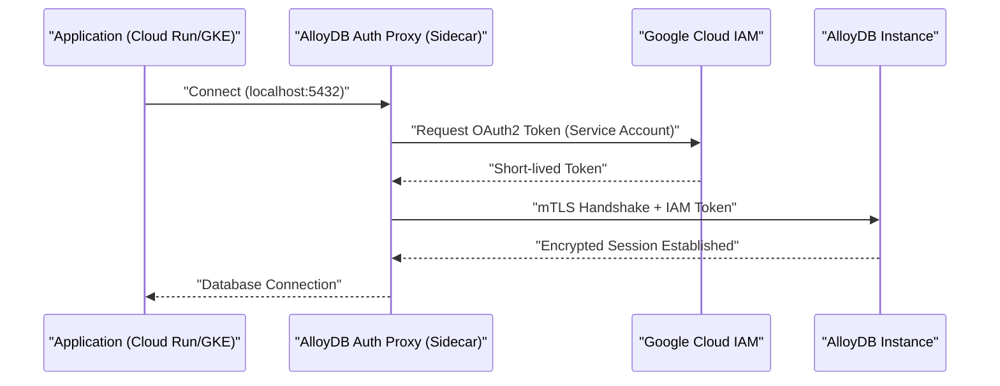
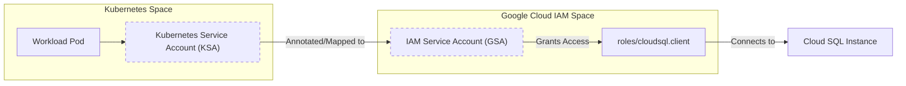

<!-- source: DeepWiki mcp.deepwiki.com · repo google/skills · page 5.1 IAM & Security Patterns Across Skills · fetched 2026-10-26 -->

# IAM & Security Patterns Across Skills

Relevant source files

The following files were used as context for generating this wiki page:

- [cloud/products/alloydb/alloydb-basics/references/iam-security.md](cloud/products/alloydb/alloydb-basics/references/iam-security.md)
- [cloud/products/bigquery/bigquery-basics/references/iam-security.md](cloud/products/bigquery/bigquery-basics/references/iam-security.md)
- [cloud/products/cloud-run/cloud-run-basics/references/iam-security.md](cloud/products/cloud-run/cloud-run-basics/references/iam-security.md)
- [cloud/products/cloud-sql/cloud-sql-basics/references/iam-security.md](cloud/products/cloud-sql/cloud-sql-basics/references/iam-security.md)
- [cloud/products/firebase/firebase-basics/references/iam-security.md](cloud/products/firebase/firebase-basics/references/iam-security.md)
- [cloud/recipes/google-cloud-recipe-auth/SKILL.md](cloud/recipes/google-cloud-recipe-auth/SKILL.md)

This page documents the standardized Identity and Access Management (IAM) and security architectures implemented across the `google/skills` repository. It provides a technical reference for how various Google Cloud products (Cloud SQL, AlloyDB, Cloud Run, BigQuery, Firebase, and GKE) share common patterns for role naming, database authentication, network perimeter security, and service identity.

## 1. Predefined IAM Role Conventions

Across all product skills, IAM roles follow a hierarchical naming convention. This allows for consistent permission assignment regardless of the specific service being utilized.

| Pattern | Cloud SQL | AlloyDB | Cloud Run | BigQuery | Firebase |
| :--- | :--- | :--- | :--- | :--- | :--- |
| **Admin** | `roles/cloudsql.admin` | `roles/alloydb.admin` | `roles/run.admin` | `roles/bigquery.admin` | `roles/firebase.admin` |
| **Editor/Dev** | `roles/cloudsql.editor` | N/A | `roles/run.developer` | `roles/bigquery.dataEditor` | `roles/editor` |
| **Viewer** | `roles/cloudsql.viewer` | `roles/alloydb.viewer` | `roles/run.viewer` | `roles/bigquery.metadataViewer` | `roles/firebase.viewer` |
| **Client/Invoker** | `roles/cloudsql.client` | `roles/alloydb.client` | `roles/run.invoker` | N/A | N/A |

### Role Usage Patterns
*   **Admin Roles**: Provide full control over the resource lifecycle, including deletion and permission management [cloud/products/cloud-sql/cloud-sql-basics/references/iam-security.md:10-10](), [cloud/products/alloydb/alloydb-basics/references/iam-security.md:12-12]().
*   **Client/Invoker Roles**: These are specialized roles for connectivity. For example, `roles/cloudsql.client` is required for the Cloud SQL Auth Proxy to establish a secure tunnel [cloud/products/cloud-sql/cloud-sql-basics/references/iam-security.md:17-19](), while `roles/run.invoker` is required to trigger a Cloud Run service [cloud/products/cloud-run/cloud-run-basics/references/iam-security.md:10-10]().

**Sources:** [cloud/products/cloud-sql/cloud-sql-basics/references/iam-security.md:6-25](), [cloud/products/alloydb/alloydb-basics/references/iam-security.md:7-16](), [cloud/products/cloud-run/cloud-run-basics/references/iam-security.md:5-14](), [cloud/products/firebase/firebase-basics/references/iam-security.md:12-23]()

## 2. IAM Database Authentication

A key security pattern across data skills is the replacement of static passwords with IAM-based authentication. This leverages Google Cloud Identity (users or service accounts) and short-lived OAuth2 tokens.

### Implementation Details
*   **Cloud SQL**: Supports IAM authentication for MySQL and PostgreSQL [cloud/products/cloud-sql/cloud-sql-basics/references/iam-security.md:43-45](). Users must have the `roles/cloudsql.instanceUser` role [cloud/products/cloud-sql/cloud-sql-basics/references/iam-security.md:20-21]().
*   **AlloyDB**: Highly recommends IAM authentication to centralize access control and avoid secret sprawl [cloud/products/alloydb/alloydb-basics/references/iam-security.md:40-43](). It uses the `roles/alloydb.databaseUser` role [cloud/products/alloydb/alloydb-basics/references/iam-security.md:14-14]().

### Connection Flow with AlloyDB Connectors
The AlloyDB Connectors (Auth Proxy and Language Libraries) automate the exchange of IAM credentials for database access tokens and enforce mTLS.

**Diagram: IAM Auth & mTLS Data Flow**

**Sources:** [cloud/products/alloydb/alloydb-basics/references/iam-security.md:51-63](), [cloud/products/cloud-sql/cloud-sql-basics/references/iam-security.md:28-30]()

## 3. Network Security: PSC vs PSA

For managed services, the repository documents two primary patterns for private connectivity within a VPC.

| Feature | Private Service Connect (PSC) | Private Services Access (PSA) |
| :--- | :--- | :--- |
| **Mechanism** | Endpoint (IP) in consumer VPC | VPC Peering to Google-managed VPC |
| **Recommendation** | Recommended for new configurations [cloud/products/alloydb/alloydb-basics/references/iam-security.md:21-21]() | Legacy/Alternative [cloud/products/alloydb/alloydb-basics/references/iam-security.md:24-24]() |
| **Benefits** | Multi-VPC support, no peering limits, better IP management [cloud/products/alloydb/alloydb-basics/references/iam-security.md:22-23]() | Internal IP connectivity [cloud/products/cloud-sql/cloud-sql-basics/references/iam-security.md:32-33]() |

### VPC Service Controls (VPC-SC)
VPC-SC is used across BigQuery, AlloyDB, and Cloud SQL to define security perimeters, mitigating data exfiltration risks by ensuring services can only be accessed from authorized networks [cloud/products/bigquery/bigquery-basics/references/iam-security.md:30-31](), [cloud/products/alloydb/alloydb-basics/references/iam-security.md:29-30]().

**Sources:** [cloud/products/alloydb/alloydb-basics/references/iam-security.md:19-31](), [cloud/products/cloud-sql/cloud-sql-basics/references/iam-security.md:32-33](), [cloud/products/bigquery/bigquery-basics/references/iam-security.md:30-31]()

## 4. Service Identity Patterns

A core best practice across all skills is the use of **User-Managed Service Accounts** over default service accounts.

### Service Account Types
1.  **User-Managed Service Account**: Created by the user with minimal permissions (Principle of Least Privilege) [cloud/products/cloud-run/cloud-run-basics/references/iam-security.md:20-23]().
2.  **Default Service Accounts**: (e.g., Compute Engine default) are often over-privileged and should have automatic IAM grants disabled via organization policy [cloud/products/cloud-run/cloud-run-basics/references/iam-security.md:32-40]().
3.  **Service Agents**: Managed by Google for internal operations (e.g., `service-PROJECT_NUMBER@gcp-sa-cloud-sql.iam.gserviceaccount.com`) [cloud/products/cloud-sql/cloud-sql-basics/references/iam-security.md:58-59](), [cloud/products/alloydb/alloydb-basics/references/iam-security.md:88-91]().

### Workload Identity
For GKE, the repository promotes **Workload Identity Federation**, which maps Kubernetes Service Accounts (KSA) to Google IAM Service Accounts (GSA), eliminating the need for static JSON keys [cloud/recipes/google-cloud-recipe-auth/SKILL.md:139-145]().

**Diagram: Service Identity Mapping**

**Sources:** [cloud/products/cloud-run/cloud-run-basics/references/iam-security.md:15-43](), [cloud/recipes/google-cloud-recipe-auth/SKILL.md:108-145](), [cloud/products/cloud-sql/cloud-sql-basics/references/iam-security.md:53-62]()

## 5. Data Encryption & Compliance

Across all storage and compute services, data security is handled through two primary layers:

1.  **Encryption at Rest**:
    *   **Default**: Google-managed keys [cloud/products/bigquery/bigquery-basics/references/iam-security.md:27-28]().
    *   **CMEK**: Customer-Managed Encryption Keys are supported for Cloud SQL, AlloyDB, and BigQuery to provide greater control over key rotation and access [cloud/products/cloud-sql/cloud-sql-basics/references/iam-security.md:40-41](), [cloud/products/alloydb/alloydb-basics/references/iam-security.md:35-37](), [cloud/products/bigquery/bigquery-basics/references/iam-security.md:28-28]().
2.  **Encryption in Transit**:
    *   Enforced by default for AlloyDB [cloud/products/alloydb/alloydb-basics/references/iam-security.md:33-34]().
    *   Provided by the Cloud SQL Auth Proxy for Cloud SQL [cloud/products/cloud-sql/cloud-sql-basics/references/iam-security.md:28-30]().

**Sources:** [cloud/products/cloud-sql/cloud-sql-basics/references/iam-security.md:38-45](), [cloud/products/alloydb/alloydb-basics/references/iam-security.md:32-37](), [cloud/products/bigquery/bigquery-basics/references/iam-security.md:25-29]()

---

