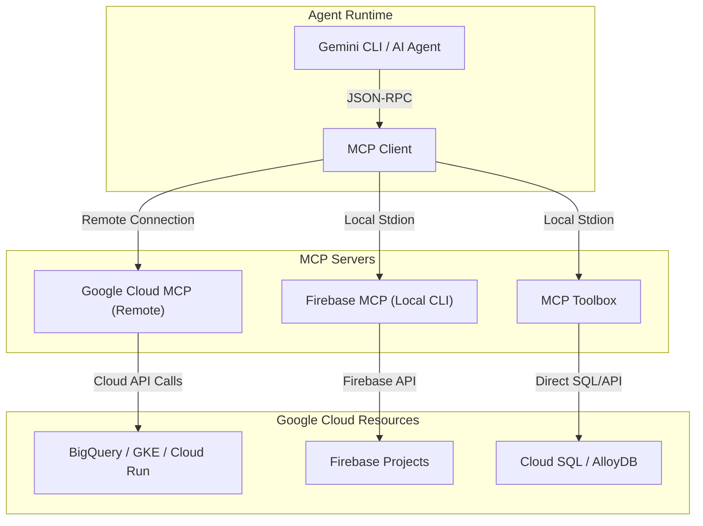
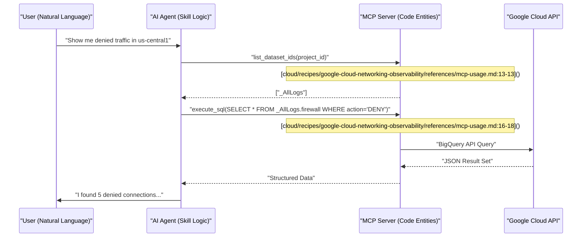

<!-- source: DeepWiki mcp.deepwiki.com · repo google/skills · page 5.2 Model Context Protocol (MCP) Integration Pattern · fetched 2026-10-26 -->

# Model Context Protocol (MCP) Integration Pattern

Relevant source files

The following files were used as context for generating this wiki page:

- [cloud/products/alloydb/alloydb-basics/references/mcp-usage.md](cloud/products/alloydb/alloydb-basics/references/mcp-usage.md)
- [cloud/products/bigquery/bigquery-basics/references/mcp-usage.md](cloud/products/bigquery/bigquery-basics/references/mcp-usage.md)
- [cloud/products/cloud-run/cloud-run-basics/references/mcp-usage.md](cloud/products/cloud-run/cloud-run-basics/references/mcp-usage.md)
- [cloud/products/cloud-sql/cloud-sql-basics/references/cli-usage.md](cloud/products/cloud-sql/cloud-sql-basics/references/cli-usage.md)
- [cloud/products/cloud-sql/cloud-sql-basics/references/core-concepts.md](cloud/products/cloud-sql/cloud-sql-basics/references/core-concepts.md)
- [cloud/products/cloud-sql/cloud-sql-basics/references/mcp-usage.md](cloud/products/cloud-sql/cloud-sql-basics/references/mcp-usage.md)
- [cloud/products/firebase/firebase-basics/references/mcp-usage.md](cloud/products/firebase/firebase-basics/references/mcp-usage.md)
- [cloud/products/kubernetes-engine/gke-basics/references/mcp-usage.md](cloud/products/kubernetes-engine/gke-basics/references/mcp-usage.md)
- [cloud/recipes/google-cloud-networking-observability/SKILL.md](cloud/recipes/google-cloud-networking-observability/SKILL.md)
- [cloud/recipes/google-cloud-networking-observability/references/connectivity-tests.md](cloud/recipes/google-cloud-networking-observability/references/connectivity-tests.md)
- [cloud/recipes/google-cloud-networking-observability/references/mcp-usage.md](cloud/recipes/google-cloud-networking-observability/references/mcp-usage.md)

The Model Context Protocol (MCP) is the foundational integration layer used across all Google Cloud product skills in this repository. It provides a standardized interface for AI agents to interact with remote Google Cloud resources, execute queries, and manage infrastructure without requiring local shell access or complex CLI configurations.

## Overview of MCP in Agent Skills

MCP enables a "Tools-First" approach where the agent prioritizes structured API interactions over manual CLI execution. This pattern ensures higher reliability, better error handling, and more efficient data retrieval.

### Core Architecture
The integration follows a hub-and-spoke model where the AI agent (the MCP Client) connects to various MCP Servers. These servers are either hosted remotely by Google Cloud or run locally via the Firebase CLI or MCP Toolbox.

**Diagram: MCP Integration Data Flow**

**Sources:** [cloud/products/cloud-sql/cloud-sql-basics/references/mcp-usage.md:1-10](), [cloud/products/firebase/firebase-basics/references/mcp-usage.md:1-5](), [cloud/products/kubernetes-engine/gke-basics/references/mcp-usage.md:1-7]()

## Product-Specific MCP Configurations

Each product skill leverages MCP differently, utilizing specific tools tailored to that product's resource model.

### 1. Database Services (Cloud SQL, AlloyDB, BigQuery)
Database skills use MCP to bridge the gap between natural language questions and structured data.

*   **Cloud SQL & AlloyDB**: Use MCP to manage instances and execute SQL. Tools include `execute_sql`, `create_instance`, and `list_users` [cloud/products/cloud-sql/cloud-sql-basics/references/mcp-usage.md:11-27]().
*   **BigQuery**: Primarily used for data analysis. The `execute_sql` tool is restricted to `SELECT` statements to ensure safety [cloud/products/bigquery/bigquery-basics/references/mcp-usage.md:12-21]().

### 2. Compute Services (GKE, Cloud Run)
Compute skills focus on lifecycle management and observability.

*   **GKE**: Provides 23 tools for cluster management and Kubernetes operations. It uses hierarchical resource paths (e.g., `projects/{P}/locations/{L}/clusters/{C}`) [cloud/products/kubernetes-engine/gke-basics/references/mcp-usage.md:1-18]().
*   **Cloud Run**: Enables serverless deployments via tools like `deploy_service_from_image` and `deploy_service_from_archive` [cloud/products/cloud-run/cloud-run-basics/references/mcp-usage.md:7-24]().

### 3. Networking Observability
The networking recipe uses a multi-server MCP pattern to correlate logs and metrics.

| Server | Primary Role | Key Tools |
| :--- | :--- | :--- |
| **BigQuery MCP** | High-volume log analysis | `execute_sql`, `get_table_info` |
| **Cloud Logging MCP** | Real-time event discovery | `list_log_entries`, `list_log_names` |
| **NetworkManagement MCP** | Path diagnostics | `create_connectivity_test`, `get_connectivity_test` |
| **Cloud Monitoring MCP** | Performance metrics | `list_timeseries`, `list_metric_descriptors` |

**Sources:** [cloud/recipes/google-cloud-networking-observability/references/mcp-usage.md:6-82]()

## Tool Naming & Usage Conventions

To ensure consistency across skills, the following tool naming conventions are enforced:

*   **`execute_sql`**: Used in Cloud SQL, AlloyDB, and BigQuery for running database queries [cloud/products/bigquery/bigquery-basics/references/mcp-usage.md:12-14]().
*   **`list_log_entries`**: Standard tool for retrieving Cloud Logging data [cloud/recipes/google-cloud-networking-observability/references/mcp-usage.md:36-37]().
*   **`search_documents`**: Used in AlloyDB AI and Firebase for RAG-based knowledge retrieval.
*   **`apply_k8s_manifest`**: Used in GKE for deploying resources via YAML [cloud/products/kubernetes-engine/gke-basics/references/mcp-usage.md:46]().

**Diagram: Natural Language to Code Entity Mapping**

**Sources:** [cloud/recipes/google-cloud-networking-observability/SKILL.md:42-45](), [cloud/recipes/google-cloud-networking-observability/references/mcp-usage.md:11-28]()

## Gemini CLI Extensions

Gemini CLI extensions provide specialized capabilities that go beyond standard MCP tools, such as health auditing and lifecycle management.

*   **Cloud SQL Extensions**: Specialized for PostgreSQL, MySQL, and SQL Server health checks [cloud/products/cloud-sql/cloud-sql-basics/references/mcp-usage.md:29-36]().
*   **BigQuery Data Analytics**: Advanced analytics workflows and plugin support for Claude Code [cloud/products/bigquery/bigquery-basics/references/mcp-usage.md:43-46]().
*   **AlloyDB Extension**: Focuses on performance monitoring and lifecycle management [cloud/products/alloydb/alloydb-basics/references/mcp-usage.md:29-29]().

## Implementation & Error Recovery

Skills are instructed to follow a strict "MCP First" preference: `MCP tools > gcloud CLI > kubectl/bq` [cloud/products/kubernetes-engine/gke-basics/references/mcp-usage.md:70-72]().

### Schema Verification Pattern
When using `execute_sql`, agents must verify schemas to prevent "Unrecognized name" errors:
1.  `list_dataset_ids` to find the target [cloud/recipes/google-cloud-networking-observability/references/mcp-usage.md:22-23]().
2.  `get_table_info` to verify field casing (e.g., `jsonPayload` vs `json_payload`) [cloud/recipes/google-cloud-networking-observability/references/mcp-usage.md:25-26]().
3.  `execute_sql` for final retrieval [cloud/recipes/google-cloud-networking-observability/references/mcp-usage.md:27]().

### Connectivity Test Lifecycle
For Network Management, agents must follow a Create-Poll-Delete lifecycle:
*   **Create**: `create_connectivity_test` [cloud/recipes/google-cloud-networking-observability/references/connectivity-tests.md:23-24]().
*   **Poll**: `get_connectivity_test` until results are ready [cloud/recipes/google-cloud-networking-observability/references/connectivity-tests.md:25-26]().
*   **Cleanup**: **CRITICAL** - Always call `delete_connectivity_test` before finishing the turn [cloud/recipes/google-cloud-networking-observability/references/connectivity-tests.md:17-19]().

**Sources:** [cloud/recipes/google-cloud-networking-observability/SKILL.md:66-75](), [cloud/recipes/google-cloud-networking-observability/references/connectivity-tests.md:1-30]()

---

