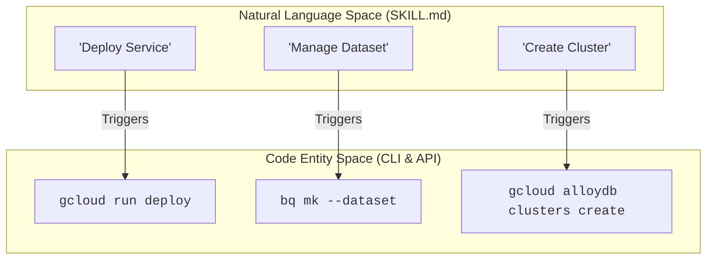
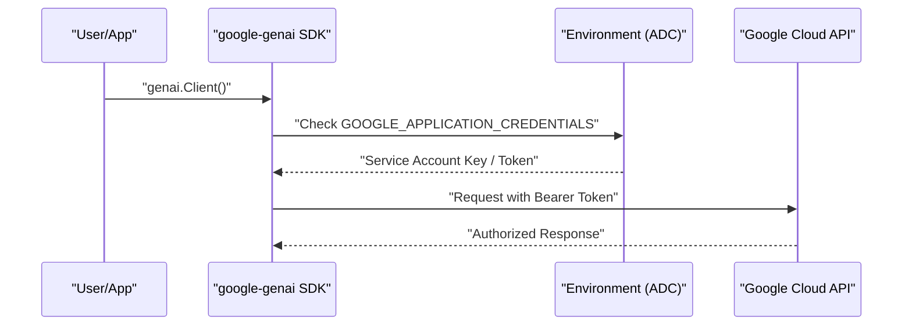

<!-- source: DeepWiki mcp.deepwiki.com · repo google/skills · page 6 Glossary · fetched 2026-10-26 -->

# Glossary

Relevant source files

The following files were used as context for generating this wiki page:

- [README.md](README.md)
- [cloud/products/agent-platform/gemini-api/SKILL.md](cloud/products/agent-platform/gemini-api/SKILL.md)
- [cloud/products/alloydb/alloydb-basics/SKILL.md](cloud/products/alloydb/alloydb-basics/SKILL.md)
- [cloud/products/alloydb/alloydb-basics/references/iam-security.md](cloud/products/alloydb/alloydb-basics/references/iam-security.md)
- [cloud/products/bigquery/bigquery-basics/SKILL.md](cloud/products/bigquery/bigquery-basics/SKILL.md)
- [cloud/products/cloud-run/cloud-run-basics/SKILL.md](cloud/products/cloud-run/cloud-run-basics/SKILL.md)
- [cloud/products/cloud-sql/cloud-sql-basics/references/iam-security.md](cloud/products/cloud-sql/cloud-sql-basics/references/iam-security.md)
- [cloud/products/firebase/firebase-basics/SKILL.md](cloud/products/firebase/firebase-basics/SKILL.md)
- [cloud/products/kubernetes-engine/gke-basics/SKILL.md](cloud/products/kubernetes-engine/gke-basics/SKILL.md)
- [cloud/recipes/google-cloud-networking-observability/SKILL.md](cloud/recipes/google-cloud-networking-observability/SKILL.md)
- [cloud/recipes/google-cloud-networking-observability/references/connectivity-tests.md](cloud/recipes/google-cloud-networking-observability/references/connectivity-tests.md)
- [cloud/recipes/google-cloud-networking-observability/references/mcp-usage.md](cloud/recipes/google-cloud-networking-observability/references/mcp-usage.md)
- [cloud/recipes/google-cloud-recipe-auth/SKILL.md](cloud/recipes/google-cloud-recipe-auth/SKILL.md)
- [cloud/well-architected-framework/google-cloud-waf-cost-optimization/SKILL.md](cloud/well-architected-framework/google-cloud-waf-cost-optimization/SKILL.md)
- [cloud/well-architected-framework/google-cloud-waf-reliability/SKILL.md](cloud/well-architected-framework/google-cloud-waf-reliability/SKILL.md)
- [cloud/well-architected-framework/google-cloud-waf-security/SKILL.md](cloud/well-architected-framework/google-cloud-waf-security/SKILL.md)

This page provides definitions for codebase-specific terms, abbreviations, and domain concepts used throughout the `google/skills` repository. It serves as a technical reference for engineers to understand the implementation details and data flow of the Agent Skills framework.

## Core System Terms

### Agent Skill
A modular unit of knowledge and instructions designed for AI agents. In this repository, each skill is defined by a directory containing a `SKILL.md` file, which acts as the primary entry point and system prompt for the agent [README.md:11-18](). Skills are categorized into `products`, `recipes`, and `well-architected-framework` [README.md:22-34]().

### skills.sh
The distribution platform and CLI tool used to install and manage skills from this repository [README.md:3-5]().
*   **Implementation**: Users install skills via `npx skills add google/skills`, which allows for selective installation of specific directories [README.md:13-18]().

### SKILL.md
The mandatory markdown file that defines the skill's identity and behavior. It typically contains frontmatter (name, description) and a structured body (Core Principles, Reference Directory, Validation Checklists) [cloud/well-architected-framework/google-cloud-waf-security/SKILL.md:1-4]().

### Reference Directory
A sub-directory (usually `./references/`) within a skill folder containing specialized technical documentation. These files are "loaded" by the agent based on specific trigger keywords or user scenarios [cloud/products/kubernetes-engine/gke-basics/SKILL.md:24-51]().

**Sources:** [README.md:1-51](), [cloud/products/kubernetes-engine/gke-basics/SKILL.md:1-54]()

---

## Technical & Infrastructure Concepts

### Model Context Protocol (MCP)
A standard protocol used across skills to connect AI agents to external data sources and tools.
*   **Usage**: Product skills like BigQuery, AlloyDB, and Firebase use remote MCP servers to perform live operations such as `execute_sql` or `search_documents` [cloud/products/bigquery/bigquery-basics/SKILL.md:75-76](), [cloud/products/firebase/firebase-basics/SKILL.md:96-96]().
*   **Gemini CLI Extension**: A specific implementation of MCP that allows the Gemini model to interact with Google Cloud resources directly via the command line [cloud/products/alloydb/alloydb-basics/SKILL.md:56-57]().

### Golden Path
A set of opinionated, production-ready default configurations.
*   **GKE Implementation**: The GKE skill defaults to the "Autopilot Golden Path," which enforces specific networking (VPC-native), security (Workload Identity), and reliability standards [cloud/products/kubernetes-engine/gke-basics/SKILL.md:10-13]().

### Disaggregated Architecture
A design pattern where compute and storage scale independently.
*   **Products**: This concept is central to **AlloyDB** [cloud/products/alloydb/alloydb-basics/SKILL.md:10-12]() and **BigQuery** [cloud/products/bigquery/bigquery-basics/SKILL.md:14-18]().

### Natural Language to Code Entity Mapping
The following diagram illustrates how high-level domain concepts in the `SKILL.md` files map to specific code entities and CLI tools used in implementation.

**Diagram: Domain to Entity Mapping**

**Sources:** [cloud/products/cloud-run/cloud-run-basics/SKILL.md:103-110](), [cloud/products/bigquery/bigquery-basics/SKILL.md:27-30](), [cloud/products/alloydb/alloydb-basics/SKILL.md:26-31]()

---

## Identity & Access Management (IAM)

### Application Default Credentials (ADC)
The strategy for automatically discovering credentials in the environment.
*   **Flow**: Used by the `google-genai` SDK to authenticate the `genai.Client()` without hard-coded keys [cloud/products/agent-platform/gemini-api/SKILL.md:61-67]().

### IAM Database Authentication
A security pattern that replaces static database passwords with short-lived OAuth tokens tied to IAM principals (Users or Service Accounts).
*   **Supported By**: Cloud SQL (MySQL/PostgreSQL) [cloud/products/cloud-sql/cloud-sql-basics/references/iam-security.md:43-46]() and AlloyDB [cloud/products/alloydb/alloydb-basics/references/iam-security.md:40-43]().

### Service Agent
A Google-managed service account that allows a Google Cloud service to access resources in your project.
*   **AlloyDB**: `service-PROJECT_NUMBER@gcp-sa-alloydb.iam.gserviceaccount.com` [cloud/products/alloydb/alloydb-basics/references/iam-security.md:88-91]().
*   **Cloud SQL**: `p[PROJECT_NUMBER]-[UNIQUE_ID]@gcp-sa-cloud-sql.iam.gserviceaccount.com` [cloud/products/cloud-sql/cloud-sql-basics/references/iam-security.md:55-57]().

**Diagram: Authentication Data Flow**

**Sources:** [cloud/products/agent-platform/gemini-api/SKILL.md:57-83](), [cloud/products/cloud-sql/cloud-sql-basics/references/iam-security.md:53-63]()

---

## Product-Specific Terminology

| Term | Definition | Context/File |
| :--- | :--- | :--- |
| **AlloyDB AI** | Features including vector search, hybrid search, and model endpoint management. | [cloud/products/alloydb/alloydb-basics/SKILL.md:13-16]() |
| **Auth Proxy** | A sidecar or local process providing IAM-based secure tunnels to databases. | [cloud/products/cloud-sql/cloud-sql-basics/references/iam-security.md:28-30]() |
| **CMEK** | Customer-Managed Encryption Keys; provides control over data-at-rest encryption. | [cloud/products/alloydb/alloydb-basics/references/iam-security.md:35-37]() |
| **Express Mode** | A simplified authentication mode for Gemini API using an API key. | [cloud/products/agent-platform/gemini-api/SKILL.md:71-76]() |
| **FinOps** | A cultural practice of cloud cost management and accountability. | [cloud/well-architected-framework/google-cloud-waf-cost-optimization/SKILL.md:12-14]() |
| **Live API** | Bidirectional streaming for low-latency voice and video interactions. | [cloud/products/agent-platform/gemini-api/SKILL.md:21-21]() |
| **Worker Pools** | Always-on background workloads for pull-based processing (e.g., Kafka). | [cloud/products/cloud-run/cloud-run-basics/SKILL.md:21-23]() |

**Sources:** [cloud/products/alloydb/alloydb-basics/SKILL.md:1-16](), [cloud/products/cloud-sql/cloud-sql-basics/references/iam-security.md:1-67](), [cloud/products/agent-platform/gemini-api/SKILL.md:1-100](), [cloud/well-architected-framework/google-cloud-waf-cost-optimization/SKILL.md:1-135]()