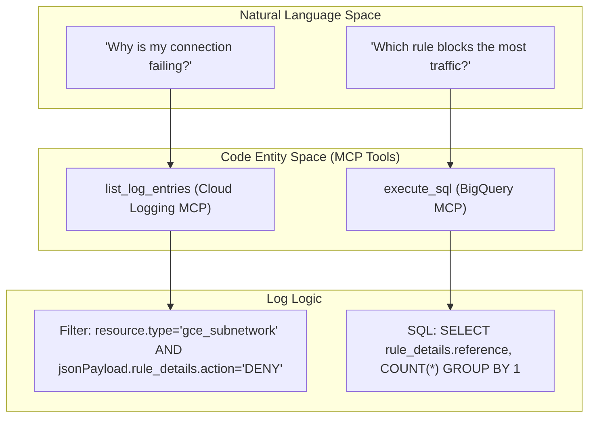
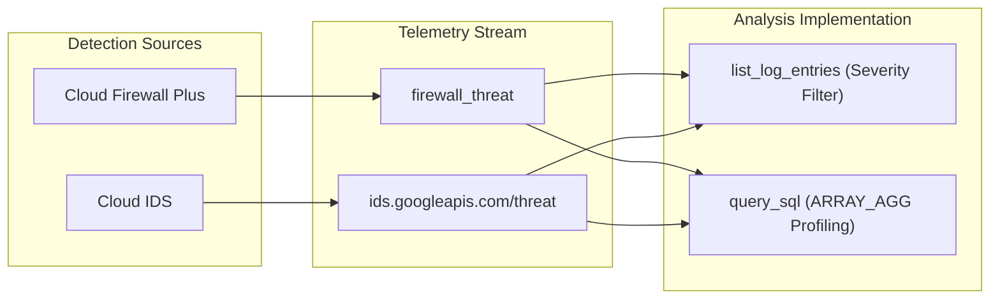

<!-- source: DeepWiki mcp.deepwiki.com · repo google/skills · extra page Network Observability: Firewall & Threat Log Analysis · fetched 2026-10-26 -->

# Network Observability: Firewall & Threat Log Analysis

<details>
<summary>Relevant source files</summary>

The following files were used as context for generating this wiki page:

- [cloud/recipes/google-cloud-networking-observability/references/firewall-analysis.md](cloud/recipes/google-cloud-networking-observability/references/firewall-analysis.md)
- [cloud/recipes/google-cloud-networking-observability/references/threat-analysis.md](cloud/recipes/google-cloud-networking-observability/references/threat-analysis.md)

</details>


This page covers the technical implementation and analysis workflows for Google Cloud firewall and threat telemetry. It details how to leverage Cloud Logging and BigQuery to analyze firewall rule actions and detect security threats using Cloud Firewall Plus and Cloud IDS.

## Firewall Rule Log Analysis

Firewall logs provide visibility into VPC traffic patterns, specifically whether traffic was permitted or blocked by configured rules. These logs are primarily associated with the `gce_subnetwork` resource type and the `compute.googleapis.com/firewall` log stream [cloud/recipes/google-cloud-networking-observability/references/firewall-analysis.md:1-4]().

### Data Flow and Log Structure
Firewall logs are ingested via Cloud Logging and can be exported to BigQuery for long-term trend analysis. The primary payload contains connection details and the specific rule reference that triggered the log entry.

| Field Name | Description |
| :--- | :--- |
| `jsonPayload.rule_details.action` | The outcome of the rule: `ALLOW` or `DENY` [cloud/recipes/google-cloud-networking-observability/references/firewall-analysis.md:87-87](). |
| `jsonPayload.rule_details.reference` | The unique name/reference of the firewall rule [cloud/recipes/google-cloud-networking-observability/references/firewall-analysis.md:88-89](). |
| `jsonPayload.connection.src_ip` | The source IP address of the packet [cloud/recipes/google-cloud-networking-observability/references/firewall-analysis.md:90-91](). |
| `jsonPayload.connection.dest_ip` | The destination IP address of the packet [cloud/recipes/google-cloud-networking-observability/references/firewall-analysis.md:90-91](). |

### Exploratory vs. Trend Analysis
The system distinguishes between two analysis modes:
1.  **Exploratory Analysis**: Uses `list_log_entries` via the Cloud Logging MCP to debug specific connection failures or investigate anomalies [cloud/recipes/google-cloud-networking-observability/references/firewall-analysis.md:12-15]().
2.  **High-Volume Trends**: Uses `execute_sql` via the BigQuery MCP to identify "top talkers" or frequently triggered deny rules [cloud/recipes/google-cloud-networking-observability/references/firewall-analysis.md:16-19]().

### Firewall Analysis Architecture
The following diagram maps the natural language analysis requests to the specific MCP tools and log filters used in the codebase.

**Firewall Log Analysis Mapping**

Sources: [cloud/recipes/google-cloud-networking-observability/references/firewall-analysis.md:21-50]()

## Threat Log Analysis

Threat analysis monitors for malicious activity using Cloud Firewall Plus and Cloud IDS. These services generate specialized log streams that include threat signatures, severity levels, and attacker profiles [cloud/recipes/google-cloud-networking-observability/references/threat-analysis.md:1-4]().

### Log Sources
Threat data is aggregated from two primary log names [cloud/recipes/google-cloud-networking-observability/references/threat-analysis.md:17-24]():
-   `networksecurity.googleapis.com/firewall_threat` (Cloud Firewall Plus)
-   `ids.googleapis.com/threat` (Cloud IDS)

### Attacker Profiling via BigQuery
For advanced threat hunting, the `query_sql` tool is used to aggregate data. A key implementation detail is the use of `ARRAY_AGG` to sample threat types per attacker IP while maintaining a count of total attacks [cloud/recipes/google-cloud-networking-observability/references/threat-analysis.md:69-77]().

**SQL Pattern for Attacker Profiling**:
```sql
SELECT
  JSON_VALUE(json_payload.connection.clientIp) AS attacker_ip,
  COUNT(*) AS attack_count,
  ARRAY_AGG(DISTINCT JSON_VALUE(json_payload.threatDetails.threat) LIMIT 5) AS sample_threats
FROM `{project_id}.{dataset_id}._AllLogs`
WHERE log_id IN ('networksecurity.googleapis.com/firewall_threat', 'ids.googleapis.com/threat')
GROUP BY 1
ORDER BY attack_count DESC
```
Sources: [cloud/recipes/google-cloud-networking-observability/references/threat-analysis.md:70-77]()

### Threat Severity Filtering
The codebase implements strict filtering for high-priority incidents. Severity levels include `CRITICAL`, `HIGH`, `MEDIUM`, `LOW`, and `INFORMATIONAL` [cloud/recipes/google-cloud-networking-observability/references/threat-analysis.md:143-144](). Diagnostics typically focus on `HIGH` or `CRITICAL` threats where the action taken was `DENY` [cloud/recipes/google-cloud-networking-observability/references/threat-analysis.md:26-34]().

### Threat Detection Data Flow
This diagram illustrates the flow from threat detection to security analysis tools.

**Threat Analysis Data Flow**

Sources: [cloud/recipes/google-cloud-networking-observability/references/threat-analysis.md:13-34](), [cloud/recipes/google-cloud-networking-observability/references/threat-analysis.md:46-77]()

## Implementation Details

### Key Field Mapping (BigQuery vs. Logging)
When querying logs in BigQuery, the top-level column is `json_payload` (snake_case), but nested fields within the payload maintain the original `camelCase` format from the API [cloud/recipes/google-cloud-networking-observability/references/threat-analysis.md:40-44]().

| Feature | Logging Filter Path | BigQuery JSON_VALUE Path |
| :--- | :--- | :--- |
| Threat Name | `jsonPayload.threatDetails.threat` | `json_payload.threatDetails.threat` |
| Source IP | `jsonPayload.connection.clientIp` | `json_payload.connection.clientIp` |
| Action | `jsonPayload.action` | `json_payload.action` |
| Rule Name | `jsonPayload.rule_details.reference` | `json_payload.rule_details.reference` |

Sources: [cloud/recipes/google-cloud-networking-observability/references/threat-analysis.md:46-56](), [cloud/recipes/google-cloud-networking-observability/references/firewall-analysis.md:45-50]()

### CLI Fallback Mechanisms
If MCP tools are unavailable, the codebase provides direct `gcloud` and `bq` command equivalents to ensure operational continuity [cloud/recipes/google-cloud-networking-observability/references/threat-analysis.md:79-81]().

-   **gcloud logging read**: Used for immediate log retrieval with `--format json` [cloud/recipes/google-cloud-networking-observability/references/firewall-analysis.md:58-60]().
-   **bq query**: Used for running standard SQL against the `_AllLogs` view [cloud/recipes/google-cloud-networking-observability/references/firewall-analysis.md:71-83]().

Sources: [cloud/recipes/google-cloud-networking-observability/references/threat-analysis.md:79-138](), [cloud/recipes/google-cloud-networking-observability/references/firewall-analysis.md:52-83]()

---

