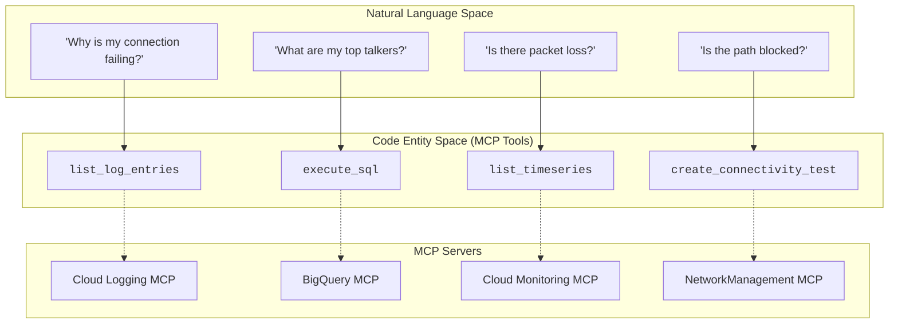
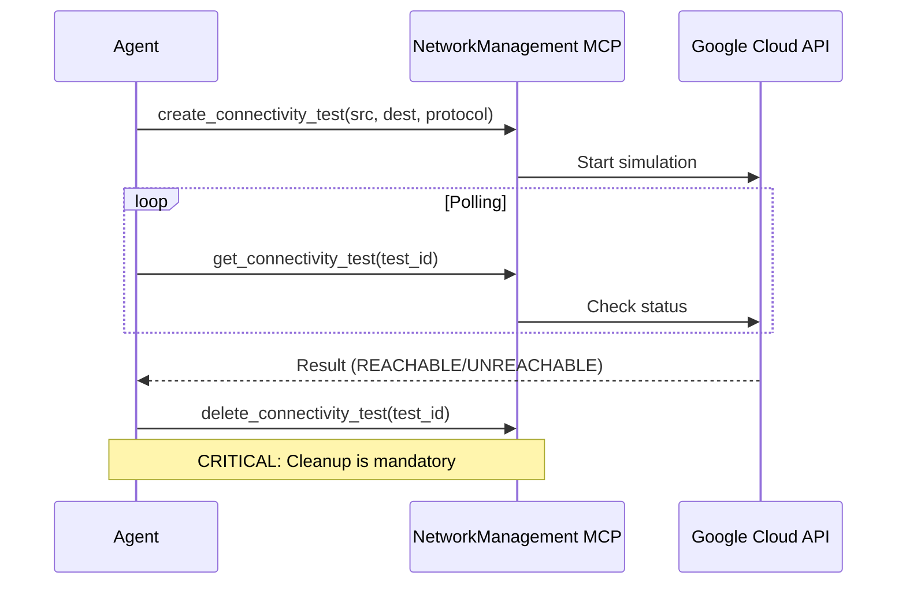

<!-- source: DeepWiki mcp.deepwiki.com · repo google/skills · extra page Network Observability: MCP Tools & Connectivity Tests · fetched 2026-10-26 -->

# Network Observability: MCP Tools & Connectivity Tests

Relevant source files

The following files were used as context for generating this wiki page:

- [cloud/recipes/google-cloud-networking-observability/SKILL.md](cloud/recipes/google-cloud-networking-observability/SKILL.md)
- [cloud/recipes/google-cloud-networking-observability/references/connectivity-tests.md](cloud/recipes/google-cloud-networking-observability/references/connectivity-tests.md)
- [cloud/recipes/google-cloud-networking-observability/references/mcp-usage.md](cloud/recipes/google-cloud-networking-observability/references/mcp-usage.md)
- [cloud/recipes/google-cloud-networking-observability/references/metrics-analysis.md](cloud/recipes/google-cloud-networking-observability/references/metrics-analysis.md)
- [cloud/recipes/google-cloud-networking-observability/references/vpc-flow-analysis.md](cloud/recipes/google-cloud-networking-observability/references/vpc-flow-analysis.md)

This page details the implementation and operational workflow for the Google Cloud Networking Observability diagnostic framework. The system leverages four specialized Model Context Protocol (MCP) servers to provide a unified interface for log analysis, metric retrieval, and path diagnostics.

## MCP Server Architecture

The networking observability skill coordinates between four remote MCP servers to provide a Primary Source of Truth (PSOT) for network telemetry. This multi-source approach allows for a transition from exploratory analysis (Logging) to high-volume trend analysis (BigQuery).

### Code Entity Mapping: Natural Language to Code Space

The following diagram maps the logical diagnostic tasks to the specific MCP tools and code entities defined in the repository.

**Diagram: MCP Tool Mapping**

**Sources:** [cloud/recipes/google-cloud-networking-observability/references/mcp-usage.md:1-82](), [cloud/recipes/google-cloud-networking-observability/SKILL.md:51-56]()

## Core MCP Server Details

### 1. BigQuery MCP (Preferred for Trends)
Used for high-volume aggregations and "Top-N" analysis. It is the primary tool for identifying top-blocking firewall rules or high-bandwidth IPs [cloud/recipes/google-cloud-networking-observability/SKILL.md:42-45]().
*   **Key Tools:** `list_dataset_ids`, `list_table_ids`, `get_table_info`, `execute_sql` [cloud/recipes/google-cloud-networking-observability/references/mcp-usage.md:13-18]().
*   **Workflow:** Verification of schema is mandatory before execution to handle variations like `jsonPayload` vs `json_payload` [cloud/recipes/google-cloud-networking-observability/references/vpc-flow-analysis.md:93-95]().

### 2. Cloud Logging MCP (Exploratory)
Used for real-time identification of recent events or debugging specific anomalies [cloud/recipes/google-cloud-networking-observability/references/vpc-flow-analysis.md:11-14]().
*   **Key Tools:** `list_log_entries`, `list_log_names` [cloud/recipes/google-cloud-networking-observability/references/mcp-usage.md:36-38]().
*   **Filter Standard:** Always search both `compute.googleapis.com/vpc_flows` and `networkmanagement.googleapis.com/vpc_flows` [cloud/recipes/google-cloud-networking-observability/references/vpc-flow-analysis.md:24-30]().

### 3. NetworkManagement MCP (Path Diagnostics)
Executes static analysis of the network configuration to identify routing or firewall blocks [cloud/recipes/google-cloud-networking-observability/references/connectivity-tests.md:3-6]().
*   **Key Tools:** `create_connectivity_test`, `get_connectivity_test`, `delete_connectivity_test` [cloud/recipes/google-cloud-networking-observability/references/mcp-usage.md:54-58]().

### 4. Cloud Monitoring MCP (Performance)
Provides time-series data for throughput, RTT, and packet loss [cloud/recipes/google-cloud-networking-observability/references/metrics-analysis.md:3-21]().
*   **Key Tools:** `list_metric_descriptors`, `list_timeseries` [cloud/recipes/google-cloud-networking-observability/references/mcp-usage.md:73-74]().

**Sources:** [cloud/recipes/google-cloud-networking-observability/references/mcp-usage.md:6-82](), [cloud/recipes/google-cloud-networking-observability/references/vpc-flow-analysis.md:7-18]()

## Connectivity Test Lifecycle

Connectivity tests follow a strict Create-Poll-Delete lifecycle. Because these tests are static analyses, they must be validated against the actual `RUNNING` state of the instances involved [cloud/recipes/google-cloud-networking-observability/references/connectivity-tests.md:8-12]().

**Diagram: Connectivity Test Workflow**

**Sources:** [cloud/recipes/google-cloud-networking-observability/references/connectivity-tests.md:17-30](), [cloud/recipes/google-cloud-networking-observability/references/mcp-usage.md:60-64]()

## Implementation Patterns

### Schema Validation Workflow
To prevent errors caused by inconsistent log schemas in BigQuery, the following workflow is enforced:
1.  **Validate**: Run `bq show --schema` to verify casing (e.g., `jsonPayload` vs `json_payload`) [cloud/recipes/google-cloud-networking-observability/SKILL.md:69-71]().
2.  **Dry Run**: Use `bq query --dry_run` to verify references without cost [cloud/recipes/google-cloud-networking-observability/SKILL.md:71-74]().
3.  **Execute**: Run the validated SQL [cloud/recipes/google-cloud-networking-observability/SKILL.md:74-74]().

### EXCLUDE_ALL_METADATA Fallback
Subnetworks configured with `EXCLUDE_ALL_METADATA` will result in `NULL` VM names in VPC Flow Logs [cloud/recipes/google-cloud-networking-observability/SKILL.md:46-48]().
*   **Behavior**: If a query by VM name returns no results, the system must automatically retry using the internal IP address (`jsonPayload.connection.src_ip`) [cloud/recipes/google-cloud-networking-observability/SKILL.md:48-49]().

### CLI Fallback Mechanisms
If MCP servers are unavailable, the system falls back to specific `gcloud` and `curl` templates.

| Task | Fallback Command | Notes |
| :--- | :--- | :--- |
| **Metrics** | `curl ... monitoring.googleapis.com/v3/...` | `gcloud monitoring` is restricted; use `curl` [cloud/recipes/google-cloud-networking-observability/references/metrics-analysis.md:62-64](). |
| **Logs** | `gcloud logging read ...` | Limit results to 10 for efficiency [cloud/recipes/google-cloud-networking-observability/references/vpc-flow-analysis.md:54-58](). |
| **Trends** | `bq query --use_legacy_sql=false ...` | Primary for high-volume data [cloud/recipes/google-cloud-networking-observability/references/vpc-flow-analysis.md:60-63](). |
| **Path** | `gcloud network-management connectivity-tests ...` | Follows create/describe/delete pattern [cloud/recipes/google-cloud-networking-observability/references/connectivity-tests.md:31-36](). |

**Sources:** [cloud/recipes/google-cloud-networking-observability/SKILL.md:46-74](), [cloud/recipes/google-cloud-networking-observability/references/metrics-analysis.md:47-62](), [cloud/recipes/google-cloud-networking-observability/references/vpc-flow-analysis.md:50-80]()

---

