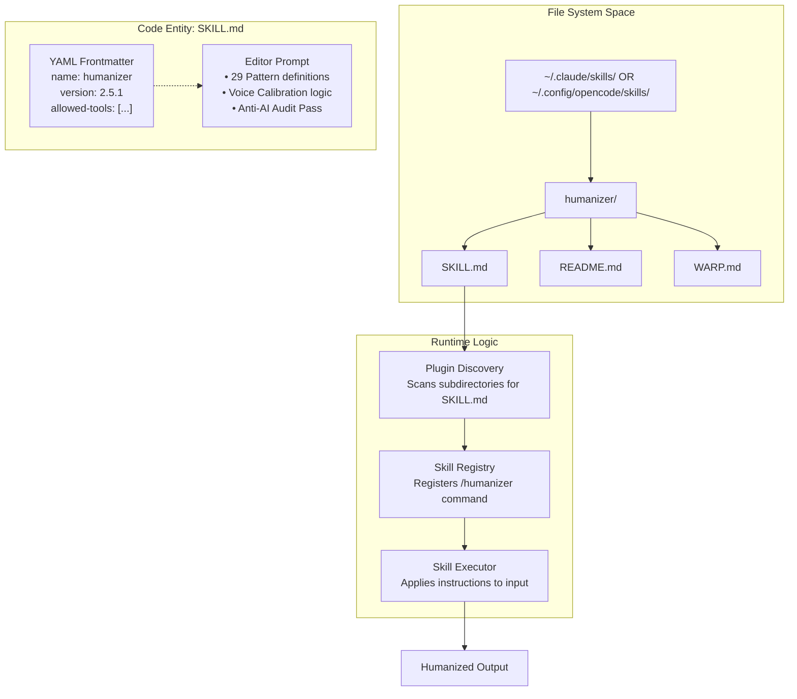
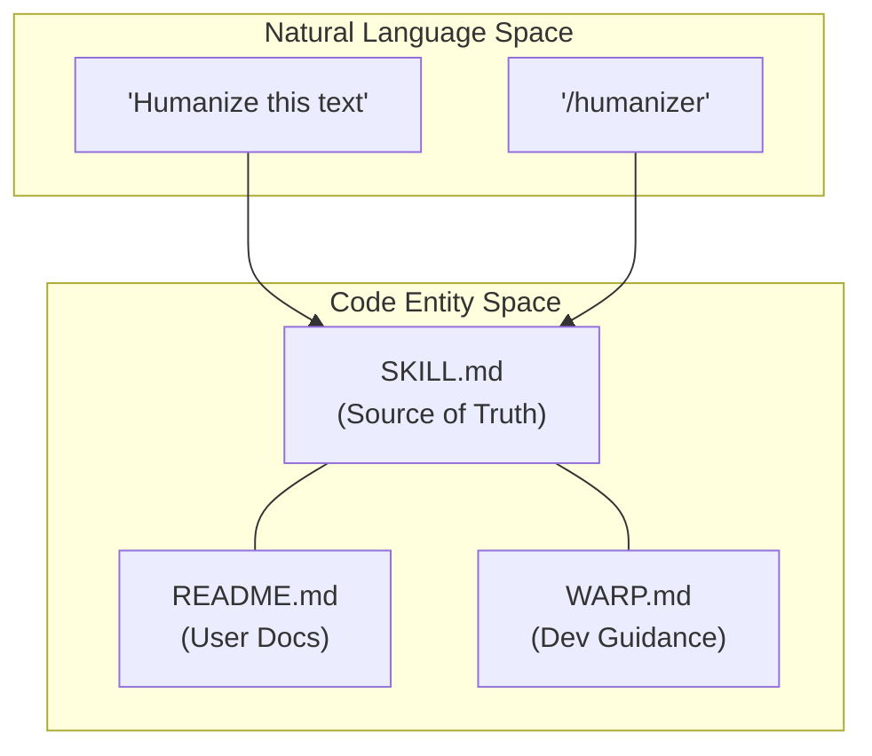

<!-- source: DeepWiki mcp.deepwiki.com · repo blader/humanizer · page 2 Installation and Usage · fetched 2026-10-26 -->

# Installation and Usage

<details>
<summary>Relevant source files</summary>

The following files were used as context for generating this wiki page:

- [README.md](README.md)
- [WARP.md](WARP.md)

</details>


This page provides an overview of how to install and use the Humanizer skill in Claude Code and OpenCode. It covers the plugin architecture, file placement requirements, installation methods, and invocation patterns. For detailed installation instructions, see [Installation](#2.1). For comprehensive usage examples and invocation patterns, see [Using the Humanizer Skill](#2.2).

The Humanizer skill operates as a file-based plugin. Installation involves placing the `SKILL.md` file in a specific directory (e.g., `~/.claude/skills/humanizer/`), after which the host environment automatically discovers and loads it based on YAML frontmatter metadata [SKILL.md:1-18]().

---

## Plugin Architecture

The Humanizer skill leverages a file-based plugin system common to Claude Code and OpenCode. Each skill is defined by a `SKILL.md` file containing YAML frontmatter (metadata) and Markdown instructions (behavior) [WARP.md:8-9]().



**Plugin Discovery and Loading Sequence**

The runtime loads skills in three phases:
1. **Discovery**: Scans subdirectories for `SKILL.md` files [README.md:9-37]().
2. **Parsing**: Extracts YAML frontmatter to determine skill name, version, and allowed tools [SKILL.md:1-18]().
3. **Registration**: Makes the skill available via command (`/humanizer`) and natural language invocation [README.md:46-63]().

Sources: [SKILL.md:1-18](), [README.md:9-37](), [WARP.md:8-9]()

---

## Directory Structure and File Placement

The Humanizer skill requires specific directory placement to be discovered. OpenCode also scans the Claude Code directory for compatibility [README.md:39]().

| Tool | Required Path | Required File |
|------|---------------|---------------|
| **Claude Code** | `~/.claude/skills/humanizer/` | `SKILL.md` |
| **OpenCode** | `~/.config/opencode/skills/humanizer/` | `SKILL.md` |



**File System Layout and Documentation Hierarchy**
- `SKILL.md`: The actual skill definition and "runtime" artifact [WARP.md:8-9]().
- `README.md`: Installation, usage, and a summarized table of the 29 patterns for humans [WARP.md:10]().
- `WARP.md`: Developer-facing guidance for maintaining the repository [WARP.md:1-3]().

Sources: [README.md:9-39](), [WARP.md:12-21]()

---

## Installation Methods

Users can choose between cloning the full repository or copying only the essential skill file.

1. **Git Clone Method** (Recommended):
   ```bash
   mkdir -p ~/.claude/skills
   git clone https://github.com/blader/humanizer.git ~/.claude/skills/humanizer
   ```
   This allows for easy updates via `git pull` [README.md:9-14]().

2. **Manual Copy Method**:
   ```bash
   mkdir -p ~/.claude/skills/humanizer
   cp SKILL.md ~/.claude/skills/humanizer/
   ```
   Useful if the repository is already downloaded locally [README.md:16-21]().

Detailed instructions for both Claude Code and OpenCode are provided in [Installation](#2.1).

Sources: [README.md:7-37](), [WARP.md:25-35]()

---

## Usage Patterns

Once installed, the Humanizer skill can be invoked through several patterns:

### Command and Prompting
The skill is typically invoked using the `/humanizer` command followed by the text to be processed [README.md:46-57](). It also responds to natural language requests like "Please humanize this text" [README.md:59-63]().

### Voice Calibration
A unique feature of the Humanizer is **Voice Calibration**. Users can provide a sample of their own writing (2-3 paragraphs) before the AI text. The skill analyzes sentence rhythm and word choices to match the user's personal style [README.md:65-79]().

### Processing Pipeline
The skill executes a multi-stage transformation:
1. **Pattern Identification**: Scans for the 29 AI writing patterns [README.md:91-145]().
2. **Remediation**: Rewrites the text to remove identified AI-isms [SKILL.md:406-410]().
3. **Anti-AI Audit**: Performs a second pass to catch lingering artifacts [README.md:85]().

For detailed usage examples and advanced calibration techniques, see [Using the Humanizer Skill](#2.2).

Sources: [README.md:41-85](), [SKILL.md:24-32]()

---

## Version Management

The skill version (currently **2.5.1**) is defined in the `SKILL.md` YAML frontmatter [SKILL.md:3](). Maintainers must ensure this version matches the `README.md` version history [WARP.md:42-46]().

| Version | Key Changes |
|---------|-------------|
| 2.0.0 | Complete rewrite based on Wikipedia's "Signs of AI writing" [README.md:83](). |
| 2.3.0 - 2.5.1 | Expansion from 24 to 29 patterns, including fragmented headers and persuasive authority tropes [README.md:126-129](). |

For maintenance workflows and synchronization protocols, see the [Developer Guide](#5).

Sources: [SKILL.md:3](), [README.md:133-145](), [WARP.md:42-53]()

---

